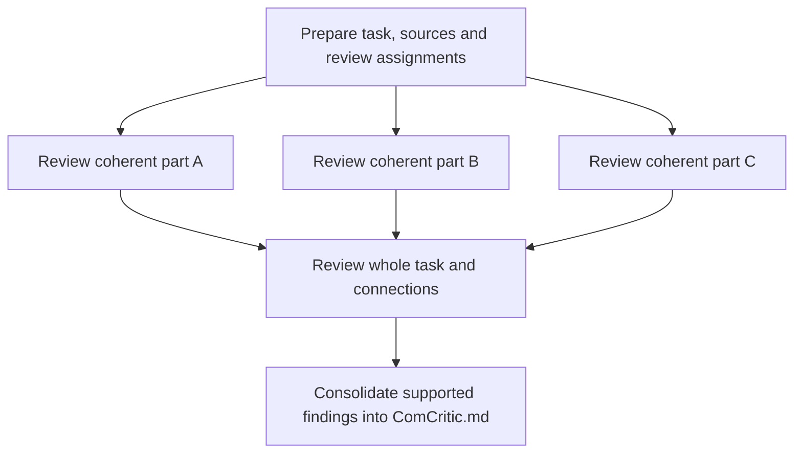

# 14 retained findings — merged text


---

# Finding: A structured critique process for AI communication

## Question

Does it make sense to adapt the code-oriented Dynamic Critic into a process that reviews every outgoing AI communication, uses our principles and guides, records its findings, and returns a corrected version? What advantages would this offer over the principle-guided revision we already use?

The intended recipients are Enes, colleagues and other AIs. The purpose is to make communication dependable enough to understand and direct real work. This inquiry assesses the approach; it does not implement the skill or establish its measured effectiveness.

## Finding

### 1. The problem is dependable application of the standards

We already have useful guidance on identifiable referents, object relationships, concrete actions, intended purposes, necessary background, coherent explanations and preserving meaning through edits. The existing principles also require the AI to acknowledge unknown meaning rather than invent it. [Non-ambiguity principles](/Users/nsstorm/Desktop/projects/AIOpsMan/artifacts/skills/non-ambiguous-communication/references/non-ambiguity-principles.md)

The earlier writing method already included an ordered procedure and a second pass. It would be inaccurate to describe this change as introducing structure for the first time. The unresolved issue is whether that procedure reliably examines what matters and carries its corrections into the delivered answer. [Previous-method assessment](/Users/nsstorm/Desktop/projects/AIOpsMan/research/analyses/writing-review-method-assessment.md)

Your proposal makes the review itself inspectable. Instead of receiving only another rewrite and an assurance that it is better, we would have the review questions, concrete findings and evidence of what the revision addressed. This creates opportunities to catch omissions and makes remaining failures easier to diagnose. It does not remove the possibility that the reviewing AI is wrong.

### 2. What the staged approach can add

| Advantage | The mechanism that creates it | What must be true for the advantage to hold |
| --- | --- | --- |
| More focused inspection | Diagnose a particular draft against an explicit purpose and standards before editing it. | The critic must examine actual text and source relationships, rather than produce generic advice. |
| More relevant review questions | Tailor additional questions to the subject, intended reader and aspect being communicated. | The original request and applicable shared principles remain authoritative; the generated prompt cannot silently narrow them. |
| Visible coverage | Record which spans and requirements were examined, including questions the message failed to answer. | Coverage records must be specific enough to expose an omission; a single checked box cannot stand for an entire document. |
| Checkable corrections | Connect each accepted finding to the revised wording and recheck the relevant meaning. | Closure must be based on the final text, not simply on an edit having been performed. |
| Better diagnosis of recurring failures | Retain the draft, review basis, findings, changes and later recipient feedback. | Review judgments remain claims that can be corrected, not automatic ground truth. |
| Easier maintenance of guidance | Keep principles and guides separate from the skill’s process. | Each review uses identifiable applicable guidance, so later changes do not erase what an earlier review was instructed to do. |
| Broader recipient coverage | Apply shared clarity and truth requirements while changing the needed content and form for each communication. | A technical explanation, an operational update and an AI handoff are assessed for their actual purpose. |

These are advantages of an explicit process when it is actually followed. Reduced clarification effort, fewer missed defects and lower overall cost are intended outcomes to observe in use, not results established by this inquiry.

### 3. What “dynamic” contributes—and what it does not

A principle such as “make the action concrete” can become a specific question: what action is proposed for these workflows, and does the outgoing text state it?

The historical correction sequence illustrates the need. The AI successively clarified a “wave,” then the number of workflows, but Enes still asked what “start with” meant. Each local repair left another part of the intended meaning unsettled. A tailored critic could examine the object, action and purpose together. That is a proposed way to address the observed failure; this inquiry did not run it as an experiment. [Recorded correction sequence](/Users/nsstorm/Desktop/projects/AIOpsMan/research/evidence/nonambiguity/nonambiguity-examples.md:13079)

Dynamic prompt generation can connect general guidance to those particular objects and relationships. It is especially promising when the subject has distinctions that a generic prompt would not call out.

It also creates another possible failure point. If the generated prompt is derived only from the draft, an answer that is entirely absent from the draft may never be checked. Required answers should therefore be established from the request, recipient’s task and relevant sources, then compared with what the draft actually supplies.

An explicit fixed review procedure could supply many of the same benefits. The current evidence does not establish that generating a new prompt for every message is better than using a stable procedure with message-specific inputs. This is a question about the additional value of dynamic generation, not a reason to discard structured critique.

### 4. Review both the facts and the meaning available to the reader

Two questions need distinct attention:

1. **Does the communication faithfully represent the underlying work?** Compare consequential claims with the available sources. Preserve the difference between a proposal, an agreed decision, completed action and an unknown outcome.
2. **Can the intended reader understand the communication from what they receive?** Check the actual words and explicitly assumed background. Identify where the message supplies the necessary referents, relationships, context and answers.

A reviewer who has read every source may understand an unexplained phrase because it knows what the writer meant. That does not establish that Enes, a colleague or a receiving AI can recover the same meaning.

A reader-focused check can ask the reviewer to reconstruct the message’s subject, actions and implications and point to the wording that supports each answer. Where the text and assumed background do not supply an answer, the reviewer should identify the gap rather than fill it from private context. The earlier method assessment already proposed this distinction. Its practical value still needs observing in actual use. [Reader-understanding proposal](/Users/nsstorm/Desktop/projects/AIOpsMan/research/analyses/writing-review-method-assessment.md)

Calling a pass “independent” does not make it independent. A real information boundary requires control over what that pass receives. A role instruction in the same context is a weaker simulation and should be described honestly.

### 5. Chunking needs a connection back to the whole

Small spans can give the reviewer a manageable target and make coverage visible. The span should remain meaningful: a definition, qualification or comparison may need to travel with the paragraph it explains.

For example, one section might describe approval of a limited trial while a later section says the work is approved for production. Both sentences can be individually clear. Their contradiction appears only when their relationship is examined. This is an illustrative failure condition, not a reported project event.

The completed message also needs to answer the intended question. Duncan’s feedback exposed a message that described several documents but left the recipient to assemble the important findings and operational position. Making each description clearer would not necessarily supply those missing answers. [Communication lessons from Duncan’s feedback](/Users/nsstorm/Desktop/projects/AIOpsMan/research/analyses/communication-lessons-from-duncan-2026-09-21.md)

The relevant pattern is therefore focused local review connected to a final whole-message review. A short message may already be the smallest coherent unit. No evidence inspected here establishes a universal paragraph count.

Research on long-context use gives a reason to examine attention and placement carefully: the studied models handled some relevant information less reliably when it occurred in the middle of long inputs. That research concerns retrieval and question-answering tasks; it does not validate our proposed chunk size or prove that all current models behave identically. [Lost in the Middle](https://aclanthology.org/2024.tacl-1.9/)

### 6. The adaptation must carry findings through to checked repairs

The linked Dynamic Critic is made for implementation plans. It generates a tailored prompt, produces findings and alternative mitigations, then selects among them. It has a separate path for a wrong or unestablished premise. Its selection phase does not itself implement the chosen repair. [Dynamic Critic](https://github.com/karaposu/aligncraft/blob/main/skills/critic-d.md)

For communication, the intended process needs this complete relationship:

**Communication purpose, sources and references → tailored inspection of the draft → supported findings → justified corrections → checked final communication.**

A finding should establish the problematic passage or omission, the applicable requirement, the effect on the recipient and the basis for a repair. The AI should then judge whether the finding is valid and check the actual revised text. Findings can be resolved, rejected with reasons or left explicitly unresolved.

Some problems need a direct wording correction. Others reveal missing facts or a conclusion that has not been worked out. The latter require source investigation or renewed reasoning; adding a confident sentence would conceal the problem. A useful outgoing message may accurately communicate an unknown or ask a precise question about it.

The coding-specific requirement to manufacture quick, robust and long-term alternatives for every substantial finding should not transfer automatically. Communication needs genuine alternatives where meaning or emphasis is disputed, and a direct correction where the evidence already determines it.

### 7. Every outgoing communication can be reviewed without an endless review process

Your intended scope includes messages to you, colleagues and other AIs. The general policy can apply to every outgoing delivery while the depth varies with the communication and the uncertainty involved.

A short factual answer may have a compact review record and remain unchanged. A longer account may require source checks, local inspection and a global comparison. The classification as short or simple must not silently waive a requirement; an unresolved claim or incomplete coverage can require more attention.

Internal critique notes are intermediate work, not an unlimited chain of new outgoing communications requiring another complete critique. If those notes themselves are prepared for a recipient, that delivered version becomes a communication to review.

Pre-delivery review also has a real timing implication: it must inspect the text before that text is exposed to the recipient. A process that reviews already-streamed text is offering a different kind of protection.

Finally, a review verdict concerns quality. It does not grant permission to send a message or take an action on someone’s behalf.

### 8. Persistent critiques provide a basis for improvement

A useful record can help distinguish several causes of a disappointing answer:

- The necessary source information was unavailable or not read.
- The review questions omitted an applicable requirement.
- The critic saw the relevant material but judged it incorrectly.
- The diagnosis was sound but the repair failed.
- The repair solved one problem and introduced another.

That distinction is valuable because each cause suggests a different change. A missing principle may call for guidance work; a skipped check may call for a stronger review procedure; a wrong source fact will not be solved by more style rules.

The record should remain connected to the reviewed draft, the standards used and the final version. Later recipient feedback can then challenge an earlier pass. A critique that found no issue but was followed by a clarification is useful evidence too.

Shared principles should not automatically absorb every critic suggestion. A recurring pattern, its exceptions and evidence that a change helps can support a proposed revision. Keeping the references separate makes such revisions manageable while preserving the history of earlier reviews.

### 9. What confidence is justified now

The approach is conceptually defensible, and its process benefits can be stated concretely. It has not yet been shown to catch every important defect in your communications.

There is research support for feedback-and-refinement methods on selected tasks. There are also findings that intrinsic self-correction can fail or worsen reasoning responses. Those studies support examining the conditions under which review helps; they do not establish the performance of this proposed AIOpsMan workflow. [Self-Refine](https://arxiv.org/abs/2303.17651) · [Intrinsic self-correction study](https://proceedings.iclr.cc/paper_files/paper/2024/hash/8b4add8b0aa8749d80a34ca5d941c355-Abstract-Conference.html)

The practical advantage to pursue is a process that exposes and reduces communication failures and makes remaining errors easier to understand. Neither “another model checked it” nor “critique.md exists” establishes that outcome on its own.


---

# Finding: How a communication critic should adapt

## Question

How should a communication-critique skill adapt to the text it reviews? Should it generate its own review prompt, select references for the situation, or use a fixed procedure? How should it handle presentations, stories and worker-to-manager communication while preserving our principles?

The goal is a design we can later turn into a skill. This inquiry examines the mechanism and its boundaries; it does not create or install that skill.

## Finding

### 1. The critic needs to understand the communication it is judging

Your original problem is dependable application: the AI knows useful principles but still misses important meaning. A critique artifact can make that failure inspectable. This inquiry adds another condition: the critic must apply the right standards to the actual communication.

Before reviewing the draft, it should establish what the recipient needs to understand or do after receiving it. That comes from your request and relevant context. The draft cannot be the sole source of its own requirements, because the draft might already answer the wrong question. The existing [common-pitfalls note](</Users/nsstorm/Desktop/projects/model_evaluation/devdocs/writing_review/common pitfalls.md>) describes precisely this kind of purpose drift.

The critic should consider the following factors when they affect the review:

| Factor | What it changes |
| --- | --- |
| Purpose and aspect | Whether the text must explain a technical mechanism, report an operational position, request a decision or tell a story. |
| Reader’s knowledge | Which names, relationships and prior events need explanation. |
| Working relationship | Relevant voice, established responsibilities and how an actual request should be expressed. |
| Medium and delivery | Whether the recipient receives a chat message, standalone document, slide deck, live talk or AI handoff. |
| Factual or creative scope | Which claims must match sources and where invention or deliberate ambiguity is authorised. |
| Editing constraints | What may change, what must remain, and which earlier corrections must be preserved. |

This can be a short statement inside the critique. It does not require a separate classification form for every message. Existing context should answer these questions wherever possible; the critic should not routinely ask you to supply information it already has.

### 2. “Presentation,” “manager” and “operations” are different dimensions

A presentation can explain operations to a manager. Choosing one of those labels and discarding the others would lose relevant guidance.

The appropriate model is to combine applicable guidance. Shared principles cover necessary meaning and fidelity to the task. More specific guides can cover operational substance, the relationship with the reader or the presentation medium. Each guide contributes within its stated scope.

The same recipient can need different communications. If a manager asks what has changed operationally, the answer should establish the current position and implications. If that manager asks why a scoring calculation changed, the answer should retain enough technical detail to explain the calculation.

Your older [writing principles](/Users/nsstorm/Desktop/projects/model_evaluation/devdocs/writing_review/writing_principles.md:136) say to leave technical mechanics out of upward or across communication unless the recipient builds the system. That rule captures a particular writing need, but literal universal application would fail the technical-question example. The critic should identify the scope mismatch and follow the actual request. It should not silently rewrite the guide into a new universal rule.

### 3. What should remain stable, and what should vary

| Part of the critic | Stable responsibility | What can adapt |
| --- | --- | --- |
| Establish the task | Review the intended communication and respect authorised changes. | Which contextual facts matter. |
| Use references | Read the applicable guidance and account for material conflicts. | Which guides and sections apply together. |
| Construct checks | Cover applicable requirements and preserve their basis. | Concrete questions about this text and its omissions. |
| Diagnose problems | Explain the problematic passage or missing answer and its effect on the reader. | Relevant problem types and severity. |
| Correct the text | Make supported changes and preserve necessary meaning. | Wording, organisation, detail and genre-specific treatment. |
| Verify the result | Check the actual final version and state unresolved limits. | Review depth, local units and medium-specific inspection. |
| Preserve the record | Make the basis and outcome recoverable. | The size of the record and how much supporting material it needs. |

The principles remain in separate reference files, as you requested. `SKILL.md` would explain the procedure, the references’ roles, and the obligation to read the shared and applicable scoped guidance. Requiring every guide’s literal rules to govern every text would defeat their purpose.

### 4. A dynamic critic can use a fixed procedure

There are three viable ways to construct the review instructions:

1. **Instantiate a stable procedure.** Supply this communication’s purpose, sources, reader context and applicable references to an established review process.
2. **Assemble applicable guidance.** Combine the relevant reference sections and their checks into a review plan.
3. **Generate additional questions.** Ask about particular claims, unexplained relationships or missing answers that the actual text raises.

These can be combined. For example, a stable procedure can select the appropriate references and then generate a question such as: “Does ‘ready’ mean the workflow is designed, implemented, tested or already operating?”

A freshly generated review plan should be checked against the applicable requirements before it governs the critique. Otherwise, a principle omitted during prompt generation can disappear from the entire review.

A new question does not automatically establish a new rule. The critic may notice an issue that no guide names explicitly, but it must still explain why that issue matters to the task or reader before prescribing a change.

Research offers a relevant structural example: G-Eval uses supplied task criteria with generated evaluation steps. That shows these roles can be separated; it does not establish the best configuration for our skill. [G-Eval](https://aclanthology.org/2023.emnlp-main.153/)

### 5. Reference selection is itself a fallible judgment

The reference collection needs enough information to establish what each guide applies to, what it excludes, and whether it is adopted guidance, a proposal or a historical example. This could be a small index or clear scope statements in the files themselves. With a small collection, reading the relevant collection together can be sufficient.

The critic should read the chosen guidance rather than relying on titles. It should reconsider selection when an uncovered requirement, conflicting rule or unsupported assumption becomes visible during review.

A real conflict must be resolved using the current request, scope and evidence. Newness or apparent specificity alone is insufficient: a newer guide can concern a different task.

Two existing source distinctions make this concrete:

- The older writing guide requires human subjects. The current [non-ambiguity principles](/Users/nsstorm/Desktop/projects/AIOpsMan/artifacts/skills/non-ambiguous-communication/references/non-ambiguity-principles.md) explicitly allow the actual actor to be a person, team, application or automated workflow. A critic must not invent a human actor to satisfy the older wording.
- The [manager principles](/Users/nsstorm/Desktop/projects/model_evaluation/devdocs/writing_review/manager_principles.md) govern how an AI Operations Manager approaches work. They are not a writing-style guide for every message addressed to a manager.

Manager-role and task-framing procedures should remain outside the default communication package. This inquiry read them to understand the boundaries. It did not adopt their operational instructions as part of the proposed communication critic.

The inspected AIOpsMan skill package currently contains the non-ambiguity skill, its principles reference and a communication outline. Dedicated general hierarchy, presentation and fiction guides were not present there. They would need to be authored or deliberately selected; the critic should not pretend they already exist.

### 6. How the approach changes across your examples

**Worker-to-manager operational update.** The critic examines whether the message conveys the actual position, substantive findings, consequences, proposed next action and any real input needed. It should not invent an approval request, assign responsibility or promote a proposal into completed work.

The [Duncan feedback analysis](/Users/nsstorm/Desktop/projects/AIOpsMan/research/analyses/communication-lessons-from-duncan-2026-09-21.md) shows why this goes beyond clear wording. A message can explain several documents clearly while still leaving the reader to assemble their conclusions. The critic must inspect whether the requested operational answer is present. Duncan’s suggested headings are evidence about that exchange, not a universal template.

**Technical explanation to the same manager.** The critic keeps the technical details needed to answer the question and supplies intelligible explanations. Hierarchy alone should not cause it to remove the substance requested.

**Presentation.** The critic establishes whether the recipient will receive a standalone deck or a live presentation. A chart, layout or spoken explanation may carry meaning absent from extracted text. If the reviewer cannot inspect those inputs, it must name that coverage limit. A standalone deck cannot rely on an imagined future explanation to repair missing meaning.

**Story.** In commissioned fiction, suspense and an initially unidentified character may be intentional. The critic should preserve that effect. A narrative account of real work still needs faithful facts and status. The label “story” does not settle which standard applies.

**Mixed document.** An operational report can contain a technical appendix and a fictional illustration. Their local guidance can differ while the whole document retains an identifiable purpose and clear boundaries between fact and illustration.

### 7. The record should show the basis of the critique

The user-requested `critique.md` should make the review recoverable. It should show:

- The communication’s purpose and any material assumptions about the reader or delivery.
- The references used, why they apply, and consequential limitations or conflicts.
- The review questions and coverage of applicable requirements.
- Findings tied to passages or missing answers, with their basis and reader consequence.
- Which fixes were accepted, rejected or left unresolved, and why.
- The corrected version, or an unambiguous reference to it, and the result of checking that version.

For changing sources, a current filename is not always enough. Use a recoverable revision or preserve the relevant passage. A hash can reveal that a file changed; it cannot retrieve its old contents by itself.

This record can distinguish failure causes: an unsuitable guide, incorrect selection, an omitted check, a mistaken finding or an unsuccessful repair. That is a concrete advantage over receiving another rewrite without an inspectable explanation of what was checked.

A review may legitimately leave the text unchanged. An unsupported stylistic preference should not become an edit simply to demonstrate that the critic did work.

### 8. Missing information should limit the particular judgment it affects

If a specialist guide is unavailable, the critic can still review against the actual brief and applicable shared guidance. Additional observations should be identified as provisional judgments rather than attributed to invented references.

If a necessary fact is missing, the record should say which fact is missing, which finding or correction depends on it, and what can still be reviewed. It should not merely attach a vague caveat to an otherwise confident rewrite.

Some communication failures expose missing substantive reasoning. If the work has not established a conclusion, the critic cannot repair the message by inventing one. It can identify the gap and produce wording that accurately conveys what is known and unresolved.

### 9. The process should remain finite and proportionate

The earlier requirement to review every outgoing delivery remains. The amount of review can vary without silently exempting messages from the applicable responsibilities.

A short answer can have a compact critique record. A longer document can be reviewed in meaningful local units, with the surrounding context necessary to judge them and a final check across the complete communication. No inspected evidence establishes two or three paragraphs as an optimum for every case.

Internal review work needs a finite boundary; it should not trigger an endless critic-of-critic chain. If internal notes are later prepared for a recipient, that delivered version is itself a communication to review.

### 10. What this establishes

The recommended design is **a stable review process that applies scoped references dynamically and can generate text-specific questions**. Its principal advantage is that adaptation and correction become inspectable.

The same AI can still misinterpret the task, select a wrong guide or approve an inadequate repair. Neither a saved critique nor another reasoning pass guarantees independent judgment. This inquiry does not establish perfect communication, a reduction in missed issues, or superiority of freshly generated plans over assembled instructions.


---

# Finding: Reuse the Dynamic Critic report for communication

## Question

Can we reuse Dynamic Critic's existing `critic.md` format for communication review—its risk descriptions, severity, impact, mitigations and choices—while changing the coding-specific content? Is that structure already sufficient, or does communication require a different report?

The aim is to decide the artifact shape before building the communication skill. The comparison uses the supplied [three-pass Dynamic Critic source](https://github.com/karaposu/aligncraft/blob/5aa3f054d3a16775936d029ec4fae8a4b654a5cc/skills/critic-d.md), pinned to an immutable revision. The installed local copy is a two-phase variant; the two were not silently combined.

## Finding

### 1. The existing structure fits the job we need

We want an inspectable account of what is wrong with a communication, why it matters, and how the final text addresses it. A risk-based critique report is capable of carrying that account.

The supplied format already combines accessible explanation, precise evidence and explicit remedy choices. Those functions are directly useful here. The main adaptation concerns the content each field must carry, rather than replacing the report with a different kind of document. [Examined source](https://github.com/karaposu/aligncraft/blob/5aa3f054d3a16775936d029ec4fae8a4b654a5cc/skills/critic-d.md)

Your preference for reuse therefore survives the inquiry. The exact visible sections can remain largely unchanged. The rules for populating them need a communication-specific definition.

### 2. Map the familiar fields to communication

| Existing field or section | Communication-specific meaning |
| --- | --- |
| Document verdict | What the review established about this draft: no required changes identified, revisions required, or necessary meaning/source information remains unresolved. |
| High-level summary | Main communication problems, review scope and the important outcome. Briefly identify the purpose, reader, reviewed version and applicable references. |
| Risk: plain explanation | What the recipient could misunderstand or fail to learn, and why that matters. |
| Risk: precise explanation | The exact passage or missing answer, its location, the intended meaning supported by sources, and the applicable principle. |
| Category | A useful communication description, such as unclear referent, missing context, unsupported status, missing substantive answer or broken connection between ideas. |
| Severity | Low, Medium or High, with a short explanation of the consequence for the intended reader. |
| Impact | What the misunderstanding could cause: a wrong belief, mistaken action, unnecessary clarification or inability to assess the work. |
| NoobEng | Rename to **Context**: the background an otherwise capable reader needs to understand this particular finding. |
| Affected areas | The relevant sentence, paragraph, section, slide, repeated term or document-wide omission. |
| Mitigation | A concrete supported correction, with genuine alternatives where they exist. |
| Selection and notes | Which remedy is chosen, why, what remains unresolved and any separate future improvement. |

These are proposed meanings for the communication version. They are not claims that the existing code skill already performs communication review.

The categories should help describe real problems. They should not become a quota or a requirement to find one issue in each category.

### 3. Precision should locate the problem and establish its meaning

The communication equivalent of technical detail is often an exact quotation and its relationship to the available evidence.

For example, “the sentence has a referential ambiguity” names a type of issue but does not tell the revising AI what to repair. A useful precise explanation identifies which word has several plausible referents, what the context does or does not establish, and which interpretation the source supports.

The plain explanation and precise explanation can remain two paragraphs. They should describe the same issue at different levels. The first makes the reader consequence understandable; the second lets someone locate and assess it.

The Context field should add a prerequisite, such as why a named document is relevant or the difference between a proposed design and a running operation. If the risk paragraphs already explain everything needed, a brief statement that no further context is needed is enough. Three versions of the same explanation would add reading burden without adding meaning.

This follows the existing [non-ambiguity principles](/Users/nsstorm/Desktop/projects/AIOpsMan/artifacts/skills/non-ambiguous-communication/references/non-ambiguity-principles.md): give enough context to understand the present point and preserve necessary meaning through edits.

### 4. Keep severity, but define it for communication

A useful initial rubric is:

- **High:** the communication could create a materially wrong belief or action, or fail to convey its main required answer.
- **Medium:** necessary meaning is difficult to recover or requires clarification, while the problem does not carry the same material distortion.
- **Low:** limited reading friction or an optional improvement, with the important meaning already intact.

Each rating needs a short reason tied to the actual purpose and reader. These are qualitative definitions to calibrate through use, not measured probabilities.

Severity is independent of edit size. Changing one negation can correct a serious reversal; rewriting a long paragraph may only improve its flow.

Severity is also independent of confidence. If the critic suspects a consequential error but lacks the source needed to verify it, the precise explanation should say so. A High label must not turn a suspicion into a fact.

### 5. Distinguish a message needing revision from meaning that is not established

Use document-level outcomes that concern the reviewed draft rather than instructing implementation or authorising delivery. Possible labels are:

1. **No required changes identified** — within the inspected material and applicable requirements.
2. **Revisions required** — the intended meaning is supported, and the findings identify corrections.
3. **Meaning or source information needs resolution** — a required assertion cannot yet be grounded or the draft answers the wrong question.

The third outcome should name the affected scope. One unresolved claim need not invalidate every supported paragraph.

A truthful message about an unknown is different. If the task is to report current uncertainty, “We have not established who owns monitoring” can be the correct answer. The underlying unknown is not automatically a defect in the message.

A verdict also does not certify perfection. A text-only review of slides cannot establish the meaning of diagrams it did not inspect. The report's opening should state that limitation rather than present no findings as complete assurance.

### 6. Preserve the mitigation idea without manufacturing alternatives

There is an important correction to the earlier shorthand used in this discussion: the original source distinguishes remedies by what they resolve. It also checks whether broader recurring instances actually exist. A complete one-word repair can occupy its durable-instance role; it does not need to become a large change. [Mitigation-selection logic](https://github.com/karaposu/aligncraft/blob/5aa3f054d3a16775936d029ec4fae8a4b654a5cc/skills/critic-d.md#L288)

That logic is worth retaining. The adaptation should preserve the distinction between a temporary response, a complete correction of this issue and a justified broader improvement.

The problem is a requirement to produce distinct proposals when the evidence supplies only one appropriate correction. For the communication version, a heading can say **Not applicable: no distinct supported option** and explain why. That is a small, explicit change to the output contract.

Consider a draft using the wrong date when the source clearly supplies the correct date. Replacing it may be the complete correction. We do not need to invent an elaborate second solution and an automatic update to shared principles.

Broader fixes remain useful when a real pattern exists. If the same undefined label appears throughout a document, a consistent document-wide correction may be better than fixing only one sentence. The critic should name those occurrences and explain why one correction applies to them.

Changing shared guidance for future communications is a different scope. It may be proposed in the future note, but it does not replace correcting today's message and should not happen automatically during its review.

Selection can retain the familiar distinctions among what is chosen, what would provide the most adequate correction with the least unnecessary change, and what is constrained by available information. An acceptable temporary response must still be truthful. Time pressure cannot justify selecting an invented fact.

### 7. Add an explicit connection to the corrected text

The source's final pass chooses mitigations; it does not apply them. The communication skill's promised result includes corrected text, so the output must connect diagnosis to that result. [Selection-stage boundary](https://github.com/karaposu/aligncraft/blob/5aa3f054d3a16775936d029ec4fae8a4b654a5cc/skills/critic-d.md#L278)

Two arrangements satisfy this without replacing the report:

- **A small Correction result section** identifies the corrected version, the findings addressed and what the final check established.
- **A companion corrected-text artifact** contains the delivery and check result; the report's summary identifies it unambiguously.

The second arrangement can preserve the report's visible sections almost exactly. The first is easier to inspect when everything is short enough to keep together. This inquiry does not establish that either is universally better.

Keep the original draft judgment distinguishable from the final-version result. Otherwise, a reader may see “revisions required” beside corrected text and not know which version the verdict concerns.

Rejected findings and unresolved issues should remain visible. A no-change outcome is valid when the review found no necessary correction. If a Low issue receives a simple edit, that edit still belongs in the final check; it does not require three mitigation proposals.

### 8. What the adapted report could look like

The following is an **illustrative specimen**, not an actual project review or a tested communication-skill output. Its facts are supplied here solely to demonstrate the format.

**Example brief:** explain current monitoring readiness to a colleague.

**Example source fact:** the monitoring design is documented, but monitoring has not been enabled.

**Example draft:** “Monitoring is running and will alert us to failures.”

The specimen keeps the familiar risk fields. It uses one supported correction and explicitly marks the other mitigation slots as inapplicable.

````markdown
---
model: unknown
effort: unknown
---

# Communication critique — illustrative example

## Verdict on the reviewed draft

REVISIONS REQUIRED

## Summary

The draft incorrectly says monitoring is active. The supplied example fact
establishes only a documented design. Correct that status before relying on
this message as a readiness update.

Review basis: the example brief, source fact and single-sentence draft above.
The review checks their consistency and whether the colleague can understand
the actual state. It does not inspect a live monitoring system.
Relevant guidance: preserve established meaning and do not invent missing facts.

## Risk 1 — The message presents a design as active monitoring

### Risk

The colleague could believe failures are already being detected automatically.
That would give them a false understanding of the current protection, because
the monitoring has only been designed and has not been enabled.

The draft says “Monitoring is running and will alert us to failures.” The
supplied example source states that the design is documented but monitoring
is not enabled. Both “is running” and the assurance about alerts exceed what
that source establishes.

### Category

Incorrect factual status.

### Severity

High — this is a readiness update, and the sentence could make the reader
rely on a capability that is not active.

### Impact

The colleague may make plans on the assumption that monitoring already
provides protection. The message also conceals the remaining enabling work.

### Context

A documented monitoring design describes the intended operation.
It does not establish that the operation is running.

### Affected areas

The single status sentence in the reviewed draft.

### Mitigation — Quick

Not applicable: no separate supported workaround is needed. The actual status
is known and can be stated directly.

### Mitigation — Robust

Replace the sentence with:

“The monitoring design is documented, but monitoring has not been enabled.”

Why this is robust: it corrects both the implied completion and the unsupported
assurance, while preserving the progress the source actually establishes.

- [x] selected
- [x] elegant
- [ ] last_resort

Note
Why chosen: one short correction fully resolves the supported issue without
adding assumptions or requiring broader changes.
For future: —

### Mitigation — Long-term

Not applicable on this evidence: this example establishes one misleading
sentence, not a recurring pattern that justifies changing shared guidance.

## Correction result

Corrected text:
“The monitoring design is documented, but monitoring has not been enabled.”

Risk 1: applied and checked against the supplied example fact. The corrected
sentence retains the documented design and explicitly states that monitoring
is not enabled. No claim of active alerts remains.

Scope of this result: consistency and clarity of this illustrative sentence.
No live capability, additional document or recipient response was tested.
````

For an actual report, replace the illustrative source reference with a recoverable document revision, message or preserved passage, and identify the applicable principle reference. The corrected version may also be a separate file rather than an inline sentence.

This specimen demonstrates why a large new field set is unnecessary. The precise explanation contains the evidence; the context field supplies a useful distinction; the notes justify the selection; the result establishes what the correction actually changed.

### 9. What should remain outside the format

The report does not need to contain the entire reference library. `SKILL.md` can explain the procedure and require reading applicable reference files. The critique records which guidance mattered and where a reader can recover it.

Code-specific file deprecation, task replanning and managerial execution should not follow automatically from a communication verdict. A missing premise in a message calls for a clear account of the missing meaning and its scope, not an unrelated operational workflow.

A report template also cannot establish that every relevant issue was found. The process must still examine the draft, sources and recipient's task. A well-filled artifact makes the judgment inspectable; it does not make the judgment infallible.


---

# Finding: How comm-critic-d should use its references

## Question

Should Communication Critic D read our principles and guides before creating a tailored critique prompt, or should the generated prompt leave that reading and interpretation to the AI that executes it? What must carry between those stages, and which meaning gaps remain?

**Communication Critic D**, shortened to **comm-critic-d**, is the skill we are designing to prepare and save a critique prompt for a particular communication, then execute it to produce **critic.md containing findings and mitigation proposals**. Applying those proposals is a separate process. The same AI can perform both stages.

## Finding

### 1. Why the reference stage matters

The original problem is that an AI can receive good writing principles and still miss important communication failures. A critique artifact is intended to make the examination and its findings inspectable. Reference use matters because the critic must apply the right standards to the right communication before its findings can be useful.

Reading the principles during preparation lets the AI turn a broad concern into a meaningful test for the actual draft. A principle about identifiable references might become a question about which workflow “it” denotes. A principle about necessary context might become a question about whether this recipient knows why a particular example was chosen.

Preparation should also consider required content absent from the draft. If it reads only what the draft says, it can tailor a careful review around the wrong answer. The actual request and relevant context supply requirements the draft may have failed to meet.

This supports your preference for the first arrangement: the saved prompt contains useful task-specific interpretation before execution begins. That is an artifact benefit. We have not established that it catches more defects than a reviewer that performs the same interpretation during execution.

### 2. References, the task and factual sources have different roles

The word “reference” can hide several kinds of material. The critic needs to distinguish their roles even if all are Markdown files.

| Material | What it contributes |
| --- | --- |
| Current request and corrections | What this communication is supposed to do and preserve. |
| Shared communication principles | General standards, including their qualifications. |
| A scoped guide | Guidance for a particular purpose, medium or relationship, when that scope applies. |
| Factual source material | Evidence about what actually happened or what a claim means. |
| Historical examples and prior design findings | Lessons, illustrations or proposed designs whose status must remain visible. |

A historical example can illustrate a communication failure without establishing a current project fact. A design finding can propose a rule without making it adopted guidance. A guide for how an operations manager does their job does not automatically govern every message addressed to a manager.

Guide selection should therefore use the actual purpose, recipient knowledge, medium and local role of the passage. A manager asking how a calculation works needs the relevant technical explanation. The same manager asking for operational progress needs a different selection of information.

### 3. What preparation should do

The AI running comm-critic-d should first establish a compact basis for the review: the communication's purpose, what the recipient needs to understand, what the recipient can reasonably be assumed to know, and what should remain open.

It should read the shared references and the supplementary guidance that applies. Mandatory shared references should not be skipped because the draft appears simple. Supplementary guides require a scope judgment rather than automatic application of every file in the folder.

The generator should then create questions or direct review instructions suited to this text. They should cover the relevant categories, including potential omissions and relationships across the whole message. The categories organise attention; they do not require one finding or a fixed number of questions each.

Before saving the prompt, the generator should compare its instructions back to the task and selected guidance:

- Which applicable requirement or qualification has disappeared?
- Which demand has the generated prompt added without a basis?
- What is intentionally open, and do the questions preserve that?
- Could the original task's main answer still be missing even if every local question were answered?

This comparison is a judgment check. It does not prove that the prompt preserves everything. It does, however, identify the specific place where an omitted qualification or invented demand should be challenged.

### 4. What the generated prompt should carry

A useful generated prompt should make the following available to its executor:

1. **The target and purpose:** which draft is being reviewed, under which request, for which recipient and intended use.
2. **Required meaning and intended openness:** what the communication must convey now and which choices, concepts or claims must remain provisional.
3. **Applicable guidance:** which references govern the review, why they apply and any material limits or conflicts.
4. **Tailored examination:** questions or instructions directed at this text's particular claims, omissions and relationships.
5. **The output boundary:** produce critic.md with supported findings, proposals and material review limits; do not apply the proposals.

These are content responsibilities, not a requirement for five large sections. A short review may carry them in a compact prompt.

The prompt should retain the applicable obligations and their qualifications, not merely a list of questions stripped of their basis. This does not require two identical copies of the same rule. A well-written question can contain its governing condition; a selected reference can supply the fuller explanation.

For example, our [non-ambiguity principles](/Users/nsstorm/Desktop/projects/AIOpsMan/artifacts/skills/non-ambiguous-communication/references/non-ambiguity-principles.md) require concrete actors and actions **when those details are needed to understand the sentence**. A generated instruction saying “Every sentence must name the person responsible” changes that principle. It makes the requirement universal and excludes applications or automated workflows as legitimate actors.

A source citation would not repair that change. The generator must preserve what the principle actually requires.

### 5. What execution should do with the references

The executing AI needs the relevant content, not merely awareness that a reference exists. There are three legitimate ways to supply it:

| Execution situation | Suitable treatment |
| --- | --- |
| The same AI has the complete relevant material available in active context | Use it directly. |
| The executor needs to obtain the material | Read the identified references and relevant task/evidence inputs. |
| The original files will not be available | Supply preserved material containing the needed guidance, context and qualifications. |

The existing [non-ambiguity skill](/Users/nsstorm/Desktop/projects/AIOpsMan/artifacts/skills/non-ambiguous-communication/SKILL.md) already allows current reference contents to be reused when they have been read in full and remain available in active context. The new design does not need a blanket requirement to reopen files at every phase boundary.

A saved prompt can therefore be self-contained for a bounded review if it includes the necessary material faithfully. Alternatively, it can have explicit dependencies on accessible sources. It should not claim to be independently usable while relying on a conversation or local path its executor cannot access.

When a source or request changes materially, the AI should reconcile the affected review instructions before relying on them. A prompt prepared for “recommend one option” becomes unsuitable after a correction to “leave the choice open,” even if the principles have not changed.

Preserving the basis of an old review and performing a new current review are different needs. A recoverable revision or saved relevant passage supports the former. Current task instructions determine the latter. A hash can show that content changed, but cannot recover its old meaning on its own.

### 6. Execution must be able to challenge the prepared prompt

Tailored questions direct attention; they cannot guarantee that preparation anticipated every material issue. The reviewer should be allowed to identify another supported defect and to recognise when the prepared instructions misapply a principle.

For every proposed finding, it should establish the affected passage or missing answer, why that meaning is required now, what consequence the reader faces, and what evidence supports that judgment. It should consider whether legitimate shared context or intended openness makes the apparent gap acceptable.

The reviewer may have access to facts the recipient will never see. Those facts can support a claim's accuracy while leaving the delivered sentence incomprehensible. Knowing what “it” denotes privately does not make that referent available to the reader.

If a material requirement was missed or a source was applied under the wrong scope, revisit the affected part of preparation. This is a bounded response to an identified mismatch. It is not an instruction to keep expanding the review indefinitely.

After examining local passages, compare the whole communication with the original purpose. Chunking can help focus attention, but relationships between chunks and entirely absent answers still need examination.

The result is a bounded critique. “No issues identified in the inspected material” is different from a guarantee that the communication is perfect. Any material limit should qualify the particular judgment it affects.

### 7. Intended openness survives all stages

The principle established in the [intended-openness finding](/Users/nsstorm/Desktop/projects/AIOpsMan/research/inquiries/2026-09-26_14-06__comm-critic-d-preserving-intended-openness/finding.md) remains central: criticise meaning required for the current exchange while preserving the uncertainty or openness that belongs to it.

Preparation should identify specific open dimensions when the evidence establishes them. The generated prompt should carry those boundaries explicitly. Execution should apply them to both findings and mitigation proposals.

An exploratory label does not exempt every sentence from review. An unresolved choice can coexist with a known meeting date, a factual error or an unclear referent. Conversely, a vague authoring request may delegate development of a concrete proposal; the critic should not assume every unspecified detail must remain fuzzy in the resulting message.

If intent cannot be established, the critic should qualify the affected finding. It can continue reviewing independent issues. It should request clarification only when the requested judgment actually depends on information it cannot recover.

### 8. A complete example of reference-informed preparation

This is an invented illustration of the proposed design, not an actual comm-critic-d run.

**Situation:** Enes wants to update a colleague who has not seen the project-notes discussion. The alternatives are one shared document or a separate document for each project. No choice has been made.

**Enes asks the working AI:**

> Draft a short note identifying the two arrangements we are exploring for project notes. Leave the choice open; do not recommend one yet.

**The working AI produces:**

> We’re exploring both. No decision yet.

**comm-critic-d receives:** the request, this draft, the stated recipient context and the relevant principle references.

During preparation, it reads the principles on identifiable referents and prerequisite context. It also carries the explicit instruction to preserve the open choice. An illustrative excerpt from the generated prompt is:

> Review the draft as a note to a colleague who has not seen the discussion. The note needs to identify the subject as the arrangement for project notes and name the two alternatives: one shared document or a separate document for each project.
>
> Apply the selected principles on identifiable referents and necessary context. Examine whether the recipient can identify what “both” refers to. Preserve the undecided choice; an absent recommendation is appropriate here.
>
> Check the whole note against the request as well as the individual wording. Record supported findings and mitigation proposals in critic.md. Do not apply changes or choose an arrangement.

The full prompt would identify the target and selected reference material or supply that material directly. The excerpt shows the case-specific application, rather than pretending a sentence alone constitutes the complete reusable skill.

During execution, the reviewer can report that “both” has no identifiable alternatives for this recipient. It can propose naming the subject and the two arrangements while retaining the undecided status. It should not propose adding a recommendation.

This example separates three things: the principle provides a standard, the prepared prompt applies it to the known situation, and critic.md records the actual defect and bounded proposal.

### 9. Advantages and limits of this arrangement

The saved prompt makes the AI's preparation visible. We can inspect whether it selected the right guidance, preserved qualifications and understood the current task before examining the findings.

The report can then distinguish several failure points: unsuitable guidance, wrong selection, loss during tailoring, missed application or an unjustified finding. That makes later improvement more specific than adding another general writing rule after every disappointing result.

Separate reference files remain maintainable. Updating a principle need not mean rewriting the skill's procedure, although saved prompts that depend on materially changed guidance may need their applicability reassessed.

These benefits concern structure and inspectability. The same AI can make related mistakes in preparation and execution. Reusing its reasoning or rereading a file does not create independent validation. Reduced omission rates, acceptable review effort and actual recipient understanding remain questions for use.

### 10. The meaning gaps that remain worth attention

**Applicability and genuine conflicts.** We have a clear default: use actual purpose, scope and current instructions. Difficult cases remain where two valid requirements pull against each other. The critic needs to explain the tradeoff without inventing a universal precedence rule.

**Faithful preservation in a compact prompt.** We know what must survive: applicable meaning, conditions, exceptions and protected openness. The difficult judgment is how much source context an executor needs to apply those requirements correctly, especially when passages are extracted or the executor has not seen preparation.

**Evidence for required meaning and review completion.** A supported finding needs more than an imaginable improvement. We need consistent judgments about necessary reader context, when uncertainty requires a conditional observation, and what the examined scope supports saying at completion. Local plus whole review defines a responsibility; it does not prove that every important defect was caught.

The exact meaning of **harmony** in the proposed categories also remains provisional. That narrower definition can be clarified when authoring the category reference without delaying this reference-placement decision.

Turning repeated critique findings into shared principles is a separate future question. Repetition alone can amplify a mistaken preference, so the critic should not automatically change its reference library.

These residuals do not require solving all communication theory before a first usable skill. They identify where its judgments should remain explicit and where experience should inform refinement.


---

# Finding: Useful check items without bloated references

## Question

What should each check item—and the reference document containing it—communicate so Outgoing Communication Critic D can create useful review instructions? How much explanation, example material and history should accompany those checks?

The goal is to understand a proportionate structure before adopting a format. The existing material grew out of real misunderstandings and corrections. This inquiry asks how to preserve those lessons without making every item a long document.

## Finding

### 1. What these references are helping the critic do

The planned Outgoing Communication Critic D receives a communication draft, its actual task and relevant context. It reads applicable references and creates a tailored review prompt. Executing that prompt produces `critic.md`, containing findings and proposed mitigations. Applying those proposals is a separate process.

A reference check therefore needs to help the AI recognise a communication problem and justify the judgment. It does not need to prescribe every detail of a future finding, rewrite the draft, or decide the underlying operational question.

A category such as “ambiguity” points to an area of attention. A check item develops a particular judgment within that area. The generated prompt then adapts that judgment to a particular text; a finding records an actual problem observed in that text. The four are related but do different work.

### 2. The older attempt did not lack structure

The [current non-ambiguity principles](/Users/nsstorm/Desktop/projects/AIOpsMan/artifacts/skills/non-ambiguous-communication/references/non-ambiguity-principles.md) contain eight numbered principles, explanations and review questions. They already include qualifications about reader needs and unnecessary detail.

The [earlier writing principles](/Users/nsstorm/Desktop/projects/model_evaluation/devdocs/writing_review/writing_principles.md) contain ten numbered entries with Rule, Why, examples and Check sections. They also contain historical correction analysis and a repeated checklist. The other inspected writing documents add further explanations and corrective cases. It would be inaccurate to describe this material as an unstructured first attempt.

One source contrast shows why another template cannot solve the whole problem. The older actor rule says sentences should have a human subject. Its own rationale describes a workflow making decisions automatically. The newer principle instead says to identify the actual actor when that information is needed; the actor may be a person, application or workflow. The newer formulation preserves the intended lesson without requiring false human agency. See the [older actor rule](/Users/nsstorm/Desktop/projects/model_evaluation/devdocs/writing_review/writing_principles.md:80) and the [current actor principle](/Users/nsstorm/Desktop/projects/AIOpsMan/artifacts/skills/non-ambiguous-communication/references/non-ambiguity-principles.md:43).

That is a change in the rule's meaning and applicability. Giving both versions identical headings would not resolve it. Real misunderstandings are good starting evidence, but the generalisation drawn from them still needs examination.

### 3. What meaning a useful check item carries

Each check item uses the following four fields, each on its own line:

| Information | What it gives the critic | How much needs writing? |
|---|---|---|
| **What to examine** | Identifies the specific aspect of the communication to inspect. | A short, concrete description. |
| **What counts as a problem** | States the condition that warrants a finding. | A clear criterion; avoid replacing it with “Is it clear?” |
| **Why it matters** | Names the misunderstanding or difficulty the defect causes the reader. | Often one clause or sentence. |
| **When it applies—and its limits** | States relevant conditions and prevents unnecessary detail, invented meaning or forced closure. | Keep the applicable boundary brief; shared guidance can supply common conditions. |

The four separate fields make each part visible and independently checkable. Keep the content brief and give each field its own job: the first names what to inspect, the second identifies a defect, the third explains its consequence, and the fourth bounds application. The user selected this layout for clarity and checkability; this does not establish a measured improvement in model performance.

The criterion should identify a meaningful distinction. “Explain relationships” is less useful than identifying the reader's need to understand how two objects are connected when that connection is necessary to follow the point. That wording tells the critic both where to look and why a missing explanation may matter.

### 4. The agreed check-item shape

Use a descriptive heading followed by the four labelled fields on separate lines. A field can be short without being omitted. Examples and deeper explanation remain conditional additions.

For instance, the existing relationship principle can be represented as follows:

**Relationships between named objects**

- **What to examine:** How the important objects mentioned in the text relate to one another.
- **What counts as a problem:** A necessary connection is missing or misleading, so the reader cannot follow the point.
- **Why it matters:** The reader has to guess how the objects connect and may misunderstand the explanation.
- **When it applies—and its limits:** Apply when the connection is needed to understand the point. Do not demand an explanation already clear from the text or established shared context.

This illustrates the agreed field layout using the [current relationship principle](/Users/nsstorm/Desktop/projects/AIOpsMan/artifacts/skills/non-ambiguous-communication/references/non-ambiguity-principles.md:26). It combines the concern, criterion, reader consequence and boundary. It needs no extra scenario just to fill an Example field.

This illustration does not replace the existing reference. There is no fixed word limit: a harder distinction may need more explanation within the same four-field layout.

### 5. What the reference file adds beyond its items

The file gives items their common context. A lightweight candidate has:

1. **Purpose and scope:** what communication concerns this file covers, and which recipients, purposes or situations its guidance applies to.
2. **Shared application rules:** how to interpret the checks together—especially required meaning, legitimate shared context, intended openness and uncertainty.
3. **The check items:** organised with descriptive headings and enough separation to find distinct judgments.
4. **Supporting material where useful:** links or notes for deeper explanation, illustrative cases or historical origins. Make their role clear when they could be mistaken for current facts or governing rules.

That does not imply four compulsory long sections. Purpose and scope may take a few sentences; shared rules can refer to another mandatory reference when the preparer can actually access its contents. There is no need to repeat the entire critic workflow in every guide.

The existing non-ambiguity file explicitly addresses Enes's tendency to remember the work's direction without retaining all its detailed context. That framing is relevant evidence about one communication situation. It does not establish that every outgoing recipient needs the same amount of background. Outgoing applicability must follow the actual recipient and purpose.

Source dates, status labels, IDs and revision notes can be helpful when they resolve a real maintenance or authority question. They are not automatically required fields for every item. A heading and source location may be enough to identify the guidance at this stage.

### 6. Shared rules can save repetition, but must survive selection

Suppose intended openness is stated once at the beginning of a reference file. That avoids repeating the same instruction inside every item. But if the preparer copies only an item about missing information into the dynamic prompt, leaving out the openness instruction, the reviewer may demand an answer that was meant to remain unsettled.

The required property is that the governing rule remains available and is applied during the review. It can be carried in the generated prompt, preserved with the relevant passage, or available in the reviewer’s usable context. A path to an unread document does not itself convey the rule.

This also defines the limit of optional supporting material: **a qualification that changes whether something is a defect cannot be optional in the actual judgment**. Deeper history or a supplementary teaching example can be optional. A necessary exception must stay in the usable review basis.

The preparer may combine related check items into one tailored question. It should preserve their meaning rather than mechanically produce one question per item. Conversely, review should still compare the communication with the actual request, because an omitted answer may leave no topic in the draft for a selector to recognise.

### 7. When an example earns its space

An example is useful when it resolves a material uncertainty about applying the general explanation. It can distinguish two situations that sound alike but warrant different judgments, or make a difficult relationship concrete.

Start by asking whether a clearer general explanation would solve the problem. If it would, adding a story may not help. If the distinction remains hard to follow, one short contrast can be worthwhile. Actual repeated misapplication is also a reason to revisit the explanation or add an illustration.

An example should make its relevant difference apparent. Otherwise the AI may treat incidental names, tools, message length or historical facts as part of the rule. A corrected sentence from an old project is especially easy to mistake for a universal preferred sentence or a currently true fact.

This is an editorial judgment, not a reliable automatic test for example necessity. The inquiry supports conditional use and variable depth; it does not establish that example-free or example-rich references perform better in this critic.

### 8. Keep practical rationale distinct from discovery history

A sentence explaining what the reader would misunderstand can be necessary to apply a check well. A long account of how many times a similar correction occurred serves a different purpose: it preserves the lesson's origin and helps us revisit the generalisation later.

Both can be retained. The shorter working entry can explain the judgment and point to the deeper source where that source is useful. Supporting history might remain in the same file under a separate heading; it does not require a new directory or a database.

This distinction is more useful than removing every Why section. Some Why sections explain the actual rule boundary. Deleting them would make the item shorter and less faithful at the same time.

### 9. What “hundreds of check items” does and does not tell us

Four quantities matter separately:

- How much guidance is stored in the whole collection.
- How much material the preparer reads and interprets for a particular task.
- How much guidance and how many tailored questions the reviewer receives.
- How much target text and surrounding evidence the reviewer examines.

A large stored collection need not become one enormous prompt. But selecting only a small subset is not automatically safe either: selection can miss an applicable requirement or its exception. Reading a small coherent reference in full remains a reasonable option. A larger library may eventually need better navigation or retrieval, but that need should arise from observed difficulties.

Primary research gives reasons to take context use seriously: [Lost in the Middle](https://aclanthology.org/2024.tacl-1.9/) reports sensitivity to information position in its evaluated tasks, while [RULER](https://arxiv.org/abs/2404.06654v3) examines long-context performance across varied synthetic tasks. Neither establishes a safe number of communication checks or the best reference format for this proposed critic. Only their abstracts and publication metadata were inspected here.

For now, the useful editing question is: **if this passage were removed, what understanding or judgment would be lost?** Retain text that carries a necessary criterion, condition or explanation. Consider removing or relocating repetition and discovery narrative that the particular review does not need. This remains fallible judgment, not proof of a minimum sufficient prompt.

### 10. Keep growth tied to distinct judgments

Not every new misunderstanding deserves a new check item. It may be another occurrence of an existing failure, evidence that an explanation is inadequate, or a genuinely different concern.

Compare the failure condition, its scope, the evidence needed and the reader consequence. Two items with the same judgment may be combined. Two items that share the category “ambiguity” may still deserve separation: naming an object correctly and explaining its relation to another object can fail independently.

Severity and specific mitigations usually belong to the actual review. A reusable item may explain a possible consequence, but it cannot assign every future instance the same severity without considering that instance's purpose and impact.

### 11. What this inquiry establishes

The agreed direction is **four brief fields per check item, common file-level context, and deeper explanation only where useful**. The current material already supplies much of this. Some entries may need a scope correction; some may benefit from shorter presentation; some may need no change.

The user has now selected the four-field item layout. The broader file structure and the right explanatory depth remain open. Comparative critic performance is still unmeasured; adopting a readable layout does not resolve that evidence question.


---

# Finding: Discovering context through leads and independent source searches

## Question

How should the proposed context-lead mechanism discover the background of a message, and what does its formalisation add to ordinary context gathering and the existing Surfacing discipline?

The purpose is to make discovery more repeatable when useful history and related work are scattered across systems and the AI cannot rely on remembering them.

## Finding

### 1. The problem this mechanism addresses

fixcomm is the proposed parent skill for improving outgoing communication. Its communication critic identifies risks and proposes mitigations; revision is a separate operation. Both need enough relevant background to understand what the message means.

The missing background may not appear as an obvious gap. A message can sound self-contained while relying on an older experiment, an exception, a dependency or a decision made elsewhere.

Your proposal gives the AI a way to investigate those possibilities systematically. The message supplies starting clues. The available sources supply independent places to look. Retrieved material supplies further clues.

The general mechanism also applies beyond communication—for example, to understanding a task before planning it. Communication remains the motivating use here.

### 2. Extract questions from both the message and its origin

A **context lead** is something in the message or retrieved evidence that points toward a concrete context question.

In the hypothetical model-evaluation example, the leads include model evaluation, named participants, previous experiments and workflows. “Which workflows are involved?” and “Was a similar evaluation attempted before?” are useful leads even before the AI knows the answer or the name of a relevant record.

Each lead should retain its basis: the phrase, reference or passage that prompted it. This keeps semantic expansion connected to the task.

The AI should also recover the message's origin when available: its enclosing conversation, original question, parent messages, replies and references to earlier work. A reply saying “use the previous scope” cannot be understood from its topic alone.

Once it has extracted leads, it should compare them with the original message and available origin. This protects against losing a subject or relationship before the searches begin.

### 3. Preserve independent searches alongside linked discovery

The two movements solve different discovery problems.

**Independent searches** begin with the original leads in each available context source within the task's work environment. They give unlinked material an opportunity to be found.

**Linked discovery** follows references, identities and relationships exposed by retrieved material. It can reveal a specific model, experiment or project that the original message never named.

In your hypothetical example, one path is:

> Original Slack exchange → earlier model-evaluation discussion → GLM experiment → linked Linear project → supporting document.

At the same time, the original model-evaluation and workflow questions independently prompt searches in Airtable, Linear and the document source.

Those independent paths matter even when the linked path eventually reaches the same system. Reading one linked Linear project does not answer “What other related work exists in Linear?”

A useful test makes the distinction concrete: remove the Slack-to-Linear link while leaving a relevant project searchable. Linked discovery loses that route. An independently seeded Linear inquiry still has a way to find it.

Independent inquiries can run concurrently when their inputs and source limits permit. Their independence provides the coverage benefit; concurrency mainly reduces waiting.

### 4. Enforce meaningful inquiry rather than identical tool calls

“Search each source” needs a substantive meaning.

For each anchored question, the AI should use the source's actual search or reading capabilities, relevant identities and known vocabulary. It should inspect returned material enough to establish what it found and what scope remains unexamined.

Airtable may represent the relevant context through Models records, Workflow records and their relationships. Searching only the phrase “model evaluation” could miss them. Semantic investigation includes inspecting those actual structures.

A messaging system may instead hold the decision about which workflows were selected. The fact that workflows usually have a structured home does not justify skipping their discussion history.

The general questions can stay independent of the provider:

| Question | What it helps uncover |
|---|---|
| What is this message continuing or responding to? | The originating situation and earlier scope. |
| What objects and activities does this subject involve? | Relevant records whose names differ from the original phrase. |
| Who worked on this subject, and what did they do? | Topic-related activity and earlier attempts. |
| What earlier decisions, exceptions or unresolved issues concern it? | Governing historical context. |
| What connected work or dependencies could affect its meaning? | Context outside the immediate exchange. |
| What changed afterward? | Current qualifications and superseded positions. |
| Which retrieved relationships remain unclear or unsupported? | Concrete questions for further investigation. |

An organisation supplies the practical routing knowledge: workspaces, projects, bases, relevant source systems, local terminology and supported operations. The skill need not hard-code Storm Ideas, particular people or a models table.

“Available sources” should be established from the actual work environment and accessible routes. An incomplete source inventory is a limitation to investigate; it is not proof that omitted locations contain no context.

Several questions may share one source read when that read genuinely covers them. A complete small table might answer both a model question and a workflow relationship question. A restrictive search requiring both words might cover only their intersection. Grouping saves work only when the constituent questions remain covered.

### 5. Let discoveries renew the search

A discovered model name, alias, project, date range or relationship can make a new question possible.

The AI should assess each meaningful new lead across the source set. Earlier work can satisfy part of that renewed investigation where its actual scope already covers the question.

A repeated link to already-inspected material does not automatically require another identical search. Conversely, recognising the same record identifier does not prove that its contents, scope or relevant state remain unchanged.

The admission question is practical: does this discovery introduce or materially change an unanswered question that matters to the task? Its source and task connection should be identifiable.

This keeps the mechanism dynamic without turning every incidental noun into a new company-wide investigation.

### 6. Use relationship review to develop the context

The proposed third pass has real work to do. It examines how the recovered material fits together.

It asks whether two records concern the same experiment, whether a dependency points in the correct direction, whether an older decision remains applicable, and what evidence supports a claimed connection.

It also asks whether the connections suggest another concrete inquiry. A model record linked to an unfamiliar workflow may expose precisely the context the initial message omitted.

Relevant findings need not all belong to one project. A separate experiment may be useful precedent. Preserve that distinction rather than forcing the material into one story.

Similarly, discovering the same issue through two paths improves its chances of being found; it does not create two independent confirmations of its contents.

### 7. Build the task's index as the investigation proceeds

A complete maintained company index is unnecessary as a prerequisite. The investigation can assemble a smaller account specifically for the task.

That account needs three kinds of information:

- **Recovered context:** relevant objects, facts, passages and supported relationships.
- **Investigation coverage:** which questions were pursued in which source scopes and what the actual reads established.
- **Unfinished work:** unanswered questions, unread continuations, unavailable locations and useful next leads.

These can fit in one proportional document or existing linked records. This inquiry does not require a database, a visual graph or a separate file for every part.

The content itself must remain available or recoverable. An index of links is insufficient if the next AI cannot recover the passages needed to understand the connections.

This is the useful meaning of dynamically indexing context: the task creates a navigable account of what it discovered, how it is connected and where investigation can continue.

### 8. Retain the three duties while allowing bounded feedback

Your proposed organisation holds:

1. **Establish the origin and initial leads.**
2. **Investigate those leads independently across sources and history.**
3. **Inspect the combined relationships and follow meaningful new leads.**

Later discoveries can send work back to an earlier duty. For example, relationship review may reveal a new source or show that two apparently identical projects differ.

A fixed three-pass limit can still be an operating policy. If useful work remains at that limit, the result includes the unfinished questions. Three completed passes alone cannot establish that the context is complete.

Depth should vary. A busy Slack branch should not consume the entire allowance before other required sources receive a meaningful initial inquiry.

The earlier consequence-based idea still helps: once leads are visible, give more attention to uncertainty that could change a commitment, responsibility or conclusion. It guides depth and ordering while preserving the independent source opportunities.

### 9. What the formalisation adds

| Added duty | Practical advantage |
|---|---|
| Origin recovery | Reconstructs what an excerpt is answering or continuing. |
| Independent cross-source investigation | Gives relevant unlinked material a route into the task. |
| Semantic object and relationship questions | Finds context represented differently from the original wording. |
| Evidence-led new questions | Pursues specific clues the initial message could not supply. |
| Relationship inspection | Turns separate results into an understandable, qualified account. |
| Recorded coverage and unfinished work | Makes omissions visible and supports later continuation. |
| Comparison with the original message | Keeps discovery faithful to the task's actual subjects. |

These duties externalise part of the process a knowledgeable person performs when thinking, “Someone worked on this before; I should find it.”

They also make failure more diagnosable. If important context was missed, the record can help distinguish an omitted lead, an unsearched source, a weak query, an unread continuation or a mistaken connection. That makes improvement more targeted than adding another broad instruction to “be thorough.”

### 10. How this relates to the existing Surfacing discipline

The installed Surfacing discipline already defines bounded traversal, relevance judgments, coverage tracking and incomplete-region reporting. It should not be described as inherently random.

Its defined unit is the retrieved item. Its reference explicitly places stable cross-item relationships outside that operation and assigns repeated invocation to the caller. See the [Surfacing specification](/Users/nsstorm/.agents/skills/surfacing/references/surfacing.md), §§1.3 and 3.7.

The proposed mechanism therefore adds explicit coordination: form semantic leads, distribute source inquiries, preserve independent paths, renew them from evidence and build the relationship account.

A specialised composite can do this. An explicit caller using existing Surfacing can also do it. Under equal duties and source access, neither packaging has an inherent discovery advantage.

### 11. What we can call more reliable

The formalisation makes required search behaviour repeatable and inspectable. It creates additional routes to context and makes certain omissions observable.

This inquiry tested that logic against source contracts and hypothetical cases. It did not measure real search recall, cost or consistency. Actual use is needed to establish those performance claims.

The remaining work is mainly authoring and calibration: a compact instruction, a proportional output format, and evidence about useful retrieval limits.


---

# Finding: How the inbound critic should justify context gaps and remedies

## Question

How should the inbound communication critic use the task and available context to determine what the orchestrator needs explained, identify justified communication gaps, and propose remedies without adding unnecessary background or forcing intended openness to become settled?

The orchestrator is the person or future AI coordinating the work. The proposed critic examines a worker's contribution to that recipient and produces findings and mitigation proposals. Applying those proposals remains a separate process.

The goal here is to establish the critic's judgment and general thinking process before authoring its exact prompt or reference set.

## Finding

### 1. Start from the actual contribution and exchange

The original problem was that the AI wrote from inside its detailed working context. The user then had to recover what its terms referred to, how objects related and why a point mattered before assessing the answer.

The [original problem framing](/Users/nsstorm/Desktop/projects/AIOpsMan/research/analyses/nonambiguity-problem-framing.md) makes this more specific than a request for simpler language. An explanation can use ordinary words and correct names while omitting the connection that makes the point understandable.

The critic therefore needs the actual communication task, the contribution being explained, applicable instructions and relevant work context.

The recipient's title does not determine the required answer. The same orchestrator can ask for a file inventory, a technical explanation, a progress account or an exploration. A useful response to one can be incomplete or distracting for another.

The larger project's eventual needs also do not automatically become requirements for this exchange. A project may eventually need a final decision while the present task deliberately explores alternatives.

If the purpose remains materially ambiguous, the critic should preserve that uncertainty in its judgment. It should not select whichever purpose makes its preferred critique easiest to justify.

### 2. Raise questions from both the work and the message

The [earlier omitted-context inquiry](/Users/nsstorm/Desktop/projects/AIOpsMan/research/inquiries/2026-09-27_20-20__communication-dependencies-and-omitted-context/finding.md) established two complementary directions of examination.

**From the task and work toward the delivery:** what needs to become understandable, given the actual request and what the work establishes? This can reveal a required answer that the draft never mentions.

**From the message toward its grounds:** what does this claim, comparison, reference or proposed action depend on? This can reveal an unexplained relationship, hidden qualification or unsupported implication.

Names and entities provide starting points. They do not define the boundary of the review. Two objects may be named correctly while their relationship remains missing.

Reference check items help the critic ask these questions. They do not establish a problem merely by applying to the general topic. Their conditions and limits must survive translation into a tailored prompt.

A worker's supplied context account is useful evidence, but calling it complete cannot establish that it contains every omitted requirement. The critic needs enough actual task and source substance to challenge the draft's selection.

### 3. Distinguish necessary understanding from related background

Context is necessary when it enables the recipient to follow, assess or use this particular contribution for the current purpose.

The reviewer should be able to explain the connection:

> What point, relationship, conclusion or requested answer becomes difficult to understand or assess without this explanation?

This can establish a need even when no immediate action follows. Understanding an emerging concept or the relationship between two systems is a legitimate communication purpose.

A possible mistake or consequence can help make the need concrete. It should not become an invented harm story used to justify optional background.

A fact may be relevant to the project without being needed in this communication. The history of a tool, every intermediate attempt or an unrelated dependency should not be added solely because discovery found it.

The [orchestrator-needs finding](/Users/nsstorm/Desktop/projects/AIOpsMan/research/inquiries/2026-09-27_19-56__orchestrator-position-context-needs/finding.md) supplies the guiding distinction: needed understanding, what is already available to the recipient, and what must be newly explained are separate questions.

### 4. Test a candidate before turning it into a finding

A candidate concern deserves examination. A retained finding needs a reasoned basis.

The critic should establish:

1. **What understanding is needed and why.** Connect it to the actual request, an applicable communication requirement or the meaning of the present contribution.
2. **What the delivery does with that understanding.** Identify the passage, missing answer, misleading connection or specific reliance on context.
3. **Whether relevant existing context already resolves the concern.** Inspect the actual shared exchange and pertinent Supporting Context.
4. **What difficulty or risk remains.** Explain the consequence at the certainty supported by the available material.

These are thinking obligations. They do not require four new report fields or a separate artifact for every candidate.

The third obligation is especially useful: **test the strongest supported reading under which the communication is already adequate.**

That means looking for a real explanation in the exchange, a usable supporting entry, or a convention legitimately established by the task. It does not mean imagining an exceptionally knowledgeable recipient who can fill every gap.

If the concern disappears under that reading, the critic should drop it. This protects adequate concise communication and avoids duplicate background.

An alternative “ideal answer” can suggest questions, but differences from it are not themselves defects. The alternative may contain extra scope, a preferred style or invented requirements.

### 5. Handle uncertain reader knowledge without guessing

The critic rarely knows exactly what a recipient currently remembers. That does not make contextual review impossible.

A communication can visibly rely on task-private shorthand, an unintroduced relationship or unexplained history. If the actual delivery is expected to restore that context, the critic can identify the reliance without claiming that the recipient has forgotten.

For example, a worker preparing a return-to-work explanation might refer to “the five” without identifying the objects or the relevant action anywhere in the delivered account. The finding can name that omitted meaning and why it matters to the explanation. It need not diagnose the recipient's memory.

The opposite error is to say “the reader might not know this” about every conventional term. Without a specific task or delivery basis, that possibility does not justify a risk finding.

Access follows the same distinction. An essential explanation offered only through a worker-local file to a separate recipient presents a concrete delivery reliance worth examining. If accessibility is unestablished, the critic should say precisely that; it cannot claim confirmed access failure.

Merely failing to test the permissions of every normal shared reference does not automatically create a communication risk.

The useful rule is:

> **First establish why the concern matters in this communication. Then qualify the particular condition that remains uncertain.**

This does not resolve every future method for modelling recipient knowledge. It establishes how the critic can remain useful and honest while that knowledge is incomplete.

### 6. Keep the need, its answer and intended openness separate

The task can establish that an assessment is required before the reviewer knows the correct assessment.

If a worker's draft replaces the requested assessment with a list of activities, the critic can identify the missing answer. It should not invent the assessment to complete its mitigation.

An adequate explanation of why the assessment cannot yet be supplied may already communicate the actual state faithfully. That does not mean the underlying work is complete, and unfinished work alone should not automatically become another communication defect.

Intended openness is another question. An exploratory task may deliberately leave a selection, definition or estimate provisional even when substantial facts are known.

The critic should preserve that specific openness while continuing to assess surrounding meaning. It can flag an unclear subject, contradictory factual statement or wording that falsely presents a choice as settled.

The [Meaning and fidelity guide](/Users/nsstorm/Desktop/projects/AIOpsMan/artifacts/skills/fixcomm-wild/references/comm-critic-d/references/meaning-and-fidelity.md) already captures this boundary in its intended-openness check. The task establishes what should remain open; a vague passage does not prove that all its ambiguity was intended.

When intent itself is uncertain and the distinction would materially change the critique, the judgment should remain qualified. The critic should not quietly transform exploration into decision-making.

### 7. Examine the complete delivery and its reading arrangement

The recipient may receive a main message, a supporting explanation, a longer document or a combination. Private worker notes are not automatically part of that delivery.

The [Supporting Context foundation](/Users/nsstorm/Desktop/projects/AIOpsMan/research/inquiries/2026-09-27_19-00__supporting-context-references-and-depth/finding.md) gives the existing arrangement: a meaningful main account, numbered connections to useful explanations, and optional deeper material.

The critic should recognise when a precise, accessible supporting entry already supplies the needed explanation. Necessary understanding does not always require another paragraph in the main message.

However, optional support cannot be the only place that makes a misleading main claim accurate. If the main message implies general readiness while the evidence concerns one trial, the scope of that claim needs correction at the point where it matters.

Longer communication also needs both local and whole-account attention. Read coherent sections with the context needed to understand them, then inspect their connections and combined implication.

A section may legitimately raise a question that the next section answers. It should not receive a final missing-context finding before the relevant whole has been considered.

Conversely, every individual section can contain true statements while the conclusion implies something stronger than the evidence. Factual verification alone would miss that communication problem.

Mixed audiences require care. An outgoing draft shown to the orchestrator retains its eventual audience; the surrounding explanation serves the orchestrator. The critic should not automatically insert private editorial notes or inbound supporting markers into the outgoing text.

### 8. Propose the change that would resolve the actual difficulty

A mitigation should explain what the recipient would understand differently after the proposed change.

Depending on the problem, a sufficient remedy may be:

- Naming the particular object or action.
- Explaining a necessary relationship.
- Qualifying a claim's scope, evidence or status.
- Bringing an existing explanation closer to where it is needed.
- Pointing directly to a useful supporting passage.
- Removing an unsupported implication or distracting detour.
- Identifying the specific substance that must be obtained or developed before a stronger answer is possible.

More background is one possible remedy, not the default result of every finding.

“Proportionate” means enough to resolve the problem while preserving the task and its constraints. It does not mean the fewest possible words. Removing a necessary qualification to meet an invented brevity target would fail the same review.

Actual length and medium constraints still matter. The critic should seek a faithful formulation within them. If the requirements cannot jointly be met, it should expose the specific conflict rather than hide it by overstating the result.

A proposal must be checked independently of the diagnosis. A valid concern about an unclear plan does not justify inventing an owner or deadline. A valid concern about unexplained evidence does not justify claiming that additional tests were performed.

The critic's endpoint remains the proposal. Applying it, contacting people, performing new substantive work or changing references belongs elsewhere.

### 9. Make the dynamic prompt an examination brief

The previous [Unplugged Surfacing integration finding](/Users/nsstorm/Desktop/projects/AIOpsMan/research/inquiries/2026-09-27_22-10__inbound-communication-unplugged-surfacing/finding.md) established the surrounding pattern: context discovery and renewal, inbound-specific critique, then supported revision.

Within that arrangement, dynamic preparation should use the current task, contribution, available context and applicable references to produce questions suited to the target.

The generated prompt needs to retain the grounds for those questions and the relevant conditions. For example, an ownership check should not become a demand to assign an owner when the present communication intentionally leaves responsibility open.

Preparation should not precompute a closed list of defects and make execution merely confirm them.

Execution examines the actual target and support. It can reject a candidate because the explanation is already present, refine it because the uncertainty concerns a different matter, or discover an omitted question that preparation missed.

A genuine new evidence need should return through the established discovery owner. When the basis changes, the affected findings and proposals need reconsideration. The critic should not independently build a second untracked investigation.

These are general responsibilities. Exact prompt sections, naming and packaging remain later authoring decisions.

### 10. Keep the report inspectable and proportionate

The existing [comm-critic-d entrance](/Users/nsstorm/Desktop/projects/AIOpsMan/artifacts/skills/fixcomm-wild/references/comm-critic-d/SKILL.md) already provides a report with Risk, Category, Severity, Impact, Context, Affected areas and Mitigation.

Those fields can carry the necessary grounds without adding a compulsory score or a parallel checklist:

- The risk and affected area explain the actual missing or misleading meaning.
- The impact explains why that matters to this recipient and task.
- The context supplies what is necessary to understand the finding.
- The mitigation explains a supported remedy and its boundaries.

Severity follows the actual consequence for the exchange. A communication problem need not involve a harmful action to matter, and an uncertain issue should not automatically receive high severity.

Several applicable checks can support one finding. Repeated symptoms can be combined when they have the same actual problem and remedy. Distinct causes or required changes should remain distinguishable.

If no supported concerns remain after review, a report with no findings is legitimate. It should not manufacture risks to demonstrate activity.

This preserves the user's preferred scope: criticism and proposals, followed by improvement of references through experience. It does not introduce a separate approval process or declare perfect detection.

### 11. What this adds to our understanding of the skill

We already understood that the critic needs task context, recipient awareness and principles. This inquiry makes the judgment connecting them more concrete.

The critic must be able to justify both its diagnosis and its proposed intervention. Its references help it notice concerns, while the actual task, evidence and delivery determine which concerns survive.

That gives later skill authoring a clearer foundation than “add enough context”:

> Establish what this contribution needs to make understandable. Raise questions from the task and actual work as well as the draft. Examine how the intended delivery supplies that understanding. Test whether relevant shared or supporting context already resolves each concern. Retain grounded problems, preserve specific uncertainty, and propose sufficient changes that remain faithful to the facts and intended openness.

The method still depends on judgment. Its value is making that judgment more explicit and improvable; effectiveness must be learned from actual use.


---

# Finding: Discovering what deserves a supporting-context reference

## Question

When an AI hands a communication to the orchestrator, how should it discover what deserves a supporting-context reference, including several things within one sentence or paragraph?

The orchestrator is the person or future AI coordinating the work. The user wants self-contained understanding across the delivered documentation, with generous supporting context available for inspection. Missing useful context is considered worse than providing extra context the recipient may choose to skip.

This inquiry concerns discovering and attaching those references. The separate question of how to group the resulting explanations into entries remains deferred.

## Finding

### 1. The goal is to make the AI's contextual understanding available

The communication problem is broader than unclear wording. The AI may have a detailed understanding of the work while the orchestrator sees only its compressed message.

The orchestrator might recognize a phrase such as “evaluation results” without knowing which evaluation, which result set or which limitations the AI has in mind. The sentence can sound clear while its underlying meaning remains difficult to recover.

The [original problem framing](/Users/nsstorm/Desktop/projects/AIOpsMan/research/analyses/nonambiguity-problem-framing.md) describes this difference between remembering the direction of work and holding its detailed context.

Your current instruction establishes a stronger delivery preference: make useful surrounding understanding available generously, so you can choose what to inspect.

That changes how references should be considered. The AI should not first reduce the communication to the smallest set of indispensable explanations. A clear summary can still benefit from references to the precise objects, detailed results, relevant history and supporting reasoning behind it.

This extends the reference-discovery aspect of the [numbered Supporting Context foundation](/Users/nsstorm/Desktop/projects/AIOpsMan/research/inquiries/2026-09-27_19-00__supporting-context-references-and-depth/finding.md). Its main-message, supporting-entry and optional-depth arrangement remains applicable.

### 2. What a supporting reference connects

A supporting reference is an association between:

- A particular expression, claim or passage in the communication.
- The contextual meaning the reader can inspect through it.
- A usable destination supplying that meaning.

The number is the compact address for this association.

The destination may identify the actual thing being discussed, explain its role, show how things relate, describe relevant history, provide evidence, explain a judgment or expose a limitation.

These roles can coexist. A note about an evaluation result might identify the evaluation and explain its outcome, then point to the actual result records.

The reference must not imply more than its destination provides. A document identifying which workflows were tested does not automatically establish what the results prove about other workflows.

The [earlier inquiry into omitted context](/Users/nsstorm/Desktop/projects/AIOpsMan/research/inquiries/2026-09-27_20-20__communication-dependencies-and-omitted-context/finding.md) remains relevant: named objects are only starting points. Relationships, assumptions and missing requested answers can matter just as much.

### 3. The results and the tested workflows can both have references

Consider a hypothetical worker AI reporting an evaluation to the orchestrator:

> We obtained evaluation results[1] from two tested workflows[2]. Their applicability beyond those workflows remains unestablished[3].

The numbers in this illustration represent different supporting meanings:

| Marked meaning | What the supporting material could make inspectable |
|---|---|
| **[1] Evaluation results** | Which evaluation and run; which models or approaches; what was measured; the actual outcomes; relevant result records and limitations. |
| **[2] Two tested workflows** | Which workflows; what they do; their role in this evaluation; the relevant test setup; any recorded reason for choosing them. |
| **[3] Applicability beyond those workflows** | What the evidence covers, what has not been established, and why the wider conclusion remains open. |

This is an illustration of reference scope, not an assertion that a real evaluation occurred or a mandatory three-entry template.

The second reference does not make the first unnecessary. Understanding the tested workflows cannot substitute for identifying the results.

The third reference illustrates something else: a relationship or qualification can deserve support even when both objects already have references.

More opportunities may appear in the actual material. A date, comparison criterion, model version or particular testing method could have its own useful association. Nothing in this example caps the number of references.

The discovery operation should preserve these meanings independently. Whether some of their explanations later share an entry is the separate organization question you postponed.

### 4. How the AI should detect the opportunities

A general instruction such as “add useful references” leaves too much to a single judgment. The inquiry supports several deliberate movements of attention.

They describe work the AI should do. They do not require a separate agent, file or rigid fixed-count pass for each movement.

#### Read the expressions for what they mean here

Read a coherent passage and notice expressions that carry particular meaning: names, objects, concepts, records, quantities, dates, versions, actions, pronouns and shorthand.

Ask questions such as:

- Which exact thing or set is meant?
- What does this term mean in this use?
- What does this object represent or do here?
- Which event, action, version or earlier result is being referred to?

Familiar vocabulary is not a reason to skip this inspection. “Friday” is familiar, but a handover may still need to identify the date. “Two workflows” needs no explanation of the number two, but it may need to identify the members of the set.

A term can have both a general meaning and a particular instance. Explaining the general concept of evaluation does not identify the evaluation results the message is discussing.

#### Examine the claims and relationships

Read what the passage says about those things.

Look for comparisons, causes, reasons, criteria, dependencies, conditions, changes, status and uncertainty. Words such as “better,” “ready,” “because,” “previous,” “selected” and “only” can point to substantial context.

Useful questions include:

- Better by which criterion, and compared with what?
- What makes this conclusion follow from the evidence?
- How do these objects relate?
- Why is this example or earlier decision relevant here?
- What has actually been completed?
- Which conditions limit the statement?
- Is this choice settled, proposed or deliberately open?

These questions guide attention. They are not a closed taxonomy or a requirement to add every possible field to every message.

For example, noticing the phrase “the selected approach” should prompt checking whether a selection actually happened. It should not prompt the AI to make that selection.

#### Compare the draft with the task and available work

A draft cannot reveal everything it omitted merely through the words it contains.

The AI should also consider the actual request, relevant work, source material and prior corrections. It should ask what contextual understanding from that material is absent from, or hard to reach through, the delivery.

This comparison has two jobs:

- Discover required meaning the draft never represents.
- Preserve useful available detail that the compressed message leaves implicit.

The second job matters under your generous-context preference. Detailed outcomes or relevant history can deserve accessible support even when they do not change the main conclusion.

When an entire requested subject is absent, the critic may need to propose representing it in the communication before a reference can be attached. Adding numbers only to existing nouns would miss that problem.

#### Inspect what the supporting explanation itself assumes

A supporting note can move the original problem elsewhere.

If the note explains a result using an unexplained internal term, the reader still lacks the context. The AI should identify that new dependency and explain it or provide a usable reference.

The test is whether the explanation actually answers its contextual question. A successful link or an informative title is insufficient.

Once the explanation supplies that understanding, further useful detail can remain optional. Completing the first explanation does not mean removing its deeper references.

#### Check the account as a whole

Finally, inspect the associations together with the main message.

Individually accurate notes can accompany an unsupported overall conclusion. Repeated names can silently refer to different versions. Several clear sentences can leave their relationship unexplained.

For a longer document, examine coherent sections with their context, then examine the complete account. A whole-document skim cannot replace the local work.

### 5. The inclusion rule should favor useful context

The central question is:

> What could the orchestrator identify, understand or inspect about this communication through the proposed support?

A concrete answer supplies a reason to keep the association.

The support may concern identity, role, method, history, rationale, evidence, alternatives, limitations or other contextual understanding. Its usefulness need not depend on preventing a serious error or changing an immediate decision.

Where a contextual connection is plausible but not yet clear, retain it for examination rather than silently discard it. Grounding still matters: the AI must not invent the connection or its answer.

This is different from a general preference for maximum visible numbers. A number that opens no meaningful explanation gives the reader little to inspect.

Likewise, an unrelated document does not become useful support merely because it shares a word or appears beside a relevant source. If the AI can establish how that document explains the actual contribution, it belongs back in consideration.

Distance and age are not exclusion rules. An old decision can explain a current constraint. A separate workstream can explain a present dependency.

The preference is therefore broad available contextual coverage, including optional depth. It does not require a universal glossary or an unprocessed copy of the whole workspace.

### 6. Where the number should go

Place the marker beside the expression or claim its destination actually supplements.

An object reference can follow the identifying phrase. A reference about reasoning or scope can follow the relevant claim. A paragraph-wide explanation may attach to the passage it explains.

The association should preserve decisive qualifiers. A note about a provisional result should not appear to support an unqualified claim of completion.

Several markers within one sentence are acceptable when the addressed meanings differ. They need not be forced into a single trailing number.

Some meanings overlap. A model's identity and the comparison involving that model may each deserve support. Their notes should make the different purposes apparent.

This is a scope requirement rather than a final typography decision. The exact visual style of the number can be chosen for the delivery medium later.

### 7. More access does not require duplicate explanations

The same explanation may be useful in several places.

When its meaning and state still fit, the communication can repeat the same local reference number. A later section should not lose useful access merely because the object appeared earlier.

An existing supporting document may also supply the explanation. Reusing it requires inspecting the relevant content and its fit, rather than relying on its title.

Reuse must preserve identity and state. A document describing last week's evaluation might not explain this week's result, even when both have the same project name.

These principles permit generous references while keeping explanations consistent. They do not require a global identifier registry or a new document for each occurrence.

### 8. What self-contained understanding requires

Self-contained understanding can be distributed across a connected set of delivered documents.

The main communication gives a meaningful account of the contribution. Supporting entries explain what their markers refer to. Deeper material provides further detail or evidence the recipient can choose to inspect.

The recipient should not need the worker's private chat memory to identify the subjects or reconstruct the central explanation.

A source link may provide access to evidence without providing the explanation. If the recipient must search through a long source and assemble the point themselves, the handover may still be incomplete.

The main message must also preserve qualifications that affect its claim. A deep note cannot be the only place revealing that “ready” means a completed design rather than an implemented process.

The [orchestrator-needs finding](/Users/nsstorm/Desktop/projects/AIOpsMan/research/inquiries/2026-09-27_19-56__orchestrator-position-context-needs/finding.md) distinguishes necessary understanding, what is already available and what needs to be newly explained. Under the current handover requirement, an earlier explanation can satisfy a need through usable access; merely assuming the recipient remembers it cannot.

This is not a promise of offline independence. If the delivery relies on an external source or a file in another session, actual recipient access still matters.

### 9. Unknown and deliberately open matters still deserve context

Discovering a contextual question does not establish its answer.

The AI may know which evaluation is meant but lack the recorded reason for selecting its workflows. The missing reason should not be invented to complete a note.

Support can explain what is known, what remains unestablished and any evidenced route to recovering it. If the task deliberately leaves a choice open, the note can explain that choice and its current alternatives without settling it.

A note describing an unresolved state can be a complete explanation of that state. It does not make the underlying question or work complete.

The same distinction governs stopping. If an explanation still depends on an unintroduced contextual meaning, the AI should continue or preserve the specific limit. If the question is answered in the delivered material, it need not recursively explain every ordinary word used in the answer.

Useful deeper access remains available after that point. A finite retrieval allowance bounds the work performed; it does not prove that all possible context was found.

### 10. How this fits the inbound critic

The [justified-gap finding](/Users/nsstorm/Desktop/projects/AIOpsMan/research/inquiries/2026-09-27_22-44__inbound-critic-justified-context-gaps/finding.md) established how the critic should justify a communication problem. This inquiry adds a distinct requirement for discovering supporting-reference opportunities.

During preparation, the AI can consider contextual questions broadly, including opportunities for useful optional access. A candidate question does not have to be a defect before it can inform the supporting material.

During critique, the explicit requirement for a generously referenced, self-contained handover becomes part of the standard. Missing useful associations can therefore matter even when the main sentence is grammatically clear.

The critic still needs to explain what is missing or misleading and how its proposal helps. It should not create one risk record for every noun or every successfully supplied reference.

The critic remains proposal-only. Writing or revising the communication and its Supporting Context belongs to the later correction or authoring stage.

This inquiry establishes the detection and association logic. It leaves final entry grouping for the next discussion, as requested.


---

# Finding: Visible questions in Supporting Context

## Question

How should an AI show, choose and count the questions answered by each Supporting Context entry accompanying a message to the orchestrator?

The proposed normal structure is up to three tailored questions plus one history-and-connections question. The aim is to give the recipient enough understanding without requiring them to remember the worker AI's detailed context.

The orchestrator is the user now and may be a coordinating AI later. A supporting entry is the explanation reached through a numbered reference in the main message.

## Finding

### 1. Visible questions make the explanation easier to inspect

The worker AI holds details of its investigation that the recipient may not remember or have seen. Supporting Context exists to make those details understandable at the point of handover.

A paragraph can explain something accurately while leaving its purpose hard to identify. A visible question makes that purpose explicit: which subject is being explained and what the answer should supply.

The question also helps a reader decide whether to read the answer now. Someone who already knows which workflows were tested may still want the answer about why they were selected.

This makes omissions easier to discuss later. The user can identify a missing question, an inadequate answer or a misleading assumption in the question itself. That is more concrete feedback than “this still lacks context.”

These are explanatory questions written into the documentation. They do not automatically become questions that the AI asks the user or sends to colleagues.

### 2. Use three plus one as the normal arrangement

For an ordinary entry, use:

- Up to three questions tailored to what this reference needs to explain.
- One visible question about how its subject fits with earlier or related work.

Use fewer tailored questions when they already supply the explanation. Do not invent an extra rationale, implication or action merely to fill three positions.

In a simple historical reference, the history/connections question might itself supply the whole explanation. A second question is unnecessary if it would only repeat the answer.

The proposed count is a useful starting discipline. It encourages the author to consider whether an entry has become too broad. This inquiry found no evidence that exactly three tailored questions is optimal for every kind of work.

I therefore recommend a **normal upper target**, with a controlled response when it cannot preserve the explanation. An absolute limit would sometimes force an artificial split, a hidden compound question or an omission. Section 7 explains how to handle that case.

### 3. Choose questions from the understanding the reference should provide

Before selecting the final questions, identify what the entry is meant to make understandable.

For an evaluation-scope reference, the purpose might be to explain which workflows the evidence covers and what that means for interpreting the result. For a file reference, it might simply identify the file and explain its role. For an emerging concept, it may explain the idea while preserving its provisional state.

The AI should consider both:

- The task and underlying work, including meaning the draft may have omitted.
- The actual expression, claim or relationship to which the reference is attached.

Then it should turn those needs into concrete reader-facing questions. Depending on the subject, a question may concern identity, a relationship, rationale, evidence, scope, status, significance or uncertainty. These are possibilities, not mandatory categories.

A question should name enough of its subject to be understandable. “Why?” is less useful than “Why were these workflows selected for this evaluation?”

A question must also avoid inventing its own premise. “Why did we approve this approach?” is wrong if the work only explored it. A more faithful question might ask what informed the proposal.

### 4. Count one question by what its answer explains

One question has one recognizable explanatory purpose.

“Which workflows were tested?” can have an answer containing two workflow names, their relevant versions and enough description to distinguish them. Those are several facts answering one question.

“How do these results compare with the earlier trial?” may need several observations about two sets of results. It can still be one comparison question.

By contrast, “Which workflows were tested, who approved them, what did they cost and what happens next?” contains several independent questions even if written under one heading.

The practical test is to inspect the answer:

- Can it give a direct response to one clear question, with details that support that response?
- Or does it switch between separate explanatory purposes that deserve their own questions?

This is a judgment about meaning. Counting question marks alone cannot enforce it.

The same distinction applies to entries. Related questions may form one useful explanation. Separate explanations may concern the same object. Multiple entries may live in one Supporting Context file. The number of questions, entries, files and inline markers are different counts.

### 5. Keep the history/connections question focused

A useful general formulation is:

> **How does this fit with earlier or related work?**

In the delivered entry, replace “this” with the actual subject when needed—for example, “How does this evaluation fit with earlier or related work?”

The answer might explain an earlier attempt, a decision that led here, a change from a previous position, or a current dependency. Include what helps situate the present subject.

The question does not require both a complete timeline and a list of every connection. Historical and current facts can jointly explain one relationship to existing work. Unrelated historical and dependency questions should not be packed into this heading.

Keep the question visible in the initial design. If the relevant connection is already explained elsewhere in the delivery, give a brief local orientation and a precise pointer instead of repeating the explanation.

If the available context does not establish earlier work, say that accurately. “The available notes do not establish an earlier trial” is different from “There was no earlier trial.” A claim about what was searched must reflect the search actually performed.

The fixed question does not authorize unlimited retrieval or contacting people. Context discovery supplies its evidence and known recovery leads through the existing process.

### 6. Put usable answers beneath the questions

Each answer should supply its substance directly, followed by the details needed to understand it. A short answer is welcome when sufficient; a one-sentence limit would be arbitrary.

Retain the relevant evidence, source pointers and qualifications. They can sit beside the answer they support. The Q&A format does not require repeating a separate evidence/status/limits form under every heading.

An answer can truthfully explain what remains unknown or deliberately open. Making an entry understandable does not require finishing the underlying task.

The main message also retains its important qualifications. Optional Supporting Context should not be the only place that makes an otherwise misleading main claim accurate.

### 7. Preserve context when the entry becomes overfull

When more than three tailored questions seem necessary, examine the arrangement before cutting anything:

1. **Remove duplicate asks.** Two headings may be asking for the same understanding.
2. **Keep supporting facts with their answer.** Several relevant details do not always need separate questions.
3. **Separate genuinely distinct purposes.** For example, evaluation scope and a detailed results comparison may each deserve a coherent entry.
4. **Use deeper explanation for useful detail.** Keep an adequate answer in the initial entry, then point precisely to the expansion.

A deeper pointer must not replace the whole explanation with “see the report.” The recipient should understand the answer and its important limits before deciding whether to read more.

If an additional distinct question must remain with the entry for the explanation to make sense, keep it visible as an exception to the normal arrangement. That is preferable to disguising several questions as one or losing context.

The exception should be recognizable during authoring or review. It does not require a new reporting field or a policy explanation in every message. Repeated exceptions are a reason to reconsider the count or entry boundaries during practical use.

### 8. A concrete illustration using this inquiry

The following illustrates the entry form using facts from this design discussion.

**[1] Proposed question structure for Supporting Context**

**What does the three-plus-one structure contain?**

Normally, up to three questions tailored to the reference's explanation, plus one question about how its subject fits with earlier or related work. Simple entries use fewer tailored questions.

**Why make the questions visible?**

The recipient can see what each answer explains, choose which explanations to read, and identify missing or poorly answered context without guessing the author's intended scope.

**What should happen when three tailored questions are insufficient?**

First remove duplication and inspect whether the extra material belongs within an existing answer, a separate coherent entry or deeper explanation. Preserve any necessary additional question explicitly if reorganizing it would damage understanding.

**How does this proposal fit with the earlier Supporting Context design?**

The earlier design already linked numbered references to useful explanations and optional deeper material. This proposal makes the questions within those explanations visible and gives their normal presentation an initial bound. It preserves the existing duties to supply evidence, accurate scope and usable links.

**Basis:** the current request and the earlier supporting-context and reference-discovery findings linked in Changes from Prior.

This example shows all three tailored questions. A reference that only needs identification and a brief relationship explanation should be much smaller.

### 9. Keep the larger process intact

The previous [reference-discovery finding](/Users/nsstorm/Desktop/projects/AIOpsMan/research/inquiries/2026-09-28_10-00__supporting-context-reference-discovery/finding.md) established broad examination of expressions, relationships, task/work requirements and dependencies within supporting explanations.

That discovery remains broader than the number of delivered questions. The AI must not stop looking simply because it has found four easy questions to answer.

After organizing the entry, compare its actual questions and answers with the contextual needs found. This can reveal an omitted relationship, unsupported answer, misleading scope or important detail lost during grouping.

The [inbound critic finding](/Users/nsstorm/Desktop/projects/AIOpsMan/research/inquiries/2026-09-27_22-44__inbound-critic-justified-context-gaps/finding.md) still governs criticism: a possible question is not automatically a defect. A retained finding needs a reason grounded in the communication's task and actual delivery. The critic proposes remedies; applying them remains separate.

Question-based entries give that review something more inspectable. They do not establish that the AI noticed every possible gap.

### 10. Reuse earlier explanations without rebuilding all history

An earlier explanation can still be useful even if it was written as prose rather than Q&A.

The current entry should make its question visible, orient the reader and point to the specific explanation that answers it. Verify that the earlier content still fits the current subject, scope and status.

Do not infer fit merely because both documents use the same topic name. A previous proposal and a current implementation may need different explanations.

Nothing in this entry structure requires reading every old Supporting Context file or creating a global registry. Broader discovery machinery becomes a separate question if actual reuse repeatedly fails.


---


# Finding: Make communication critique comprehensive through focused review and careful consolidation

## Question

The first presentation test of Fixcomm, our workflow for improving outgoing communication, produced only five risks in `ComCritic.md`. The presentation still contained problems that the author later corrected. Does the critic need smaller overlapping chunks, shared context and parallel reviewers to find more? What went wrong, and what process should we try next?

Here, **comm-critic-d** is the component that creates a task-specific review prompt and then a report of risks and proposed mitigations. Applying those mitigations remains a separate step.

## Finding

### 1. What the presentation test actually shows

The reviewed artifact was a 29-slide facilitator script containing 4,509 words. Each slide had instructions for the screen to show, a purpose and exact speech for the presenter to read. Reviewing it required checking how those fields worked together, as well as checking the wording within each field.

The generated critic prompt identified six local groups and a subsequent whole-text pass. Its first group included the preamble and slides 1–12. The saved critique reported five risks. No separate per-group review results were preserved in the supplied run folder, and the inspected public tool sequence contained no worker dispatch.

That does not prove the AI never considered the groups internally. It means the saved record cannot show what each local examination discovered before the final report was written.

The report explicitly accepted some areas where a more demanding review could identify a reader or presenter difficulty. For example, slide 10 tells the presenter to show Home, navigate into Settings and App updates, then return to Home. Its speech describes a daily Home routine without explaining that Settings demonstration. The critic accepted the whole slides 1–12 group without reporting that mismatch. The original task's request for a script the presenter could follow makes this a grounded concern to examine.

A different example concerns slides 13–14. The critic reasoned that a visual demonstration could carry details missing from the speech. That is possible, but the supporting assets were not supplied or inspected. The report should not use their possible contents to establish that the audience has enough context. It could preserve a qualified concern and explain what visual support would resolve it.

These examples suggest two distinct weaknesses: insufficiently focused examination and permissive judgments about whether explanation is needed. The evidence supports the latter directly through the report's stated reasoning. The contribution of attention load remains a hypothesis.

**Evidence:** [original script](</Users/nsstorm/Documents/Codex/2026-09-28/review-and-improve-the-attached-presentation/outputs/fixcomm-review-2026-09-28-01/sources/presentation-original.md>), [original task](</Users/nsstorm/Documents/Codex/2026-09-28/review-and-improve-the-attached-presentation/outputs/fixcomm-review-2026-09-28-01/sources/original-author-brief.md>), [generated prompt](</Users/nsstorm/Documents/Codex/2026-09-28/review-and-improve-the-attached-presentation/outputs/fixcomm-review-2026-09-28-01/dynamic_comm_critic_prompt.md>), [actual critique](</Users/nsstorm/Documents/Codex/2026-09-28/review-and-improve-the-attached-presentation/outputs/fixcomm-review-2026-09-28-01/ComCritic.md>).

### 2. Three places where comprehensiveness can fail

| Part of the review | What can go wrong | What would help |
|---|---|---|
| Finding possible problems | A broad pass overlooks a local relationship, undefined reference or missing explanation | Smaller coherent assignments and concrete reader/presenter examination |
| Deciding whether a concern is justified | The critic excuses a gap with assumed context, or demands detail the task deliberately leaves open | Apply the actual task, available evidence and guide limits to each concern |
| Combining the findings | Distinct problems disappear into a broad heading, or a brief summary omits useful occurrences | Preserve local results and record how each submitted concern was retained, combined or rejected |

The first two have evidence in this case. The third is a design risk to prevent, not a proven explanation of this run: no saved record shows that dozens of discovered findings were discarded.

Writing a longer final report addresses none of these automatically. Adding more reviewers primarily changes how examination is distributed; those reviewers still need sound judgment and careful consolidation.

### 3. The recommended review process

**Prepare the review from the actual communication task.** Preserve the original request, unchanged target version, intended recipient, medium, applicable guide contents, available evidence and intended openness. A summary can orient reviewers, but it must not become their only access to the task or the limit of what they may question.

**Assign coherent parts of the communication.** In this presentation, keep each slide's screen instructions, purpose and speech together. Give each part a primary reviewer so responsibility is clear. Include neighboring context where needed and make distant relevant passages accessible.

**Perform and save each local review.** A reviewer examines the assigned parts concretely and returns supported findings with exact locations, consequences and proposed remedies. It can return several problems in one paragraph or no findings in a clear section. Its result also identifies any assigned work it could not finish.

**Review the whole communication against the original task.** Check required answers absent from the draft, cross-section relationships, conflicting claims, reading order and the connections between evidence and conclusions. This step reads the actual target and original request; it does more than summarize the local reports.

**Consolidate the findings into `ComCritic.md`.** Keep every supported distinct issue. Combine duplicates only when the same problem and remedy genuinely apply, retaining affected locations and material qualifications. Preserve a short, recoverable reason when a submitted concern is rejected or merged.

The critic still stops at findings and proposals. It does not revise the target, invent missing facts, contact people or perform the underlying work.



The three local boxes illustrate independent assignments, not a requirement to use exactly three workers. The same assignments can run serially. Whole-document examination follows local review in the recommended baseline, preserving the current workflow's order.

### 4. What every local reviewer needs

Shared context has several different roles. The reviewer needs enough evidence to judge the communication, but the recipient may never receive all that evidence.

For example, a reviewer can use a definition on a later slide to understand a term. That does not establish that the audience understood the term when it appeared earlier. Conversely, a definition already provided to the audience can make a later short reference perfectly clear.

Each reviewer therefore needs:

- The original task and the actual target version.
- The applicable references with their conditions and limits, read as required by the skill.
- Its owned passages and contextual overlap.
- A usable route to relevant distant passages and supplied supporting material.
- A distinction between what the recipient receives and what is private, later, inferred or unavailable.
- Permission to identify supported concerns beyond the prepared questions.

The original generated prompt already contained important versions of these safeguards. The proposed handoff must preserve them; their absence is not established as the original failure's cause.

### 5. How to handle unknown context without suppressing useful criticism

A reviewer may know that an explanation is missing without knowing the fact needed to complete it. If a script refers to two projects but identifies only one, the critic can propose identifying the second project. It does not need to select or invent that project.

A concern can also depend on an unresolved condition. If a demonstration would make the scenario clear but its contents are unavailable, state the specific concern and the supporting content that would remove it. Do not call the demonstration wrong or assume it resolves the problem.

Intended openness remains protected. An exploratory text that leaves a choice undecided should not acquire a recommendation merely because the critic is now more thorough. More examination must not expand the task's authority.

### 6. How large should the chunks be?

This inquiry does not establish a reliable word, paragraph or slide threshold. Four or five chunks could be a starting configuration for a trial; it should not become a universal rule.

Choose coherent explanation or interaction units first. Keep strongly connected fields together. Estimate whether the assigned material can receive concrete local examination, and split or continue work that cannot be completed at that scope. Preserve actual incomplete work rather than disguising it as a no-findings result.

Overlap protects nearby relationships. It does not replace access to distant definitions or the whole-document check. A short reply can remain one assignment while retaining all review responsibilities.

### 7. What a larger finding count should mean

Distinguish **distinct problems** from **affected occurrences**. One undefined term repeated ten times may be one problem with ten locations. Two different defects in the same sentence may deserve two findings if their consequences and remedies differ.

The report should retain supported low-severity problems as well as major ones. A small consequence does not make a finding invalid. At the same time, repeated overlap findings must not inflate the count.

The earlier historical comparison is useful diagnostic evidence, but it does not establish that this original presentation contains forty or fifty independently detectable defects. Its 77 correction records include later wording, new information and preferences. They cannot all be counted as defects available to the blind original review.

### 8. What parallelism contributes—and what remains unproved

Separate workers offer a concrete way to distribute local assignments and may shorten elapsed time when real concurrency is available. They also repeat context loading and create integration work. Neither the time saving nor the detection gain has been measured here.

Workers receiving the same faulty assumption may repeat it. A finding reported by only one worker can still be correct. Consolidation should inspect its evidence rather than require agreement.

Actual tool calls, unique result locations and inspected completion states are necessary for a real parallel implementation. Writing “run these in parallel” into a prompt does not itself create workers. A serial fallback should perform the same review duties.


---

# Finding: Teach communication principles through their failure patterns and meaningful variations

## Question

Could communication principles help the critic find more important problems if each explained its underlying pattern and several ways that pattern can appear? What would that reference material look like, and how should we judge its effect on the results?

The goal is to make lessons from past corrections reusable across different texts. We want the critic to recognise relevant problems even when their wording differs from the examples that originally taught us the lesson.

## Finding

### 1. What the current references do—and where this proposal adds something

Fixcomm is the workflow that gathers context, critiques an outgoing communication and applies supported corrections. Its critic, comm-critic-d, reads five reference files containing 26 check items before creating a review prompt for the particular text.

Those items separate four things: what to examine, what counts as a problem, why it matters, and when the rule applies. Many already express broad patterns. For example, the [prerequisite-context check](/Users/nsstorm/Desktop/projects/AIOpsMan/artifacts/skills/comm-critic-d/references/non-ambiguity.md#n5-prerequisite-context-available-to-the-reader) covers prior events, reasons, distinctions and background needed for a present point.

The latest presentation experiment still missed an example whose situation was not introduced and a term whose explanation appeared after its first substantive use. Both concerns already fit the current principles. The [reference-source audit](/Users/nsstorm/Desktop/projects/AIOpsMan/research/analyses/communication-reference-source-audit-2026-09-29.md) also found that conversion from the original lessons compressed concrete diagnostic questions and worked contrasts.

This makes your proposal relevant: a richer principle could make the different forms of its concern easier to recognise. It does not establish that reference shape caused the misses. The actual generated prompt already included some relevant timing and context questions, so application remains another possible weakness.

### 2. What “pattern”, “variation” and “meta version” would mean

Consider one principle: the reader must receive the context needed to understand the current point.

**The pattern is the recurring failure:** the writer relies on an understanding that the recipient has not been given when they need it.

**Variations show different ways it happens:**

- An example begins with details before explaining the situation those details belong to.
- A term is used to explain a process before the reader learns what the term means.
- The necessary explanation exists in the author's private notes but never reaches the recipient.
- A past decision is mentioned, but the connection between that decision and the present point is missing.

These are not four unrelated rules. They help the critic notice the same dependency failure in different places and forms.

**The meta-level explanation identifies what stays the same:** in every case, understanding the current passage depends on something that is unavailable to the intended reader at that point.

That common condition lets the critic recognise another form without needing its exact wording in the reference. It is more useful than a higher-level slogan such as “always provide enough context”, because it explains the relationship to inspect.

### 3. Variations need a concrete way to inspect the text

An explanation of possible failures can still remain passive. The principle should help the critic perform the judgment:

1. Identify what this recipient needs to understand for the passage's purpose.
2. Locate where the actual communication or established shared context supplies that understanding.
3. Check whether the explanation reaches the recipient before it is needed.
4. If it does not, identify the missing meaning and the difficulty it causes.

This is a diagnostic procedure for the prerequisite-context principle. Other principles need their own appropriate questions; it is not a universal four-step template for every item.

For a presentation, the answer may be conveyed by speech, a visible example or a combination. A screen reference alone does not show that the situation was explained. Conversely, the critic's inability to inspect a screen does not prove that participants receive no explanation. It should state the specific uncertainty when that uncertainty affects the proposed finding.

The procedure remains critique-only. Discovering an unexplained scenario permits a proposal to introduce it; it does not permit inventing its facts.

### 4. Teach the difference that changes the judgment

A reference becomes more useful when it helps the critic distinguish an actual failure from an acceptable near-match.

A reply may say “That deadline works” without restating the project because the visible conversation already identifies the deadline. The same sentence in a standalone message may leave the recipient unable to identify it. The phrase is identical; the available context changes the judgment.

Likewise, a story can deliberately withhold an explanation. A later definition becomes a defect only when the reader needed it earlier for the task. The principle should preserve that condition.

A short contrast is worthwhile where the distinction is easy to misapply. There is no need to add one to every rule. Its purpose is to explain what changes the verdict, not to fill an example slot.

These acceptable cases belong in the teaching material when useful. They do not require printing clean sentences or “no issue found” sections in ComCritic.md.

### 5. A candidate using the four existing fields

The following illustrates the proposed shape. It is not an installed replacement.

#### Context needed before the present point can be understood

- **What to examine:** The background this recipient needs to understand the current point, and where the intended delivery supplies it. Look for an example without its situation, a past decision without its relevance, an explanation confined to private notes, or a definition introduced after it is needed. Ask what understanding is required here and where the recipient receives it.
- **What counts as a problem:** The passage depends on an explanation that is missing or unavailable to the intended reader when needed, forcing them to reconstruct its meaning. The listed forms are illustrative; another form qualifies when the same dependency, gap and reader consequence are present.
- **Why it matters:** The recipient may recognise the words while misunderstanding the situation, significance or connection they are meant to explain.
- **When it applies—and its limits:** Use the actual task, recipient and delivery sequence. Established shared context or adequately introduced visible material can supply the explanation. Preserve intentional withholding and open choices that serve the task. Do not invent unknown facts or treat uninspected supporting material as proof that the explanation is present or absent.

Here, the common failure lives mainly in “What counts as a problem”. Variations and the diagnostic question live mainly in “What to examine”. The other fields keep the consequence and limits explicit.

The variation descriptions add distinct recognition cues without requiring a separate miniature case study for each one. If a particular boundary remains difficult, a short contrast can accompany the item.

### 6. Keep the generalisation faithful

A principle should not become broader merely because its explanation becomes richer.

The rule against unsolicited meeting offers in Enes's name remains a specific author preference. A general rationale about avoiding invented commitments may explain it, but cannot replace the actual restriction. Different expressions of a meeting offer can be variations; changing the rule to apply to every author would be a new, unsupported policy.

Similarly, identifying an object and explaining its role remain separate judgments. A report can be clearly named while its relationship to the work is unclear. Grouping both under “missing context” must not make either concern disappear.

Several principles can support one finding. Matching more principles does not automatically mean finding more distinct problems. Keep the actual missing meanings and consequences visible when deciding whether findings are separate.

### 7. Compare shapes without expanding the whole library first

Four representations remain viable:

| Representation | What changes | What the comparison would establish |
|---|---|---|
| Existing references | Nothing | The baseline for judging any improvement. |
| Diagnostic questions added | The inspection procedure becomes more concrete. | Whether better questions alone help. |
| Patterns and variations inside four fields | The procedure gains explanations of different manifestations and selected contrasts. | Whether this additional calibration helps recognition and discrimination. |
| Separate pattern card | The same content uses distinct headings for common failure, variations and diagnostic check. | Whether layout helps, if semantic content is held equivalent. |

The practical first candidate is selected enrichment within the current four fields. It fits the user's established preference and allows the proposed content to be inspected without a simultaneous library reorganisation.

Simple, precise rules can stay as they are. Longer worked illustrations may be optional, but any exception that changes whether a case is a defect must remain in the operative guidance. No extra file hierarchy or universal number of variations follows from this inquiry.

### 8. What the next experiment should tell us

Use the same source, permitted context, model settings and review method when comparing reference versions. The separate [proposal for different pass operations](/Users/nsstorm/Desktop/projects/AIOpsMan/devdocs/inquiries/2026-09-29_00-14__distinct-inspection-methods-for-critique-passes/finding.md) remains relevant, but changing both at once would test their combined result without identifying each contribution.

Compare supported new findings, important misses, duplicates and unsupported criticisms. Include cases whose wording differs from the teaching examples, along with similar-looking cases that should remain acceptable.

Inspect the saved dynamic prompt too. If it reduces a useful principle to a vague label or drops its exception, the failure occurred during preparation. If the relevant distinction is present in the prompt but absent from the critique, application remains the issue. Those observations help locate a failure; a single run still cannot establish its general cause.

The proposal can plausibly increase useful coverage. It cannot promise thirty, fifty or any other number of findings. The strongest evidence would be recovery of important missed meanings across different texts without more false alarms or duplicate splitting.


---

# Finding: Why the older communication checks need different treatment

## Question

Do the older communication references still make sense alongside the newer ambiguity skill? Does grouping their checks by sentence versus message, comparison material and editing constraints explain the difference correctly?

The goal is to understand their role and assess the supplied proposal. This inquiry examines the current [comm-fix-ambiguity skill](/Users/nsstorm/Desktop/projects/AIOpsMan/comm-fix-ambiguity/SKILL.md), which detects ambiguity and then makes supported repairs. It does not propose or apply a skill rewrite.

## Finding

### 1. Start with the difference between a concern and a recognizable failure

The older communication review used five guides: non-ambiguity, meaning and fidelity, recipient and purpose, operational communication, and Enes's author preferences. Those guides describe things a good review should examine. Each item already includes a problem condition and limits; they are more substantial than a list of topics.

The current [ambiguity patterns](/Users/nsstorm/Desktop/projects/AIOpsMan/comm-fix-ambiguity/references/non-ambiguity-patterns.md) go further in a particular direction. Each pattern names a specific form of missing meaning, supplies a question, explains when it is and is not a problem, and distinguishes it from nearby patterns. That makes the expected act of recognition more explicit.

For example, “detail supports the reader's task” is a broad criterion. It includes both missing necessary explanation and excessive irrelevant material. Before treating it like one ambiguity pattern, we would need to say which failure we are looking for and what would establish it in this exchange.

This explains why some older references can feel generic beside the current catalogue. Their concerns remain meaningful, but a single broad item may contain several different checks.

### 2. Different failures can be equally concrete

These examples are illustrative; they are not results from a detector run.

| Example | What is wrong | What lets a reviewer establish it |
|---|---|---|
| “The trial is ready,” with no explanation of ready for what | The needed meaning of readiness is unresolved | The draft, purpose and context available to its recipient |
| “The trial is approved,” while the supplied source says approval is pending | The claim is clear but unfaithful to the evidence | A comparison between the claim and that source |
| Asked whether the trial can start, the response only lists documents created | The requested answer is absent | The request compared with the response, including any justified limitation |
| The brief leaves the decision open, but the draft presents it as settled | Intended openness has been lost | The draft compared with the applicable brief |

Each failure can be located and explained. What differs is the question the reviewer answers and the material that can justify the judgment.

These concerns can overlap. If the draft itself says both “approval is pending” and “the trial is approved,” the current ambiguity patterns may catch the incompatible account. If the contradiction exists only in a separate source that detection cannot read, the same conclusion is unavailable to that step. Partial overlap does not establish complete fidelity coverage.

### 3. The four proposed groups lose important distinctions

**“Sentence, read against the text itself” is too narrow for the recipient checks.** Wording and layout can involve a whole list or argument. Voice depends on an applicable instruction and the relationship with the reader. Usable references can require knowledge of where a link leads or whether the recipient can access it. The [Recipient and purpose guide](/Users/nsstorm/Desktop/projects/AIOpsMan/artifacts/skills/comm-critic-d/references/recipient-and-purpose.md) explicitly includes these conditions.

**“Message, read against the request” does not cover every operational check.** The request can tell us that a briefing needs an account of responsibility. It cannot, by itself, establish that the named person actually has that responsibility. The [Operational communication guide](/Users/nsstorm/Desktop/projects/AIOpsMan/artifacts/skills/comm-critic-d/references/operational-communication.md:28) checks both missing responsibility and unsupported ownership. Those are separate failure forms inside one item.

The same issue occurs with reported progress and the route forward: missing explanation differs from an unsupported claim about capability, readiness or timing. A request may contain the necessary evidence, but “request-relative” does not guarantee that it does.

**“Sentence, read against the evidence” is useful but not a fixed size.** Reasoning, attribution and conclusions may require comparison across several passages or documents. The affected sentence can be where a finding is reported without being the full span that must be examined.

**“Constraints on edits, not detections” is incorrect.** The [Meaning and fidelity guide](/Users/nsstorm/Desktop/projects/AIOpsMan/artifacts/skills/comm-critic-d/references/meaning-and-fidelity.md:28) expressly checks drafts as well as proposed changes. A draft may already contain unsupported finality, a restored excluded sentence or a missing qualification. Detecting that existing violation and preserving the same property during a later edit are both legitimate uses.

A smaller inventory correction: the proposal groups **17 checks**—seven meaning/fidelity, five recipient/purpose and five operational checks. The total becomes **20 checks** only when the three author preferences are included. The [complete item audit](/Users/nsstorm/Desktop/projects/AIOpsMan/devdocs/inquiries/2026-10-01_16-11__communication-reference-fit/docarchive/decomposition.md) covers all twenty and retains their conditions.

### 4. The current skill already uses some wider concerns in a limited role

The current workflow separates detection from fixing:

- **Detection** reads the target, governing request, author brief and its specified review material. It does not read the extra context supplied for fixing.
- **Fixing** may use that supplied context to make missing meaning explicit. It must preserve facts, voice, commitments, corrections and intended openness.
- **Final readback** checks the changes and delivery format specified by the skill. It does not rerun detection or perform a comprehensive review against all the older guides.

These boundaries are explicit in [preparation and detection](/Users/nsstorm/Desktop/projects/AIOpsMan/comm-fix-ambiguity/SKILL.md:30), [the preservation rule](/Users/nsstorm/Desktop/projects/AIOpsMan/comm-fix-ambiguity/SKILL.md:55), and [readback](/Users/nsstorm/Desktop/projects/AIOpsMan/comm-fix-ambiguity/SKILL.md:70).

That gives the older concerns several possible roles. Some describe defects already covered by particular ambiguity patterns. Some constrain how a warranted repair should be made. Others would require an additional comparison or broader review. Inserting their files into the current catalogue would not, by itself, supply those operations or sources.

Author preferences follow the same logic. [Enes's preferences](/Users/nsstorm/Desktop/projects/AIOpsMan/artifacts/skills/comm-critic-d/references/enes-author-preferences.md) can identify concrete problems in applicable outgoing messages, such as an unsolicited meeting offer. They are conditional on authorship, relationship and current instructions. They are not universally irrelevant, and the current skill does not automatically load them.

### 5. A better basis for understanding the checks

For any older concern, ask:

1. **What exact failure would we identify?** For example, is the actor unclear, or is an explicitly named actor unsupported?
2. **When does this check apply?** A substantive briefing, a requested inventory and a personal message can have different requirements.
3. **What material establishes the failure or its exception?** The draft may suffice; another case may need the brief, a source, an applicable correction or an earlier version.
4. **How much material must be compared?** A finding's location may be one sentence while its basis spans the document.
5. **What are we doing with the rule?** Reviewing the input, preserving meaning during a change, and checking the resulting revision are distinct activities.

These are questions for making a check understandable, not a prescription for five new files or mandatory fields. They preserve the useful part of the attachment—attention to what a check reads and compares—without forcing unlike checks into exclusive bins.

**The central conclusion is that the older references mix broader criteria and different review operations. Their concerns can make sense and be detectable, while still needing more specific failure forms or different evidence to work well in the current workflow.**


---

# Finding: develop Communication independently before formalising context integration

## Question

What is the user establishing by saying that fidelity depends on Context Accumulation, can be approximated with the AI's current task context, and should therefore be a later concern rather than Communication's next focus?

The goal is to stabilise that development boundary, explain the present arrangement, and define what makes a Communication improvement sufficiently independent. Selecting a particular replacement is a separate decision.

## Finding

### 1. The decision concerns how Workcraft should develop

Workcraft aims to improve the capabilities involved in doing work with AI. Its Communication capability includes preserving meaning and making a contribution understandable. Context Accumulation supplies and maintains the information the work needs. Fidelity—representing the relevant sources and instructions faithfully—connects those responsibilities.

The earlier inquiry correctly identified that fidelity assessment needs a usable basis. It then moved from that dependency to a development recommendation: investigate how to capture, organise, retain and provide the basis. That move was unwarranted under the phase you are describing.

The stabilised direction is:

> **For now, develop Communication through useful improvements that can stand on a bounded input. Use available task context for ordinary faithful work. Develop structured support for context-dependent fidelity when that integration becomes the chosen focus.**

This fits the [Workcraft overview](/Users/nsstorm/Desktop/projects/AIOpsMan/core/what-is-workcraft.md), which explicitly permits one capability to advance while others still rely on human involvement. Incremental development does not require every contributing responsibility to have a finished system first.

The current inquiry establishes a coherent development choice. It does not establish through measurement that deferral maximises benefit or minimises cost.

### 2. The present approximation uses context already available in the task

When an AI is already working on a task, it often has the relevant exchange, brief, author instructions and material it has inspected. Those inputs can support drafting, interpretation and local correction without a separately engineered evidence-delivery system.

For example, if a supplied reply says that a proposal fits the wider design, the AI can preserve that limited endorsement when explaining it. It does not need a new provenance system to avoid enlarging the endorsement into complete approval. The [saved Caspar explanation](/Users/nsstorm/Desktop/projects/AIOpsMan/devdocs/inquiries/2026-10-05_23-03__highest-value-next-communication-check/development-packet/sources/caspar-explanation.txt) makes this distinction in its opening, using the [available reply](/Users/nsstorm/Desktop/projects/AIOpsMan/devdocs/inquiries/2026-10-05_23-03__highest-value-next-communication-check/development-packet/sources/caspar-thread.txt).

The [current revision protocol](/Users/nsstorm/Desktop/projects/AIOpsMan/artifacts/skills/fixcomm/references/comm-revise.md) already accepts material from the active exchange and files without requiring a separate context document. The present arrangement can use that existing route.

“Approximate” describes the degree of formal support and assurance. It does not make a known qualification optional. If the task needs a fact that is missing, recovering that particular fact or asking a targeted question can remain ordinary task work. That need does not automatically become a project to build general context infrastructure.

Available context also does not guarantee correct interpretation. In the [Christine reply](/Users/nsstorm/Desktop/projects/AIOpsMan/devdocs/inquiries/2026-10-05_23-03__highest-value-next-communication-check/development-packet/sources/christine-reply.txt), a qualified prompt-level endorsement was available; the [subsequent summary](/Users/nsstorm/Desktop/projects/AIOpsMan/devdocs/inquiries/2026-10-05_23-03__highest-value-next-communication-check/development-packet/sources/ruler-summary.txt) still described broader sign-off. The two examples establish that ordinary contextual judgment can succeed and fail. They do not measure its general reliability.

Your observation that AI can already do useful contextual work is therefore a practical basis for proceeding. It need not become a claim that fidelity is solved, or a demand to measure all ordinary work before developing anything else.

### 3. “Individual” means the improvement can be developed on its own terms

The useful criterion is practical separability. For a proposed Communication improvement, we should be able to explain:

1. **The problem:** what observable defect or shortcoming it addresses.
2. **The inputs:** what document, brief, setting or other bounded material it requires.
3. **The result:** what judgment or improvement it produces, and how that result can be assessed.
4. **The added value:** what useful gain it offers over the current behaviour, while preserving required meaning.
5. **The dependency burden:** whether obtaining and maintaining its inputs would itself require substantial new work on another capability.

If the main unresolved work is discovering a moving body of evidence, keeping it current across tasks and supplying it reliably to another worker, the proposal is substantially an integration project. That makes it a poor fit for the current preference, even if the final output is a message.

A brief or a small supplied source does not automatically create that burden. The [existing explicitness detector](/Users/nsstorm/.claude/skills/non-explicitness-detection/SKILL.md), for example, works from a document and a setting sentence. Its declared inputs illustrate how a Communication component can be bounded; this does not select explicitness as the next target.

There is an important counterexample to an absolute “fidelity is not individual” claim. The [substance detector](/Users/nsstorm/.claude/skills/comm-detect-substance/SKILL.md) can assess supplied reference material, and the earlier status inquiry already assembled source-paired examples. A narrow fidelity check can therefore be tested separately today. Technical feasibility does not oblige us to select it as the next investment. The deferral rests on the present development choice, not on an assertion that such testing is impossible.

### 4. Later work connects context provision with dependable assessment

The deferred integration concerns how relevant information is found, retained, refreshed and made usable to the AI assessing a contribution. It includes the connection between that supplied basis and a fidelity check's actual scope.

Some foundations already exist. The Workcraft overview describes Context Accumulation as partially implemented, with task-level discovery and persistence. It separately identifies unfinished continuity across tasks: future discovery, maintenance and propagation of changed understanding. “Later” therefore concerns further structured development and integration; it does not imply that all context capability is absent now.

This work can return when a bounded Communication–Context Accumulation integration is deliberately selected, or when concrete recurring failures lead to an explicit change of priority. It need not wait until every part of Context Accumulation is complete.

For the current phase, the result is a selection principle. Which specific Communication improvement best meets that principle remains open.


---

# Finding: three additional work communication views

## Question

Which additional main work communication views should have useful references beside technical and operational, with a maximum of two or three additions? How do those distinctions clarify the shared base, and where does a proposal fit?

## Finding

### 1. The five views make different things understandable

The purpose of a view reference is to help someone supply or recognize a particular understanding of the work. A useful reference goes beyond a label: it explains the questions, relationships and qualifications that make the account adequate.

I recommend this initial set:

| View | Central question | What the account brings into focus |
|---|---|---|
| **Conceptual — new** | What is this, and how should we understand its meaning and boundaries? | Identity, definitions, distinctions and relationships. |
| **Technical — established** | How is it constituted, and how does it work? | Parts, mechanisms, behavior, constraints and failure conditions. |
| **Operational — established** | How does the work happen or stand, and what does progress require? | Activities, contributions, usable results, dependencies and practical consequences. |
| **Strategic — new** | Why pursue this direction, and how does it serve the intended goals? | Desired outcomes, expected value, relevant alternatives, priorities and trade-offs. |
| **Evaluative — new** | What can we conclude, and on what basis? | Criteria, observations, interpretation, judgments and limits. |

These questions describe the center of each perspective. They are not mandatory headings or a sequence every message must follow.

The same fact can matter in several views. For example, a model's latency can explain a technical constraint, an operational delay, a strategic trade-off or an evaluation result. The view changes how that fact is connected to the question being answered.

### 2. Conceptual: meaning, boundaries and relationships

A conceptual account helps someone understand **what a thing is, what belongs to it, and how it relates to neighboring things**.

This is already a recurring need in the user's work. The historical requests include defining the Benefit axis of a skill-assessment method and separating a general evaluation guide from the criteria for an individual workflow. The current request—understanding what a communication view is through its possible forms—is another example. See the [Benefit definition request](/Users/nsstorm/Documents/Codex/2026-09-15/i-think-we-can-i-want/outputs/traverse-usage-catalogue.md:330) and the [general evaluation ruler request](/Users/nsstorm/Documents/Codex/2026-09-15/i-think-we-can-i-want/outputs/traverse-usage-catalogue.md:1848).

A technical explanation of how evaluation software stores criteria or produces judgments would not necessarily answer what the general guide means or why it differs from a local ruler. An operating procedure could also be clear while that distinction remains unresolved.

A conceptual reference would guide the author or receiver to look for:

- The thing's identity and relevant scope.
- The distinctions needed to avoid conflating adjacent concepts.
- The relationships that explain how its parts fit.
- Examples or counterexamples when they make the boundary clearer.

Conceptual communication can be detailed and technically precise. Its distinguishing feature is the meaning it develops, not its level of abstraction or its length.

### 3. Strategic: goals, value and direction

A strategic account explains **why a direction is worth pursuing in relation to what the work is trying to achieve**.

It becomes useful when considering an initiative, choosing where to invest effort, explaining a priority or comparing routes to a desired outcome. The intended benefit may concern quality, learning, reliability, time, service or cost. It need not be financial or long-term.

The historical request about [near-term benefits from existing skill-evaluation components](/Users/nsstorm/Documents/Codex/2026-09-15/i-think-we-can-i-want/outputs/traverse-usage-catalogue.md:1020) directly asks how available work could serve organizational goals. In the [saved model-evaluation exchange with Duncan](/Users/nsstorm/Desktop/projects/AIOpsMan/devdocs/inquiries/2026-10-05_23-03__highest-value-next-communication-check/development-packet/sources/duncan-thread.md), the proposed starting point also has a rationale involving active use, potential savings, assessable outputs and earlier work.

The distinction from operational communication is practical: someone may understand exactly how an evaluation would run while still not understand why that evaluation deserves attention now.

A strategic reference would help communicate the connection between the proposed work and the desired outcome, why the direction fits, which alternatives matter, and what trade-offs affect the choice. These concerns apply when the exchange needs them; a small rationale does not require a full business case.

“Why?” alone does not make an account strategic. Explaining why a mechanism behaves a certain way is usually technical. Explaining why that mechanism is worth developing relative to the goal is strategic.

### 4. Evaluative: judgment and evidence

An evaluative account explains **what a result or assessment warrants us concluding, and why**.

It connects the subject being judged, the relevant criteria, the observations or arguments, the judgment and its limits. It is useful for experiment findings, audits, comparisons, research conclusions and assessments of proposals or completed work.

The user's [evaluation sample-planning request](/Users/nsstorm/Documents/Codex/2026-09-15/i-think-we-can-i-want/outputs/traverse-usage-catalogue.md:1825) explicitly connects examples to the conclusions they can and cannot support. The [design-file versus actual-skill inquiry](/Users/nsstorm/Documents/Codex/2026-09-15/i-think-we-can-i-want/outputs/traverse-usage-catalogue.md:721) similarly distinguishes what different evidence can establish. The [ambiguity-detection experiment report](/Users/nsstorm/Desktop/projects/AIOpsMan/compare/report-detection-experiments.md) is an actual account organized around experiments, claimed lessons and unresolved limits.

This inquiry uses that report as evidence of the kind of communication being produced. It does not independently validate the report's experimental or causal claims.

A technical account may explain how a detector works. An operational account may explain how its test was carried out. The evaluative account answers what the test tells us—for example, whether an observed difference supports a conclusion or remains inconclusive.

This is also more specific than “include evidence.” Every view should preserve support and uncertainty. The evaluative view makes the relationship between evidence, criteria and judgment the central substance of the account.

The reference does not require the communicator to conduct a new evaluation. Where the underlying judgment is absent, the useful result may be a precise statement of what still needs to be established. An inconclusive result can be communicated adequately.

### 5. Proposal belongs to another dimension

The user's hesitation about “proposal” points to a useful distinction:

| Consideration | What it tells us |
|---|---|
| **Aspect/view** | Which understanding of the work the account brings into focus. |
| **Communicative purpose** | What the contribution is doing: proposing, explaining, reporting, requesting, instructing or exploring. |
| **Participant relationship** | Who is contributing or receiving, and how the contribution fits their work. |

A proposal could explain a new technical mechanism, an operating arrangement, or the value of pursuing a particular direction. It could combine all three. Knowing that it is a proposal does not determine which of those accounts the recipient needs.

A proposal guide could still be useful. It would help with the purpose of putting something forward and might draw on several view references. That is a reason to distinguish its role, rather than using it as one of the three additional aspects.

Exploratory treatment works similarly: technical alternatives, operating alternatives or strategic alternatives can all be explored while preserving open questions. The existing [Workcraft overview](/Users/nsstorm/Desktop/projects/AIOpsMan/core/what-is-workcraft.md) already uses “exploratory” as a legitimate description of communication. This finding clarifies its relationship to the selected aspects; it does not prohibit that ordinary usage.

### 6. Oversight remains a useful combined account

The earlier oversight example retains its value. A coordinator needs to understand how a contribution fits the wider work, what it establishes, what it changes and what needs attention.

That account often combines:

- Operational understanding of current work and dependencies.
- Evaluative understanding of what the contribution establishes.
- Strategic understanding of why its consequences matter.

Conceptual or technical explanation may also be needed. The actual exchange determines the combination.

A dedicated oversight guide may eventually make that combination easier to produce or assess. The evidence here supports keeping the need visible while selecting the three broader additions above. A role label alone still does not determine the requested view.

### 7. What this teaches the shared base

The expanded spectrum sharpens the definition:

> **A communication view organizes the substance of work around a particular family of questions and relationships, so someone can gain the understanding the exchange needs.**

The base should explain that views can combine, that purpose and participant role help determine their use, and that changing the view changes emphasis and connections while preserving consequential meaning.

The particular references then make each family of questions concrete. Shared standards—clear meaning, suitable context, faithful claims and preserved uncertainty—belong in the common foundation. Each view adds its own guidance rather than repeating the whole communication framework.

Model evaluation shows the spectrum on one subject:

| View | Example of the understanding sought |
|---|---|
| Conceptual | What is an evaluation ruler, and how does a general guide differ from workflow-specific criteria? |
| Technical | How are model outputs generated, compared and judged? |
| Operational | How does a candidate move through preparation, comparison, review and any subsequent change? |
| Strategic | Why evaluate this workflow or model now, and what worthwhile outcome are we seeking? |
| Evaluative | What do the observations support concluding, and what remains unestablished? |

These are distinct questions even when asked by the same person at the same level of detail. That is the strongest reason for recognizing the views.

### 8. The same distinctions work when receiving communication

A receiver can use the references to identify what understanding an account supplies:

- “I understand the mechanism, but not why this direction serves our goal.”
- “I understand what was done, but not what the results allow us to conclude.”
- “I understand the steps, but not what this concept includes or excludes.”

These are descriptions of missing understanding, rather than labels such as “too technical.” They can support an internal assessment, a re-expression using available material, or a focused request for another explanation. Feedback remains optional.

If the original task requested that understanding, its absence may be a communication mismatch. If a new use now requires a different view, the original account may have been entirely appropriate.

Changing the view cannot establish an unknown result, make a proposal an adopted decision or independently verify a reported claim. Workcraft can combine communication with retrieval or substantive reasoning when the task requires it. The view reference does not itself supply missing work.

### 9. Why these three are a justified starting set

Each addition has recognizable demand in the inspected work, a question that other accounts can leave unanswered, and specific guidance a reference can provide.

The inquiry also considered keeping only conceptual and strategic additions, with evaluative concerns embedded in common guidance. That remains a possible packaging choice. The preferred conceptual set includes evaluative because explaining what a result warrants is a recurring substantive need, beyond preserving truthful wording or attaching sources.

User/stakeholder experience, risk and domain-specific perspectives may also justify useful references. This inquiry does not establish that they are less important across all work. It establishes a supported small set for the current foundation, using the work available here.

The source review includes preserved user requests, a direct saved management exchange, existing guidance and authored work. Some older original transcripts behind curated historical episodes were unavailable; their records were supporting context rather than necessary proof. No claim is made about global frequency or measured improvement from references that have not yet been authored and tried.

