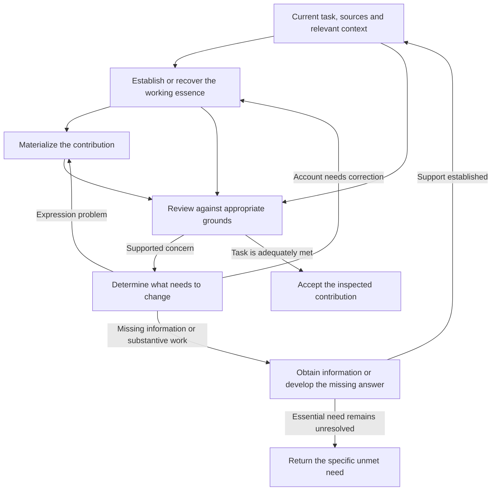
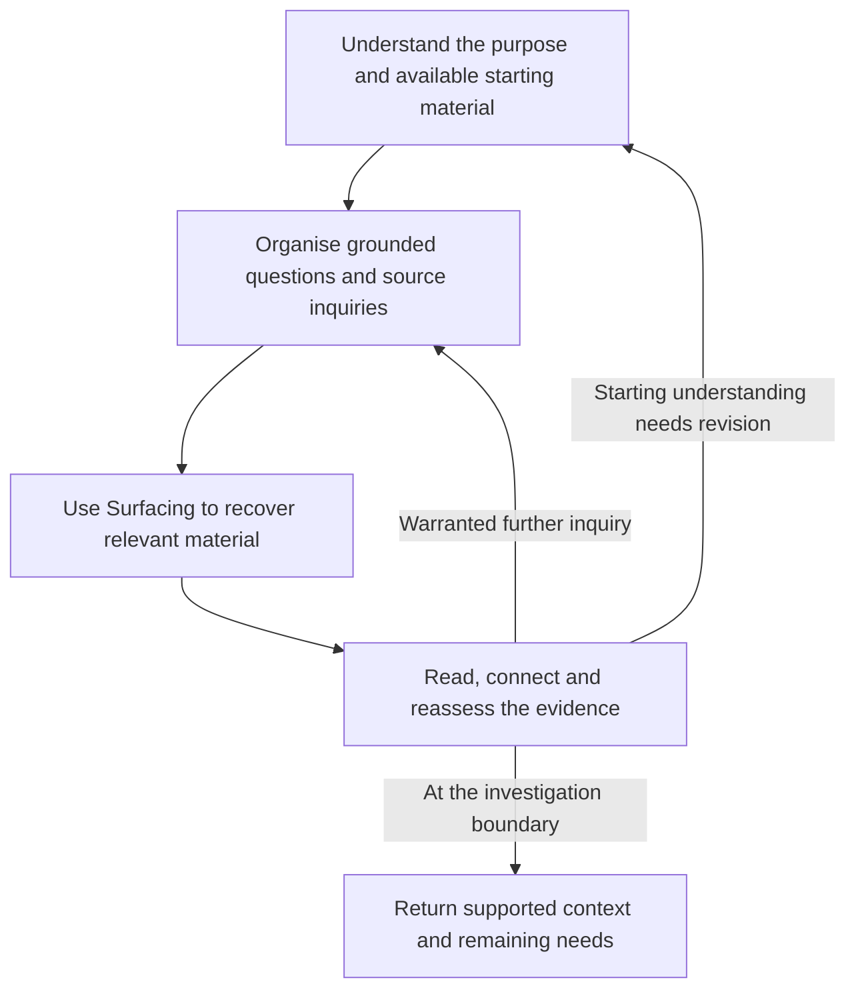

# 11 essential findings — merged text

Nine Communication Craft core findings in the recommended reading order, followed by two shared-method companions.


---

# Finding: Communication substrate — its meaning, dimensions and use

## Question

What is the communication substrate or essence? What does it do, why is it useful, and what are its main concepts and dimensions?

The aim is a broad foundation from which we can understand a particular exchange: who is communicating with whom, what is being said, what is being conveyed through it, and what kind of interaction is taking place. That foundation should also explain how we establish the exchange's needs, the meanings and relationships that matter, their supporting grounds, and what remains unknown or intentionally open.

The conceptual map must extend beyond what every case needs and beyond what current tools can measure. Existing meaning and fidelity guidance was excluded as a source of definitions or authority. This inquiry establishes the foundation before developing those later checking concepts.

## Finding

Communication Craft needs a foundation that explains what we are trying to understand and shape before we decide how to write, inspect or improve an expression. Otherwise a method can polish words while leaving the contribution itself unclear.

The foundation developed here starts with communication as situated activity. Someone produces or encounters an expression as meaningful in a situation. It can concern something, perform an act, express a position, maintain a relationship, or invite an experience. What happens depends partly on how others interpret and respond to it.

This includes attempts that fail to reach or be understood by their intended recipients. It also accommodates expressions encountered later, mixed purposes, disagreement, and communication whose meaning develops through the exchange. It does not attempt to settle every boundary between human communication, natural signs, animal signaling and information transmission.

### 1. What we mean by substrate and essence

**The communication substrate is the working understanding that supports making sense of, developing or assessing a particular communication.**

That understanding can include:

- The situation and people involved.
- What the contribution is about and what it says.
- What someone is doing through the contribution.
- How its meanings connect.
- How it is expressed and made available.
- How it might be or has been received.
- The grounds and limits of our account.

“Working understanding” matters. We establish an account from available material and reasoning. That account can be incomplete or mistaken, and it can change when we learn more.

The actual exchange is not identical to our account of it. A transcript records words and some surrounding information; a participant can state an intention; a recipient can describe a reading. Those provide different kinds of evidence. None automatically supplies the complete communication situation.

**Essence names the important meaning and relationships in that account for the present use.** For example, the essence of a recommendation may need to preserve the problem, the preferred option, the reasons, the tradeoff and the remaining uncertainty. Reducing it to “choose option B” could remove the substance of the recommendation.

The two terms need not designate two separate files or processing stages. The proposal is to use *substrate* when emphasizing the supporting understanding, and *essence* when emphasizing what matters within it. This is proposed vocabulary for this framework; the conceptual distinction is more important than treating the names as settled terminology.

### 2. The general map and the particular account

The **general map** describes the kinds of things that can matter in communication. It is broad enough to include intention, relationship, authority, emotional expression, interpretation and consequence, even when some of those cannot be established in a particular case.

A **particular account** uses that map to understand a specific contribution or exchange. Its depth depends on the use. A routine acknowledgment may need almost no explicit preparation. A sensitive recommendation, disputed explanation or complex handover may benefit from a substantial written account.

Leaving a dimension unrecorded in one account does not mean the dimension is absent from communication. It might be irrelevant to the current question, already understood, inaccessible, or simply not examined yet. Those are different conditions.

The map therefore serves as a guide to attention. It is not a requirement to fill every field before communicating.

### 3. The main dimensions

The following fourteen facets form the proposed map. They overlap because communication is relational. Their grouping is an explanatory choice, not a claim that fourteen is the uniquely correct number of independent variables.

#### A. The situated interaction

| Facet | What belongs here | What the account should help us understand |
|---|---|---|
| **1. Participants and voices** | Author, drafter, sender, represented person or organization, intended recipients, observers and later readers | Who is communicating with whom, whose view is represented, and who is responsible for the contribution |
| **2. Relationships, roles and authority** | Familiarity, trust, standing, power, responsibilities, permissions and obligations | What the participants can reasonably expect or commit, and how their relationship affects the act |
| **3. Circumstances and history** | Relevant events, setting, timing, constraints, prior turns and changes since earlier communication | Why this contribution occurs now and what background gives it significance |
| **4. Activity and place in the exchange** | The larger activity, its stage, and what this contribution responds to or opens | Whether this is part of planning, teaching, negotiation, repair, celebration, reporting or another activity |
| **5. Purposes, interests and needs** | What each party seeks, needs, expects, avoids or leaves open | Where sender aims, recipient needs, task requirements and shared purposes align or differ |
| **6. Shared knowledge and conventions** | Language, vocabulary, prior knowledge, assumptions, cultural or genre conventions | What can be relied on as understood, what is merely presumed shared, and what needs establishing |

A useful distinction within “kind of interaction” is **activity versus act versus genre or medium**. A negotiation is an activity. Refusing an offer is an act within it. An email is one way that refusal may be expressed. These classifications answer different questions.

A contribution can also perform several acts. An executive update may report progress, recommend a next step and request a decision. Calling it an “update” does not establish which of those acts it actually performs or needs to perform.

#### B. The contribution and its grounds

| Facet | What belongs here | What the account should help us understand |
|---|---|---|
| **7. Subject matter and content** | People, objects, events and states; claims, questions, alternatives, decisions, examples and experiences | What is being talked about and what is said or proposed about it |
| **8. Meaning relationships** | Cause, reason, support, contrast, condition, qualification, sequence, part and whole, consequence | How the content fits together and why those connections matter |
| **9. Communicative acts and intended conveyance** | Informing, asking, recommending, refusing, committing, acknowledging, consoling, joking; intended or implied significance | What someone is doing through the contribution and what they seek to get across |
| **10. Stance, affect and commitment** | Certainty, tentativeness, concern, appreciation, disagreement, emotional expression and responsibility | How the speaker positions themselves toward the content and others, and how strongly they commit |
| **11. Grounds and warrant** | Evidence, reasons, attribution, authority, capability and relevant conventions | What supports a claim, an interpretation or the standing to perform the act |

Subject matter alone is not enough. “We considered a restriction and used a name check” identifies two things. It does not explain whether the restriction was rejected, why it was rejected, or how the chosen check addresses the concern.

The connections supply that understanding. A condition limits a promise. A reason supports a recommendation. A contrast distinguishes two apparently similar cases. A qualification changes the strength or scope of a claim.

“Grounds” also requires care. Evidence that a statement is true is different from evidence that someone said it. Reasons for choosing an action differ from authority to commit an organization to it. A request is not a factual claim that can be verified in the same way as a reported test result.

#### C. Expression and availability

| Facet | What belongs here | What the account should help us understand |
|---|---|---|
| **12. Expression and conditions of access** | Words, organization, visual form, sound, gesture, tone, timing, channel, availability and accessibility | How the contribution becomes perceivable and which features affect its meaning or possible reception |

The working account need not prescribe every word. Many contributions can be expressed in several suitable ways.

Some features of expression, however, carry part of the meaning. “Might” and “will” make different commitments. Quoting someone is different from endorsing their words. A joke may depend on exact phrasing. Timing can change whether a question feels like an invitation, a reminder or pressure.

In those cases, the account should retain or point to the relevant expression feature. Abstracting it away would remove something the communication is doing.

#### D. Reception and what follows

| Facet | What belongs here | What the account should help us understand |
|---|---|---|
| **13. Reception and interpretation** | Possible readings, anticipated readings, recipient reports and evidence of understanding or misunderstanding | What the expression makes available to a recipient and what they actually take from it when that is known |
| **14. Consequences and continuation** | Replies, decisions, actions, changed expectations, relationship effects, repair and further turns | What happens through or after the contribution, and how that changes the situation |

A recipient can understand a recommendation and reject it. Someone can comply without understanding the reason. A lack of reply can have several causes. These observations should remain distinguishable.

An authoring account can record intended or anticipated reception. It cannot record successful reception as an observed fact before evidence exists.

### 4. How these dimensions relate

The map becomes useful when its contents are connected.

A person **speaks in a role**. That role may give them authority to approve something or merely a reason to offer an opinion. Their contribution **responds to an earlier question** and **concerns a particular subject**. It may **recommend an action because of a reason**, **qualify that recommendation with a condition**, and **invite a decision from someone else**.

The expression makes those relations available with some degree of clarity. Recipients interpret it from their own knowledge and circumstances. Their responses can change the conversation, the decision, or the author's understanding.

A small example shows why this matters. Consider the constructed message:

> Friday works, provided Maya approves the budget. Please confirm by noon.

To understand it, a person may need to establish:

- Who can speak for the Friday schedule.
- Who Maya is and what her approval covers.
- Whether the first sentence is a conditional proposal, a feasibility report, or a commitment.
- What exactly the recipient is being asked to confirm.
- Whether noon is a proposed deadline or an already agreed constraint.
- What evidence supports the availability claim.
- Whether any recipient has accepted the proposal.

The words alone do not answer every question. Some answers may be supplied by shared context. Others may need clarification. The substrate is the working account that connects the available answers and preserves the material unknowns.

### 5. What “underneath the words” can mean

This phrase is useful, but it can conceal several different questions.

| Question | Example |
|---|---|
| What does the wording conventionally express? | “Can you send the draft?” has the form of a question about ability |
| What act is being performed in this situation? | It may function as a request to send the draft |
| What further significance is intended or implied? | A reminder that the draft is still outstanding may be part of the conveyance |
| What stance is expressed? | Tentativeness, urgency, annoyance or politeness may be conveyed |
| What private motive might explain the contribution? | The speaker may want reassurance, progress, control or something else |
| What did the recipient actually understand? | The recipient may report hearing a request, criticism or a simple question |

The framework should allow these distinctions. It should also preserve their different evidential status.

A participant's statement about their intention is evidence about that intention. Context can support an inference. Neither gives us unrestricted access to private motives. We can preserve plausible interpretations without pretending that every expression has one fully recoverable hidden meaning.

### 6. What qualifies the whole account

Perspective, grounds and uncertainty apply throughout the map. They should not be reduced to one overall confidence label.

For each important assertion or relationship, distinguish:

1. **Whose view it represents.** The author’s intention, a recipient’s reading, an analyst’s interpretation or a jointly established position.
2. **When it applies.** Before a decision, after clarification, or at the time of a particular message.
3. **What it rests on.** Observed expression, a participant report, a record, inference, assumption or convention.
4. **How well it is supported.** What supports it, what challenges it and how much remains uncertain.
5. **Whether it is agreed.** Participants can disagree even when each position is clearly expressed.
6. **What remains incomplete or open.** Unknown, unavailable, unexamined, absent from supplied material, intentionally undecided, or irrelevant for the current use.

These qualifications can coexist. Someone can report an intention that another participant disputes. The report may also leave an important part unspecified.

Actual beliefs, feelings, attention and understanding may matter even when we cannot directly observe them. The account can include what is reported or reasonably inferred about those states while keeping them distinct from their expression.

This distinction matters for later automation. A tool might reliably detect that a speaker expressed confidence while remaining unable to determine whether that confidence was justified or sincere.

### 7. How we establish a useful substrate

Establishing the account involves both understanding the situation and making judgements about the contribution. It can draw on the following activities without requiring one rigid sequence.

#### Establish what this exchange needs

Start with the explicit request or communicative task, the surrounding activity, the participants’ roles, the preceding exchange, and the consequences of misunderstanding.

Keep the sources of need visible. “The recipient explicitly asked for the decision” is different from “we infer that the recipient probably needs more background.” An organization's requirement, a genre convention and an author's preference also have different standing.

When purposes conflict, represent the conflict. A sender's desired outcome does not automatically determine the recipient's legitimate need or the requirements of the activity.

#### Establish which meanings and relationships matter

Build the account of what is being said or developed, including its act, stance, reasoning and conditions.

A part may matter because it is:

- Explicitly required by the task or exchange.
- Needed to interpret another part.
- Consequential to the act, inference, commitment, experience or continuation.
- Uncertain in a way that could materially change the reading.

Asking “what changes if this is altered or omitted?” can reveal importance. An uncertain answer does not establish that the part is dispensable.

This is also where we may discover that the author has not yet formed a judgement. If an update needs a recommendation and the material contains only observations, selecting nicer words will not supply the missing reasoning. Forming the substrate may require thinking through the recommendation.

#### Establish the grounds

Connect claims and interpretations to the available records, participant statements, observations and reasoning. Distinguish an assertion in a source from a fact independently established by the inquiry.

For an intended act, consider the relevant standing or capacity. Someone can write a promise without having authority to promise on another person's behalf. The account should expose that issue when it matters.

#### Preserve what remains unknown or open

Name the gap and its consequence for this account. Seek further material or clarification when it is necessary for the intended use. Preserve alternatives when the evidence does not settle them.

Intentional openness deserves its own treatment. An invitation to explore, a provisional idea or an unresolved choice may be doing exactly what the exchange requires. Completing it by invention would change the contribution.

#### Revise as communication develops

Drafting can reveal missing reasoning. A question can expose an assumption. Feedback can establish that the reader needed a different connection or understood the act differently.

The account can change in response. That change should distinguish a revised current position from a corrected description of what was previously said or believed.

### 8. What the direct cases show

#### An operational briefing needs the author's assembled judgement

In the [model-evaluation conversation](../2026-10-05_23-03__highest-value-next-communication-check/development-packet/sources/duncan-thread.md), the initial message explains several documents and proposes a starting workflow. The recipient asks instead for a more direct account of what the author now understands, has concluded, has achieved operationally, and needs from the recipient.

The relevant substrate therefore includes the stage of the work, the author's judgement, the recommendation and its reasons, the difference between usable work and proposals, and the recipient's decision needs.

The recipient explicitly allows that useful work may exist. A responsible account preserves that distinction; it does not turn criticism of the briefing into a claim that the underlying work has no value.

This case illustrates why the substrate must connect content to the exchange's needs. It does not establish that every update needs the same headings.

#### Explaining a technical decision and replying to reviewers use different selections

The [technical explanation and Slack-drafting transcript](</Users/nsstorm/.codex/attachments/797f55f6-8e63-49c7-aa91-9d4b91b9fd95/Pasted text.txt>) moves through several tasks: understanding what happened, explaining why a suggestion was declined, and composing a brief outgoing reply.

The subject remains related, but the current learner and eventual reviewers are different recipients. The full explanation may need a step-by-step history. The outgoing reply may need the adopted idea, the adjustment, the reason and the reported result.

The account must preserve the important relations before making that selection. It should also retain uncertainty about what was actually implemented when the user questions the claim. The transcript's assertions about software behavior and test results remain reported assertions here; this inquiry did not inspect or verify the code.

These cases show a use for an explicit account: make the subject, audience, act, reasoning and grounds available together so that expression can be chosen with understanding.

### 9. Why the foundation is useful

For **understanding**, it helps distinguish the topic from the contribution. We can ask what is being requested, promised, implied, justified or left open.

For **developing communication**, it exposes missing work before or during expression. We may need to form a judgement, establish a reason, recover a source or resolve a participant's role.

For **adaptation**, it helps preserve meaningful relations while changing the expression for another audience or purpose. It also helps identify when changing the audience changes the contribution itself.

For **examining a failed exchange**, it distinguishes possible causes: a mistaken account, unsupported content, a missing relationship, an unsuitable expression, absent shared knowledge, or a different recipient reading.

For **later checking and approximation**, it gives the method a defined target. A tool's observation can then be compared with the richer concept it is meant to indicate.

These are design benefits supported by the distinctions and cases. The complete approach has not yet been tested as an operational method against a comparable approach without explicit substrate formation.

### 10. How to preserve the unmeasurable dimensions

The conceptual map should name what matters even when we cannot inspect it directly.

Later approximation should keep three things separate:

| Concept of interest | Available evidence or possible indicator | What that evidence does not automatically establish |
|---|---|---|
| Intended conveyance | An explicit brief, wording, prior turns, subsequent clarification | The complete private intention |
| Shared knowledge | Previous exchanges, shared records, recognized terminology | That both participants retained and interpret it identically |
| Recipient understanding | A paraphrase, relevant question, explanation or response | Full understanding of every part |
| Expressed stance | Modal words, evaluative language, tone or form | Sincerity or justified confidence |
| Practical effect | An observed decision, action or changed response | That the communication alone caused it |

The table proposes distinctions for future investigation, not validated detectors. An approximation becomes useful when its limits are understood and its errors can be examined. Omitting inaccessible dimensions from the foundation would make those errors harder to recognize.


---

# Finding: the understanding an exchange needs, and how views contribute

## Question

What determines the understanding a particular exchange needs, and therefore which views contribute and how they combine? Does Workcraft's Communication lack a fundamental concept, or does an existing concern need clearer treatment? What should be developed next at that fundamental level?

## Finding

### 1. The exchange gives the views their job

Workcraft is developing Communication so that people and AI can make work understandable to one another. The earlier inquiries identified different views of work: conceptual, technical, operational, strategic and evaluative. Each helps answer a different family of questions.

Your new question concerns how those resources become useful in a particular exchange. The fundamental distinction is:

| Concern | What it tells us |
|---|---|
| **Required understanding** | What this exchange should make understandable about the work, for its recipients and intended use. |
| **Communication view** | A recurring family of questions and relationships that can contribute to that understanding. |
| **The actual account** | The substance communicated, including the connections and qualifications that let the recipient understand it. |

For example, “operational” identifies a broad concern. “Understand what this preparation now enables and what remains before we can run an evaluation” states a particular need. The second gives the first a concrete job.

A concise definition is:

> **A communication need is the understanding a contribution should make available for a particular exchange, given its purpose and context.**

The useful content is the actual understanding being specified. Naming something “a communication need” does not establish what it is. Often one ordinary sentence is enough to express it.

This also clarifies the meaning of purpose. “Proposing,” “reporting” and “requesting” name what a contribution is doing. A fuller purpose explains what that contribution should accomplish for understanding. The communication need can sit within that fuller purpose; it does not require another independent concept or component.

### 2. Several things establish the required understanding

No single factor in the proposed hypotheses is sufficient by itself.

| Basis | What it contributes |
|---|---|
| **The actual request and applicable corrections** | The question, requested contribution, scope and what should remain open. |
| **The intended use of the exchange** | Why this understanding matters: learning, exploring, assessing, coordinating, deciding or carrying out work. |
| **The work's current situation** | What has happened, what is being considered, and which uncertainties or dependencies matter now. |
| **The recipient's relevant context and participation** | What can legitimately be assumed, which relationships need explaining, and what contribution or authority the recipient actually has. |
| **The delivery context and constraints** | How the recipient encounters the communication, its available supporting material, requested depth and meaningful limits. |

The [recipient-and-purpose guide](/Users/nsstorm/Desktop/projects/AIOpsMan/artifacts/skills/comm-critic-d/references/recipient-and-purpose.md) already asks for these considerations together. The [meaning-and-fidelity guide](/Users/nsstorm/Desktop/projects/AIOpsMan/artifacts/skills/comm-critic-d/references/meaning-and-fidelity.md) also requires the actual request and intended use to inform what substance should be present.

These factors do different jobs. A person's role may explain why a decision falls to them. Their prior knowledge may explain why a term needs no introduction. The request may establish that they want the mechanism explained, even though their role often involves operational decisions.

An inferred need remains an inference. “Managers want three views” is not adequate evidence about this manager's current question. Where uncertainty changes the account or its assessment, make that uncertainty visible and resolve the relevant context or question. There is no need to turn routine communication into a mandatory questionnaire.

The need can also become clearer during the exchange. A person may ask for an initial explanation and discover a more precise question through it. Discovery can aim to uncover what matters before a decision or priority exists. The user's preserved [better-questions request](/Users/nsstorm/Documents/Codex/2026-09-15/i-think-we-can-i-want/outputs/traverse-usage-catalogue.md:951) and [discovery-stage correction](/Users/nsstorm/Documents/Codex/2026-09-15/i-think-we-can-i-want/outputs/traverse-usage-catalogue.md:1547) are concrete examples of those legitimate outcomes.

### 3. The pasted hypotheses contribute at different levels

| Hypothesis | What survives | Its limit |
|---|---|---|
| **The recipient's next act** | Intended use is a strong reason for needing particular understanding. The pasted hypothesis rightly includes simply understanding. | The same use can require different explanations depending on the actual question and existing context. An imagined eventual act is not enough to select the content. |
| **The recipient's question** | Questions are a useful way to express and inspect the needed understanding. | Their relevance still needs a basis. An invented implicit question does not become authoritative merely because it is plausible. |
| **The recipient's role** | Participation and authority can affect what must be understood or requested. | The same person can need very different accounts at different times. Role alone does not select the views. |
| **A missing need/use layer** | Giving the required understanding explicit treatment helps connect the exchange to the account. | The current foundation already covers much of this concern. A new standalone layer is not established. |

These are therefore partly complementary. The intended use helps explain why the understanding matters; context helps establish what is needed; questions make it concrete; views can help supply the answer.

### 4. View composition means connecting the substance

Once the needed understanding is concrete, the views become easier to use. A question about what a result establishes may call for evaluative understanding. A question about what that result enables may need an operational account. Understanding why the consequence deserves attention may call for strategic reasoning.

One exchange can need all of those relationships. However, including three categories of content does not ensure that the account connects them.

Consider a **hypothetical** message with three statements:

- The trial produced inconsistent results.
- Another trial is proposed.
- Reliability is the goal.

The topics are relevant. The needed explanation may still be missing: what does the inconsistency prevent us from concluding, what would another trial establish, and why is that uncertainty worth resolving for the goal?

That is the work of composition. It can connect:

- Evidence to the judgment it supports.
- A mechanism or constraint to its practical consequence.
- A proposed action to the uncertainty or dependency it addresses.
- A result or direction to the goal it serves.

These are examples of useful relations, not a universal sequence. Some exchanges need only a definition, a focused explanation or an acknowledgement. Others need several connected answers. The same fact may contribute to more than one view without being repeated under several headings.

The order of explanation also follows the exchange. A reader investigating a mechanism may need its operation first and its practical implication afterward. A reader assessing a current limitation may need the consequence first, then enough mechanism to understand it.

The [meaning-and-fidelity guide's reasoning check](/Users/nsstorm/Desktop/projects/AIOpsMan/artifacts/skills/comm-critic-d/references/meaning-and-fidelity.md:38) already asks that source statements, interpretations and conclusions stay connected. The development here is to explain how that requirement operates when views combine.

### 5. Duncan's case illustrates the relationship, with two corrections

The [saved September exchange](/Users/nsstorm/Desktop/projects/AIOpsMan/devdocs/inquiries/2026-10-05_23-03__highest-value-next-communication-check/development-packet/sources/duncan-thread.md) shows a recipient asking for the substantive position, the contributor's learning and judgment, actual operational progress, and a comprehensible route forward. Those requests naturally draw on several views.

The general lesson is that the recipient needed an intelligible account of the work as a whole. He was being asked to perform too much of the synthesis himself. The mix of views follows from the substantive questions in this exchange; his job title does not establish that mix for every future message.

Two claims in the pasted review need correcting:

1. **The original message was not “in none of the views.”** It already contained a rationale for the proposed starting point, a description of the operating approach, outstanding requirements and an explicit statement that no new comparison had run. Duncan's complaint concerns the account he could get from the message as a whole, not proof that every substantive element was absent.
2. **The existing operational guide does cover conclusions.** Its first check expressly includes the current position, findings, conclusions and implications. It also names the problem of describing documents or activities while leaving the recipient to assemble what the work establishes. Its present contents do not support the claim that it would necessarily miss Duncan's second concern. See the [operational guide](/Users/nsstorm/Desktop/projects/AIOpsMan/artifacts/skills/comm-critic-d/references/operational-communication.md).

Duncan also said not to take his suggested structure verbatim. His five headings are useful case evidence, not a universal communication format.

Describing artifacts is legitimate when an inventory or source-review orientation is the requested contribution. The defect arises when that description substitutes for a substantive account the exchange requires. This conditional distinction is more general and more accurate than banning document descriptions.

### 6. The relationship works on both sides of communication

For **producing communication**, the question is: what must this contribution make understandable, and how can the available substance supply that understanding coherently?

For **receiving communication**, the question is: what does this account actually make understandable, compared with what this exchange needs? The result may identify adequate understanding, a missing connection, an unanswered question or uncertainty about the requirement itself. That result remains useful even if no feedback is sent.

For **adapting communication**, the question is: what does the new use require that the original account was not designed to supply? A technical report can be adequate for its original purpose and still need an operational explanation for another use. The new requirement does not retroactively prove that the original sender failed.

The following contrasts show why the foundation is broader than a briefing guide. The examples are conceptual illustrations, except where the cited source establishes the request.

| Exchange | Understanding sought | Consequence for views |
|---|---|---|
| Explain what an evaluation ruler is | Identity, boundaries and its distinction from workflow-specific criteria | Conceptual understanding can be the main contribution. No progress report is automatically needed. |
| Explain whether evaluation preparation is ready to use | Current usable position, remaining conditions and the basis for that assessment | Operational and evaluative understanding may need to connect; technical context can support them. |
| Help make confused questions clearer | What is uncertain and which questions need separate answers | Exploration should preserve openness; a final decision may be inappropriate. |
| List the documents available for review | Which documents exist and what each covers | An artifact inventory can itself satisfy the request. |
| Acknowledge receipt in an established thread | That the contribution was received | No elaborate view treatment is required. |

An account can span a thread or connected documents when that context is genuinely available to the recipient. The foundation does not require every message to reproduce the entire body of work.

### 7. A good account cannot manufacture the missing answer

Required understanding and available substance can differ.

Sometimes the answer exists in the message but needs a clearer connection or emphasis. Sometimes it is available in supporting material. Sometimes a fact, interpretation, conclusion or decision has not been established. These situations call for different work.

A faithful “the comparison has not run” can communicate the current position well while leaving “which model should we use?” unanswered. Naming the gap does not satisfy that wider need. Inventing a conclusion would misrepresent the work.

This also means communication quality does not certify the underlying work. A clear account of a test is not independent proof that the test was sound. A clear statement of incompletion is not completion.

The [current revision protocol](/Users/nsstorm/Desktop/projects/AIOpsMan/artifacts/skills/fixcomm/references/comm-revise.md) permits supported synthesis and requested recommendations while retaining missing facts, decisions and undelegated substantive choices as unresolved. The [Supporting Context guide](/Users/nsstorm/Desktop/projects/AIOpsMan/artifacts/skills/orchestrator-inbound-communication/references/supporting-context.md) similarly distinguishes unavailable, unread, unestablished, disputed and deliberately open material.

Within Workcraft, Communication concerns the understandable account and its fit to the exchange. Context Accumulation supplies relevant information. Semantic Formulation develops substantive judgments or explanations that still need thought. Alignment compares what is needed with what is supplied. Orchestration chooses and coordinates the further work. These responsibilities can contribute to one action; they do not require separate agents or seven stages for each message. See the [Workcraft overview](/Users/nsstorm/Desktop/projects/AIOpsMan/core/what-is-workcraft.md).

### 8. The next focus is a clearer shared foundation

**I recommend developing the common account of how an exchange establishes its required understanding, and how connected contributions from views supply it.**

This is a fundamental concern because it applies across recipients, message purposes and views. It helps explain how a technical reference, an operational reference and the other view references are used together. It also gives receiving assessment a concrete basis.

The development should make five things easy to understand:

1. What the exchange should make understandable.
2. What establishes that need, including consequential uncertainty.
3. How one or more views can contribute relevant questions and answers.
4. How those answers form a connected account.
5. What remains unfulfilled when required substance is unavailable.

Those are concerns for the foundation, not mandatory message fields. Their treatment could be integrated into existing purpose/substance guidance or placed in a short common reference. This inquiry does not establish which packaging is best.

The concern is already partly present. The current guidance covers required substance, intended use, recipient context, connected reasoning and visible gaps. The prior findings also explicitly allowed combinations. The contribution of this inquiry is to bring those functions into a clearer relationship, rather than claim that Workcraft had never considered them.

The conceptual result is established here. Authoring guidance that applies it, implementing a reliable method for inferring implicit needs, and measuring recipient benefit remain distinct development tasks. The recommendation follows the user's current foundation-building objective; it is not a measured ranking of every possible Communication improvement.


---

# Finding: communication essence, materialization and review

## Question

Can a communication substrate essence serve as the organizing basis for creating, reviewing and repairing communication? What should that essence contain, how can it support several materializations, and when should critique change the text or the underlying understanding? How does the same idea apply to receiving a message and later answering it?

The aim is a sound process foundation for Workcraft, the project's framework for automating work through AI. This finding establishes the conceptual account; the effectiveness of a particular automated implementation remains to be tested.

## Finding

### 1. Give the essence enough meaning to do the job

The practical problem is familiar from the supplied AI session: a short message can read smoothly while leaving out an important reason. Improving its wording alone may never restore that reason. The process needs an account of what this contribution is trying to convey and why that meaning belongs.

Here, a **contribution** is the message, report, reply or other communication being worked on. For this loop, **communication essence means the grounded working account of an exchange and the contribution being intended or understood within it**.

Two questions organize that account:

| Question | What it establishes |
|---|---|
| **What exchange is this?** | Participants, direction, purpose, relevant context, expectations, needed view, delivery and relationship constraints. |
| **What is this contribution intended or understood to convey?** | The particular claims, answers, reasons, requests or acknowledgements; their relationships, qualifications and important open parts. |

These concerns can live in one account. They do different work. “A technical reply to the reviewer explaining a rejected restriction” establishes the situation and broad purpose. It does not tell us which restriction was rejected or either reason for rejecting it.

The second question must reach particular meaning. For example: “The fixed-role restriction was declined partly because it could reject legitimate clicks.” That statement contains a risk, the choice it bears on and the risk's status. A list reading “restriction, risk, decision” does not yet supply the same understanding.

This also clarifies the relationship between **substrate essence** and the later phrase **substance essence** in the request. The proposed working account needs both the situation and the substantive meaning. We can preserve that distinction without committing to two separate artifacts or treating the wording as a settled taxonomy.

Requirements are one result of reasoning from this account: what the contribution should make understandable, with grounds for that expectation. A participant's identity is a contextual fact; “explain both material reasons for declining the restriction” is a requirement. Calling everything a requirement would lose the distinction the user was pointing toward.

### 2. Establish the essence first as a usable working basis

The first organizing operation is to establish or recover this account. It can be brief when the communication is simple, and fuller when the contribution contains several connected judgments or unresolved matters.

A practical way to do it is:

1. **Understand the current exchange.** Read the request and relevant context. Identify whose contribution is being prepared or received and what it is doing now.
2. **Establish the particular meaning.** State the answers, reasons, relationships and qualifications that matter to this contribution. If an answer is missing, identify that gap.
3. **Check the grounds.** Distinguish source-supported statements, the author's stated intention, reasonable inference, disputed expectations and unknowns where the difference matters.
4. **Look back for omissions.** Compare the account with the actual request and relevant source material. The essence cannot expose a meaning it has already forgotten merely by inspecting itself.

A source detail belongs when it contributes to the understanding this exchange needs. Its presence in the source alone does not make it mandatory in every message. Conversely, a brevity request does not make a material reason irrelevant. The selection should have an explainable connection to the task.

“First” does not require every meaning to be settled before any formulation begins. Trying to express a thought can reveal a missing distinction. That is useful feedback: refine the account on supported grounds, then improve the expression.

The essence can itself be prose or a table. Its distinction from the final message is its **role**: it organizes what we understand and intend; the materialization is what the recipient will encounter. An existing task account can already serve this role. The inquiry supports making the middle understanding explicit enough to inspect; it does not prove that every message needs a new document.

### 3. Materialize the contribution in a form suited to the exchange

**Materialization is the actual expression of the working account for a particular delivery.** It involves selecting and arranging words, examples, detail and emphasis. It may use supporting material where the recipient can legitimately access it.

Several materializations can be acceptable. They need to preserve the meanings and relationships that matter for their use. They need not contain identical words or every detail available in the source.

Consider the supplied browser-tool transcript. The longer explanation gave two reasons for leaving out a restriction that would accept only a fixed list of interactive element roles: it would not stop the reported attack, which already used a genuine button, and it risked rejecting legitimate interactions. The later short draft retained the first reason and omitted the second. The record shows the omission; it does not show the AI's private intermediate understanding. [Source transcript](</Users/nsstorm/.codex/attachments/797f55f6-8e63-49c7-aa91-9d4b91b9fd95/Pasted text.txt:94>).

The following is a **constructed communication example based on the transcript's reported rationale**. It does not independently verify the engineering claims.

**Working essence for a short explanation to the reviewer:** retain the pre-action element check; compare the resolved element's real name with the model's description of what it intended to click; explain that the separate interactive-only restriction was declined because it would not distinguish the reported attack and could reject legitimate clicks. Preserve the second reason as a risk, rather than claiming observed regressions. The illustrative task here is explaining those choices.

**A compact materialization:**

> We kept the pre-action check and compare the resolved element's real name with the model's description of what it intended to click. We left out the interactive-only restriction: the attack already uses a genuine button, so it would pass that restriction, and a fixed role list could also reject legitimate clicks.

**A materialization with the reasons separated:**

> We kept the check before acting and compare the resolved element's real name with the model's description of what it intended to click.
>
> We did not add the interactive-only restriction for two reasons. The attack uses a real button, so it would pass that restriction. Limiting targets to a fixed set of roles also risks rejecting legitimate clicks outside that set.

Both versions preserve the two reasons and attach them to the declined restriction. Their arrangement differs. Their suitability for a real message would still depend on the actual requested detail, surrounding context and supported facts.

Now consider this shorter version:

> We kept the pre-action element check and left out the interactive-only restriction because the attack uses a genuine button.

That can be a clear sentence while giving an incomplete explanation for this illustrative task. The missing risk has disappeared entirely. No ambiguous word needs to stand in for it.

This is why the essence is useful: it gives the review an explicit account of meaning to compare with the expression. It also shows why the essence itself needs checking. If it contains only the first reason, a faithful materialization can reproduce the omission.

### 4. Use checks with the right comparison basis

The broader loop needs more than an explicitness test. It also needs more than a check of the essence alone.

Four useful comparison questions are:

| Comparison | Question | Example |
|---|---|---|
| **Grounding of the essence** | Does the working account respect the current task, available support and relevant quality principles? | The source supplies a material risk reason, but the account omits it or turns the possibility into an observed failure. |
| **Realization of needed meaning** | Does the actual contribution convey the required meanings, relationships and qualifications? | The account includes both reasons; the message expresses only one. |
| **Expression and intelligibility** | Does the actual wording supply the distinctions it demands, in an arrangement the recipient can follow? | “The other part” leaves the relevant proposal unclear. |
| **Fit to the exchange** | Does the contribution answer the current need with the right view, detail and delivery? | A list of documents fails to supply the assembled operational explanation requested by the recipient. |

These are comparison relationships, not a final taxonomy of every communication-quality concern. They can overlap in one finding. A missing reason can matter both to preservation and to the purpose of explaining a decision.

The existing explicitness work is already broader than spotting vague words: it examines demanded particulars such as actions, conditions, criteria and relations. Its declared scope remains narrower than all communication quality. The [explicitness detector](/Users/nsstorm/.claude/skills/non-explicitness-detection/SKILL.md) judges the declared text and setting. Private authoring knowledge must not be supplied to it as though that knowledge appeared in the message.

The [explicitness fixer](/Users/nsstorm/.claude/skills/non-explicitness-fix/SKILL.md) has a different job. It may use supplied basis material to establish the missing meaning before proposing wording. Its existing missing-meanings table is already a limited example of a useful middle representation.

For broader fidelity review, private source material can establish what should have been conveyed. It still does not count as conveyed merely because the reviewer has read it. Actual shared context, such as the surrounding thread, may contribute to the delivery; the review must distinguish it from private drafting context.

### 5. Let a finding identify the next work

The important addition to the proposed loop is **diagnosis between critique and revision**. A finding is a claim about a problem. We need to establish whether it applies, whether it is supported and what current state needs to change.

For the missing-risk finding, inspect four things: the current communication task, the source support, the working essence and the actual delivery. The resulting decision can be concrete:

| What the inspection establishes | What should happen next |
|---|---|
| The essence includes the risk, but the text omits it | Repair the text and inspect the restored explanation. |
| The source and task establish that the risk matters, but both essence and text omit it | Enrich the essence from those grounds, then revise the text. |
| The essence claims observed regressions, while the source supports only a possibility | Correct the claim's strength in the essence and affected wording. |
| A necessary fact or conclusion is not established | Obtain information or do the substantive reasoning; identify the precise unresolved need if it cannot yet be supplied. |
| The critique demands a decision rationale from a receipt-only acknowledgement | Decline or narrow the finding because it does not fit that contribution's purpose. |
| The task changes to a different recipient or purpose | Reconsider the account and the requirements affected by that change. |

This diagnosis concerns observable meaning and its grounds. It does not require guessing why the AI internally made a mistake.

A valid finding can also have a poor proposed remedy. Restoring the risk does not justify inventing a measured regression or changing a tentative recommendation into a decision. The current [communication revision protocol](/Users/nsstorm/Desktop/projects/AIOpsMan/artifacts/skills/fixcomm/references/comm-revise.md) already distinguishes a supported concern from a supported correction.

After revision, inspect the changed result and the relationships affected by it. A referent correction may need a local check. A changed source fact or purpose may warrant a broader review. The scale of renewed work follows what changed.

**An essence revision needs a reason grounded in the task or support.** Deleting an inconvenient requirement from the essence just to make a weak draft pass would make the loop self-confirming.

### 6. The creation loop has a clear shape

The positive process is:

**Establish a usable essence → materialize → review → diagnose → revise what is affected → inspect the result.**



The arrows describe reasoning and dependencies. They do not prescribe one call, agent or file for each box. A simple communication may complete quickly. A complex one may revisit the account several times.

The loop has two important safeguards: the essence remains checkable against its grounds, and review findings are assessed before they change the contribution. Those safeguards are what make iteration more than repeated rewriting.

### 7. Receiving builds a supported approximation

When receiving, the direction differs. Start with the delivered contribution and available exchange context, then construct a working interpretation of what it conveys and appears to be doing.

That account can distinguish:

- what is explicitly expressed;
- what the surrounding exchange supports;
- what is inferred about purpose or intent;
- what remains ambiguous or unknown.

This is the receiver's reconstruction. A message does not provide direct access to its author's private essence. A short “Fine” might express agreement, acknowledgement or resignation; context may resolve the difference, but the receiver should not invent certainty when it does not.

Also distinguish the **actual view conveyed** from the **view the exchange requires**. If an incoming report describes technical details, that tells us what it supplied. Whether an operational account was needed depends on the actual request and context. Deriving both the message's meaning and its requirements solely from the message would hide omissions.

The user is right to make deliberate quality analysis optional. Understanding can be useful by itself. When assessment is useful or requested, compare the interpreted contribution with the exchange's needs and support. Skipping that analysis does not mean every quality question has passed.

The receiving path is therefore:

**Read with context → reconstruct a supported account → optionally assess → use the understanding.**

The depth should suit the work. A clear acknowledgement may require very little explicit reconstruction. A disputed proposal may require alternative readings and unresolved questions to remain visible.

### 8. A reply reuses the context and establishes a new contribution

An incoming essence can be valuable for answering. It preserves what was said, why it matters, the questions raised and what is still uncertain.

It does not determine the responder's stance. Someone can understand a proposal and accept it, decline it, correct it or ask for clarification. A reply therefore needs its own speaker, recipient, purpose, intended meaning and commitments.

The transition is:

**Received account + current response task → establish the reply's essence → create and review the reply.**

The recorded exchange with Duncan provides a useful example. He asked for an assembled explanation of what had been understood, concluded and achieved operationally. He explained that descriptions of linked documents left the recipient to do the synthesis. He also explicitly allowed that useful work might exist, and said his suggested headings should not be followed verbatim. [Recorded exchange](/Users/nsstorm/Desktop/projects/AIOpsMan/devdocs/inquiries/2026-10-05_23-03__highest-value-next-communication-check/development-packet/sources/duncan-thread.md).

A received account that says only “Duncan wants a shorter message” would lose the core request. One that says “Duncan established that no useful work was done” would contradict his qualification. His suspicion about whether Enes had read the material should remain an attributed suspicion, not become an established fact.

That understanding can support different replies. If the immediate purpose is acknowledgement, an illustrative reply could be:

> Thanks, Duncan. I understand that the message needs to explain what I have concluded and achieved, rather than leave you to assemble that from the linked documents.

This is an example, not a sent message or a claim about Enes's actual understanding at that time. It acknowledges the request without inventing a deadline. It does not itself supply the improved briefing.

If the task is to write that briefing, the incoming account supplies its needs, but the author still has to establish the actual conclusions, achievements, remaining work and requested decisions. The source update explicitly said no new comparison had run. A better communication cannot turn that preparation into an achieved evaluation.

This is where reuse becomes valuable: retain the incoming meaning as context, then develop the particular response from what is actually known and intended now.

### 9. Make readiness a judgment about the inspected result

Your second-pass example is a reasonable picture of iteration. A second version may be acceptable. The reason to accept it is what the version now supplies.

A practical readiness judgment asks:

1. Does the actual contribution supply what this task requires, including the important answers and relationships?
2. Are claims and commitments supported at the strength expressed?
3. Is the meaning understandable through the actual delivery and legitimate shared context, under the applicable checks?
4. Have consequential findings been repaired, rejected on grounds, or retained as uncertainty compatible with this task?
5. Does any unresolved fact, decision or underlying work still prevent the requested answer from being complete?

An exploratory contribution can be complete while leaving a choice open. In that case, the openness is part of what should be communicated. A request for a completed result is different: a polished description of missing work does not supply that result.

A review pass over an unchanged draft, a revision cycle and inspection of the revised output are different activities. Counting them cannot establish the quality of the final contribution. A checker returning no findings reports what it found within its scope.

When essential meaning remains unavailable, continue supported independent work and identify the specific need that prevents completion. Further review should have something concrete to resolve. Repeating the same operation under unchanged conditions supplies no new grounds for acceptance.

“Ready to send” can then mean that the contribution is adequately prepared for the actual task. Delivery uses the authorization and conditions already present in that task. Actual sending and observed recipient understanding are further outcomes; the quality judgment alone does not establish them.

### 10. The middle step is useful because it makes the grounds for repair inspectable

The central intuition survives: **before fixing meaning, establish what meaning should be conveyed and what supports it**. Otherwise, a repair can be fluent and arbitrary.

Making that understanding explicit gives creation a basis, gives review something to compare with the materialization, and gives revision a way to preserve correct meaning while changing the expression. It is especially valuable when the contribution contains multiple reasons, qualifications, competing views or later reuse.

The stronger claim that every task requires a separately saved essence is not established. Direct comparison of the request, source and draft can perform the same grounding function. Existing context or review-basis work may already supply the needed account.

This leaves a useful design question: which representation makes the essential distinctions easiest to establish, inspect and maintain for a given task? That is a question for later skill design and comparison, rather than a reason to weaken the conceptual role of essence now.

### 11. The loop fits Workcraft's existing responsibilities

The loop coordinates responsibilities already present in Workcraft:

- **Context Accumulation** supplies and renews the relevant information.
- **Semantic Formulation** develops missing understanding, reasoning or judgments.
- **Communication** interprets, expresses and assesses contributions.
- **Alignment** examines meaningful differences between intended and actual states.
- **Orchestration** selects and coordinates the next operation.
- **Artifact Operations** supports saved accounts and outputs when useful.
- **Pulse** matters when the broader task waits for a later reply or other observable result.

These are interacting responsibilities in the [Workcraft overview](/Users/nsstorm/Desktop/projects/AIOpsMan/core/what-is-workcraft.md). A communication orchestration loop is a local use of them.

Several parts already exist in the communication packages: establishing a task basis, detecting explicitness gaps, deciding missing meanings before wording, assessing proposed remedies and inspecting the actual revision. The present contribution explains how those parts relate to a working essence and extends the account through receiving and reply formation.

What remains unproven is practical performance: whether a particular implementation consistently identifies the right meanings, diagnoses the right repair, improves recipient understanding and justifies its effort. The conceptual model is ready to inform that work.


---

# Finding: what explicitness contributes to Communication Craft

## Question

What did the explicitness work actually produce within Communication Craft, and when is it useful? Does the substrate itself need explicitness, or do ambiguity and missing particulars arise only during materialization? Should the question bank guide the substrate, guide expression, or inspect the finished communication?

## Finding

### 1. What the explicitness work gave us

Communication Craft has two connected parts: theory and methodology, and implementable skills that let AI apply them. The explicitness work contributed to both.

The practical achievement was to replace an underspecified instruction—“find what is unclear”—with a more definite question:

> **Does this wording need something particular, and does the text actually supply it?**

The current method calls these the **demand** and **sufficiency** tests. A particular might be an object, person, action, amount, criterion or relationship. The text must supply the meaning being asked for; merely mentioning a related topic is insufficient.

For example, “compare the new model with the current model” names the two objects. It may still leave open **what property of one is being compared with what property of the other**. The bank explicitly contains that question. It also examines such matters as which option a reason concerns, what an instruction asks someone to do, and what standard a requested judgment uses.

The work produced several things with distinct value:

| Contribution | What it gives Communication Craft |
|---|---|
| **A defined target** | A way to distinguish a demanded missing particular from a general wish for more detail. |
| **A question bank with decision rules** | A systematic way to find relevant questions and assess whether the text answers them. |
| **Limits and exemptions** | Ways to preserve ordinary language and deliberately open questions while avoiding unnecessary detail. |
| **An inspectable analysis record** | Quotes, alternatives and reasons behind decisions, with records showing which sentences and slots were covered. |
| **An executable detector** | A packaged procedure that applies the method to a source document and returns candidate gaps. |
| **A separate repair process and trials** | A way to establish supported missing meaning before editing, and evidence about where detection and repair succeed or fail. |

I examined the installed [non-explicitness-detection skill](/Users/nsstorm/.claude/skills/non-explicitness-detection/SKILL.md), its [full question bank, version 6.7.1](/Users/nsstorm/.claude/skills/non-explicitness-detection/references/explicitness-bank.md), and its [detection instructions](/Users/nsstorm/.claude/skills/non-explicitness-detection/references/detection-instructions.md). The unversioned bank in the older experiment directory is a different artifact.

The current bank is layered: newer rules override older ones. This matters because reading an older rule in isolation can produce the mistaken impression that every reference must be spelled out repeatedly or every possible detail must be supplied.

### 2. The essence is not automatically clear

The **working essence** is the grounded account of the exchange and the contribution being intended or understood. It helps us establish what we are trying to convey before deciding the final expression.

Calling it an essence does not mean that all its distinctions are already settled. It can contain a genuinely unresolved question. It can also be written in a way that fails to express a distinction the author already understands.

These are different situations:

| Situation | What is wrong—or deliberately open? | What kind of work is needed? |
|---|---|---|
| The account says “switch when the model is better,” but no comparison criterion has been established | Needed understanding or a decision is missing. | Develop or retrieve the criterion, or state the unresolved choice when that fits the task. |
| A criterion is established in the source, but the written account only says “better” | The account fails to supply known meaning. | Express the criterion from its supporting basis. |
| The account clearly states that the criterion is undecided and the current task is to compare possible criteria | The uncertainty is intentional and represented. | Preserve the openness; judge separately whether the current task has been fulfilled. |

These are constructed examples of the distinction, not results from a new detector run.

So the direct answer is **yes: the substrate must make the relevant meaning clear enough to work with, including what is still unknown**. If that substrate is recorded in prose or a table, its wording can itself be inspected for explicitness.

The detector cannot directly inspect an unexpressed mental understanding. It examines the representation supplied to it. A detected gap may reveal unfinished thinking, but the gap alone does not tell us whether the answer was unknown or merely left out. That diagnosis needs the task and supporting information.

### 3. Materialization can introduce a new problem

**Materialization** is the actual expression prepared for a particular delivery. It may differ considerably from the working account in length, wording and arrangement.

Suppose an account clearly establishes that Maya's meeting starts at 10:00 in Room Cedar. A later draft says:

> Tell her it starts then, in the other room.

If that draft is inspected without text supplying those referents, it does not carry the distinctions the account contained. The intended meaning may be clear to the author while the produced wording fails to state it.

This gives three useful possibilities:

1. **The needed meaning was never established.** Better wording alone cannot supply it responsibly.
2. **The meaning was established but poorly represented in the working account.** Clarify that account from its grounds.
3. **The working account was clear, but the materialization lost or obscured meaning.** Repair the actual expression.

A problem can also be carried unchanged from an unclear account into the final message. It need not originate in only one stage.

This is why checking an essence does not certify every later materialization. The new wording is a new object of inspection. Equally, inspecting only the final message does not explain whether the underlying account needs repair.

### 4. Use the bank to help form the essence

The bank's questions can help expose distinctions that the working account needs. That use starts from the actual task and available sources.

For example:

- **Which thing?** Which proposal, version or result are we discussing?
- **What concretely happens?** If this is an instruction, what action is intended?
- **What is compared?** Which property of each option is relevant?
- **By what criterion?** What standard governs the choice being requested?
- **How are these related?** Is the risk a reason against an option, or evidence about the chosen implementation?
- **What remains open?** Which part is genuinely undecided, and what can already be stated?

These questions can help develop the account. They do not provide the answers. An answer must come from the task, sources, an established decision or reasoning that the assignment authorizes.

When no such basis is available, the useful outcome can be an explicit question or an identified need for further work. Filling the slot with a plausible guess would create apparent precision at the expense of fidelity.

Nor should every question become a compulsory field. The current bank explicitly asks whether the particular is needed. Its declared-openness rule accepts values that are stated as unknown or undecided, and its exemptions are limited to the relevant slot.

For instance, stating that a venue has not been chosen can be explicit about that uncertainty. It does not excuse an unclear comparison criterion if the present task asks someone to choose between venues. It also does not complete a task that required a confirmed booking.

**This is a useful proposed adaptation of the bank's reasoning. It is not an existing “generate the essence” mode of the detector.** We have not yet measured whether it improves formation compared with working directly from the task and sources.

### 5. Use the bank to guide materialization

During materialization, the question changes. We are now asking how to express the established meaning so the actual wording supplies it.

The same concern can take three forms:

| Activity | Example question |
|---|---|
| **Form the essence** | What criterion should this comparison use, and what establishes it? |
| **Materialize the communication** | How will this message state that criterion and connect it to the requested decision? |
| **Inspect the result** | Does the actual text supply the criterion where its wording needs it? |

For authoring, relevant guidance includes naming the needed thing, stating the actual action or comparison, connecting reasons to the correct choices, introducing special terms and preserving qualifications.

The bank's limits should travel with that guidance. It does not mean “use the longest possible name” or “explain every ordinary word.” The current short-name rules allow an established referent to remain clear without needless repetition when no competitor has been introduced.

Giving the bank to the creator may help prevent defects. It does not prove that the creator followed it in the produced text. The difference is between **guidance used while making something** and **evidence about what was actually made**.

For this reason, a later authoring skill could use an adapted set of relevant questions without producing every sentence, phrase and decision row required by the detector. Such an activity should be described as guidance, not as a completed run of the tested detection method.

### 6. Run the detector on the representation you want to inspect

The implemented skill takes a source text and a setting. It does not require that the text was produced through the new essence-first loop.

It can therefore have several legitimate targets:

| Target | Potential value of inspection |
|---|---|
| **Written essence or working account** | Expose unclear objects, actions, criteria or relationships before the account is reused or handed to another worker. |
| **Outgoing draft** | Inspect what the recipient-facing expression actually supplies after materialization. |
| **Incoming message or report** | Identify textual uncertainties that may matter to interpretation or a clarification request. |
| **Prompt, instruction or handoff** | Examine distinctions that another AI or person must interpret when carrying out the work. |

These are compatible applications of a text-inspection contract. They are not claims that accuracy or return on effort has already been measured in every setting.

Be precise about what belongs in the inspected text. When the target is the outgoing message, private essence notes must not silently count as explanations supplied to its recipient. When the target is the written essence itself, those notes are legitimately the object being inspected.

A real thread may provide shared context that an isolated snippet leaves out. The test's declared scope must be kept distinct from the whole exchange. A gap in an isolated snippet does not, by itself, establish that the intended recipient lacks that information.

The detector returns candidate findings. The [separate fixer](/Users/nsstorm/.claude/skills/non-explicitness-fix/SKILL.md) can use supplied supporting material to decide whether a gap can be repaired, needs an author answer, or should be declined. Detecting a missing particular and establishing the right particular are separate achievements.

### 7. What the tests demonstrate about its worth

There is evidence that this work produced a useful detection improvement in the tested material.

The packaged-skill trial used a pool of technical excerpts. Blind AI editors judged reported gaps without knowing which detector produced them. I recounted the stored judgments; I did not run a new detector or independently re-judge the findings.

| Detector run | Reported findings | Findings judged real | Share judged real |
|---|---:|---:|---:|
| Plain detector | 238 | 157 | About 66% |
| Packaged bank, first run | 216 | 177 | About 82% |
| Packaged bank, second run | 228 | 181 | About 79% |

In this pool, the bank-based procedure found more items judged real while producing fewer false findings. That is a concrete gain. The percentages above describe **the share of reported findings judged real**, not the share of every possible issue found. [Packaged-skill trial](/Users/nsstorm/Desktop/projects/AIOpsMan/compare/benchmark_data/explicitness-bank/results-skill-trial.md); [stored scoring records](/Users/nsstorm/Desktop/projects/AIOpsMan/compare/benchmark_data/explicitness-bank/stability/editor-skill).

The same report includes a separate comparison with the authors' list of seventy issues. The two packaged runs fully found forty-five and forty-eight issues respectively, and fifty-one across both runs. In thirty trip-message paragraphs with fifty-six planted gaps, the skill found forty-nine in one run and fifty in the other. These results show useful coverage and remaining misses.

The repair work also has evidence. With a stand-in author supplying answers from the planted-answer key, the fixer was scored as resolving fifty of fifty-six planted gaps; eight clean or decoy paragraphs were unchanged. That demonstrates the value of **detection plus supported answers and repair** in that setup. It does not mean the detector itself knew the missing particulars. [Fixer trial, answer round](/Users/nsstorm/Desktop/projects/AIOpsMan/compare/benchmark_data/explicitness-bank/fix-tests/results-fix-tests.md).

The limitations matter to how we use the result:

- The findings were judged by AI editors and benchmark references, rather than established as universal ground truth.
- False findings and missed issues remain. The skill documents weak exemptions and limited detection of distant consistency problems.
- The packaged trial did not exercise the session's merged gap-list step exactly as written.
- The trials did not test bank-guided essence formation or preventive authoring.
- They did not establish total return on development time, the best method at equal cost, or improved recipient outcomes across communication generally.

**The worthwhile result is a concrete, inspectable and partly tested capability, together with reusable methodology.** Its value does not depend on treating it as the whole of Communication Craft. Whether the full procedure is the most efficient choice for every future task is a separate question.

### 8. Situations where it can be useful

The strongest practical reason to inspect a text is that a missing distinction could materially affect how someone uses it. Some examples are:

- **A handoff or instruction.** Which object should change, what should be done, who has the relevant part, and by what criterion should a decision be made?
- **A reusable prompt or skill instruction.** Unclear scope, exceptions or comparisons may be interpreted repeatedly. Inspecting the wording can reveal problems before reuse, although explicit instructions still do not guarantee correct execution.
- **A report with several options, versions or results.** A short reference can point to the wrong thing, or a reason can appear attached to the wrong conclusion.
- **A working account passed to another AI or resumed later.** The account has to carry the distinctions that were previously available in the author's context.
- **An incoming contribution that needs to be acted on.** A textual gap can identify what needs clarification before the receiver proceeds.

These are reasons the method's target matters in those situations. Their comparative benefits have not all been measured.

Full detection is substantial work. The skill's measured-behavior section reports 3–14 minutes and roughly 90–175 thousand tokens per section in its tests. Those are reported costs, not a fresh cost measurement by this inquiry.

A routine acknowledgement or a small context-dependent reply may be handled through careful writing and direct review. The fact that explicitness matters does not require executing the full exhaustive procedure at every stage.

A useful practical stance is therefore: **apply the concerns while working; choose a full inspection when its expected benefit justifies the effort**. The current evidence does not supply a numerical threshold for that decision.

### 9. What this check cannot establish

A text can be explicit and false. It can be explicit and irrelevant. It can also omit an entire reason that the task requires.

The earlier browser-tool example illustrates the last case. The longer source explanation contained two reasons against a restriction, including risk to legitimate interactions. A later short message retained only the reason about failing to stop the attack. A source comparison can establish the lost reason. A wording-based bank cannot be relied on to recover every requirement absent from both the draft's words and its declared setting. [Original source explanation](</Users/nsstorm/.codex/attachments/797f55f6-8e63-49c7-aa91-9d4b91b9fd95/Pasted text.txt:94>).

The bank already checks some relationships and connections. Its limitation is not that it deals only with individual words. The limitation is what its evidence and questions can establish.

A written essence can therefore benefit from two different examinations:

- **Does this account state the meaning its wording demands?** The explicitness method can help here.
- **Is this the supported and sufficient account of what the current task needs?** This also requires the task, sources and relevant judgment.

The final materialization needs the same distinction. An explicitness result contributes to quality assessment; it does not certify truth, complete fidelity, purpose fulfillment or recipient understanding.

### 10. The resulting place within Communication Craft

The earlier investment remains a useful part of the larger picture:

| Part of Communication Craft | Place of the explicitness work |
|---|---|
| **Theory and methodology** | A concrete account of demanded and supplied meaning, with questions and boundaries that can inform formation, expression and assessment. |
| **Implementable skills** | A detector that inspects actual text, and a separate fixer that establishes supported meaning before editing. |
| **Further development** | Adapt and test the questions for formative and preventive uses, and compare the effort and benefit of full inspection in specific tasks. |

The answer is not to assign the entire question bank exclusively to the essence or exclusively to materialization. **Use its questions according to the work being done, and apply its detector to the actual representation whose explicitness you want to inspect.**

That preserves the worth of what was built while keeping each use honest about what it can establish.


---

# Finding: what are we looking for beyond explicitness?

## Question

Workcraft aims to automate work through seven interacting capabilities. Communication is the capability that makes a worker's contribution understandable and assessable, whether the recipient is the orchestrator or someone else. The explicitness work has given this capability a concrete method for finding missing or unresolved particulars in text.

The user suspects there is more to intelligibility, but does not accept the proposed fifteen problem types as a settled classification. The important requirement is practical capture: a useful distinction should lead to something we can inspect and test. The requested outcome of this Traverse is a better account of that question, its uncertainties and its cautions. A final taxonomy is not required.

## Finding

### 1. Keep the practical goal visible

Workcraft's [overview](/Users/nsstorm/Desktop/projects/AIOpsMan/core/what-is-workcraft.md) makes Communication part of a larger system for getting work done. A contribution must carry enough meaning for the recipient to use or assess it. This applies to both a worker reporting to an orchestrator and a worker preparing a message for another person.

The explicitness work addresses an important part of that problem. It gives the reviewer a bounded question: does this text supply the particular meaning its own wording requires? It avoids guessing what a recipient happens to know.

The question now is how to investigate the remaining concerns without naming categories faster than we can explain what their tests would do.

### 2. The relationship feels confusing because the same words are doing different jobs

| Role in the investigation | What it means here |
|---|---|
| **The broad quality sought** | A communication whose meaning can be understood for the exchange. “Intelligibility” names this concern without settling every cause of it. |
| **A property we choose to inspect** | For explicitness: the text supplies the particulars its wording demands, under the declared scope and rules. |
| **The procedure doing the inspection** | The question bank and the AI applying its questions, evidence rules and exceptions. The procedure can make mistakes. |
| **Evidence about the result** | Whether findings are repeatable and justified, whether edits preserve meaning, and what those results establish about communication. |

For example, a passage names Run A and Run B and then says, “The run failed.” We can inspect whether it identifies the intended run. We can also test whether different reviewers make the same judgment. Those are already two different questions.

If a revision says “Run B failed,” it supplies the identity. Whether the report now gives the orchestrator enough understanding to assess the work is a further question: the orchestrator might also need the significance of the failure or evidence supporting it.

This explains the useful part of the user's “proxy” intuition. **Explicitness is a direct target when we inspect explicitness. It takes on an indirect evidential role when we use it to make a claim about a broader quality.** That use needs its own justification. The word proxy alone does not tell us whether the relationship is strong, weak, partial or useful in a particular setting.

### 3. There is concrete overlap in the material we already have

The [current explicitness bank](/Users/nsstorm/.claude/skills/non-explicitness-detection/references/explicitness-bank.md) is broader than a check for unnamed objects. It includes:

- Questions about two supported meanings of a word, through its word-sense check.
- Questions about the standard behind a judgment, including readiness and sufficiency.
- A result for meaning supplied too late.
- Questions about connections between objects or statements.
- Checks for incompatible statements and conflicting answers.

Those operations overlap concerns called ambiguity, vagueness, order, connection and consistency in the [tentative taxonomy](/Users/nsstorm/Desktop/projects/AIOpsMan/compare/devdocs/inquiries/2026-10-05_18-49__peer-categories-of-explicitness-in-communication-problems/finding.md).

That observation supports questioning the boundaries. It does not settle whether all those concerns are one property. A checking package can contain several distinguishable operations. Two different labels can also describe the same missing meaning.

**The useful comparison is therefore between actual checks:** what material they inspect, what evidence settles their question, and what kind of correction would follow. Names can help describe the result of that comparison.

This also corrects the earlier conversational shorthand that “explicitness is tested and the other fourteen are not.” The reported measurements evaluate the current bank as a package. Some operations associated with the proposed peers occur inside that package. The reports do not separately establish each proposed peer's detection quality or independence.

### 4. Practical capture has several questions inside it

The user is asking for distinctions that can lead to something observable. A useful starting test is:

> Can we show what we would inspect, what would count as a problem, and what evidence could show that our judgment is wrong?

The evidence need not be one offending word. It might be two incompatible passages, a missing answer within a declared body of material, or a relation whose competing interpretations can be shown.

Once that is specified, further questions become possible:

- **Repeatability:** do independent applications reach similar judgments under the same rules and evidence?
- **Correctness:** are the findings justified under a defensible reference, including acceptable cases that should not be flagged?
- **Practical value:** do the findings and supported repairs help the communication in the way we claim?

These questions can have different answers. The [detection trial](/Users/nsstorm/Desktop/projects/AIOpsMan/compare/benchmark_data/explicitness-bank/results-skill-trial.md) reports both precision and overlap between runs; those are different measurements. The [repair tests](/Users/nsstorm/Desktop/projects/AIOpsMan/compare/benchmark_data/explicitness-bank/fix-tests/results-fix-tests.md) examine edits against a supplied reference, including a test with answer-key responses standing in for an author. Neither report establishes all of intelligibility.

The separation between consistent measurements and justified interpretations of them also appears in the [Standards for Educational and Psychological Testing](https://www.testingstandards.net/uploads/7/6/6/4/76643089/9780935302356.pdf), particularly printed pages 11 and 33–35. Applying that distinction here is a reasoning aid; Workcraft is not adopting that field's testing system.

For this project, a concern with no identifiable observation should remain an unresolved idea rather than a promised automated capability. A concern with a plausible observation can become a testable question before it becomes a reliable tool.

### 5. A broad concept is not necessarily impossible to capture

We should keep the user's contrast between “ambiguity” and “explicitness” as a productive intuition, while refining the absolute claim.

An unrestricted instruction to “find ambiguity” can leave too much judgment unspecified. But a bounded ambiguity task can be defined. For example, [AmbigQA](https://aclanthology.org/2020.emnlp-main.466/) represents ambiguity through plausible answers and question rewrites that distinguish their interpretations. It has an annotation procedure and evaluation measures. That is a limited counterexample to the claim that ambiguity is inherently uncapturable; it is not evidence that all ambiguity in our communications has a reliable detector.

The important move in the explicitness work was giving the concern a defined target, a stopping rule and an evidence test. A different name was useful insofar as it helped specify that operation.

### 6. The question about peers is still open, but it is now more precise

Consider three kinds of observation, as illustrations rather than a new classification:

- A reference fails to identify one of two named runs. The existing explicitness method has a direct question for this.
- Two statements give incompatible dates for the same handover. The comparison needs to establish that they concern the same event and current plan; an earlier plan and a revised plan may be compatible. The existing bank already includes a conflict check.
- A passage supplies its referents and conditions but remains difficult to follow because of its organisation. This motivates a possible further inquiry. We have not established the right capture method, and a preference for shorter sentences would not settle it.

These cases direct attention to what the reviewer must actually observe. They do not require three separate skills or three mutually exclusive categories.

There is another caution about the benchmark leftovers. The missed deposit example has a proposed clarification that adds a consequence of changing the booking; the missed group-payment example has a proposed clarification that adds a follow-up procedure. Those exact repairs require more than the original passage supplies. The underlying rhetorical concerns may still be valid. **A missed item and an intended repair do not, by themselves, prove the existence of an additional peer.** The [source passages](/Users/nsstorm/Desktop/projects/AIOpsMan/compare/benchmark_data/3/01-passages.md) and [answer key](/Users/nsstorm/Desktop/projects/AIOpsMan/compare/benchmark_data/3/02-answer-key.md) make that distinction inspectable.

### 7. The clearer question to carry forward

> **What can we reliably inspect in a communication to identify obstacles to understanding, and how should those checks be organised around what our explicitness method already covers?**

Inside that question are three useful uncertainties:

1. **What are we trying to capture?** A textual condition, a recipient's understanding, or evidence connecting the two?
2. **What would count as a distinct check?** Different terminology, different deciding evidence, different operations and different repairs are not automatically the same distinction.
3. **What would justify trusting it?** A clear example, agreement across checks, justified findings and demonstrated practical benefit support different strengths of claim.

This is the solid progress from the inquiry: the possible peers can remain open while we become more precise about what would make a proposed distinction useful. The result may include new checks, extensions, regrouping or no additional categories in a particular area.

The same reasoning applies in both Communication directions. What changes is the delivered material and the purpose of the exchange. The existing explicitness test can remain independent of guessed reader knowledge while broader claims about communication receive their own evaluation.


---

# Finding: how the fix skill should carry out its edits

## Question

The fix skill (designed in the prior finding) turns explicitness gaps into edits on a copy of the source. An explicitness gap is a place where the wording needs something particular and the text does not single it out.

The user asked how the skill should carry out the edits:
- with parallel agents, which may be a bad idea because the edits must fit together across the whole text ("holistic");
- with one subagent working through them sequentially;
- or with other options.

**Goal:** a map of the options, their trade-offs, a recommendation, and a way to test it.

## Finding

### 1. Context

The prior finding designed what the fix skill decides. It also left the execution open: who performs the edits, in how many agents, in what order. The user's intuition was that parallel agents may break holism, and that one sequential subagent may be the safe choice. This finding maps the options and shows where each one fits.

### 2. The work has four layers

| Layer | What happens | Needs judgment? | Needs the whole document? |
|---|---|---|---|
| **Decide** | fold repeats; check whether each gap is real; find a basis; choose the canonical wording and the first-use place | yes, the hardest | yes |
| **Word** | write the new sentence text for each fixed row | yes, local | reads it for context; writes locally |
| **Apply** | replace the old words with the new words in the copy | no, mechanical | no |
| **Check** | confirm the edits added nothing invented and broke nothing | yes | only the changed sentences, plus the table |

The user's two options map onto these layers:
- **"One subagent sequentially"** is right for deciding, always. It is right for wording when the text is short.
- **"Parallel agents"** is right only for wording, only on long texts, and only with a shared table.

Applying needs no agent at all.

### 3. Why holism can be carried by a table

The fix edits are deliberately small: the smallest phrase that supplies the missing particular. They do not restructure paragraphs. So the ways a set of fixes can break the whole are few and nameable:
- **Two names for one thing.** Section 1 writes "the StoryOS API" and section 3 writes "the platform API". This is the worst failure, because it creates a new explicitness gap.
- **Introduced twice, or never.** Both editors add the defining phrase, or each assumes the other did.
- **An answer applied in one place only.**
- **Uneven voice.** Minor at this edit size.

The first three are prevented by one decision written down:

> **The missing-meanings table.** One row per missing meaning: status (fixed / asked / declined) · canonical wording · first-use anchor (the sentence where it is introduced) · quoted basis · covered gap ids · the question, if asked.

Every wording agent uses the row's wording verbatim. The agent that owns the first-use sentence writes the introduction; the others use the shorter form. The "asked" rows are the author questions, so the table and the question sheet are one file.

**Translation precedent.** Large documents are split across translators working in parallel. Consistency comes from a shared termbase and translation memory, and a separate reviewer runs a quality check. The design here has the same shape, reached independently.

### 4. Who decides: a fresh agent, not the main session

The prior finding placed fixing in the main session, for the author's context and the answer round. The decide layer has one judgment that behaves like detection: "does the text already single this out?" (the decline check).

Two measurements from the detection work bear on this:
- a session that wrote or discussed a text finds about half of what a fresh reader finds;
- the detection target is the wording's explicitness, not what a reader happens to know.

A session that "knows" the meaning will decline real gaps, and any context it uses as a basis stays invisible.

**Resolution:**
- Deciding and wording run in fresh agents that receive only:
  - the copy;
  - the gap rows;
  - the supplied basis files (request, brief, sources);
  - an optional `context.md`;
  - the answers.
- The session:
  - launches the agents;
  - asks the author the "asked" rows once;
  - writes each answer into its row (status fixed, basis = the quoted answer);
  - offers to write conversation facts the author approves into `context.md`.

The prior placement's purpose survives; only the location moves.

**Cost of the change, not yet measured:** possibly more questions when the session would have known an answer. `context.md` is the mitigation. A test is planned (section 8).

### 5. Recommended pipeline by size

**Short band** (up to about 1,800 words, the largest section size tested in detection):
1. One fresh agent writes the table and the wording proposals for all "fixed" rows.
2. The session asks the author the "asked" rows once and writes the answers into the rows.
3. If there were answers, the same kind of agent words the newly fixed rows (a second launch, only then).
4. Mechanical apply.
5. The script check, then one fresh reviewer.

That is two model passes in the usual case.

**Long band:**
1. One fresh decider writes the table.
2. The author round, as above.
3. One wording agent per detection section, all in parallel, each:
   - reading the whole copy and the table;
   - proposing only for sentences in its own line range (a sentence that crosses a boundary belongs to the section where it starts);
   - citing a table row for every proposal;
   - writing a *table note* rather than deviating when it disagrees with the table.
4. Mechanical apply.
5. The script check, then one fresh reviewer.

**Fallback.** Where parallel launch is not available, one wording agent works through the sections sequentially, re-reading per section.

**Very long texts** (over about 15k words). A single decider may overload. Section deciders propose rows, and a consolidator merges duplicate meanings and picks one wording each. Untested.

### 6. Apply mechanically; the proposals are the patch

Agents never edit the file. They write proposals: the exact old words (the anchor), the new words, the gap ids, and the table row.

One applier (the session's Edit tool, or a throwaway script):
- applies the proposals in source order as literal replacements;
- re-finds each anchor in the current copy;
- skips and records a proposal whose anchor is missing or not unique;
- rejects a proposal that cites no row.

This removes the write race of parallel editors and makes the result reproducible. The diff maps every change to a row.

The proposals file is the **primary artifact**:
- the revised copy is one rendering of it;
- the author can optionally accept or reject each proposal before apply;
- the patch can be re-applied to a slightly revised source, re-anchored by quote.

### 7. Check independently, once

**First, a script.** It flags added content words that appear in neither the row's basis quote nor the table's wording. It reports and never reverts.

**Then one fresh reviewer** reads the original, the copy, the diff and the record, and checks the changed sentences only for:
- dropped meaning;
- broken referents;
- naming inconsistent with the table;
- broken format;
- leaked notes.

Its findings are repaired once by the orchestrator, or listed in the return. There is no second review and no re-detection.

This replaces the prior design's self-readback. The editor does not certify its own work.

### 8. What is still unmeasured, and how to test it

- **The size threshold.** On benchmark 3 (30 trip messages): one wording agent against two section agents, on the same table. On finding.md: one against four. Compare:
  - fixed rows missed;
  - naming consistency, the table wording used verbatim everywhere;
  - invented particulars, which should be 0;
  - wall-clock time.
- **Decision placement.** On the same gaps, a decider in the main session (after the conversation) against a fresh decider. Compare declines that a hand check marks wrong, and the number of questions.


---

# Finding: Exposing vital missing context and possible recovery sources

## Question

When essential information is missing, but available evidence suggests that another person or system could supply it, what should the AI expose?

Why does this matter for communication, which part of the workflow should handle it, and what should stop while the user decides whether to obtain that information?

## Finding

### 1. The missing information has a second layer

We are designing fixcomm, the proposed workflow that gathers context, runs comm-critic-d to produce communication criticisms, and uses comm-revise to apply supported corrections.

The problem appears when the AI lacks an answer needed for a message. It may make that limitation sound like the final state of the work: “we do not know the result.”

But two different things may be true:

1. The AI has not obtained the result.
2. A message, record or other evidence points to a person or location that could help recover it.

The second fact should survive the workflow. Without it, the operator loses a useful choice before the outgoing message is finalised.

This goes beyond careful wording. Replacing “we don't know” with “I haven't confirmed” can make a sentence more accurate while still hiding a useful source the operator did not know existed.

### 2. Why this matters

**It can prevent an avoidable incomplete answer.** The user can obtain existing information before telling a recipient that an important question remains unanswered.

**It preserves the actual state of knowledge.** A source may be unread, inaccessible, outside the current search, disputed, or not yet created. Those situations call for different next steps.

**It gives the user an informed choice.** The user can weigh the value of obtaining the answer against time, access or the purpose of the current message.

**It makes the AI's work easier to assess.** The operator can see what was established, what was not obtained, and why a suggested source is relevant.

These are conceptual advantages. This inquiry did not measure how often the proposed behavior finds a useful source or prevents a communication failure.

### 3. A recovery lead needs evidence, but not certainty

A **recovery lead** is evidence that identifies a useful place or person to investigate an unanswered question.

Its strength depends on what the evidence actually says:

| Available evidence | What the AI can reasonably say |
|---|---|
| Someone says they saved the relevant results in a named workbook | Their message identifies that workbook as a source to inspect. The AI still needs its contents. |
| Someone says they coordinated the relevant trial | They may help locate or explain its results. Possession of the answer remains unconfirmed. |
| A project record links to a repository or internal page | That location is a concrete recovery route. Its accessibility and sufficiency still need checking. |
| A person's role sounds relevant, with no evidence connecting them to the particular work | The role alone does not establish that they know the answer. |

The AI should keep the source statement and its own inference distinguishable. “Morgan coordinated this trial, so Morgan may help locate the results” is different from “Morgan has the results.”

Time and scope matter. Evidence about a previous trial can be a useful lead without establishing the outcome of the current trial.

A person can also be an intermediary: someone who knows where the relevant record or responsible colleague can be found. The design should not discard that route merely because the person does not personally hold the answer.

### 4. Determine importance from the actual communication task

A gap is consequential when the missing information materially affects what the present communication must convey.

The AI should identify:

- The required answer, conclusion, commitment or explanation affected.
- Why the missing information could change it.
- Whether the current task deliberately leaves that matter open.

This judgment starts from the request and intended use, including required meaning absent from the draft.

For a results summary, missing results can prevent the main answer. For a message asking where the results are stored, their absence may be entirely appropriate.

If the task itself is unclear, the AI should qualify its judgment. It can recover or ask for the specific distinction that affects dependent work. It should not invent a recipient requirement and then declare the task blocked by it.

A vital gap still matters when no supported recovery lead exists. In that case, say what is missing without inventing a person who supposedly knows.

### 5. Where the responsibility belongs

This is a general context capability with a communication-specific use. It does not belong exclusively to one skill.

| Component | Responsibility |
|---|---|
| **Ordinary Surfacing**, the existing context-recovery discipline | Retain relevant source material, explicit references to further sources and actual unfinished or unavailable source needs. |
| **The caller or unplugged-surfacing coordinator** | Interpret supported relationships, connect evidence across sources and decide what further bounded investigation is warranted. |
| **fixcomm**, the proposed communication workflow | Connect the gap to the communication's task, expose the consequential choice to the operator and manage faithful continuation. |
| **[comm-critic-d](/Users/nsstorm/Desktop/projects/AIOpsMan/artifacts/skills/comm-critic-d/SKILL.md)**, the diagnostic skill | Identify supported communication risks and propose remedies in ComCritic.md. A missing required answer may be discovered here too. |
| **[comm-revise](/Users/nsstorm/Desktop/projects/AIOpsMan/artifacts/protocols/comm-revise.md)**, the correction protocol | Apply supported changes, return unmet requirements and identify a partial result when essential meaning remains unresolved. |

The current [Surfacing specification](/Users/nsstorm/.agents/skills/surfacing/references/surfacing.md) already distinguishes recovered contents from a saved source trace and returns unfinished territory. Its role stops short of deciding how a communication should proceed.

The [unplugged-surfacing design](/Users/nsstorm/Desktop/projects/AIOpsMan/research/inquiries/2026-09-27_10-06__unplugged-surfacing-general-structure/finding.md) adds coordinated investigation and integration. It can preserve and develop recovery leads across several sources. It remains an optional larger mechanism for this capability.

The complete behavior still needs explicit caller instructions. A generic list of unread sources is not enough if the operator cannot tell which answer is affected or why a particular source is worth pursuing.

These are logical responsibilities. One AI can perform several of them; they do not require separate agents, files or modules.

### 6. What should happen before the user is interrupted

When relevant information can be read within the task's existing authority and source scope, the AI should pursue that recovery without unnecessarily asking the user to do it.

A consequential choice becomes visible when the need remains unresolved and further progress depends on something such as another person's response, unavailable access, additional scope, or the user's choice about delay.

Preserve the actual status. “I have not read it,” “access was denied,” and “it lies outside the allowed sources” are different statements.

Contacting a person is a separate action from identifying that person as a possible source. The discovery of a lead does not itself authorise outreach.

### 7. What the operator should see

The explanation should contain enough meaning to support a decision:

1. **What is missing and why it matters to this task.**
2. **Where it may be obtained, and the evidence for that route.**
3. **Why it has not been obtained and what remains uncertain.**
4. **What useful choices remain, including the effect on the output.**

These are explanation purposes, not a mandatory four-field template. A short paragraph may be sufficient.

#### A fully situated hypothetical

Suppose you ask the AI to draft a message to your manager summarising a model trial and recommending the next step.

While recovering context, the AI reads a coworker's message saying they saved the trial results in a private workbook. The AI cannot access that workbook. It has enough material to describe the trial method, but lacks the result needed for the recommendation.

A useful operator-facing notice would be:

> I can describe the trial, but I cannot yet support the recommendation because I have not obtained its results. Your coworker's message identifies the private workbook as the results location; I could not access it. The workbook may supply the missing basis.
>
> You can obtain the workbook or ask the coworker for the result, then we can assess whether it supports a recommendation. If you need a message now, we can prepare a limited update stating which result remains unconfirmed, without implying nobody has it. The requested results-based recommendation would remain unfinished.

In an actual run, the notice would link to the recovered message or record. This example is hypothetical; no coworker's knowledge or workbook was investigated here.

The explanation gives the operator a choice without making the outgoing recipient read the AI's private editing discussion.

### 8. What “stop” should mean

Hold the unsupported part of the outcome before it is presented as complete.

Continue work that remains supported independently of the gap. In the hypothetical above, describing the method may be possible while the recommendation is held.

If the whole requested outcome depends on the missing answer, the workflow should say that plainly. A polished document with its essential answer missing remains partial.

The user can choose a narrower task, such as an interim update. That new communication may be complete on its own terms. Choosing it does not establish the missing facts or make the original recommendation finished.

If the recipient needs a limitation to understand the message, that limitation belongs in the actual message. A private note to the operator cannot repair misleading recipient-facing text.

### 9. Preserve the need through later operations

A consequential gap can be discovered during context recovery, critique or revision. fixcomm should handle it wherever it appears.

When new information arrives, inspect what it actually answers. A reply confirming involvement, a stale document or a report about another version may leave the original question unresolved.

Reassess the affected claims and review basis. Sometimes this permits a local revision; sometimes the communication's main conclusion needs renewed critique. Receiving a reply is not, by itself, evidence that the gap is resolved.

Preserve an explicit user choice while its task and circumstances remain unchanged. A material factual change or changed request can warrant revisiting it.

### 10. Keep the design small

The requirement is a supported connection between missing meaning, a possible source and the user's options.

It does not require an organisation-wide expertise index, a new critic, a permanent gap database, fixed confidence percentages, or a prescribed card for every unknown.

It also does not guarantee discovery of all missing context. It improves how the workflow handles consequential gaps and leads it actually identifies.


---

# Finding: Numbered supporting context with optional depth

## Question

How should Supporting Context relate to a communication addressed to the orchestrator, using small numbered references? What can its entries contain, and how should deeper explanation be distributed across files so a human or future AI recipient can choose how much to read?

The purpose is to establish a consistent foundation with enough structure to be usable and enough flexibility to avoid unnecessary documents or repeated context.

## Finding

### 1. Structure the relationship consistently

The orchestrator may remember the work's direction without holding the worker's detailed investigation. Supporting Context lets the worker make that detail available without putting every explanation into the main message.

Your proposed numbers give the recipient a precise connection between a passage and its supporting explanation.

The central relationship is:

```text
Communication passage [1]
          ↓
Supporting Context entry [1]: informative title + explanation
          ├── Relevant sources and their meaning
          └── Optional deeper explanation: clearly named purpose
```

The number provides a compact address. The entry provides the understanding. Source references provide a way to inspect the basis.

Those functions belong together, but they are different. A number next to a sentence does not by itself establish that the sentence is true.

### 2. Make the context entry the basic unit

A **context entry** is a coherent explanation that supplies context needed to understand or assess the passage it supports.

This answers your concern about “entities.” A person, project, system, document or record may need explanation. But naming those things separately may still leave the important relationship unexplained.

For instance, the earlier ambiguity material described confusion between a workflow and a record representing that workflow. Two separate definitions would not necessarily explain how the workflow and its record relate. One context entry can explain that relationship.

Conversely, the same object may raise different contextual questions. Its history and the reason for selecting it might deserve separate entries if readers would use those explanations independently.

Use the understanding supplied to decide an entry's scope. There is no need to define a universal ontology in which everything must first be classified as a particular kind of entity.

### 3. Allow a broad range of relevant contents

Supporting Context can include any kind of material that performs its explanatory or evidential job.

| Possible content | What an entry can explain |
|---|---|
| Objects and concepts | What the named thing is, which instance is meant, and its role here. |
| Relationships and representations | How things connect, depend on one another or represent one another. |
| Events, processes and history | What happened, how the situation developed, or what an action involves. |
| Decisions and rationale | What was decided or proposed, why, and what remains open. |
| Criteria, constraints and assumptions | What the judgment depends on and which conditions limit it. |
| Claims and evidence | What the sources establish, what the AI infers, and why that supports the account. |
| Uncertainty, conflicts and missing information | What is unresolved and how that affects the current understanding. |

This is an open range of contents, not a mandatory list of sections. An entry may combine several rows where they form one coherent explanation.

“Comprehensive” should mean covering the material context needed for this communication. It does not require copying everything the worker encountered. It also does not require inventing a missing fact to make the document appear complete.

### 4. Give entries a small recurring structure

The following pattern is enough to make entries recognizable:

| Component | What it supplies |
|---|---|
| **Number and informative title** | Identifies the entry and the contextual question or subject it explains. |
| **Explanation and relevance** | Supplies the context and makes its connection to the communication clear. |
| **Basis and limits** | Identifies relevant source support, inference, uncertainty or conditions affecting the explanation. |
| **Deeper reading** | Points to a named further explanation when one exists. |

The number, title and actual explanation belong in every entry. Evidence and limitations must appear wherever the content requires them. A purely explanatory entry does not need an invented external source, and an entry with no further expansion does not need an empty “Deeper reading” field.

A predictable order helps: explain first, then show the relevant basis and further reading. Source links can also sit directly beside the statements they support.

The primary Supporting Context document needs a short opening identifying the communication it accompanies. That can include a real link to the message or document when one exists. It does not require a fabricated message address or another file solely for the backlink.

### 5. Define what each number means

Use one local number for one identifiable context entry within that communication.

- Place the marker beside the word, claim or passage it supplements.
- Reuse the same number where the same explanation is needed again.
- Use separate numbers for genuinely different explanatory needs, even when they concern the same entity.
- If several claims share a marker, make the entry's scope clear enough that the marker does not appear to support unrelated assertions.
- Keep the actual link or document-and-entry association recoverable when copying a passage elsewhere.

The numbers are local labels for this communication's entries. They do not need to become global identifiers for concepts across the project.

Use compact linked numbers in the chosen delivery medium. Superscript appearance is a presentation choice to settle and verify when the medium is selected.

The primary note can explain the convention once: the numbers in the communication lead to its supporting-context entries. Inside those entries, use recognizable source titles or labels for original evidence. This avoids giving the same unexplained number two different jobs.

### 6. Treat depth as additional understanding

Depth means that another explanation supplies more detail about the same matter or a relevant underpinning.

It can answer questions such as:

- What happened before the current situation?
- Why was this option selected?
- How does the relationship work in detail?
- What evidence and qualifications support the conclusion?

Depth is not automatically the same as length, technicality, confidence or importance. A detailed discussion can remain uncertain.

A useful arrangement for substantial communication is:

| Reading position | Its job |
|---|---|
| Main communication | Convey the present contribution and its significance faithfully. |
| Primary Supporting Context | Give useful explanations for the numbered references. |
| Optional deeper material | Expand particular questions in coherent detail. |

These are explanatory roles. They do not require exactly three files or the same number of levels for every entry.

The original sources can be linked wherever they support an explanation. They need not sit behind every depth level.

### 7. Use several files when separate reading helps

A possible layout is:

```text
communication.md
supporting-context.md
context/
    relevant-history.md
    decision-rationale.md
```

This is an illustration, not a required folder or naming scheme. The main communication may be a chat message rather than a file.

The numbered entries live in the primary supporting note. A particular entry can link to the relevant history, rationale or another deeper explanation. Several entries can point to the same deeper document.

Create a deeper file when all of the following hold:

1. It adds relevant understanding beyond the first explanation.
2. It forms a coherent piece that the recipient can use separately.
3. Independent reading or reuse provides enough value to justify another document, while the parent explanation remains faithful.

If a short section does the job, keep it in the same document. If a suitable existing artifact already does the job, point to its relevant section.

Stop expanding when another level would add no useful understanding for this communication. Do not manufacture a file merely to complete a depth ladder.

### 8. Make each deeper link tell the reader what it offers

A label such as “Why these workflows were selected” tells the recipient more than “Level 2” or “More details.”

The primary entry should already give the first explanation. Its deeper link offers an expansion the reader can choose.

A knowledgeable recipient may go directly to a deeper document. That document's title and opening should identify its scope well enough for that use. The arrangement offers a common entrance; it does not impose a compulsory reading order.

A return link can help navigation. Circularly sending the reader from one file to another without answering the contextual question does not supply depth.

For a separate AI orchestrator, the receiving system must actually support selective loading. Splitting the same text into several files does not help if the system automatically loads every file.

### 9. Preserve truthful meaning at every useful stopping point

The main message still needs enough context to convey its point. The numbers cannot become an excuse for shorthand that is unintelligible until every note is opened.

The same applies to the primary entries. If a result is provisional, that status must be clear before the reader chooses whether to inspect its detailed analysis.

Deeper reading may be necessary for a particular task. A request to verify evidence requires inspecting that evidence even when the recipient already understands the background.

Keep intended openness intact. A structured entry can explain an unresolved question without deciding it or manufacturing a request for approval.

When an outgoing draft appears inside the orchestrator's communication, distinguish that draft from the explanation to the orchestrator. Supporting notes and markers are not automatically part of what the eventual outgoing recipient receives.

### 10. Keep the references understandable as the work changes

Before a draft is delivered, numbers can be reorganized if their occurrences and targets are updated together.

After delivery, do not silently assign an existing number a different meaning. New entries can use unused numbers. Splitting or merging entries should preserve the earlier association or make its correction or replacement explicit.

This does not make content immutable. Mistakes should be corrected visibly, including in the main account when the mistake affects its point.

Shared deeper material also needs to fit the state being communicated. A later result should not silently appear to have been the evidence for an earlier message.

Where the historical basis matters, use available source history or preserve the relevant observation with attribution. This does not require copying every source or building a complete versioning system.

### 11. Keep the structure's contribution clear

The structure offers specific advantages:

- Readers can reach the explanation for a particular passage.
- The main communication can stay focused while substantial background remains available.
- A primary note gives a useful first level of context.
- Deeper explanations can be selected and reused.
- References, entry scope and inconsistent statements become easier to inspect.

These are reasons to adopt the foundation, not measured performance results.

A complete set of working links does not prove that the AI discovered every necessary piece of context. A chain of citations does not prove an inference. Context discovery, substantive reasoning and communication review retain their responsibilities.

The final foundation is therefore a **consistent reference relationship with flexible content and depth**.


---

# Finding: explicitness repairs need a bounded readability repair rule

## Question

**What does the real communication evidence change about the previous finding, and what concrete check should follow for explicitness fixes?**

The answer must cover inserted clarifications, a present but poorly distinguished main point, misleading implication and excess material. It must also move beyond framing by producing a reviewable check and applying it to actual outputs.

## Finding

### 1. The concrete problem is in how existing review findings are handled

The explicitness fixer supplies meanings that text leaves missing or unresolved. It works from quoted source material or author answers. Its wording instructions favour a small identifying phrase, apposition or parenthetical explanation and say not to rewrite the rest of the sentence.

The [current reviewer instructions](/Users/nsstorm/.claude/skills/non-explicitness-fix/references/reviewer-instructions.md) already include check 7, **Readability**. They explicitly say “Advisory only.” The [fix skill's repair step](/Users/nsstorm/.claude/skills/non-explicitness-fix/SKILL.md:150) then repairs findings marked `must-fix`.

That combination matters in the saved outputs. Earlier reviewers flagged the interruptions described below, but the fixed copies retained them. The missing contribution is a sufficiently bounded reason to require and permit a correction.

This does not prove that every advisory should become mandatory. Some existing advisory findings concern preference; others raise a meaning issue requiring a different check.

### 2. Actual edits provide a better starting point

The source set includes 42 historical communication excerpts in benchmark 2, 30 pre-existing test messages in benchmark 3, and an actual project finding before and after explicitness repairs. The benchmark-3 messages are seeded test material, not naturally occurring workplace conversations. Their repaired copies nevertheless show what the fixer actually produced.

#### A reason interrupts “decides … whether”

The [fixed project finding](/Users/nsstorm/Desktop/projects/AIOpsMan/compare/benchmark_data/explicitness-bank/fix-tests/f-short-v2/fixed.md:162) begins its explanation:

> it decides, since a stated confidence that carries signal is one objection to a binary line, whether the dividing line is binary or a gradient …

The inserted reason delays the complement telling the reader what the test decides. The sentence later adds another question: whether self-reports should be forbidden or calibrated.

The demonstration repair moves the exact reason to after both questions. It retains the definition of the gradient, both alternatives about self-reports and the causal connection. Only the position of the reason changes. The [complete before/after diff](review-candidate/f-short-v2.diff) makes the comparison inspectable.

There is only one parenthesis pair in this sentence. A check based on “two or more parentheses” would miss the relevant interruption.

#### Payment details interrupt “one request … not ten reminders”

The [fixed group-payment message](/Users/nsstorm/Desktop/projects/AIOpsMan/compare/benchmark_data/explicitness-bank/fix-tests/b3-answers/fixed.md:73) says:

> Collecting the money is one request in the group chat for the £45 each person still owes, to be paid into the trip account by the 14th, not ten separate reminders.

The demonstration repair says:

> Collecting the money is one request in the group chat, not ten separate reminders: each person still owes £45, to be paid into the trip account by the 14th.

The contrast is now complete before the payment explanation. The actor, individual amount, destination, deadline and negation remain in the same sentence.

The benchmark's intended policy also involves later individual follow-up, which this fixed passage does not settle. The repair does not invent that policy. **This is evidence of a local presentation correction, not a certificate that the whole message passes explicitness.**

### 3. Useful clarifications prevent a blanket rule

The [packing message](/Users/nsstorm/Desktop/projects/AIOpsMan/compare/benchmark_data/explicitness-bank/fix-tests/b3-answers/fixed.md:181) contains two glosses:

> Bring a decent jacket (warm and waterproof, for the walk and the cold evenings) and only essential electronics (your phone and a power bank), as there is just one socket.

Each gloss defines its own item. The rule should keep the warmth, waterproofing and restricted electronics; a count of brackets cannot justify removing them.

Critique exposed the same limitation in the proposed mandatory treatment of the project finding's long opening sentence. It has two long local definitions, but distinguishing it from the packing instruction depended too heavily on length. The candidate now flags that opening as advisory and retains an optional two-sentence rewrite.

A second downgrade concerns “the same £1,200, one sum seen through both” in the money message. The phrase “one sum” can distinguish a single balance from two balances with equal amounts. Apparent repetition can carry disambiguating value. The optional rewrite preserves one-sum identity; it is not treated as a required economy correction.

### 4. The review rule and the work completed here

The proposed review question is:

> Did this edit introduce a specific obstruction that can be removed locally while preserving every original and supplied meaning?

For a required readability repair, the reviewer must show the separated grammatical parts or explicit contrast, identify the inserted words responsible and provide an exact replacement. A repeated-meaning finding must establish that the repetition contributes no disambiguation, qualification or necessary reference.

The replacement must preserve the source's meanings **and** the particulars supplied by the fix. That includes numbers, actors, conditions, negation, scope, references and intended openness. A supplied definition cannot be moved beyond its first need or the immediately following sentence.

Length, multiple glosses and the availability of a nicer rewrite are review leads. They are not sufficient evidence for `must-fix`. When an exact safe repair cannot be established, the reviewer records an advisory. A meaning-changing problem continues to use the existing meaning checks.

The [proposed skill diff](review-candidate/skill-candidate.diff) coordinates four changes across three files:

1. Give the existing readability check a bounded mandatory branch.
2. Permit the corresponding local restructuring in the fixer instructions.
3. Preserve canonical names and definition content while allowing documented grammatical rearrangement.
4. Connect the exact repair to the existing one-pass application step. If preservation cannot be verified, keep the current text and record the unresolved repair.

The [eight case records](review-candidate/cases.jsonl) contain source spans, context, supporting table rows, decisions and preservation ledgers. Final development decisions are **two required-repair candidates, three keeps, and three advisory or mixed results**.

The two required-repair candidates were applied to separate [project-finding](review-candidate/f-short-v2.reviewed.md) and [trip-benchmark](review-candidate/b3-answers.reviewed.md) copies. All eight case spans were checked for exact unique occurrence. Reversing the two replacements reproduces the input fixed copies byte for byte.

Nine manual preservation challenges reject changes such as dropping “not”, changing £45 per person to £45 total, omitting the deadline, removing “about”, collapsing one balance into equal-looking balances, or moving definitions to a distant footnote. These checks expose concrete failure conditions; they do not estimate reviewer accuracy.

This was one unblinded development exercise. The candidate was refined on these cases. The historical reviewer reports corroborate some observations, but no new independent reviewer or recipient study ran.

### 5. What the broader concerns yielded

| Concern | Actual material examined | Result |
|---|---|---|
| Main point present but insufficiently marked | The bicycle-hire message places the Friday form-return requirement inside a Thursday announcement | An action-first version is plausible for trip preparation. The existing no-form/no-bike consequence already signals importance. This is a task-dependent prominence candidate, not a proven edit regression. |
| True statement suggesting more | “Workflows table is complete” alongside remaining wrong statuses; recent output treated as proof a workflow is used | These involve unstated standards, competing senses or unwarranted conclusions. They do not establish a clean new residual beyond existing explicitness and meaning checks. |
| Too much material | Full-copy growth, the one-sum explanation, repeated experiment introduction, and long finding prose | Necessary details explain useful growth; apparent duplication can disambiguate. The repeated experiment introduction is a small existing naming issue. No global length threshold survives. |
| Overclaim in the previous response | The prior final qualified validation but announced the wider inquiry complete | Preserve its qualification and correct its answeredness. Two constructed contrasts were insufficient for the wider question and practical goal. |

The broader cases are documented in the [case analysis](docarchive/innovation.md) and [critique](docarchive/critique.md). The clean “literally true but suggests more despite full explicitness” residual remains **unestablished in this inspected set**. That is a negative result of examination, not an omitted category.

The reported expansion is reproducible. The entire benchmark-3 file grew from **2,993 to 3,414 whitespace-separated words: 14.07%**. Its message passages alone grew from **1,681 to 2,102 words: 25.04%**. Both counts describe the same 421 added words; the whole-file denominator includes unchanged settings and instructions.

The project finding grew from 5,047 to 5,477 words, or 8.52%. None of these percentages is a harm measure. A word cap would penalise supplied amounts, deadlines and definitions alongside genuinely avoidable material.


---

# Shared-method companions


---

# Finding: The general structure of unplugged surfacing

## Question

What should unplugged surfacing contain, how should its broad passes and parallel work relate, and what should its eventual skill document explain?

The goal is a clear shared understanding that supports later focused inquiries. Exact prompts, schemas, schedules, source limits and file organisation remain open.

## Finding

### 1. Understand the skill as a whole investigation

The wider communication workflow needs enough context to understand a message before criticising or revising it. Relevant context can be distributed across conversations, project records, documents and structured data.

Unplugged surfacing coordinates the investigation across that distributed material. It starts from a received purpose and available material, follows meaningful clues, conducts independent inquiries in relevant sources, and builds a supported account of what it learns.

A **context lead** is a clue in available material that can guide another inquiry: a subject, person, workflow, project, prior decision, identifier or source reference. Its meaning and relationship to the task matter; searching its exact words is only one possible method.

The existing [Surfacing discipline](/Users/nsstorm/.agents/skills/surfacing/references/surfacing.md) recovers relevant material within an inquiry territory. The surrounding unplugged-surfacing process owns work organisation, cross-source relationships and further invocations. This respects Surfacing's existing operation boundary.

In fixcomm, this account would supply context to the communication critique. The same investigation can serve other tasks. Its output does not itself decide the operational issue, approve a communication or apply corrections.

### 2. Keep responsibilities, passes and sections distinct

These are three views of the same skill:

- **Responsibilities:** what work must be done and accounted for.
- **Passes:** how the investigation moves through that work over time.
- **Sections:** how the eventual instructions explain the work to an AI or human reader.

A responsibility can recur during several passes. One agent can perform several responsibilities. One section can explain several related duties.

This distinction lets us give the skill a meaningful structure now while preserving choices about execution and documentation.

### 3. A useful responsibility map

| Responsibility | What it does | What it contributes to the investigation |
|---|---|---|
| **Orient the investigation** | Understand the received purpose, starting material, its origin, available source routes and significant unknowns. | Enough grounded basis for the next useful inquiry. |
| **Organise inquiries** | Turn context leads and missing understanding into coherent questions; consider independent source opportunities and group bounded assignments. | Work that can be pursued, with its relationship to the task understood. |
| **Recover material** | Use actual Surfacing within the chosen source territory, following applicable source guidance. | Relevant supporting material, its source scope and further leads. |
| **Connect and reassess** | Read the returned evidence, compare identities and relationships, preserve qualifications, and reconsider what remains unknown. | A developing understanding and justified follow-up questions. |
| **Continue or return** | Compare needed context with actual investigation and its bounds. Choose further warranted work or return the supported account with remaining needs. | A controlled continuation or a useful bounded result. |

Coordination and record-keeping accompany these responsibilities throughout. They do not happen only when assignments are first issued or when a final report is written.

This five-part grouping is provisional. Combining two groups is acceptable if their duties and information relationships remain explicit.

### 4. The broad process and its passes

A normal journey looks like this:



The arrows show information dependencies. They are not global barriers that forbid overlapping independent work.

**The initial pass works from the starting material and its origin.** Reading the original thread or recovering a missing parent message may itself require Surfacing. Preparation cannot require all the context that the skill exists to discover.

**Subsequent passes use what was learned.** A returned source can reveal a new project, clarify a name, contradict an apparent relationship or expose earlier history. The coordinator then revisits the relevant questions and source inquiries.

Two discovery directions remain visible throughout:

- Follow references and meaningful leads encountered in retrieved material.
- Independently investigate the task's questions in relevant available sources, including material that no retrieved source linked to.

Following a link to one project does not establish what other relevant projects exist in that system. Conversely, independent searching does not remove the value of following a precise source reference.

The process does not require exactly three passes or a universal “level one, level two” depth rule. Bounded rounds are one understandable arrangement. Incremental integration is another: useful results can inform further work before unrelated investigations finish.

### 5. How parallelism fits

Parallelism belongs to the organisation of inquiries.

1. **The coordinator establishes shared purpose and enough context for each assignment.**
2. **Independent ready assignments can run together.** Each concerns a coherent question and a bounded source scope.
3. **Workers use Surfacing and return meaningful evidence.** They also make actual investigated scope, limits and relevant new leads available.
4. **The coordinator reads and combines the returns.** It handles overlap, preserves disagreements and decides what further work is justified.

“Ready” is relative to the question. Investigating an unknown identity can be ready to start. A comparison that assumes the identity is already known may need to wait.

Assignment boundaries should follow coherent inquiries. One worker may investigate several related leads; one source read may inform several questions. Neither one agent per noun nor one agent per responsibility is required.

Reuniting the work means incorporating its evidence into a coherent understanding. It does not necessarily mean waiting for every worker before reading any return.

Workers can follow useful local clues within their assignments. Newly discovered work that changes the broader investigation returns to the coordinator for consideration. This keeps initiative useful without letting parallel branches independently redefine the task.

One executor can perform the same process serially. Agent count changes execution capacity and handoff needs; it does not remove discovery obligations.

### 6. What develops throughout the investigation

The operation needs a developing account of three distinct things:

| Part of the account | What it records |
|---|---|
| **Recovered context** | What the material supports, its sources, qualifications, relationships and unresolved differences. |
| **Investigation coverage** | Which questions and source scopes were actually investigated. |
| **Unfinished work** | Relevant material or questions still unread, unavailable, unresolved or outside the current bound. |

These distinctions prevent “we searched” from becoming “we established the answer.”

One coordinator owns the combined interpretation and work picture. That is logical ownership, not a requirement for one file, one database or a document that every worker edits.

Evidence must actually be available to the context doing the integration. Surfacing's saved trace contains identifiers and metadata, while its recovered material lives in its active workspace. A trace or a completion mark cannot supply a missing qualification. Supporting contents must therefore be transferred, already accessible, or recovered.

The account can preserve an intentionally open choice or an uncertain relationship. Connecting context should not force the downstream decision.

### 7. What the eventual skill document should explain

These are **seven explanation purposes**, not a final table of contents:

| Explanation area | Question it should answer |
|---|---|
| **Purpose and boundaries** | What does unplugged surfacing accomplish, and where does its responsibility end? |
| **Inputs and environment** | What does it receive, which source routes are available, and how does it begin when background is missing? |
| **Responsibilities and process** | How do questions, retrieval, integration and feedback develop? |
| **Parallel coordination** | What can run independently, what must workers receive and return, and who combines the work? |
| **Evidence and output** | What supporting material, relationships, source scope and gaps must the consumer be able to use? |
| **Continuation and completion** | What warrants more investigation, and what does returning at a bound mean? |
| **Dependencies and guidance** | Which disciplines and source guides must be used, when must they be read, and what role does each play? |

A shorter document could combine these into five headings without losing any function. A longer document could fail even with all seven headings if, for example, it never explains how worker evidence reaches the coordinator.

The entrance should explain the whole operation and direct the reader to required supporting instructions. Exact reference files can be decided when their reading and execution needs are understood.

Keep three roles distinguishable: the skill's operating instructions; applicable environment or source guidance; retrieved material used as evidence. A newly discovered source can make additional guidance relevant during the run.

The existing [comm-critic-d entrance](/Users/nsstorm/Desktop/projects/AIOpsMan/artifacts/skills/comm-critic-d/SKILL.md) provides an example of making dependencies, sequence and output boundaries explicit. Its particular reference count and critique workflow do not determine unplugged surfacing's structure.

### 8. Scale without adding machinery prematurely

For a small task, several duties may occur within a short sequence of reads by one executor. For a larger task, the same duties may require several bounded assignments and repeated integration.

A broad supplied aim, such as understanding a thread, can be enough to begin. The skill need not demand an artificial numerical success criterion. When no grounded inquiry can proceed from available material or source routes, it should identify the specific missing basis.

New evidence can refine questions within the task. A new instruction from the user or caller can revise the task itself. When scope changes, previous evidence remains useful only for the questions and source scope it actually supports.

A bounded partial return can still be useful. It must preserve significant unfinished scope rather than treating completed workers or a completed pass as proof of complete context.

Later detail should attach to the responsibility it explains. A separate component or reference is warranted when it has a distinct function or reading need; each edge case does not automatically require another subsystem.


---

# Finding: what the bank method is, and what we learned about designing prompts

## Question

The "explicitness bank" is a written list of questions that a fresh AI session answers sentence by sentence. Its job is to find places where a text's wording needs something particular that the text does not supply. It went through versions v1 to v6.6 (see `devdocs/inquiries/2026-10-05_12-43__recap-of-the-explicitness-detection-adventure/finding.md` for the history).

The user asked two things:

1. **Is our method "multi-class classification using LLMs, a kind of pattern matching: we have references and we match and detect them"?** The user felt it is "kind of correct" and asked for a more accurate phrasing.
2. **Two or three general prompt-design rules** that we learned. They should guide anyone writing advanced prompts: general, but not so general that they say nothing.

## Finding

The user wants two things that can be reused beyond this project: a correct mental model of the method, and a short guide for writing prompts. Both are drawn from the measured history of bank versions v1 to v6.6, not from general advice.

### 1. What we do

#### 1.1 The method in four steps

1. **The model chooses the questions.** For each sentence, it runs a checklist of trigger kinds and writes one question for every place and slot that applies. A *slot* is one particular a wording can need, such as which one, of what, who, what is done, or by what criterion.

   This step is open-ended: nothing fixes in advance how many questions a sentence gets. It decides recall. Evidence:
   - in the analysis of misses that every version shared, 9 of the 15 misses on the long document had no question asked at all;
   - bank v6.6's added questions about actions and relationships brought about 60 more real gaps per run.
2. **The model answers each question with a quote.** It picks one of seven answers:
   - QUOTE (the text supplies it);
   - LATER (only after the point that needs it);
   - MULTIPLE (two candidates fit);
   - CONFLICT (two incompatible versions);
   - CANNOT (not supplied);
   - UNSPECIFIC (a re-mention that doesn't single the thing out);
   - NOT-DEMANDED (nothing particular is needed here).

   This step is a 7-way classification grounded in quotes. It decides precision.
3. **A script turns the answers into findings.** LATER, MULTIPLE, CONFLICT, CANNOT and UNSPECIFIC count as gaps. The model never declares "this is a problem"; it only reports what the text says.
4. **Separately, we measure the detector.** We compare its findings to the benchmarks' reference lists and to a blind editor (an independent AI judge that does not know which detector produced a finding). This is evaluation, not detection.

#### 1.2 Your phrase, part by part

| Part of the phrase | Verdict | Why |
|---|---|---|
| "multi-class classification" | **Right for step 2** | Each question gets one of 7 answers. At the sentence level it is *multi-label*: a sentence can carry several gaps |
| "using LLMs" | Right | No training; prompting plus scripts |
| "pattern matching" | **Right only for step 1's trigger checklist** | The checklist proposes where to ask, by kinds of wording. The decisions (is something particular needed? does the text single it out?) judge meaning in context |
| "we have references, we match them and detect" | **Belongs to step 4, not detection** | The detector never sees a reference. References and the editor score the detector after the fact |

#### 1.3 Better phrasings, at three lengths

- **One line:** an LLM fills in a questionnaire for every sentence, quoting the answers; a script turns unanswered questions into findings.
- **One sentence, technical:** codebook-guided annotation by an LLM, in which each decision is an extractive reading-comprehension question that may be unanswerable, ambiguous or answered too late, and findings are computed by rule.
- **The structure:** the four steps in section 1.1.

"Codebook" and "annotation" are standard terms from content analysis and linguistic annotation:
- a *codebook* is the written set of categories and decision rules that annotators follow;
- an *annotator* applies it to every unit of a text.

Our bank versions are codebook revisions. The blind editor plays the second annotator, and the references play the "gold standard" labels.

The frame also suggests one practice we have not used: **measure agreement between different models, or between a model and a human, on a shared sample.** That is how annotation projects check whether a codebook, rather than one annotator's habits, is doing the work.

#### 1.4 Why the name matters

Calling it "classification" points improvement at the labels. The record says the big gains came elsewhere:
- **Recall** rose when we changed *which questions get asked*:
  - one required row per sentence: 58% → 85–89% on the long document;
  - action and relation questions: +60 real gaps per run.
- **Precision** moved when we changed *what counts as an answer*:
  - the stricter "supplied" rule in v6.6: 73% → 56% real.

So the two halves of the method are also the two levers.

### 2. Prompt-design rules

**Scope.** The rules come from prompts that make a model find, judge, check or extract. They are expected to carry over to generation tasks such as the planned translation project, as the 2026-10-01 grounded-asks finding argued, but that is not yet tested.

**One-line summary:** ask small questions the text can answer, let the output's shape do the checking, and write your instructions as explicitly as you want the answers.

#### Rule 1: ask small questions the input can settle, and decide everything else outside the model

- **One thing per question.** Merged questions hide gaps. For example, a frame word settled *which* test plan was meant, and the merged question never asked *what* it tests; this happened in 16 of 16 runs. Survey designers follow the same rule: no "double-barrelled" questions.
- **Require the quote that settles the answer, and always allow "not there / can't tell".**
- **Define a valid answer.** A quote counts only if:
  - it answers exactly the question asked;
  - its own source is clear (not "your X", a frame word, or "see the document");
  - no competing answer was found.

  Adding this definition in v6.6 brought about 60 more real gaps per run.
- **Never ask the model to vouch** for completeness, counts or importance; compute those outside. When we asked it to vouch, it complied in form only:
  - a script stamped "checked" on 306 of 313 log lines;
  - lists stopped at 25–40 items, six times running.
- **Why the rule holds:** a model fills an open question fluently, whether or not the input settles it. A required quote, checked against the question, is the only thing that separates the two cases.

#### Rule 2: let the shape of the output enforce coverage, not the instructions

- **Require one row per unit that must be covered, and check the rows with a script.** "Check every sentence" as an instruction got form-only compliance. A required row per sentence raised recall on the long document from 58% to 85–89%.
- **Keep each chunk small.** One pass reports a roughly fixed amount: 7-excerpt sections gave 151 real gaps, against 116–131 for 14-excerpt sections.
- **Why the rule holds:** a skipped row is visible, while a skipped instruction is not.

#### Rule 3: write the prompt as a text that will be read literally

- **Bound every word of extent or scope.** Bank v6.4 said "explained later in the same passage counts as explained" and never said how big a passage is. The model took the whole document as the passage, and recall fell from 89% to 54%.
- **Say exactly what each exception exempts.** "Someone" correctly left the person open, but the model then stopped asking what that person does. "At a high level" was meant to excuse detail, but it was also used to skip which steps apply. That caused about 5 systematic misses. Each exception should name the one thing it covers.
- **Why the rule holds:** a model resolves your instructions' open slots the same way it resolves the text's, fluently and in whatever direction the context suggests. A prompt is itself a text, and the explicitness standard applies to it.

#### When testing a prompt change

- Change one thing at a time.
- Judge it on material it was not tuned on (the v6.4 rules were tuned on one benchmark and collapsed on another).
- Use at least two runs, because results vary about ±3% between identical runs.
- Look at recall and precision together. Bank v6.6's stricter rules found far more real gaps, but a larger share of its findings were false.


