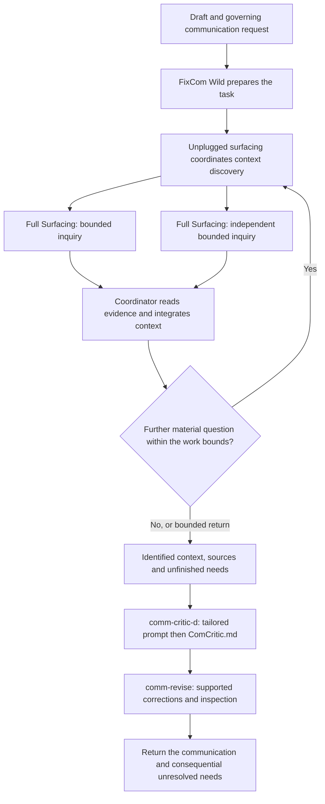

# Historical finding 1

10 findings from the latest 15 Traverse inquiries, in chronological order. Together, the two files cover 27–28 September 2026 and the general Workcraft, context-discovery and communication design.

These are edited historical compilations, not summaries or current operating instructions. Historical terminology, proposals, next actions and limitations retain their original date and meaning. Company-specific feedback, attributions and tool details have been omitted or generalised; reusable conclusions and generic examples remain. Each finding identifies its original source and any content edits. The originals are unchanged.

Navigation links between included findings stay within these two files. Other evidence links resolve to their source locations; links to relocated skill components use their current locations. Linked originals retain the complete historical record.

**Other volume:** [historical finding 2](historical%20finding%202.md)

## Contents

- [01. What fixcomm should ask ordinary Surfacing to recover](#finding-01-what-fixcomm-should-ask-ordinary-surfacing-to-recover) — 2026-09-27 11-40
- [02. Exposing vital missing context and possible recovery sources](#finding-02-exposing-vital-missing-context-and-possible-recovery-sources) — 2026-09-27 12-18
- [03. A pure, portable operating design for fixcomm](#finding-03-a-pure-portable-operating-design-for-fixcomm) — 2026-09-27 13-03
- [04. Integrating unplugged surfacing into FixCom Wild](#finding-04-integrating-unplugged-surfacing-into-fixcom-wild) — 2026-09-27 14-36
- [05. Craft as a framework for autonomous work](#finding-05-craft-as-a-framework-for-autonomous-work) — 2026-09-27 16-19
- [06. Unplugged surfacing already implements substantial Context Accumulation](#finding-06-unplugged-surfacing-already-implements-substantial-context-accumulation) — 2026-09-27 16-57
- [07. Orchestrator Inbound Communication](#finding-07-orchestrator-inbound-communication) — 2026-09-27 17-36
- [08. Orchestrator message and supporting context](#finding-08-orchestrator-message-and-supporting-context) — 2026-09-27 18-07
- [09. Numbered supporting context with optional depth](#finding-09-numbered-supporting-context-with-optional-depth) — 2026-09-27 19-00
- [10. What the orchestrator needs to understand from a worker’s communication](#finding-10-what-the-orchestrator-needs-to-understand-from-a-workers-communication) — 2026-09-27 19-56

---

## Finding 01: What fixcomm should ask ordinary Surfacing to recover

**Original:** [finding.md](../../research/inquiries/2026-09-27_11-40__fixcomm-ordinary-surfacing-invocation/finding.md)

**Inquiry:** 2026-09-27_11-40__fixcomm-ordinary-surfacing-invocation

**Compilation edits:** Replaced a personal action-owner name with the corresponding generic role.

### Changes from Prior

**Prior:** [Surfacing, dynamic critique and fold within one communication workflow](../../research/inquiries/2026-09-26_17-21__surfacing-critique-fold-communication-workflow/finding.md).

**Revision trigger:** The user selected the communication-specific Surfacing invocation for a full inquiry, while leaving unplugged surfacing for later.

**Preserved:** The actual communication task directs context recovery. Surfacing provides relevant material; comm-critic-d interprets that material during review preparation. Actual source contents remain available through the handoff.

**Clarified:** The proposed questions about recipient context and intended openness direct an evidence search. They do not require Surfacing to deliver settled judgments about either.

**Added:** A concrete caller-preparation rule, a concise invocation, and an explanation of how explicit or implicit source boundaries affect the call.

**Migration:** None. This finding does not modify the skills or protocol. The current critic produces ComCritic.md, and the folding protocol is now comm-revise; those existing contracts govern over older names in the prior finding.

**Authoring-action comparison:** The prior MUST and COULD actions are retained below. Its first two authoring requirements are now represented in comm-critic-d. The parent-workflow requirement remains broader than this inquiry: this finding specifies its Surfacing portion, while comm-revise already defines revision. No action is silently widened or made unconditional.

### Question

What should fixcomm ask ordinary Surfacing to recover, and how should it express that request concisely with an appropriate source scope?

The answer must include material relevant to required meaning absent from the draft. It must also preserve intended openness and the distinction between recovering context and judging the communication.

### Finding Summary

- **Use a stable recovery instruction with concrete inputs for each task.** fixcomm identifies the draft, governing request and known source areas before invoking ordinary Surfacing.
- **Recover evidence for communication review.** Include the request, relevant exchanges, supporting and contrary material, applicable instructions, recipient-context evidence and indications of intended openness.
- **The task guides relevance beyond the draft's existing topics.** An answer omitted from the draft must still influence what material is sought.
- **Specify where this invocation operates.** Use explicit source boundaries when known, or ordinary Surfacing's existing boundary-discovery step when they are implicit.
- **Pass actual source contents onward.** The saved Surfacing trace identifies sources and coverage; it does not contain those sources' substance.
- **The invocation is clear enough for later inclusion in fixcomm.** Exact retrieval depth and the parent's broader follow-up policy remain separate questions.
- Three full sequential iterations produced the answer. The tests establish conceptual fit with the current files, not measured retrieval accuracy.

### Finding

#### 1. The purpose comes from the communication task

fixcomm is the proposed skill that will gather context, run a communication critique and apply supported corrections. This inquiry concerns its first operation: obtaining the material that makes the review grounded.

The draft alone cannot determine that operation's purpose. A draft may omit a requested comparison, a necessary result or an important qualification. A search based only on its existing topics could repeat the omission.

fixcomm should therefore supply both the current draft and the request it serves. The current request may already be sufficient—for example, a user may provide a draft and a new editing brief. A separate historical brief is not a universal prerequisite.

When an important part of the task is unknown, fixcomm should preserve that uncertainty. If an identifiable source can recover it, recovering that basis can become part of the invocation. The caller should not fill an unknown recipient, purpose or requirement with a plausible guess.

#### 2. The five concerns are directions for recovering material

The proposed concerns are useful, with the following meanings:

| Concern | What Surfacing should seek |
|---|---|
| **What the recipient asked or needs to understand** | The governing request, relevant recipient questions and exchanges that show the communication's intended use. |
| **Facts and prior exchanges** | Material supporting, challenging or qualifying the claims and required answers, including relevant history and corrections. |
| **Preferences and constraints** | Applicable authoring instructions, corrections, exclusions and task-specific guidance, with their actual scope. |
| **The recipient's context** | Evidence of what was shared, said, requested or made accessible in the exchange. |
| **What should remain open** | Instructions or exchanges indicating provisional concepts, unresolved choices and other intended openness. |

These are relevance concerns, not five mandatory searches or five boxes that must contain an answer. A single exchange can inform several concerns.

Two refinements matter.

**Seek contrary and qualifying material as well as support.** An earlier correction may matter precisely because it contradicts the draft. Searching only for confirmation would weaken the review's basis.

**Seek evidence about recipient context and openness.** Access to a document does not establish comprehension. Silence about a decision does not establish that the author deliberately intended to leave it open.

The critic's preparation makes those judgments from the recovered material. Its current [Step 1](../../artifacts/skills/comm-critic-d/SKILL.md) already establishes required meaning, reasonable reader assumptions and intended openness. The workflow does not need an extra full interpretation discipline for every message.

#### 3. fixcomm prepares a concrete source scope

Surfacing calls the area it will inspect its **territory**. In practice, that means identifiable source material or locations and their boundaries.

A purpose such as “recover recipient context” explains what matters. It does not identify where to look.

Before calling Surfacing, fixcomm uses the available task context to consider:

- The supplied draft and governing instructions.
- The draft's origin and relevant exchange.
- Supplied source references.
- Other known task-relevant source locations or areas, including locations identified through applicable environment guidance.
- Actual source restrictions and access limitations.

A known relevant results document should not disappear from consideration merely because it was not attached to the request.

There are two ordinary ways to turn this basis into a call:

| Source situation | Invocation |
|---|---|
| **The source boundaries are known** | Name the concrete material or source areas and their limits. Use explicit-bounded territory. |
| **The source boundaries are implicit** | Supply the task, starting material, identifiable source routes and actual restrictions. Use ordinary boundary discovery to establish the working territory before traversal. |

An explicit user restriction, such as reviewing only supplied documents, governs the scope. The result should retain that limitation.

An inaccessible source is a different situation. It may remain relevant even though it cannot be read. Its unavailability should not be reported as evidence that no relevant context exists.

This is ordinary Surfacing's existing input and boundary-discovery behavior. It does not prescribe an all-tools search, a fixed history window, parallel workers or unplugged surfacing's broader coordination.

#### 4. Proposed invocation

The bracketed parts are supplied by fixcomm from the actual task. They are not a questionnaire the user must complete.

> Run full ordinary Surfacing in artifact mode for [current draft] and [the governing communication request], using the known author, recipient, purpose, medium and current instructions supplied with them. Keep unsupported task details unresolved.
> 
> Recover existing material needed to assess the communication against its task, even where the draft omits part of the requested answer. Seek: the request and relevant exchange; material supporting, challenging or qualifying its claims; applicable corrections, preferences and constraints; evidence of context available to the recipient; and instructions or exchanges indicating what should remain open. Preserve explicit instructions about intended openness; leave unsupported judgments about intent unresolved.
> 
> Use [identified source locations or areas] within [the task's actual scope and restrictions]. Consider the supplied material, its origin and other known task-relevant source areas. When their edges are implicit, use ordinary boundary discovery from those starting routes and state the resulting territory before traversal. Do not silently limit the search to draft topics or attachments, or expand to every accessible system.
> 
> Read and relevance-tag the actual material, retaining source connections, qualifications and uncertainty. Return the normal Surfacing workspace and trace, with actual coverage and unfinished or unavailable source needs. Do not invent missing substance, certify recipient understanding or revise the draft.

This call assumes the installed Surfacing entrypoint and required reference are loaded and executed in full. It supplies communication-specific inputs; it does not replace the discipline's internal instructions.

Equivalent wording is acceptable when it preserves the purpose, source scope, evidence boundaries and output meanings. The exact paragraph structure is not a new requirement.

#### 5. What reaches comm-critic-d

Ordinary Surfacing produces two things:

- **Active source material:** the contents read into the AI's working context, tagged for relevance.
- **A saved trace:** identifiers, source locations, relevance tags, actual coverage and remaining source needs.

The Surfacing specification explicitly separates these products. A source list cannot supply a qualification that exists only in the original passage.

fixcomm must keep the necessary contents usable for the next stage. If they have been lost or another executor needs them, the relevant sources must be recovered before substantive judgment.

This does not require another context file for every message. Active contents and accessible sources can provide the handoff. A short summary may help navigation, but it must not replace needed evidence.

The critic still follows its own mandatory reference-reading instructions. A guide appearing in Surfacing's trace does not waive that requirement. The same distinction applies later to [comm-revise](../../artifacts/protocols/comm-revise.md), which reads the basis and guides before applying corrections.

#### 6. What this invocation establishes—and what it leaves to the caller

A completed Surfacing invocation accounts for the declared territory at the resolution actually traversed. It does not establish that every relevant source in the wider environment was found.

If a meaningful source lead remains outside that territory, or a source cannot be read, Surfacing can return a specific remaining need. fixcomm decides whether that need warrants another retrieval call or prevents some part of the task from being completed.

An unresolved disagreement between sources can also be a valid retrieval result. Preserving the source statements and their qualifications gives the critic a better basis than selecting whichever statement is newest or easiest to explain.

Explicit openness instructions should remain available alongside settled facts. Preserving an open decision does not require making all surrounding facts uncertain.

The exact parent policy for responding to these returns is still a separate coordination question. This inquiry establishes what the call should provide and preserve.

### Inherited Commitments Re-test

The synthesis uses the [workflow finding](../../research/inquiries/2026-09-26_17-21__surfacing-critique-fold-communication-workflow/finding.md), ordinary Surfacing, [comm-critic-d](../../artifacts/skills/comm-critic-d/SKILL.md) and [comm-revise](../../artifacts/protocols/comm-revise.md). The meaning-and-fidelity and recipient-and-purpose guides supplied additional direct checks.

These are source-grounded conceptual re-tests and hypothetical countercases.

| Commitment and source | Re-test status | Evidence and outcome |
|---|---|---|
| Recovery purpose follows the communication task, including omitted answers. Workflow §2; meaning guide M1. | **RE-TESTED — commitment confirmed.** | [First critique](../../research/inquiries/2026-09-27_11-40__fixcomm-ordinary-surfacing-invocation/docarchive/critique_iter1.md), omission probe: a draft-only search cannot represent a requested answer with no draft keywords. |
| Surfacing provides evidence rather than truth or reader comprehension. Workflow §3; Surfacing §1.3. | **RE-TESTED — commitment confirmed.** | [First critique](../../research/inquiries/2026-09-27_11-40__fixcomm-ordinary-surfacing-invocation/docarchive/critique_iter1.md), reader-access and definitive-profile tests; [final critique](../../research/inquiries/2026-09-27_11-40__fixcomm-ordinary-surfacing-invocation/docarchive/critique.md), disputed-source test. |
| Critic preparation interprets required meaning, reader context and openness. Workflow §4; comm-critic-d Step 1. | **RE-TESTED — commitment confirmed.** | [Final critique](../../research/inquiries/2026-09-27_11-40__fixcomm-ordinary-surfacing-invocation/docarchive/critique.md) rejects making retrieval resolve the entire review basis; the current critic already owns that preparation. |
| The invocation needs a bounded territory appropriate to the task. Workflow §9; Surfacing §§3.2–3.3. | **RE-TESTED — commitment confirmed but frame revised.** | [Second critique](../../research/inquiries/2026-09-27_11-40__fixcomm-ordinary-surfacing-invocation/docarchive/critique_iter2.md) tests supplied, implicit and restricted scopes. “Bounded” alone is insufficient: caller preparation names real source areas or supplies routes to boundary discovery. |
| Relevant source contents must remain usable through handoff. Workflow §5; Surfacing §5; comm-revise Step 1. | **RE-TESTED — commitment confirmed.** | All three critiques test trace/summary substitution and context loss. Needed contents must be available or recovered. |
| Already loaded context may be reused when usable. Workflow §9. | **RE-TESTED — commitment confirmed but frame revised.** | [Second](../../research/inquiries/2026-09-27_11-40__fixcomm-ordinary-surfacing-invocation/docarchive/critique_iter2.md) and [final critique](../../research/inquiries/2026-09-27_11-40__fixcomm-ordinary-surfacing-invocation/docarchive/critique.md) test actual availability and task applicability. A same-session label is insufficient; consumer guide reads remain independently mandatory. |
| Intended openness is specific to the task and survives review. comm-critic-d preparation; meaning guide M4; comm-revise Step 3. | **RE-TESTED — commitment confirmed.** | [Final critique](../../research/inquiries/2026-09-27_11-40__fixcomm-ordinary-surfacing-invocation/docarchive/critique.md), settled-fact/open-choice probe, preserves both. The invocation explicitly recovers openness instructions without inventing intent. |
| General, author-specific and task-specific guidance retain scope. Workflow §10; comm-critic-d reference rules. | **RE-TESTED — commitment confirmed.** | [Second](../../research/inquiries/2026-09-27_11-40__fixcomm-ordinary-surfacing-invocation/docarchive/critique_iter2.md) and [final critique](../../research/inquiries/2026-09-27_11-40__fixcomm-ordinary-surfacing-invocation/docarchive/critique.md) preserve source roles and consumer reads. Recency or retrieval alone cannot grant authority. |
| Targeted missing-source needs return to the caller. Workflow §9; Surfacing §§3.7/5.7; comm-revise Invocation. | **RE-TESTED — commitment confirmed.** | [Final critique](../../research/inquiries/2026-09-27_11-40__fixcomm-ordinary-surfacing-invocation/docarchive/critique.md), outside-territory and unavailable-source probes. Reporting the need neither drops it nor performs unrestricted renewal. |
| The critic stops at proposals; revision retains the original task basis. Current critic/protocol boundaries. | **RE-TESTED — commitment confirmed.** | [First critique](../../research/inquiries/2026-09-27_11-40__fixcomm-ordinary-surfacing-invocation/docarchive/critique_iter1.md) and [final critique](../../research/inquiries/2026-09-27_11-40__fixcomm-ordinary-surfacing-invocation/docarchive/critique.md) reject retrieval-as-review and summary-only handoff. This invocation preserves their existing roles. |
| Parent authoring and an optional real workflow inspection remain conditional. Workflow Next Actions. | **RE-TESTED — commitment confirmed.** | This inquiry supplies a callable design example; the current user requested investigation, not package implementation or a live communication run. [_branch.md](../../research/inquiries/2026-09-27_11-40__fixcomm-ordinary-surfacing-invocation/_branch.md) preserves that scope. |

### Next Actions

These retain the prior workflow's conditional authoring directions. The first two are already represented in the current critic package; they are not requests to rebuild it.

#### MUST — when authoring the corresponding components

- **What:** Define reference-led preparation and require the generated prompt to preserve applicable requirements, their qualifications and intended openness.
  - **Who:** The CommCriticD author.
  - **Gate:** When authoring the outgoing critic and its references.
  - **Why:** Context discovery must lead to justified, faithful review instructions.
  - **Current status:** Represented in comm-critic-d's mandatory reading and prompt-preparation steps.

- **What:** Define execution as reviewing an identifiable draft against a usable task and guidance basis, then producing critic.md findings, proposals and material review limits.
  - **Who:** The CommCriticD author.
  - **Gate:** When defining the generated prompt's execution instructions.
  - **Why:** Preserve the critic's diagnostic endpoint inside the larger workflow.
  - **Current status:** Represented in the current package. The historical action's filename is retained here for comparison; the actual required filename is **ComCritic.md**.

- **What:** Define the parent skill’s communication-specific Surfacing invocation and separate fold, including usable content handoffs and whole-text checking.
  - **Who:** The main communication skill/protocol author.
  - **Gate:** When the user chooses to build the encompassing communication skill.
  - **Why:** Make the parent responsible for source acquisition and a coherent revised result without merging them into the critic.
  - **Current status:** This finding specifies the invocation; comm-revise supplies the correction protocol. The parent SKILL.md remains to be authored.

#### COULD

- **What:** Inspect one complete parent-workflow run from surfaced sources through critique to the returned text.
  - **Who:** The framework author and the assisting AI.
  - **Gate:** When the components are usable and an actual outgoing communication is selected for a run.
  - **Why:** Observe where context assumptions, proposal selection or integration succeed or fail.
  - **Depends-on:** All three authoring requirements above. GATED on a usable composition; conceptual artifacts alone do not supply a running workflow.

#### DEFERRED

- **What:** Choose numerical search-depth, history or cost defaults.
  - **Gate:** Actual communication runs reveal repeated missed sources or excessive acquisition cost.
  - **Why if revived:** Calibrate the operating limits against observed needs.
- **What:** Specify the parent's complete response to missing facts, unresolved decisions or an invalidated critique.
  - **Gate:** A focused inquiry or fixcomm authoring task includes that coordination policy.
  - **Why if revived:** Make returns to earlier operations explicit without expanding this source-recovery call.

### Reasoning

The three iterations compared alternative purposes, source boundaries, handoffs and levels of instruction. The following groups repeated candidates by their underlying claim.

| Direction | Outcome and reason |
|---|---|
| Stable recovery instruction with concrete task/source inputs | **Retained.** Combines reuse with a purpose and territory that actually identify this task. |
| Equivalent ordinary call without a fixed template | **Retained.** Fixed boilerplate is optional; equivalent input and evidence duties still matter. |
| Incomplete starting background with a recoverable route | **Retained.** Discovery can recover missing basis without inventing it. |
| Current editing request without a historical original brief | **Retained.** The current request can govern; relevant earlier corrections remain worth recovering. |
| Caller considers known relevant source areas beyond attachments | **Retained after refinement.** Removes an implicit attachment-only cutoff while preserving task relevance. |
| Explicit territory or ordinary boundary discovery | **Retained.** Uses the existing operation's two entry situations. |
| Supporting, contrary and qualifying material | **Retained.** Contradiction can be the evidence that makes a defect visible. |
| Evidence of recipient context and openness | **Retained.** Makes later judgments supportable without pretending to know private mental states. |
| Mandatory five populated answers or five fresh searches | **Rejected.** Sources overlap, some concerns have no separate material, and quotas can manufacture activity or content. |
| Draft alone supplies the governing task and reader needs | **Rejected.** It cannot recover requirements the draft omitted. |
| Definitive reader profile or fully resolved source conflicts before return | **Rejected.** Retrieval would be required to perform unsupported interpretation and could erase meaningful uncertainty. |
| All accessible systems and all history on every call | **Rejected as a default.** Access does not establish task relevance or a finite working scope. |
| Every task field and the full original brief required before retrieval | **Rejected.** It can make retrieval depend on the information it is supposed to recover. |
| Universal recent-history cutoff | **Rejected.** Older instructions and evidence may remain relevant. Task-specific time bounds are still possible. |
| Newest source automatically wins | **Rejected.** A timestamp does not establish authority, scope or applicability. |
| Summary or trace replaces needed source contents | **Rejected.** Missing qualifications cannot be reconstructed from identifiers or a polished narrative. |
| Actual content reuse with recovery after loss | **Retained.** Preserves evidence without demanding redundant acquisition. Mandatory consumer guide reads remain intact. |
| A separate context file or interpretation stage for every message | **Not required.** Existing active context, source access and critic preparation can serve those roles. |
| Relevant outside-territory need returned to the caller | **Retained.** Preserves the discovery without uncontrolled expansion inside the call. |
| Finished Surfacing certifies complete communication context | **Rejected.** Its completion concerns actual bounded traversal; unknown or inaccessible sources can still matter. |
| Full dependency execution without copying its internal procedure | **Retained.** Keeps the caller concise while preserving the operation's actual requirements. |
| Explicitly restricted or partially available territory | **Retained as a valid case.** Its limited scope must remain visible to the consumer. |

The combined survivor is the prepared ordinary call shown above. Its smaller presentation variants preserve the same meanings. The rejected combinations bundle unsupported certainty, uncontrolled scope or missing evidence; combining those shortcuts does not remove their defects.

#### Execution record

Articulate-Simple ran once. **Three full sequential iterations** then ran Surfacing, Sensemaking, Decomposition, Innovation, Critique and RouteLister. Each stage saved and read back its output before the next stage.

All seven Innovation mechanisms ran each time. The critique accumulator records **37 individual candidate evaluations, 12 combined-design evaluations and 30 hypothetical probes**. Its final pass met all four convergence conditions, including two stable comparisons.

The structural checker was unavailable. Manual specification checks and each handoff are recorded in [_state.md](../../research/inquiries/2026-09-27_11-40__fixcomm-ordinary-surfacing-invocation/_state.md). The current route map is [routelister.md](../../research/inquiries/2026-09-27_11-40__fixcomm-ordinary-surfacing-invocation/routelister.md).

The evidence consists of local source contracts and conceptual tests. No company systems were searched, no actual outgoing draft was revised, and no skill was installed. The earlier workflow finding's own one-pass limitation remains part of that historical record; this inquiry does not retroactively change it.

### Open Questions

#### Monitoring

When a runnable fixcomm workflow is used on a nominated communication, inspect missed sources, unsupported recipient assumptions, lost qualifications and the effort spent on retrieval. A clear invocation cannot establish these results by itself.

#### Research Frontiers

The amount of history and search depth that improves communication reliably remains unmeasured. The larger parent's response to consequential gaps is also a distinct design subject.

#### Refinement Triggers

- If known relevant sources are repeatedly omitted, revisit the caller's source-area preparation.
- If the call repeatedly expands beyond its task, revisit territory binding and boundary discovery.
- If a handoff loses necessary content, change recovery or transfer before adding more source labels.
- If the critic treats access as comprehension or silence as openness, revisit the evidence-to-judgment preparation.
- If ordinary Surfacing's actual input/output contract changes, reassess this invocation against the new contract.

### Source Input

<details>
<summary>Raw user input</summary>

```text
### What exactly does fixcomm ask Surfacing to recover?

The purpose should come from **the communication’s task**, including meaning that the draft may have omitted.

It should seek the material needed to establish:

- What the recipient asked or needs to understand.
- Which facts and prior exchanges support the communication.
- Which corrections, preferences and constraints apply.
- What context the recipient already has.
- What should remain deliberately open.

This direction is already established. What remains is expressing it as a concise invocation of ordinary Surfacing, with a source territory appropriate to the particular tas


lets run full traverse on this 
```

</details>

---

## Finding 02: Exposing vital missing context and possible recovery sources

**Original:** [finding.md](../../research/inquiries/2026-09-27_12-18__vital-context-gaps-and-recovery-leads/finding.md)

**Inquiry:** 2026-09-27_12-18__vital-context-gaps-and-recovery-leads

**Compilation edits:** Replaced a personal action-owner name with the corresponding generic role.

### Changes from Prior

**Prior:** [What fixcomm should ask ordinary Surfacing to recover](#finding-01-what-fixcomm-should-ask-ordinary-surfacing-to-recover).

**Revision trigger:** The user identified a specific failure: the AI reports an unknown in an outgoing message even though evidence points to a coworker or system that could help supply the answer.

**Preserved:** Recovery follows the communication's task; actual source contents remain usable; Surfacing returns unfinished source needs; the surrounding workflow decides how to continue.

**Added:** An explicit duty to expose a consequential missing answer together with its supported recovery opportunity, before presenting the affected communication as complete.

**Clarified:** A possible source need not be a confirmed answer holder. A source lead can be useful without guaranteeing access, currentness or an answer.

**Migration:** None. This finding changes the design understanding. It does not edit or install any skill.

**Action comparison:** The prior's three conditional authoring requirements and optional workflow inspection remain below. Its deferred parent-response inquiry is partly answered here.

- **MUST/COULD drift:** Prior text: “Define the parent skill’s communication-specific Surfacing invocation and separate fold, including usable content handoffs and whole-text checking.” New additional requirement: “Make consequential missing context and supported recovery leads explicit in fixcomm's handling of unresolved needs.” Rationale: the user specifically requested this previously open parent responsibility. The prior requirement is retained; the added requirement makes the missing-source behavior concrete. Its gate remains future authoring.
- The related unplugged-surfacing finding's discovery-preservation requirement and optional reusable packaging remain conditional. No numerical limits, outreach permissions or new implementation prerequisites are introduced.

### Question

When essential information is missing, but available evidence suggests that another person or system could supply it, what should the AI expose?

Why does this matter for communication, which part of the workflow should handle it, and what should stop while the user decides whether to obtain that information?

### Finding Summary

- **The capability makes sense.** Knowing where an answer may be found is useful context even when the answer itself is unavailable.
- **The AI must distinguish its own incomplete context from the team's knowledge.** An unread or inaccessible source does not establish that nobody knows.
- **Expose a supported recovery opportunity with the missing answer.** Explain the evidence for the suggested person or source and what remains uncertain.
- **Connect the gap to the current task.** Show which required answer or claim it affects, rather than interrupting for every unknown.
- **Share the responsibility across the workflow.** Surfacing retains the evidence; a caller or coordinator interprets the connection; fixcomm handles the communication consequence and user choice.
- **Hold unsupported dependent conclusions while useful work continues.** The user can obtain information, wait, change scope or choose a faithful limited result.
- **This works with ordinary Surfacing.** It does not need to wait for unplugged surfacing.
- Three full sequential iterations support this design. Actual detection quality remains unmeasured.

### Finding

#### 1. The missing information has a second layer

We are designing fixcomm, the proposed workflow that gathers context, runs comm-critic-d to produce communication criticisms, and uses comm-revise to apply supported corrections.

The problem appears when the AI lacks an answer needed for a message. It may make that limitation sound like the final state of the work: “we do not know the result.”

But two different things may be true:

1. The AI has not obtained the result.
2. A message, record or other evidence points to a person or location that could help recover it.

The second fact should survive the workflow. Without it, the operator loses a useful choice before the outgoing message is finalised.

This goes beyond careful wording. Replacing “we don't know” with “I haven't confirmed” can make a sentence more accurate while still hiding a useful source the operator did not know existed.

#### 2. Why this matters

**It can prevent an avoidable incomplete answer.** The user can obtain existing information before telling a recipient that an important question remains unanswered.

**It preserves the actual state of knowledge.** A source may be unread, inaccessible, outside the current search, disputed, or not yet created. Those situations call for different next steps.

**It gives the user an informed choice.** The user can weigh the value of obtaining the answer against time, access or the purpose of the current message.

**It makes the AI's work easier to assess.** The operator can see what was established, what was not obtained, and why a suggested source is relevant.

These are conceptual advantages. This inquiry did not measure how often the proposed behavior finds a useful source or prevents a communication failure.

#### 3. A recovery lead needs evidence, but not certainty

A **recovery lead** is evidence that identifies a useful place or person to investigate an unanswered question.

Its strength depends on what the evidence actually says:

| Available evidence | What the AI can reasonably say |
|---|---|
| Someone says they saved the relevant results in a named workbook | Their message identifies that workbook as a source to inspect. The AI still needs its contents. |
| Someone says they coordinated the relevant trial | They may help locate or explain its results. Possession of the answer remains unconfirmed. |
| A project record links to a repository or internal page | That location is a concrete recovery route. Its accessibility and sufficiency still need checking. |
| A person's role sounds relevant, with no evidence connecting them to the particular work | The role alone does not establish that they know the answer. |

The AI should keep the source statement and its own inference distinguishable. “A coworker coordinated this trial, so they may help locate the results” is different from “That coworker has the results.”

Time and scope matter. Evidence about a previous trial can be a useful lead without establishing the outcome of the current trial.

A person can also be an intermediary: someone who knows where the relevant record or responsible colleague can be found. The design should not discard that route merely because the person does not personally hold the answer.

#### 4. Determine importance from the actual communication task

A gap is consequential when the missing information materially affects what the present communication must convey.

The AI should identify:

- The required answer, conclusion, commitment or explanation affected.
- Why the missing information could change it.
- Whether the current task deliberately leaves that matter open.

This judgment starts from the request and intended use, including required meaning absent from the draft.

For a results summary, missing results can prevent the main answer. For a message asking where the results are stored, their absence may be entirely appropriate.

If the task itself is unclear, the AI should qualify its judgment. It can recover or ask for the specific distinction that affects dependent work. It should not invent a recipient requirement and then declare the task blocked by it.

A vital gap still matters when no supported recovery lead exists. In that case, say what is missing without inventing a person who supposedly knows.

#### 5. Where the responsibility belongs

This is a general context capability with a communication-specific use. It does not belong exclusively to one skill.

| Component | Responsibility |
|---|---|
| **Ordinary Surfacing**, the existing context-recovery discipline | Retain relevant source material, explicit references to further sources and actual unfinished or unavailable source needs. |
| **The caller or unplugged-surfacing coordinator** | Interpret supported relationships, connect evidence across sources and decide what further bounded investigation is warranted. |
| **fixcomm**, the proposed communication workflow | Connect the gap to the communication's task, expose the consequential choice to the operator and manage faithful continuation. |
| **[comm-critic-d](../../artifacts/skills/comm-critic-d/SKILL.md)**, the diagnostic skill | Identify supported communication risks and propose remedies in ComCritic.md. A missing required answer may be discovered here too. |
| **[comm-revise](../../artifacts/protocols/comm-revise.md)**, the correction protocol | Apply supported changes, return unmet requirements and identify a partial result when essential meaning remains unresolved. |

The current Surfacing specification already distinguishes recovered contents from a saved source trace and returns unfinished territory. Its role stops short of deciding how a communication should proceed.

The [unplugged-surfacing design](../../research/inquiries/2026-09-27_10-06__unplugged-surfacing-general-structure/finding.md) adds coordinated investigation and integration. It can preserve and develop recovery leads across several sources. It remains an optional larger mechanism for this capability.

The complete behavior still needs explicit caller instructions. A generic list of unread sources is not enough if the operator cannot tell which answer is affected or why a particular source is worth pursuing.

These are logical responsibilities. One AI can perform several of them; they do not require separate agents, files or modules.

#### 6. What should happen before the user is interrupted

When relevant information can be read within the task's existing authority and source scope, the AI should pursue that recovery without unnecessarily asking the user to do it.

A consequential choice becomes visible when the need remains unresolved and further progress depends on something such as another person's response, unavailable access, additional scope, or the user's choice about delay.

Preserve the actual status. “I have not read it,” “access was denied,” and “it lies outside the allowed sources” are different statements.

Contacting a person is a separate action from identifying that person as a possible source. The discovery of a lead does not itself authorise outreach.

#### 7. What the operator should see

The explanation should contain enough meaning to support a decision:

1. **What is missing and why it matters to this task.**
2. **Where it may be obtained, and the evidence for that route.**
3. **Why it has not been obtained and what remains uncertain.**
4. **What useful choices remain, including the effect on the output.**

These are explanation purposes, not a mandatory four-field template. A short paragraph may be sufficient.

##### A fully situated hypothetical

Suppose you ask the AI to draft a message to your manager summarising a model trial and recommending the next step.

While recovering context, the AI reads a coworker's message saying they saved the trial results in a private workbook. The AI cannot access that workbook. It has enough material to describe the trial method, but lacks the result needed for the recommendation.

A useful operator-facing notice would be:

> I can describe the trial, but I cannot yet support the recommendation because I have not obtained its results. Your coworker's message identifies the private workbook as the results location; I could not access it. The workbook may supply the missing basis.
>
> You can obtain the workbook or ask the coworker for the result, then we can assess whether it supports a recommendation. If you need a message now, we can prepare a limited update stating which result remains unconfirmed, without implying nobody has it. The requested results-based recommendation would remain unfinished.

In an actual run, the notice would link to the recovered message or record. This example is hypothetical; no coworker's knowledge or workbook was investigated here.

The explanation gives the operator a choice without making the outgoing recipient read the AI's private editing discussion.

#### 8. What “stop” should mean

Hold the unsupported part of the outcome before it is presented as complete.

Continue work that remains supported independently of the gap. In the hypothetical above, describing the method may be possible while the recommendation is held.

If the whole requested outcome depends on the missing answer, the workflow should say that plainly. A polished document with its essential answer missing remains partial.

The user can choose a narrower task, such as an interim update. That new communication may be complete on its own terms. Choosing it does not establish the missing facts or make the original recommendation finished.

If the recipient needs a limitation to understand the message, that limitation belongs in the actual message. A private note to the operator cannot repair misleading recipient-facing text.

#### 9. Preserve the need through later operations

A consequential gap can be discovered during context recovery, critique or revision. fixcomm should handle it wherever it appears.

When new information arrives, inspect what it actually answers. A reply confirming involvement, a stale document or a report about another version may leave the original question unresolved.

Reassess the affected claims and review basis. Sometimes this permits a local revision; sometimes the communication's main conclusion needs renewed critique. Receiving a reply is not, by itself, evidence that the gap is resolved.

Preserve an explicit user choice while its task and circumstances remain unchanged. A material factual change or changed request can warrant revisiting it.

#### 10. Keep the design small

The requirement is a supported connection between missing meaning, a possible source and the user's options.

It does not require an organisation-wide expertise index, a new critic, a permanent gap database, fixed confidence percentages, or a prescribed card for every unknown.

It also does not guarantee discovery of all missing context. It improves how the workflow handles consequential gaps and leads it actually identifies.

### Inherited Commitments Re-test

The five priors named in the inquiry framing are the ordinary-invocation finding, unplugged-surfacing structure, Surfacing specification, comm-critic-d and comm-revise. The [meaning-and-fidelity guide](../../artifacts/skills/comm-critic-d/references/meaning-and-fidelity.md) provides additional direct checks.

All tests below are source comparisons and hypothetical countercases.

| Inherited commitment and source | Re-test status | Evidence and consequence |
|---|---|---|
| The communication task directs recovery, including omissions. Ordinary invocation §§1–2. | **RE-TESTED — commitment confirmed.** | [Final critique](../../research/inquiries/2026-09-27_12-18__vital-context-gaps-and-recovery-leads/docarchive/critique.md), unclear-brief and result-request tests: draft topics cannot supply missing requirements. |
| Bounded recovery can return meaningful outside or inaccessible source needs. Ordinary invocation §6; Surfacing §5.7. | **RE-TESTED — commitment confirmed but frame revised.** | [First critique](../../research/inquiries/2026-09-27_12-18__vital-context-gaps-and-recovery-leads/docarchive/critique_iter1.md), inaccessible-workbook test: the caller must connect the frontier to required meaning and a user choice. |
| Surfacing supplies relevant evidence, not truth or cross-source interpretation. Surfacing §1.3. | **RE-TESTED — commitment confirmed.** | [Final critique](../../research/inquiries/2026-09-27_12-18__vital-context-gaps-and-recovery-leads/docarchive/critique.md), conflicting reports and role-holder tests preserve relevance without certifying an answer. |
| Re-invocation belongs to the caller. Surfacing §3.7. | **RE-TESTED — commitment confirmed.** | [Second critique](../../research/inquiries/2026-09-27_12-18__vital-context-gaps-and-recovery-leads/docarchive/critique_iter2.md), authorised retrieval versus outreach cases preserve the boundary. |
| Actual source contents must remain usable; a trace does not contain them. Surfacing §5.3; ordinary invocation §5. | **RE-TESTED — commitment confirmed.** | [Final critique](../../research/inquiries/2026-09-27_12-18__vital-context-gaps-and-recovery-leads/docarchive/critique.md), lost supporting passage and trace-only handoff tests. |
| A coordinator integrates context, coverage and unfinished work. Unplugged structure §§3–6. | **RE-TESTED — commitment confirmed but frame revised.** | [First Sensemaking](../../research/inquiries/2026-09-27_12-18__vital-context-gaps-and-recovery-leads/docarchive/sensemaking_iter1.md), component-placement countertest: ordinary Surfacing plus a caller can handle a direct lead; unplugged is not a prerequisite. |
| Critic preparation judges required meaning and intended openness. comm-critic-d Step1. | **RE-TESTED — commitment confirmed.** | [First critique](../../research/inquiries/2026-09-27_12-18__vital-context-gaps-and-recovery-leads/docarchive/critique_iter1.md), omitted result and open-choice cases. |
| The critic ends at findings and proposals. comm-critic-d boundary. | **RE-TESTED — commitment confirmed.** | [Final critique](../../research/inquiries/2026-09-27_12-18__vital-context-gaps-and-recovery-leads/docarchive/critique.md), literal boundary check; source acquisition and user choice remain outside its diagnostic endpoint. |
| Revision can continue independent corrections and return partial work. comm-revise Steps1/5. | **RE-TESTED — commitment confirmed.** | [Second critique](../../research/inquiries/2026-09-27_12-18__vital-context-gaps-and-recovery-leads/docarchive/critique_iter2.md), limited update versus unchanged recommendation brief. |
| Changed facts/task can invalidate review assumptions. comm-revise Step1. | **RE-TESTED — commitment confirmed.** | [Second](../../research/inquiries/2026-09-27_12-18__vital-context-gaps-and-recovery-leads/docarchive/critique_iter2.md) and [final critique](../../research/inquiries/2026-09-27_12-18__vital-context-gaps-and-recovery-leads/docarchive/critique.md), conflicting new document and changed-premise tests. |
| Openness and applicable corrections retain scope. Meaning guide M4/M6; critic/revision instructions. | **RE-TESTED — commitment confirmed.** | [Final critique](../../research/inquiries/2026-09-27_12-18__vital-context-gaps-and-recovery-leads/docarchive/critique.md), exploration and unchanged/current-choice tests. |
| Fresh guide reads are mandatory when actually running the critic or revision. Current entrypoints. | **INHERITED-WITHOUT-RE-TEST.** | Reading policy is preserved unchanged; this inquiry inspected these components rather than executing them. |
| Authoring and optional real-run inspection remain conditional. Both prior findings' Next Actions. | **RE-TESTED — commitment confirmed.** | [Final critique](../../research/inquiries/2026-09-27_12-18__vital-context-gaps-and-recovery-leads/docarchive/critique.md), no-extra-subsystem and observation-direction tests retain design scope without authoring or live-run claims. |

### Next Actions

#### MUST — when the corresponding authoring task is requested

- **What:** Define reference-led preparation and require the generated prompt to preserve applicable requirements, their qualifications and intended openness.
  - **Who:** The CommCriticD author.
  - **Gate:** When authoring the outgoing critic and its references.
  - **Why:** Ground review instructions in applicable guidance.
  - **Status:** Already represented in the current comm-critic-d package; no rebuild requested.

- **What:** Define execution as reviewing an identifiable draft against a usable task and guidance basis, then producing critic.md findings, proposals and material review limits.
  - **Who:** The CommCriticD author.
  - **Gate:** When defining the generated prompt's execution instructions.
  - **Why:** Preserve the diagnostic endpoint.
  - **Status:** Already represented. The historical action wording is retained for comparison; the actual filename is **ComCritic.md**.

- **What:** Define the parent skill’s communication-specific Surfacing invocation and separate fold, including usable content handoffs and whole-text checking.
  - **Who:** The main communication skill/protocol author.
  - **Gate:** When the user chooses to build the encompassing communication skill.
  - **Why:** Make acquisition, diagnosis and supported revision work together.
  - **Status:** The prior invocation finding and current comm-revise supply the component designs.

- **What:** Make consequential missing context and supported recovery leads explicit in fixcomm's handling of unresolved needs.
  - **Who:** The fixcomm author.
  - **Gate:** When authoring or integrating fixcomm's source-recovery and continuation instructions.
  - **Why:** Preserve the recovery opportunity and let the operator choose before relying on unsupported completion.

- **What:** Preserve the discovery obligations in whichever skill or caller implements this mechanism.
  - **Who:** The future context-discovery skill author.
  - **Gate:** A request to author or integrate the mechanism.
  - **Why:** Retain faithful leads, origin recovery, independent relevant inquiries, supported integration and visible unfinished work.

#### COULD

- **What:** Inspect one complete parent-workflow run from surfaced sources through critique to the returned text.
  - **Who:** The framework author and the assisting AI.
  - **Gate:** When the components are usable and an actual outgoing communication is selected for a run.
  - **Why:** Observe missed leads, useful notices and truthful continuation in practice.
  - **Depends-on:** The critic preparation/execution and parent composition requirements above, including explicit handling of unresolved needs. GATED on a usable composition.

- **What:** Implement the mechanism as a reusable context-discovery component used by fixcomm.
  - **Who:** The future skill author.
  - **Gate:** The user requests implementation and chooses its packaging.
  - **Why:** Apply the same discovery duties to other tasks.
  - **Depends-on:** MUST “Preserve the discovery obligations.” GATED until those duties are retained.

#### DEFERRED

- **What:** Set numerical search-depth, history, confidence or notification limits.
  - **Gate:** Actual use reveals repeated missed leads, unnecessary interruptions or excessive search effort.
  - **Why if revived:** Adjust limits using observed consequences.
- **What:** Define persistent source-holder records or cross-task notification memory.
  - **Gate:** Repeated tasks demonstrate a recovery or repetition problem that task-local context cannot handle.
  - **Why if revived:** Address a demonstrated coordination need without assuming an index is required now.

### Reasoning

The following groups repeated alternatives by their underlying claim. It covers the surviving and rejected directions across the three iterations.

| Direction | Outcome and reason |
|---|---|
| Consequential gap plus supported recovery route | Retained: supplies a useful operator choice as well as an honest limit. |
| Source statement, qualified inference and intended question kept connected | Retained: allows useful possible sources and intermediaries without inventing possession. |
| Evidence required to identify a source, but confirmed possession not required | Retained: a route can be useful before its destination is verified. |
| Task-relative vitalness and qualified judgment when the brief is unclear | Retained: avoids inventing recipient requirements or treating all missing detail as essential. |
| Faithful limited output under a current or revised brief | Retained: useful communication can be complete while an underlying inquiry remains open. |
| Independent supported work continues | Retained: a missing conclusion need not block valid method or background work. |
| Routine authorised recovery before user intervention | Retained: avoids asking the user to perform an already feasible read. |
| Explicit caller responsibility using existing component returns | Retained: keeps the behavior clear without requiring a new subsystem or future unplugged implementation. |
| Actual source contents and unanswered question survive handoff | Retained: later operations can assess the warrant and compare new content with the real gap. |
| Late needs and changed evidence return to the parent | Retained: discovery can happen after initial retrieval, and new material may invalidate the review basis. |
| Current user choices remain applicable within their scope | Retained: another pass alone does not require the same decision again. Material changes warrant reassessment. |
| Open exploration can preserve disagreements | Retained: communicating uncertainty does not require resolving the underlying decision. |
| Native communication and other-domain analogies | Retained only as explanatory aids. They do not validate retrieval accuracy. |
| Observation-driven changes to source guidance and interruption behavior | Preserved for later use. Concrete misses or excess cost provide the trigger. |
| Notice every unknown or require a fixed card for each | Rejected as universal rules: these obscure consequential choices and encourage unnecessary structure. Optional grouping or fields remain available. |
| Require verified possession before mentioning any source | Rejected: excludes grounded intermediaries and other useful inquiry routes. |
| Automatically ask an owner or manager | Rejected: hierarchy does not prove knowledge, and finding a lead does not authorise contact. |
| Silent recovery or silent qualification in every case | Rejected: inaccessible or outreach-dependent sources can leave the user unaware of a valuable option. |
| Wait for all relevant context or a complete task profile before work | Rejected: blocks independent progress and may require the very information retrieval must recover. |
| Expose source opportunities only when the user asks | Rejected: the user may lack the knowledge needed to ask. |
| Existing frontier alone already implements the feature | Rejected: source identifiers need a task-consequence and choice connection. The existing outputs remain useful foundations. |
| Trace, filename or confident summary substitutes for needed content | Rejected: source qualifications cannot be inferred from a locator. |
| Mandatory state machine, expertise index or extra critic | Rejected as requirements: the necessary duty can be expressed in existing handoffs and parent instructions. |

The combined design joins the retained directions: supported source discovery, explicit task consequence, informed choice and faithful continuation. Combining the rejected shortcuts does not repair their failures.

#### Execution record

Articulate-Simple ran once. **Three full sequential iterations** then ran Surfacing, Sensemaking, Decomposition, Innovation, Critique and RouteLister.

Every discipline's entrypoint and required reference were loaded for its invocation. All seven Innovation mechanisms ran each time. The critiques recorded **46 individual candidate evaluations, 12 combined-design evaluations and 33 hypothetical probes**.

Each stage saved its output, read it back, attempted the structural checker and committed its handoff. The checker was absent, so checks were performed manually. Final compilation added the missing explicit User Input heading to the first Surfacing trace; its purpose and source territory were already present.

The final critique met all four convergence conditions, including two stable comparisons. The [execution state](../../research/inquiries/2026-09-27_12-18__vital-context-gaps-and-recovery-leads/_state.md) preserves the handoffs, and the [route map](../../research/inquiries/2026-09-27_12-18__vital-context-gaps-and-recovery-leads/routelister.md) preserves onward directions.

No live company retrieval, coworker contact, message revision, skill installation or skill modification took place.

### Open Questions

#### Monitoring

When the workflow is used on an actual communication, observe whether it identifies useful source leads, accurately explains their importance and avoids repetitive or unnecessary interruptions.

#### Research Frontiers

The optimal search effort and the actual rate of missed or falsely attributed sources remain unknown. This conceptual inquiry cannot establish them.

#### Refinement Triggers

- A suggested person repeatedly turns out to be connected only by role: strengthen the evidence-to-source explanation.
- A critical source is found but omitted from the user-facing choice: inspect the caller's handling of returned needs.
- Minor unknowns repeatedly stop useful work: revisit task-dependence judgment.
- New information is treated as resolution despite answering a different question: strengthen comparison with the original missing meaning.
- A current source contract changes its responsibility or output: re-test the component allocation.
- Repeated unchanged warnings interrupt the same task: refine how the caller retains the user's scoped choice.

### Source Input

<details>
<summary>Raw user input for this finding</summary>

```text
Also one thing to run traversal is surfacing. Sometimes it should. What it should do is maybe this is surfacing, maybe it's unblocked surfacing. I'm not sure, okay? Which one will have this feature. At some point, a vital information is missing, and this information, like this missing information, is vital for the task. It can be writing something, yes, writing a message. So it should point out. It should stop. I don't know which one it will be again: unblocked will handle this, or just individual surfacing. It should at some point stop and tell that this information is understood, that is in kind of that person. That person knows this information. It is vital if we want to create this. And so you should ask that person. Or maybe actually maybe this is not a good idea. Instead of, like, trying to ask to that person, it should still expose this missing context that we can get from, like another tool maybe that we don't have access, you know, surfacing doesn't have it, or some other thing, other person. Surfacing should expose it and explicitly show that. Because this happened to me many times. I was trying to craft a message and then, like communicating with the coworkers, for example, or my manager, and then AI tell me, okay, we don't know these things. We don't have this information. So we just kind of write these things to the manager, yeah? But actually this information was available with my coworker. I just didn't know. Like I didn't had the chance to ask it. I didn't know she or he has this information. And in that situation it's really bad for me, yeah? Because I'm telling my manager, yeah, I don't know it. And he will like, yeah, why don't you just ask then? He will ask this. So I think this is just an extremely, extremely important feature as well. If there is an explicit evidence of a context might be existing, a vital context might be existing in some other entity, it can be a tool, it can be a person, it can be an app, it can be maybe some internal system, you know, just a GitHub repo, and it should explicitly state it, so that we know. Like we know, and then we get to choose, okay. We get to choose, okay, I should ask this, wait for answer and update my message communication, or I shouldn't. Yeah? Explicitly. It should be kind of, hmm, like we couldn't get it, something happened, I don't know. And it is extremely, extremely important. Like I said, I don't know where this belongs exactly. It belongs to communication, definitely. And let's dive deep on it and let's run full traversal and try to understand this, like why it makes sense, why it's important. Yeah, it's really important.
```

</details>

---

## Finding 03: A pure, portable operating design for fixcomm

**Original:** [finding.md](../../research/inquiries/2026-09-27_13-03__fixcomm-standalone-skill-design/finding.md)

**Inquiry:** 2026-09-27_13-03__fixcomm-standalone-skill-design

**Compilation edits:** Replaced a personal action-owner name with the corresponding generic role.

### Changes from Prior

**Prior:** [Exposing vital missing context and possible recovery sources](#finding-02-exposing-vital-missing-context-and-possible-recovery-sources).

**Revision trigger:** The user asked for a final whole-workflow Traverse before authoring fixcomm, specifically requiring Traverse-style enforcement and a standalone skill without design history.

**Preserved:** Task-directed ordinary Surfacing, full reference-led critique, separate supported revision, intended openness, scoped guidance and consequential missing-context handling.

**What's changed:** The component designs now form an explicit parent contract: checked sequential handoffs, automatic continuation, specific returns, minimal recovery state and complete portable runtime supply.

**What's new:** A proposed entrance structure and a distinction between portable operating dependencies and environment-specific task evidence.

**Migration:** None. This inquiry creates research artifacts only. No skill or protocol was modified or installed.

The earlier authoring actions are consolidated below. These are changes to the future authoring brief, not claims that authoring occurred:

- **MUST drift:** Prior text “Define reference-led preparation and require the generated prompt to preserve applicable requirements, their qualifications and intended openness.” and “Define execution as reviewing an identifiable draft against a usable task and guidance basis, then producing critic.md findings, proposals and material review limits.” New text “Preserve comm-critic-d's current reference-led prompt generation and diagnostic ComCritic.md output when integrating it.” Rationale: both duties already exist in the current package; integration must preserve them rather than rebuild them. The actual output name is ComCritic.md.
- **MUST drift:** Prior text “Define the parent skill’s communication-specific Surfacing invocation and separate fold, including usable content handoffs and whole-text checking.” and “Make consequential missing context and supported recovery leads explicit in fixcomm's handling of unresolved needs.” New text “Author fixcomm's SKILL.md with the full operating contract established here.” Rationale: this inquiry joins both duties with enforcement, continuation and resumption; their substantive requirements remain explicit in the contract below.
- **Added MUST:** “Supply and verify the complete portable runtime dependency set.” Rationale: the user's other-laptop requirement extends beyond composing locally available skills.
- The conditional discovery-preservation action and both optional follow-ups retain their prior scope. Their gates remain authoring or actual use; they are not new prerequisites for completing this inquiry.

### Question

How should fixcomm combine ordinary Surfacing, comm-critic-d and comm-revise into a complete communication workflow?

What should its SKILL.md contain, which execution rules should it borrow from Traverse, and how can it stay concise and usable on another laptop without this repository or conversation?

### Finding Summary

- **The design is ready for authoring.** No remaining high-impact meaning gap prevents writing the entrance.
- **Keep the existing composition:** recover relevant context → generate and execute the communication critique → apply supported corrections and inspect the actual result.
- **Make the parent responsible for transitions.** Every stage receives actual usable inputs, completes its required work and hands its checked output to the next stage.
- **Carry over Traverse's mandatory reading and continuation rules.** A child operation returning does not end fixcomm.
- **Return to an earlier operation for a specific need.** Missing evidence, a changed task or an invalidated review can warrant a return; a fixed repeat-until-no-risks loop is unnecessary.
- **Keep operating instructions and necessary definitions in the runtime package.** Research findings and historical design explanations stay outside it.
- **Portability requires the called instructions and guides too.** Naming a dependency does not supply it.
- Three full sequential iterations and 32 hypothetical regression probes support this design. Installation and live communication performance remain untested.

### Finding

#### 1. What fixcomm does

fixcomm takes an identifiable draft and its communication task through context recovery, diagnosis and supported revision. Its purpose is a faithful, understandable communication that serves the intended recipient and use.

The parent preserves the current request, applicable corrections, author preferences, supporting facts and **intended openness**: choices or concepts the communication is deliberately meant to leave unresolved.

The same person may need technical explanation in one exchange and an operational update in another. The task, recipient, purpose and medium determine the required view.

fixcomm owns the coordination between these existing components:

| Component | Work it performs | What reaches the next operation |
|---|---|---|
| **Ordinary Surfacing** — the existing context-recovery discipline | Reads and relevance-tags existing material within the task's source scope | Actual source contents, recoverable locations, coverage and unfinished source needs |
| **comm-critic-d** — dynamic communication critique | Reads its guides, creates and checks a tailored prompt, executes that prompt, then checks its report | dynamic_comm_critic_prompt.md and ComCritic.md, with findings and proposed mitigations |
| **comm-revise** — the revision protocol | Assesses proposals, applies supported corrections and inspects the actual resulting communication | Corrected or intentionally unchanged text, plus consequential unresolved needs |

The parent does not merge those jobs into one generic rewrite. The critique remains diagnostic; a proposed remedy still needs assessment before application.

#### 2. What SKILL.md should contain

The entrance should explain the operation completely enough that an AI encountering it for the first time can execute it using the installed runtime references.

| Section | Required content |
|---|---|
| **Identity and boundary** | What fixcomm does, its result, and the scope of the nominated communication |
| **Inputs and dependencies** | How to identify the current draft, governing request, known communication context, output instructions and actual runtime locations |
| **Execution rules** | Full mandatory reading, ordered stages, checked actual outputs, automatic ready-stage continuation and recovery after interruption |
| **Prepare the run** | Establish usable starting task context and review workspace; retain uncertainty without inventing a complete profile |
| **Surface relevant context** | The communication-specific purpose, concrete source territory or ordinary boundary discovery, and usable content handoff |
| **Run the full communication critique** | Invoke comm-critic-d with the actual task/target/evidence; consume its checked prompt and report |
| **Apply supported corrections** | Invoke comm-revise with the current basis and actual guide locations; inspect its returned result and needs |
| **Continue, resume and finish** | Resolve supported next steps, return consequential choices, renew affected operations and distinguish complete from partial outcomes |
| **Output** | Return the usable communication prominently, with proportionate links and separate consequential editorial notes |

These are content responsibilities. The final author can combine short adjacent sections without losing them.

Principles stay in their separate reference files. The revision protocol remains separate operating material. The entrance need not duplicate the complete algorithms of the called skills.

No separate README is needed to explain the normal entrypoint. No finding, prior inquiry, design timeline or conversation recollection should be required to execute the skill.

#### 3. Which rules to carry over from Traverse

The inspected Traverse entrance supplies a useful execution pattern: load the real discipline, execute it fully, check its saved output, record the handoff, then continue.

Carry these requirements into fixcomm's own language:

- **Read the actual component instructions in full before executing that component.** Names, selected headings, summaries and remembered contents do not satisfy the read.
- **Follow every mandatory reference read required by the component.** In the current critic and revision protocol, that includes all five guides at each invocation. Reading a guide does not make every rule applicable.
- **Complete truncated reads.** After context loss, recover the required instructions and supporting contents before using them.
- **Run dependent operations in sequence.** Do not precompute the critique while generating its prompt, or revise from an expected report.
- **Check the actual produced artifacts.** A filename or completion tick does not establish that the right text was reviewed or the result inspected.
- **Continue automatically after a valid handoff.** Do not ask whether to continue between ready stages.
- **Treat a component's return as a handoff to fixcomm.** The parent continues to the next ready operation or handles the returned need.
- **Resume from actual current work.** Compare the task and artifacts with their recorded basis before deciding which operation remains incomplete.

These rules should be direct instructions, not general encouragement to “be thorough.”

Traverse itself is not a runtime stage of fixcomm. Its inquiry branches, seven research disciplines, finding compilation and archival lifecycle serve a different deliverable and do not belong in this communication workflow.

#### 4. What fixcomm asks ordinary Surfacing to recover

The [ordinary-invocation finding](#finding-01-what-fixcomm-should-ask-ordinary-surfacing-to-recover) remains the source of the design; the future skill should include the operating instruction itself and should not link to that finding as a prerequisite.

The call must direct Surfacing to recover material needed to assess the communication against its **actual task**, including required meaning absent from the draft.

It should seek:

- The governing request and relevant exchange.
- Material supporting, challenging or qualifying the draft's claims and required answers.
- Applicable corrections, preferences and constraints with their scope.
- Evidence about context available to the intended recipient.
- Instructions or exchanges showing what should remain deliberately open.

Those are relevance concerns, not a quota of five searches or five populated answers.

fixcomm identifies the source areas from the supplied material, the draft's origin, recoverable references and other known task-relevant locations. It respects actual restrictions. Where boundaries are implicit, it uses ordinary Surfacing's boundary discovery.

Surfacing returns recovered material and actual limits. It does not certify the recipient's comprehension, resolve every source disagreement or guarantee that all context in the wider environment has been found.

The source contents must remain usable by the critic and revision protocol. A saved source trace helps recover them after context loss; it does not contain their substance.

#### 5. How the loop continues and returns

The normal path is:

**Prepare → ordinary Surfacing → full comm-critic-d → comm-revise and actual-result inspection → return.**

Later work can reveal a specific unmet prerequisite:

| Situation | Parent response |
|---|---|
| A supported local wording or integration defect remains | Let revision repair it and inspect the affected text and connections |
| A needed source can be read within the current authority and scope | Recover it and reassess the affected work |
| New facts, recipient requirements or task instructions invalidate the review basis | Renew the affected critique; the affected scope may include the whole review |
| A substantive choice has not been delegated, or a vital source remains inaccessible | Explain the specific need and useful choices to the operator |
| The same unavailable information returns with unchanged inputs and access | Return the unmet need; another identical pass cannot resolve it |

Continue supported work that is independent of a missing answer. Hold the unsupported dependent conclusion.

A meaningful source opportunity must stay visible: what answer is missing, why it matters, where it may be obtained, the evidence for that lead, and why it has not been obtained. The explanation can be a short paragraph.

A person's involvement can support a possible recovery route without proving that they possess the answer. Finding such a lead does not authorise contacting them.

Preserve a user decision while its task and circumstances remain unchanged. New content must be checked against the actual missing question; receiving a reply alone does not establish that the gap is resolved.

#### 6. What completion means

Completion requires inspection of the actual resulting communication against the current task and applicable guidance.

A result may be:

- **Corrected:** supported changes were made and inspected.
- **Unchanged:** no supported change was needed, and the actual text was still inspected.
- **Partial:** essential required meaning remains unresolved and the limitation is explicit.

These are useful distinctions, not a requirement to build a status taxonomy.

An honest limitation can itself fulfill a request for a provisional update or an account of current knowledge. It cannot silently replace an essential answer the request still requires.

A user can change the task to a narrower communication. That new communication may be complete while the earlier substantive objective remains unfinished.

No-findings is a valid critique outcome. It does not prove that every relevant defect was detected, and it does not waive actual-result inspection.

#### 7. How to resume without adding a large tracking system

Use one compact current-state record beside the existing review artifacts. It should retain:

- The current task and target basis.
- Actual artifact locations.
- The last operation whose output was produced and checked.
- The next operation or specific unmet need.
- Governing decisions or changes that cannot be recovered from those artifacts.

Refer to existing source traces, prompts and reports instead of duplicating their full contents. This record is operational context; it does not need a narrative timeline, per-principle checklist or per-remedy ledger.

On resume, read the real relevant artifacts and current instructions. Check whether the target, audience, purpose, evidence or guide applicability changed. The record helps locate work; it does not prove that the work remains valid.

The exact record filename is an authoring choice. Its required information and role are now clear.

#### 8. What makes the skill portable

A complete portable distribution needs to supply:

- fixcomm's entrance and its revision protocol.
- Ordinary Surfacing's full entrance and required operating reference.
- comm-critic-d's full entrance and required guide files.
- Any other reference that those runtime instructions genuinely require.

Prefer preserving the reusable components as separate installed skills supplied together. A fully bundled folder is also valid if it carries the same complete operation and keeps its references consistent. The cognitive design does not depend on physical nesting.

A fixcomm folder that merely names missing peer skills is an incomplete installation. Relative paths in the entrance alone are insufficient: nested reference paths and generated critique-prompt locations must work on the current machine too.

The current comm-revise protocol permits callers to supply actual guide locations when packaged elsewhere. The final author should use that contract rather than inherit an incorrect repository-relative path.

Portable runtime copies must preserve full operative content while removing original-machine assumptions and irrelevant historical dependencies. This inquiry does not author those copies.

Company systems, credentials and future task evidence come from the environment in which the skill runs. The installation cannot promise that access; it must explain actual unavailable task context faithfully.

#### 9. The design's boundaries

fixcomm addresses the nominated communication. It does not implicitly send it, contact coworkers, perform the underlying operational task or modify the principles.

The new unplugged-surfacing mechanism remains separate future work. Ordinary Surfacing is the current component.

A second final judge is not required by this design. Actual missed-defect evidence could justify a later experiment with additional review; that possibility does not add an approval stage now.

### Inherited Commitments Re-test

The synthesis uses six sources: Traverse, ordinary Surfacing, the ordinary-invocation finding, the vital-context-gap finding, comm-critic-d and comm-revise. Their paths are preserved in [_branch.md](../../research/inquiries/2026-09-27_13-03__fixcomm-standalone-skill-design/_branch.md). The five existing communication guides were also read in full in the first iteration.

The evidence below is source comparison and hypothetical countertesting, not empirical skill-performance validation.

| Inherited commitment and source | Status | Evidence and consequence |
|---|---|---|
| Full loading, sequential execution and automatic continuation; Traverse execution protocol | **RE-TESTED — commitment confirmed but frame revised** | [First critique](../../research/inquiries/2026-09-27_13-03__fixcomm-standalone-skill-design/docarchive/critique_iter1.md) tests literal cloning: transfer enforcement into communication handoffs, exclude research lifecycle. |
| Runtime state permits resumption; Traverse resume protocol | **RE-TESTED — commitment confirmed but frame revised** | [Second critique](../../research/inquiries/2026-09-27_13-03__fixcomm-standalone-skill-design/docarchive/critique_iter2.md) tests stale filenames and late task changes: minimal current state plus actual-basis validation replaces copied research history. |
| Purpose and bounded territory govern retrieval; Surfacing §§1–3 | **RE-TESTED — commitment confirmed** | [Final Sensemaking](../../research/inquiries/2026-09-27_13-03__fixcomm-standalone-skill-design/docarchive/sensemaking.md) tests draft-only and all-tools defaults. |
| Actual workspace differs from source trace; Surfacing §5 | **RE-TESTED — commitment confirmed** | [Second critique](../../research/inquiries/2026-09-27_13-03__fixcomm-standalone-skill-design/docarchive/critique_iter2.md), source-content recovery and duplicate-dossier probes. |
| Cross-invocation renewal belongs to caller; Surfacing §3.7 | **RE-TESTED — commitment confirmed** | [Final critique](../../research/inquiries/2026-09-27_13-03__fixcomm-standalone-skill-design/docarchive/critique.md), directed feedback versus unchanged-input cycling. |
| Current task, omissions, contrary evidence, reader-context evidence and openness direct recovery; ordinary-invocation §§1–4 | **RE-TESTED — commitment confirmed** | [Final decomposition](../../research/inquiries/2026-09-27_13-03__fixcomm-standalone-skill-design/docarchive/decomposition.md), task/source/stage reassembly and actual delivery checks. |
| Known source areas, restrictions and implicit boundaries shape the call; ordinary-invocation §3 | **RE-TESTED — commitment confirmed** | [First Sensemaking](../../research/inquiries/2026-09-27_13-03__fixcomm-standalone-skill-design/docarchive/sensemaking_iter1.md), attachment-only versus all-tools countertests. |
| Vital missing context and supported possible sources remain visible; vital-gap §§3–7 | **RE-TESTED — commitment confirmed** | [Final critique](../../research/inquiries/2026-09-27_13-03__fixcomm-standalone-skill-design/docarchive/critique.md), source-opportunity, task-limitation and role-versus-knowledge tests. |
| Independent work continues; essential unresolved meaning remains partial; vital-gap §§8–9 | **RE-TESTED — commitment confirmed** | [Second](../../research/inquiries/2026-09-27_13-03__fixcomm-standalone-skill-design/docarchive/critique_iter2.md) and [final critique](../../research/inquiries/2026-09-27_13-03__fixcomm-standalone-skill-design/docarchive/critique.md), unchanged gaps and user-narrowed task cases. |
| All mandatory guides read per invocation; critic Step 0 and revision Step 1 | **RE-TESTED — commitment confirmed** | [First critique](../../research/inquiries/2026-09-27_13-03__fixcomm-standalone-skill-design/docarchive/critique_iter1.md), tiny draft and missing-guide probes; full reading cannot be waived by parent summary. |
| Prompt first, then diagnostic ComCritic; critic Steps 1–2 and boundary | **RE-TESTED — commitment confirmed** | [First](../../research/inquiries/2026-09-27_13-03__fixcomm-standalone-skill-design/docarchive/critique_iter1.md) and [final critique](../../research/inquiries/2026-09-27_13-03__fixcomm-standalone-skill-design/docarchive/critique.md), saved-but-unchecked prompt, proposal/application and parent-return tests. |
| Scoped guidance and intended openness survive tailoring and revision; critic rules and meaning guide | **RE-TESTED — commitment confirmed** | [Final critique](../../research/inquiries/2026-09-27_13-03__fixcomm-standalone-skill-design/docarchive/critique.md), exploration, technical-manager and different-author probes. |
| Assess remedies, preserve unmentioned required meaning and inspect actual result; revision Steps 2–4 | **RE-TESTED — commitment confirmed** | [First](../../research/inquiries/2026-09-27_13-03__fixcomm-standalone-skill-design/docarchive/critique_iter1.md) and [final critique](../../research/inquiries/2026-09-27_13-03__fixcomm-standalone-skill-design/docarchive/critique.md), unsupported promise, no findings and connected-section probes. |
| Changed task/evidence can invalidate review; revision Step 1 | **RE-TESTED — commitment confirmed** | [Second critique](../../research/inquiries/2026-09-27_13-03__fixcomm-standalone-skill-design/docarchive/critique_iter2.md), unchanged bytes with changed recipient. |
| Authoring and optional real-run inspection remain separate; both earlier findings' Next Actions | **RE-TESTED — commitment confirmed** | [Final critique](../../research/inquiries/2026-09-27_13-03__fixcomm-standalone-skill-design/docarchive/critique.md) preserves current design-only request and empirical boundary. |
| Broader context-discovery obligations remain conditional on implementing that mechanism; vital-gap Next Actions | **INHERITED-WITHOUT-RE-TEST** | That wider mechanism is outside this ordinary-Surfacing parent inquiry. Its prior conditional action remains intact, without becoming a fixcomm prerequisite. |

### Next Actions

#### MUST

- **What:** Author fixcomm's SKILL.md with the full operating contract established here.
  - **Who:** The fixcomm author.
  - **Gate:** The next task explicitly requests skill authoring.
  - **Why:** Implement context recovery, critique, supported revision, consequential-gap handling, full reads, checked continuation and accurate resumption in one pure entrance.

- **What:** Supply and verify the complete portable runtime dependency set.
  - **Who:** The fixcomm package author.
  - **Gate:** Preparing the skill for installation on another machine.
  - **Why:** Ensure every mandatory instruction and reference resolves independently of this research repository.

- **What:** Preserve comm-critic-d's current reference-led prompt generation and diagnostic ComCritic.md output when integrating it.
  - **Who:** The fixcomm author.
  - **Gate:** Wiring the critic into the parent.
  - **Why:** Keep full reference qualifications, intended openness and diagnostic separation. These duties are already implemented in the child.

- **What:** Preserve the discovery obligations in whichever skill or caller implements this mechanism.
  - **Who:** The future context-discovery skill author.
  - **Gate:** A request to author or integrate the broader context-discovery mechanism.
  - **Why:** Retain faithful leads, origin recovery, independent relevant inquiries, supported integration and visible unfinished work. This inherited future duty does not require adding unplugged surfacing to fixcomm now.

#### COULD

- **What:** Inspect one complete parent-workflow run from surfaced sources through critique to the returned text.
  - **Who:** The framework author and the assisting AI.
  - **Gate:** Usable components and an actual nominated outgoing communication.
  - **Why:** Observe execution compliance, missed context, useful notices and revision fidelity.
  - **Depends-on:** MUST “Author fixcomm's SKILL.md” and “Preserve comm-critic-d's current reference-led prompt generation”; GATED on usable composition. Cross-machine use also depends on the portable-runtime requirement.

- **What:** Implement the mechanism as a reusable context-discovery component used by fixcomm.
  - **Who:** The future skill author.
  - **Gate:** The user requests that implementation and chooses its packaging.
  - **Why:** Reuse broader discovery for other tasks.
  - **Depends-on:** MUST “Preserve the discovery obligations”; GATED until those duties are retained.

#### DEFERRED

- **What:** Set numerical search, history, confidence or retry defaults.
  - **Gate:** Actual runs show repeated missed sources, redundant notices or excessive effort.
  - **Why if revived:** Calibrate concrete costs and failures.
- **What:** Add further review stages, persistent source-holder records or detailed execution ledgers.
  - **Gate:** Actual use demonstrates a defect the existing handoffs, references and task-local state cannot handle.
  - **Why if revived:** Address the demonstrated limitation with evidence for the added work.

### Reasoning

The three iterations compared complete operating designs as well as individual refinements. The following groups cover their surviving and rejected directions.

| Direction | Judgment and reason |
|---|---|
| Compact explicit parent with full child operations | Retained: supplies orchestration without duplicating component internals. |
| Actual checked handoffs and mandatory full reads | Retained: summaries, filenames and stage ticks cannot supply missing evidence or prove correct execution. |
| Task-specific retrieval with actual source contents | Retained: includes required omissions while preserving source scope and uncertainty. |
| Consequential gap plus supported source opportunity | Retained: makes useful recovery choices visible without inventing possession or authorising outreach. |
| Targeted feedback and semantic resumption | Retained: changed task/evidence can invalidate work even when filenames or draft bytes remain the same. |
| Corrected, unchanged or partial result after inspection | Retained: avoids invented edits, false completion and forced decisions. |
| Complete distribution of reusable operating dependencies | Preferred: satisfies portability and keeps reusable components separate. |
| Equivalent complete nested distribution | Viable alternative: satisfies the same behavior but adds maintenance responsibility for duplicated versions. |
| Compact current-state account with artifact reuse | Retained: preserves late governing changes and next unmet operation without another full context report. |
| Scoped guides and separate detailed principles | Retained: mandatory reading coexists with conditional application; references can evolve without copying their text into the parent. |
| Literal Traverse clone | Rejected: carries research stages, findings, archives and machine-specific assumptions into a different operation. |
| One generic rewrite or a three-name wrapper | Rejected: loses genuine prompt/report execution, checked handoffs and separate remedy assessment. |
| Inferring completion from artifact names | Rejected: files can belong to an earlier target or remain unchecked. |
| Operator manually drives every component | Rejected for this parent skill: does not supply the requested automatic continuation. The components remain independently usable. |
| Full detailed ledger by default | Rejected: duplicates existing substantive artifacts without resolving semantic correspondence. |
| Full restart after every edit or repeat until zero findings | Rejected: wastes valid work and can endlessly revisit unchanged gaps or force intentional openness closed. |
| Missing dependency replaced with generic writing advice | Rejected: changes the operation while presenting it as completed. |
| Research links required at runtime | Rejected: breaks the user's purity and portability requirements. |
| Mandatory extra final approval critic | Not adopted: current revision already checks the actual result. An optional additional reviewer is not inherently invalid, but needs a concrete purpose and no invented approval authority. |
| Native orchestration and editorial analogies | Explanatory only: help describe boundaries but do not prove reliability. |
| Observation-led reference and workflow refinement | Preserved for actual use: a demonstrated miss is stronger grounds for new machinery than hypothetical completeness. |

#### Execution record

Articulate-Simple ran once. Three full sequential iterations then ran Surfacing, Sensemaking, Decomposition, Innovation, Critique and RouteLister.

Each discipline's entrypoint and full required reference were loaded for its invocation. All seven Innovation mechanisms ran each time. Each completed output was saved and read before its handoff.

The critique accumulator contains **55 individual candidate evaluations, 12 combined-design evaluations and 32 hypothetical probes**. Two consecutive comparisons found no new design region; the final critique retained a complete supported design.

The supplied structural-check script was absent. The checks were performed manually and recorded in [_state.md](../../research/inquiries/2026-09-27_13-03__fixcomm-standalone-skill-design/_state.md). The [route map](../../research/inquiries/2026-09-27_13-03__fixcomm-standalone-skill-design/routelister.md) preserves the concept directions and their recoverable bases.

This work establishes design readiness. It does not establish successful installation, perfect communication or measured detection performance.

### Open Questions

#### Monitoring

During actual use, inspect skipped reads, broken handoffs, stale review reuse, useful source opportunities, unnecessary interruptions and changes that lose meaning.

#### Refinement Triggers

- A relocated installation cannot resolve a mandatory reference: repair the distribution/path contract.
- A changed request is missed during resume: strengthen preservation and comparison of the governing task.
- Existing inspection repeatedly misses a particular defect: improve the relevant check or evaluate a targeted additional review.
- The current-state record repeatedly duplicates material without helping recovery: simplify its contents.
- Known source opportunities disappear from the returned needs: repair the parent's consequence and recovery explanation.
- A component's actual input/output or mandatory-reading contract changes: re-test the affected handoff.

### Source Input

<details>
<summary>Raw user input for this finding</summary>

```text
Okay, now, since this is all understood, let's do one more traverse, just to be sure, just to, like, not include any regressions, about how fixcom should be, yeah? And how it should be. It should include what, and also you should include the, you know, traverse. You should read the traverse and how it is kind of made, and then copy kind of its structure and some parts about enforcing the reading, or just, you know, don't stop, just keep continue the next stage, like stuff. You should read it and then understand these are vital, and you should copy them, because this is also a loop, yeah? And also you should understand we shouldn't put inside the— this is called thinking discipline, yeah? We shouldn't put inside, like, unnecessary information. It should be pure thinking discipline. It's about how communication should be made, and it is about. It's not only about that, but it is partially, but it is not something that we should put there, you know, like the decision process of the skills, why we made something like that. We don't need to, unless it is the context itself, we will not put such things inside and load the context. It must be pure. It just does the work, and the files we create, the findings we create, they explain how, but they shouldn't be, you know, just there should be no reference to, for example, findings, yeah? It should be a standalone skill, which I can get it, install it in another laptop, and still use it. It's important, yeah? So let's run full traverse one last time about this fixcom skill, and, like, let's stabilize our understanding, and our next step will be to actually create this skill.md file.
```

</details>

---

## Finding 04: Integrating unplugged surfacing into FixCom Wild

**Original:** [finding.md](../../research/inquiries/2026-09-27_14-36__fixcomm-wild-unplugged-integration/finding.md)

**Inquiry:** 2026-09-27_14-36__fixcomm-wild-unplugged-integration

**Compilation edits:** No content edits; only metadata, heading levels and navigation links were adjusted.

### Changes from Prior

**Prior path:** [Unplugged surfacing: general structure](../../research/inquiries/2026-09-27_10-06__unplugged-surfacing-general-structure/finding.md).

**Revision trigger:** The user asked how the existing packaged communication workflow should support a separate FixCom Wild variant, including repeated Surfacing invocations and actual parallel worker calls.

**Preserved:** Grounded context questions, independent source inquiries, linked discovery, actual Surfacing execution, supported evidence integration, bounded continuation and visible unfinished work.

**Changed:** The general coordinator design is now placed inside a concrete communication workflow. Its initial recovery, later evidence requests and resume record are connected explicitly.

**New:** A complete worker brief, an explanation of actual host calls, a minimal acquisition account and a controlled handoff to the existing critic.

**Migration:** This finding is design guidance for a separate future package. Current fixcomm, its bundled references and its ZIP remain unchanged.

**MUST/COULD drift:** Prior COULD text: “Implement the mechanism as a reusable context-discovery component used by fixcomm.” New COULD text: “Implement the mechanism as a reusable context-discovery component used by a separate fixcomm-wild package.” Rationale: the user explicitly wants to preserve current fixcomm while developing the experimental variant separately. The inherited MUST wording and future-authoring gate are retained. The additional baseline-protection MUST below comes directly from this request.

### Question

How should **FixCom Wild**, a separate version of the existing communication-revision workflow, use **unplugged surfacing** to investigate context through multiple calls to ordinary Surfacing?

Which responsibilities belong to each component? How would instructions in a skill cause actual parallel work? What must return from that work so the existing communication critic and revision protocol can use it?

The requested outcome is a stable operating design. Creating the Wild package and testing either version are subsequent work.

### Finding Summary

- **FixCom Wild should use a reusable unplugged-surfacing coordinator.** The main AI can execute that coordinator itself.
- **Unplugged surfacing should invoke ordinary Surfacing in full for bounded inquiries.** It adds investigation management around the existing retrieval discipline.
- **Parallel workers are an execution option.** Use them for substantial independent questions that have enough context to investigate.
- **The skill must direct real worker-tool calls.** Writing “run in parallel” does not itself create an agent.
- **Workers must return usable evidence.** Surfacing's saved trace alone does not contain the passages the critic needs.
- **One coordinator owns the combined context and further inquiries.** Separate worker outputs protect that ownership.
- **Keep the existing critic, revision protocol and communication guides.** Their current interfaces can accept richer supporting context.
- **Adapt initial recovery, later evidence requests and resume together.** Changing the initial recovery label alone is insufficient.
- **Preserve the ordinary package as a separate baseline.** Greater retrieval coverage and possible speed gains still need observation in use.

### Finding

#### 1. Where the new operation fits

The existing [fixcomm skill](../../artifacts/skills/fixcomm/SKILL.md) improves an outgoing draft through context recovery, communication critique and supported revision.

The proposed change concerns how it discovers the context needed for that work. A message may depend on an earlier conversation, an unlinked project record, a qualification in a document or knowledge held in an inaccessible system.

Wild keeps the same overall communication task:



The two Surfacing boxes illustrate independent inquiries. They do not prescribe two workers, one worker per source, or a fixed number of passes.

If critique or revision later identifies a specific missing fact, Wild sends that need back through the coordinator. It then reassesses the review affected by the new evidence.

#### 2. Distinguish the component from the AI executing it

A **skill invocation** means loading the skill's actual instructions and carrying out its operation.

A **worker invocation** means using the host's agent tools to create or continue another executing AI context.

These are different choices. The main AI running FixCom Wild can load unplugged surfacing and perform its coordinating work in the same context. It can then dispatch retrieval assignments to workers when useful.

A separate coordinator agent is possible, but adds another evidence handoff. It is unnecessary as the initial default.

| Component | Responsibility |
|---|---|
| FixCom Wild | Preserve the communication task, call the components, handle returned needs and deliver the inspected result |
| Unplugged surfacing | Form inquiries, arrange retrieval, integrate evidence, control follow-up and account for unfinished context |
| Ordinary Surfacing | Recover relevance-tagged material within the supplied purpose and source territory |
| Worker, when used | Execute its bounded Surfacing assignment and make the evidence available to the coordinator |
| comm-critic-d | Generate and execute the tailored critique prompt; produce findings and proposals in ComCritic.md |
| comm-revise | Assess those proposals, apply supported corrections and inspect the actual communication |

The [ordinary Surfacing specification](../../artifacts/skills/surfacing/references/surfacing.md) leaves repeated invocation and stable cross-item interpretation with its caller. That is the space the coordinator occupies.

#### 3. Turn context leads into questions before assigning work

Start with the draft's governing task, its origin and the source material already available. Include required meaning absent from the draft.

A context lead becomes a useful assignment when the coordinator can state what needs to be understood and where it can be investigated. A name or keyword alone is usually insufficient.

For example, in a hypothetical message about a model evaluation, two useful inquiries could be:

- Which earlier trials and decisions concern this evaluation?
- Which workflows and model records define the scope of the claim in the draft?

Those questions might share some reads, or require different source areas. Group work when the same retrieval genuinely serves the questions. Preserve each question's actual coverage when grouping.

Keep both discovery movements:

- **Independent discovery:** investigate the original questions across the available context sources in the task's work environment.
- **Linked discovery:** follow meaningful identities, references and relationships found during retrieval.

A linked project does not prove that other relevant projects in the same system were searched. Low expected relevance can affect ordering and depth; it must not silently erase the initial independent source opportunity.

The source environment is bounded by the task and actual authority. It is not every account or every API the AI could possibly access. If the inventory of available sources is incomplete, keep that limitation visible.

#### 4. Use passes as a practical arrangement, with feedback

A simple initial arrangement is:

1. **Orient:** understand the task, recover enough origin context and form grounded questions.
2. **Investigate:** execute ready bounded Surfacing assignments.
3. **Integrate:** consume the evidence, connect supported relationships and identify remaining questions.
4. **Continue or return:** pursue justified follow-up within the work limit, or return the supported context and unfinished needs.

Initial orientation may itself require Surfacing. It does not require complete knowledge of all sources before retrieval starts.

An assignment is ready when it can be investigated without guessing a required premise. Finding the identity of “the same model” may be ready immediately. Comparing that model's trials may need the identity first.

Begin with bounded rounds for simplicity. Starting follow-up work as soon as its prerequisites arrive is also valid, but requires closer tracking. Neither scheduling policy changes the discovery obligations.

A fixed count such as “three passes” does not establish completeness. The final pass can reveal a material question. If the work allowance is exhausted, preserve that question as unfinished.

#### 5. What each worker must receive

A complete brief needs four groups of information:

| Group | What the coordinator supplies |
|---|---|
| Question and purpose | What to investigate and why it matters to this communication |
| Relevant basis | Needed original passages, established identities, important unknowns and current task constraints |
| Source scope and bounds | Allowed source areas, applicable source-system guidance and the assignment's work limits |
| Execution and return | Actual full Surfacing instruction/reference paths, unique output location and evidence-return requirements |

The worker must load the real Surfacing entrance and mandatory reference in full for its invocation. A short task brief supplements those instructions; it does not replace them.

The worker can follow relevant local links within the assignment. It returns significant new leads whose pursuit would exceed that scope. Global expansion stays with the coordinator.

The worker writes only its own outputs. It does not edit the draft, the combined context, the communication guides or source systems. Discovery does not authorise contacting someone identified as a possible source.

#### 6. How instructions become actual parallel calls

The future skill needs to tell the AI to perform this sequence using the capabilities actually exposed by its host:

1. Identify useful independent assignments and check current worker capacity, restrictions and source access.
2. Create a worker with a fully populated brief and its own output directory.
3. Record the returned worker identifier beside the assignment.
4. Start another ready assignment before the first finishes when capacity and policy permit.
5. Consume actual returned messages, files and necessary source passages.
6. Clarify, continue or stop work through the host's real tools.
7. Integrate the results and determine whether a further bounded inquiry is justified.

On this session's host, the relevant creation tool is `collaboration.spawn_agent`. Messaging and continuation use `send_message` and `followup_task`; waiting and status use `wait_agent` and `list_agents`; interruption uses `interrupt_agent`.

These names are a concrete host illustration, not a universal interface that another laptop is assumed to provide. The portable skill should state the required operations and use the host's available equivalents.

A wait notification is not the evidence itself. An interruption request also does not prove that every pending source read has ended. The coordinator must account for actual returned status.

When worker execution is unavailable or not useful, the main AI performs the same assignments serially. It keeps the source questions, full Surfacing operation, evidence integration and unfinished-work duties.

No parallel workers were executed during this design inquiry.

#### 7. A worker's trace is not its evidence

Ordinary Surfacing produces both the material in the executing AI's context and a saved trace of the traversal. Its specification states that the trace contains no item content.

The coordinator therefore needs either:

- Relevant source passages returned with their locations, scope and decisive qualifications; or
- Accessible source locations that it actually uses to recover the necessary contents.

Suppose a source says a trial succeeded only for two workflows. A return saying only “the trial succeeded” changes the meaning. The limiting passage must survive the handoff.

A separate evidence file is useful when it preserves otherwise private or easily lost material. It is not mandatory for every small task. Actual availability and consumption of the evidence are mandatory before relying on it.

Returning every source in full by default can overload the coordinator. Preserve what is needed to support the questions, including contrary evidence and qualifications, while leaving the remainder recoverable and necessary unread material explicit.

#### 8. Keep one small account of the investigation

The coordinator maintains a task-local account containing:

- The task and source basis being investigated.
- The questions and source opportunities, with the scope actually searched or read.
- Assignments, actual worker identifiers where applicable, output locations and current status.
- The integrated context, supporting evidence and consequential unfinished needs.

This can be one small document. Separate state and evidence files are optional when their distinct use justifies them.

Wild's overall run record should point to that account. It should not maintain a second editable copy of every assignment's status.

Workers use separate directories so their normal `surfacing.md` outputs cannot overwrite one another. Only the coordinator changes the combined account.

When considering a new lead, compare the resulting question with completed and currently assigned work. The same source identifier may support different questions; finding it twice is not independent corroboration.

#### 9. Hand an identified context basis to the critic

Before dependent critique starts, the coordinator must have consumed the necessary available evidence and identified what the combined context does and does not establish.

Default to finishing or stopping owned retrieval jobs before this handoff. If a bounded partial return leaves a worker's ending unconfirmed, preserve its actual pending or unknown status and isolate its late output. It must not silently rewrite the context already issued.

New material can lead to a deliberate update. Wild then checks whether it changes the task, a claim or a review assumption, and renews the affected work.

A usable context basis can be limited. A provisional update might be fully supported by it. A requested final recommendation can remain blocked by a missing essential fact. Judge that distinction against the actual task; do not quietly replace one task with the other.

A vital gap should retain the affected answer, its consequence, any supported recovery opportunity and why recovery has not happened. The AI's missing context does not mean nobody knows the answer.

After context loss, recover the instructions and necessary source contents. A saved mark saying “integrated” records prior work; it does not recreate the evidence in the current AI's context.

#### 10. The concrete changes to the Wild entrance

| Existing area in fixcomm | Adaptation in the separate Wild copy |
|---|---|
| Operating dependencies | Add the unplugged-surfacing coordinator and resolve its actual paths alongside the existing bundled components |
| Initial context recovery | Call the coordinator with the communication task, starting material, source environment, bounds and output location |
| Execution discipline | Permit independent retrieval assignments to overlap while retaining strict order for dependent critique and revision |
| Acquisition output | Require usable integrated context, actual source coverage and unfinished needs |
| Overall run record | Point to the owned acquisition account and its current task basis |
| Returned evidence needs | Send them through the coordinator, which chooses focused full Surfacing invocations and integrates the results |
| Resume | Recover actual evidence, assignment status and the first unmet operation; retain valid prior work |
| Critic/revision handoff | Supply the identified current context and limitations through their existing interfaces |

The existing [comm-critic-d](../../artifacts/skills/comm-critic-d/SKILL.md) still reads all five communication guides, creates and checks the dynamic prompt, then creates and checks `ComCritic.md`.

The existing [comm-revise protocol](../../artifacts/skills/fixcomm/references/comm-revise.md) still reads its required basis and guides, assesses proposals, applies supported changes and inspects the result.

The references need no new communication categories simply because the evidence came from several inquiries. Source-system guidance is a separate input describing where and how to retrieve context.

#### 11. What we would author next

Create a separate `fixcomm-wild` package from the complete current package. Add an unplugged-surfacing entrance with the discovery, assignment, integration and continuation duties above.

Adapt Wild's parent entrance at the integration points in the preceding table. Reuse the ordinary Surfacing instructions, communication critic, revision protocol and five communication guides.

Use actual copied components or another deliberately versioned dependency arrangement that preserves baseline isolation. Mutable links into the current baseline are unsuitable for this experiment.

The runtime skill should contain operating instructions and required references. It should not depend on these historical findings to explain what to do.

After packaging, the two versions can be used on comparable real tasks. This inquiry does not claim that either version has been tested.

### Inherited Commitments Re-test

These are conceptual re-tests against actual source contracts and hypothetical cases. They establish the design's fit, not measured retrieval performance.

| Commitment and source | Re-test status | Evidence |
|---|---|---|
| Current task, intended openness and faithful partial-result behavior; [baseline entrance](../../artifacts/skills/fixcomm/SKILL.md), Steps 1–4 and returned needs | **RE-TESTED — commitment confirmed** | [Final critique](../../research/inquiries/2026-09-27_14-36__fixcomm-wild-unplugged-integration/docarchive/critique.md), changed-recipient, provisional-task and vital-source probes |
| Dependent stages run in order; baseline execution discipline | **RE-TESTED — commitment confirmed but frame revised** | [Second critique](../../research/inquiries/2026-09-27_14-36__fixcomm-wild-unplugged-integration/docarchive/critique_iter2.md) distinguishes independent acquisition jobs from dependent prompt/report/revision |
| Source acquisition belongs to the caller; baseline Step 2 and returned-needs table | **RE-TESTED — commitment confirmed but frame revised** | [First critique](../../research/inquiries/2026-09-27_14-36__fixcomm-wild-unplugged-integration/docarchive/critique_iter1.md) shows why Wild must route later needs through the coordinator as well as replacing initial recovery |
| Reusable coordination above Surfacing; [general-structure finding](../../research/inquiries/2026-09-27_10-06__unplugged-surfacing-general-structure/finding.md) and [composition finding](../../research/inquiries/2026-09-27_09-14__unplugged-surfacing-composition-and-parallelism/finding.md), operating responsibilities | **RE-TESTED — commitment confirmed** | [Final innovation](../../research/inquiries/2026-09-27_14-36__fixcomm-wild-unplugged-integration/docarchive/innovation.md), direct-parent and zero-worker alternatives |
| Grounded questions, origin recovery and uncertain starting basis; general structure and composition | **RE-TESTED — commitment confirmed** | [First critique](../../research/inquiries/2026-09-27_14-36__fixcomm-wild-unplugged-integration/docarchive/critique_iter1.md), ambiguous identity; [final decomposition](../../research/inquiries/2026-09-27_14-36__fixcomm-wild-unplugged-integration/docarchive/decomposition.md), question-specific readiness |
| Independent and linked discovery both required; [context-discovery finding](../../research/inquiries/2026-09-27_07-35__context-leads-and-cross-source-discovery/finding.md), source-inquiry mechanism | **RE-TESTED — commitment confirmed** | [Final critique](../../research/inquiries/2026-09-27_14-36__fixcomm-wild-unplugged-integration/docarchive/critique.md), unserved source and alias-scope probes; link-only candidate rejected |
| New material renews inquiry; prior coverage reused by actual scope; context-discovery and general-structure findings | **RE-TESTED — commitment confirmed** | [Second critique](../../research/inquiries/2026-09-27_14-36__fixcomm-wild-unplugged-integration/docarchive/critique_iter2.md), new trial; [final critique](../../research/inquiries/2026-09-27_14-36__fixcomm-wild-unplugged-integration/docarchive/critique.md), changed basis and excessive-restart alternative |
| Full ordinary retrieval and caller-owned repeated invocation; [packaged Surfacing reference](../../artifacts/skills/surfacing/references/surfacing.md), §§1.3, 3.7 | **RE-TESTED — commitment confirmed** | [First critique](../../research/inquiries/2026-09-27_14-36__fixcomm-wild-unplugged-integration/docarchive/critique_iter1.md), rename-only wrapper versus real composition |
| Trace contains no source substance; packaged Surfacing §§5.2–5.3, composition evidence handoff | **RE-TESTED — commitment confirmed** | [Final critique](../../research/inquiries/2026-09-27_14-36__fixcomm-wild-unplugged-integration/docarchive/critique.md), missing qualifier, trace-only return and recovered-context probes |
| One integration owner, bounded worker initiative and isolated outputs; composition ownership sections | **RE-TESTED — commitment confirmed** | [First critique](../../research/inquiries/2026-09-27_14-36__fixcomm-wild-unplugged-integration/docarchive/critique_iter1.md), shared-write/recursive-worker failures; [final critique](../../research/inquiries/2026-09-27_14-36__fixcomm-wild-unplugged-integration/docarchive/critique.md), late results |
| Bounded rounds and serial execution are valid; composition scheduling | **RE-TESTED — commitment confirmed but frame revised** | [Second critique](../../research/inquiries/2026-09-27_14-36__fixcomm-wild-unplugged-integration/docarchive/critique_iter2.md) accepts incremental readiness too; duties rather than pass or agent count define the operation |
| Consequential gaps retain supported recovery leads and operator choice; [vital-context finding](#finding-02-exposing-vital-missing-context-and-possible-recovery-sources) | **RE-TESTED — commitment confirmed** | [Final critique](../../research/inquiries/2026-09-27_14-36__fixcomm-wild-unplugged-integration/docarchive/critique.md), coworker source opportunity and partial outcome; no automatic outreach |
| Critic produces findings/proposals with mandatory guide reads; [critic entrance](../../artifacts/skills/comm-critic-d/SKILL.md) | **RE-TESTED — commitment confirmed** | Fresh full source inspection; [final critique](../../research/inquiries/2026-09-27_14-36__fixcomm-wild-unplugged-integration/docarchive/critique.md) rejects worker-local correction and retains diagnostic boundary |
| Revision assesses remedies, reads actual result and returns needs; [revision protocol](../../artifacts/skills/fixcomm/references/comm-revise.md) | **RE-TESTED — commitment confirmed** | Fresh full source inspection; [final critique](../../research/inquiries/2026-09-27_14-36__fixcomm-wild-unplugged-integration/docarchive/critique.md) tests stale basis and caller-owned source recovery |
| Future authoring preserves discovery duties; inherited MUST/COULD in general structure | **RE-TESTED — commitment confirmed but frame revised** | Original input protects baseline; authoring target becomes the separate Wild package, with exact wording drift recorded above |
| Worker calls require actual host capabilities; supplied collaboration contract | **RE-TESTED — commitment confirmed** | [Second innovation](../../research/inquiries/2026-09-27_14-36__fixcomm-wild-unplugged-integration/docarchive/innovation_iter2.md), concrete dispatch/collection sequence; [final critique](../../research/inquiries/2026-09-27_14-36__fixcomm-wild-unplugged-integration/docarchive/critique.md), absent capability fallback |

### Next Actions

These describe subsequent authoring; the present design inquiry is complete.

#### MUST

- **What:** Preserve the discovery obligations in whichever skill or caller implements this mechanism.
  - **Who:** The future skill author.
  - **Gate:** A request to author or integrate the mechanism.
  - **Why:** Keep faithful leads, origin recovery, independent semantic source inquiries, evidence-led renewal, supported integration and visible unfinished work in the operating instructions.

- **What:** Preserve the packaged ordinary fixcomm and its archive while creating the separate Wild variant.
  - **Who:** The future Wild author.
  - **Gate:** Creation or modification of the Wild package.
  - **Why:** Keep the existing version independently usable and available for comparison.

#### COULD

- **What:** Implement the mechanism as a reusable context-discovery component used by a separate fixcomm-wild package.
  - **Who:** The future skill author.
  - **Gate:** The user requests implementation; the separate package follows this design.
  - **Why:** Make coordinated discovery reusable while keeping the communication entrance focused.
  - **Depends-on:** MUST “Preserve the discovery obligations” and “Preserve the packaged ordinary fixcomm.” GATED until the authored arrangement satisfies both.

#### DEFERRED

- **What:** Tune numerical search, history, concurrency and integration limits.
  - **Gate:** Actual runs reveal repeated misses, delays or excessive retrieval/integration cost.
  - **Why if revived:** Fit effort to observed task needs.

- **What:** Add a maintained company index, evidence database or larger scheduler.
  - **Gate:** Repeated work or a named downstream consumer demonstrates a need the task-local account cannot meet.
  - **Why if revived:** Solve an observed recovery or duplication problem.

### Reasoning

Repeated candidates are grouped by their underlying proposal.

| Direction considered | Outcome and reason |
|---|---|
| Rename recovery and ask for broader searching | Rejected: leaves inquiry formation, independent breadth, actual calls and evidence integration unspecified |
| Reusable inline coordinator | Preferred: gives investigation duties one owner without requiring another agent layer |
| Direct serial coordination in the parent | Viable: preserves function; separate instructions offer cleaner reuse |
| Serial execution of the reusable coordinator | Viable: absence of workers changes execution speed, not discovery obligations |
| Initial Surfacing to recover origin or identity | Viable: prevents complete-preknowledge requirements from blocking investigation |
| Coherent grouping of questions | Viable: saves overlapping reads while preserving question-specific scope |
| Independent source search plus linked pursuit | Required for the intended mechanism: linked-only discovery cannot find unlinked material |
| Real host dispatch and capability checks | Required for honest parallel execution; prose labels do not create workers |
| Complete scoped worker brief | Viable: combines purpose, basis, full instructions and return duties without a large universal form |
| Trace, source title or confident summary as sufficient evidence | Rejected: omits source substance and decisive qualifications |
| Relevant evidence transfer or actual parent recovery | Viable: supports integration without copying the whole corpus by default |
| One small acquisition account and a parent pointer | Viable: enables resume without duplicate status authority |
| Separate worker output directories | Viable: avoids overwrites of canonical filenames and unowned changes to combined context |
| Unrestricted recursive workers | Rejected: global expansion and duplication can escape the investigation's bounds |
| Mandatory fixed passes | Rejected: necessary follow-up may emerge at the last pass |
| Bounded rounds | Preferred initial policy: simple to account for and integrate |
| Incremental ready-work scheduling | Viable alternative: responsive but needs closer status and premise tracking |
| Continuously worker-modified context during critique | Rejected: the review's evidence basis becomes ambiguous |
| Identified context with explicit partial work and owned updates | Viable: supports bounded progress without declaring complete world knowledge |
| Local workers diagnose and correct final text before integration | Rejected: they lack the combined context and bypass the separate critic/revision contract |
| Existing critic, revision and openness protections | Retained: actual interfaces already accept supporting evidence and return unmet needs |
| Provisional communication under limited evidence | Viable when that is the current task; does not silently fulfil an unanswered final-decision request |
| Restart everything after each new fact | Refined to affected reassessment: preserve evidence whose scope still holds |
| Permanent provider agents, large event logs and a scheduler framework | Refined to a lean account: no demonstrated need for that machinery now |
| Mutable dependencies back into baseline | Rejected: later Wild changes could contaminate the version the user wants preserved |
| Fork/join, snapshot and research-editor analogies | Explanatory aids only; actual source and tool contracts govern the design |
| Numerical tuning and persistent infrastructure | Deferred to observed operating need; conceptual analysis cannot supply optimal values |

#### Traversal record and limits

Articulate-Simple ran once. Surfacing, Sensemaking, Decomposition, Innovation, Critique and RouteLister ran sequentially through three full iterations, followed by Conclude.

The inquiry produced 66 individual candidate evaluations and 12 combined-design evaluations. Its 40 hypothetical probes overlap; they are conceptual checks, not independent empirical tests.

Each discipline's entrance and required operating reference was freshly loaded for its invocation. Outputs were saved and read back. The repository's structural checker was absent, so structure was checked manually. Stage records and the two stable landscape comparisons are recoverable through [_state.md](../../research/inquiries/2026-09-27_14-36__fixcomm-wild-unplugged-integration/_state.md) and the archived outputs.

Only inquiry artifacts were created. No operational Wild skill, live source search, parallel-worker trial, installation or baseline workflow test was performed.

### Open Questions

#### Monitoring

Once the variants are packaged and used, inspect missed relevant sources, unsupported relationships, lost qualifications, repeated retrieval, total effort and integration load. More workers may improve speed or may add overhead.

#### Refinement Triggers

- Change scheduling policy if observed waiting or bookkeeping costs make bounded rounds unsuitable.
- Adjust worker briefs if actual returns repeatedly lack necessary basis or limiting passages.
- Revisit the acquisition record if an interrupted run cannot reconstruct its actual state or source evidence.
- Revisit component boundaries if ordinary Surfacing changes its operation or output contract.
- Revisit guide content when a real communication failure reveals a missing or incorrectly generalised check.

### Source Input

<details>
<summary>Raw user input for this finding</summary>

```text
Okay, once you have this all, and then I want you to dive deep into this unplugged surfacing logic, how it fits into this already existing structure. So probably we wanna create something called, like we wanna test this, but in parallel we will kind of copy what's here, and we will call it FixCom Wild, yeah? And then it will use this unplugged surfacing logic there. And so we will not actually alter what is here because this is, like, something we should test, and I really understand the core understanding, but then for FixCom Wild skill, what we need to do, what needs to change to actually use the unplugged surfacing logic, which will actually call surfacing multiple times, how the skill calls, like parallelization calls will be made from this prompt. Let's dive deep into that. Let's just use full traversal for it, please. Use full traversal to, like, kind of understand this, discuss this, and just maybe, like, stabilize this meaning, yeah? What it means to, like, yeah.
```

</details>

---

## Finding 05: Craft as a framework for autonomous work

**Original:** [finding.md](../../research/inquiries/2026-09-27_16-19__craft-autonomous-digital-work-applicability/finding.md)

**Inquiry:** 2026-09-27_16-19__craft-autonomous-digital-work-applicability

**Compilation edits:** No content edits; only metadata, heading levels and navigation links were adjusted.

### Question

Can the framework developed for an AI operations manager become a generic framework for autonomous digital work? Do its seven concepts still make sense for software, Figma designs, Blender scenes, research and other work—and where does the claim stop holding?

This inquiry examines the framework's meaning and applicability. It does not implement a general worker or demonstrate that an AI can already complete every kind of task.

### Finding Summary

- **Craft makes sense as a generic framework for autonomous work.** Its concepts concern recurring responsibilities that extend beyond operations management.
- **The seven concepts form a reusable model of work.** Their contribution and depth depend on the task; they are not seven compulsory stages or seven separate agents.
- **Artifacts include native work products.** A Figma design, Blender scene, codebase, dataset or presentation belongs naturally in that concept.
- **Actual execution must remain explicit.** Each application needs the abilities, tools, access and observations required to perform its particular work.
- **Some successful work changes a live state or establishes that no change is needed.** Creating a document about the work does not necessarily achieve its intended outcome.
- **The framework can support exploratory goals and uncertain conclusions.** It should preserve openness that belongs to the task.
- **The examined cases do not justify adding an eighth concept now.** Execution, goals, resources and learning deserve explicit treatment, but missing names do not establish missing responsibilities.
- **“Applicable across digital work” is a defensible design direction. “Seven concepts guarantee any work can be completed autonomously” is not established.** Practical effectiveness and the eventual completeness of the seven remain questions for use.

### Finding

#### 1. What Craft can mean

The original framework grew from work that required an AI to recover context, develop an approach, communicate, maintain records and keep several activities moving. Operations management made these needs visible. Those needs also arise when the work product is a design, a program, a 3D scene or an analysis.

A suitable working definition is:

> **Craft is a framework for autonomous work. It combines Context Accumulation, Semantic Formulation, Artifacts, Communication and Pulse as the task requires, with Orchestration coordinating the work and Alignment checking its direction and results.**

The intended outcome can be a finished product, a changed system, an informed decision or a clearer understanding. An exploratory task can have a useful purpose without a predetermined answer.

Here, autonomous work means that an AI can choose and carry out useful next actions within the task and authority delegated to it. The amount it can complete depends on actual abilities and circumstances. A genuine external dependency can remain while other work progresses.

This is a broader interpretation of the original framework, supported by the comparisons in this inquiry. Existing core files have not been rewritten or renamed.

#### 2. What remains generic in the seven concepts

| Concept | General responsibility | What varies by task |
|---|---|---|
| **Context Accumulation** | Discover, understand, reconcile, retain and refresh what the work depends on. | A codebase, design brief, scene assets, dataset, source literature or conversation history. |
| **Semantic Formulation** | Develop a coherent answer, judgment or approach that fits the problem and purpose. | Software design, visual composition, research explanation, operational recommendation or an emerging problem definition. |
| **Artifacts** | Create and maintain the work products and records the task needs, in their appropriate form and location. | Native design files, scenes, source code, data, reports, presentations and shared records. |
| **Communication** | Give relevant people or other agents the meaning and context they need to participate. | Briefs, questions, explanations, reviews, handoffs, visual demonstrations and final delivery. |
| **Pulse** | Revisit relevant sources, dependencies or outcomes when a condition, event or time makes that useful. | A render finishing, feedback arriving, a deployment result, changed source data or an ongoing service check. |
| **Alignment** | Make expectations and observed states clear enough to compare them and address mismatches. | Functional behavior, visual intent, factual support, task scope, authority, feasibility and effects on other work. |
| **Orchestration** | Select and coordinate concrete actions, dependencies, returns and next steps as the task develops. | The sequence, parallel opportunities, waiting conditions, performers and level of detail needed. |

These are responsibility distinctions. A single action can serve several of them, and a single AI can perform several roles.

For example, while shaping a scene, the AI may learn from a preview and immediately revise its composition. Semantic Formulation and artifact creation interact inside that work. The framework does not require the AI to stop and transfer control between separate “thinking” and “making” agents.

The original concept notes already treat the five working capabilities as aspects of work, with Alignment and Orchestration across them.

#### 3. The essential relationship to execution

Adding Figma or Blender to the artifact list is appropriate, but an application also needs to explain how the work actually happens.

For a concrete action, we should be able to understand:

- What result is intended.
- Which actual ability, tool or performer can carry out the action.
- What observation will show what happened.
- How that observation relates to the intended result.
- What responsibility remains afterward.

These are questions for understanding an application, not a new mandatory form for every small operation.

The existing orchestration playbook already includes concrete action execution, capability and access checks, and reconciliation of uncertain results. Execution is therefore not wholly absent from the existing framework.

The broader Craft explanation should make that relationship easy to see. A framework application includes domain execution; a concept diagram alone does not supply it.

For a Blender assignment, someone or something must actually manipulate the scene and render or inspect the result. For a software assignment, an actual implementation must change the code and provide appropriate evidence about its behavior. Orchestration coordinates that work; the specialised abilities perform it.

This distinction prevents two mistakes: treating every operation as artifact production, and treating Orchestration as if it magically implements every domain technique.

#### 4. How the framework fits different kinds of work

The following are analytical scenarios, not tasks executed during this inquiry.

| Kind of work | What the framework helps organise | What the application still needs |
|---|---|---|
| **Software feature** | Requirements, approach, code changes, dependencies, checks, delivery and later feedback. | Actual development tools and domain knowledge; evidence that the relevant behavior works. |
| **Figma design** | Brief, existing components, interaction approach, native changes, review and delivery. | An available editing route and suitable inspection of the design and intended flow. |
| **Blender scene or render** | Assets, composition, native scene work, rendering, comparison with the brief and pending feedback. | Modelling/rendering capability, resources and inspection of the relevant visual/native result. |
| **Data analysis** | Source context, method, computation, interpretation and communication. | Valid domain methods and evidence that the inference is supported, beyond correct arithmetic. |
| **Research** | Source discovery, competing explanations, evidence gaps and a supported account. | Access to relevant evidence; uncertainty may remain a legitimate result. |
| **Live system change** | Exact target, intended effect, feasible action, actual state inspection and closure. | A real operation on the system and a usable way to observe its result. |
| **Ongoing monitoring or support** | Relevant conditions, retained context, responses, dependencies and follow-up work. | Actual scheduling/detection and persistence; saying “Pulse” does not start a monitor. |
| **Small deterministic change** | Correct task interpretation, adequate execution and an appropriate result check. | A sufficient existing method; explicit framework overhead can be minimal. |
| **Real-time interaction** | Purpose, setup, constraints, integration and meaningful adaptation. | A specialised implementation for time-sensitive inner operations. |
| **Creative exploration** | Alternatives, evolving intent, feedback and preservation of open choices. | Appropriate creative ability and any preference or judgment not yet supplied. |
| **Work awaiting external input** | The dependency, possible source, independent progress and return condition. | The actual response, observation or access; the framework cannot manufacture it. |
| **A justified no-change outcome** | Investigation, comparison and explanation of why no action is warranted. | Evidence adequate for that conclusion; no artificial production requirement. |

Tool documentation supports the distinction between native work and available execution. Figma exposes document operations through its plugin API, while Dev Mode places restrictions on document modification. A design can fit Artifacts even when a particular available surface cannot edit it. [Figma Plugin API](https://developers.figma.com/docs/plugins/), [Figma Dev Mode](https://developers.figma.com/docs/plugins/working-in-dev-mode/).

Blender's official documentation excerpts identify external file dependencies and command-order effects. These reinforce the need to account for native inputs and actual operations. Full-page retrieval was unavailable for those Blender sources, so this inquiry uses only the retrieved official excerpts. [Blender file handling](https://docs.blender.org/manual/en/5.3/files/blend/open_save.html), [Blender command arguments](https://docs.blender.org/manual/nl/4.5/advanced/command_line/arguments.html).

A repository archive provides a concrete live-state example: the intended effect is a change to how the repository can be used. A newly written explanation is not that change. [GitHub repository archiving](https://docs.github.com/en/repositories/archiving-a-github-repository/archiving-repositories).

#### 5. Where the broad claim has real limits

**Limited means.** An AI may understand a task but lack an available operation, necessary resource or observation. Craft can expose and coordinate that boundary; it cannot establish completed execution without those means.

**Unresolved human judgment.** Conflicting stakeholder preferences may not have an authorised resolution. The AI can develop alternatives and clarify consequences while preserving the actual decision boundary. Existing delegated authority should still be used.

**Unavailable knowledge.** Research may not support a definite answer. A missing fact may belong to another person or inaccessible system. More structured reasoning cannot turn that absence into evidence.

**Wrong scale.** A deliberative workflow is not an appropriate replacement for every rapid low-level operation. Craft can organise the task that uses such an operation; the operation needs a suitable implementation.

**Unhelpful overhead.** Requiring seven reports for a simple file change would weaken usefulness. Concept participation follows the task's needs, including what remains pending, rather than a requirement to fill every box.

These limits refute universal completion by the seven concepts alone. They do not show that visual work, software or research require an entirely unrelated way to organise work.

#### 6. Why seven can remain the current model

The inquiry considered adding Execution, Goals, Resources and Learning as additional peer concepts.

Each matters. However, the proposed additions do not all describe the same kind of thing: goals orient the task; resources constrain feasible actions; execution realises many responsibilities; learning can involve retaining a correction, applying it and checking subsequent behavior.

An additional concept should earn its place by making a distinct necessary responsibility clearer. The examined cases did not establish such an unowned responsibility that requires changing the seven now.

This is not a proof that seven are uniquely correct, minimal or complete. A serious counterexample can justify a change.

The useful test is concrete: identify what the task needed, inspect how the work actually proceeded, and try to assign the missing responsibility under the existing meanings. If assignment requires distorting those meanings, recognise a framework gap. If an already-owned duty was neglected or a tool was unavailable, record that different failure accurately. When the cause is unclear, keep it unclear.

#### 7. What this broader framing gives us

The same questions can guide different work while specialised skills and tools change. That offers a way to extend the framework without reinventing context handling, coordination, communication and result checking for each domain.

It also makes mixed work easier to understand. One assignment may involve research, a prototype, code, feedback and an operational change. The framework can connect those contributions through their actual dependencies and intended outcome.

Finally, it gives failures a useful place to investigate. A poor output may reflect missing context, an unsuitable approach, weak execution, misunderstood purpose, poor communication or a lost follow-up. Those differences matter when deciding what to improve.

These are structural advantages of the approach. Their practical size—how much error, effort or repeated human steering they reduce—still needs evidence from real applications.

### Inherited Commitments Re-test

The finding draws on five existing project documents. The statuses below concern the commitments used here, not an audit of every statement in those files.

| Commitment and source | Re-test status | Evidence and result |
|---|---|---|
| Seven working concepts; concept notes §2. | **RE-TESTED — commitment confirmed but frame revised** | Native, live, minimal and exploratory cases in [first comparison](../../research/inquiries/2026-09-27_16-19__craft-autonomous-digital-work-applicability/docarchive/innovation_iter1.md) and [action traces](../../research/inquiries/2026-09-27_16-19__craft-autonomous-digital-work-applicability/docarchive/innovation_iter2.md) support a broader work scope. No universal completeness proved. |
| Five capabilities with Alignment and Orchestration across them; concept notes, working practice. | **RE-TESTED — commitment confirmed** | Small tasks and fused creative work challenge a mandatory sequence; [second critique](../../research/inquiries/2026-09-27_16-19__craft-autonomous-digital-work-applicability/docarchive/critique_iter2.md) preserves responsibility roles. |
| Appropriate deliverables, often Markdown; concept notes, Artifacts. | **RE-TESTED — commitment confirmed but frame revised** | Native products retain the role; live-state/no-change cases prevent Artifacts from absorbing every effect. [First comparison](../../research/inquiries/2026-09-27_16-19__craft-autonomous-digital-work-applicability/docarchive/innovation_iter1.md). |
| Context includes acquisition, reconciliation and retention; [automation ladder](../../core/automation_ladder.md). | **RE-TESTED — commitment confirmed** | Native dependencies and later correction use require accurate context, while retained data alone does not establish skill or learning. [Final understanding](../../research/inquiries/2026-09-27_16-19__craft-autonomous-digital-work-applicability/docarchive/sensemaking.md). |
| Task-dependent Pulse; concept notes §8. | **RE-TESTED — commitment confirmed** | Closed, waiting and ongoing cases need different revisits; actual scheduling remains an implementation requirement. [Action traces](../../research/inquiries/2026-09-27_16-19__craft-autonomous-digital-work-applicability/docarchive/innovation_iter2.md). |
| Alignment uses explicit expectations and suitable evidence, including qualitative criteria; concept notes §7. | **RE-TESTED — commitment confirmed** | Creative/research cases preserve qualitative and provisional meaning. [Final critique](../../research/inquiries/2026-09-27_16-19__craft-autonomous-digital-work-applicability/docarchive/critique.md). |
| Actual action execution and observed outcomes; playbook §11–13. | **RE-TESTED — commitment confirmed** | Live-state and uncertain-return traces have concrete performers and observation responsibilities. [Second critique](../../research/inquiries/2026-09-27_16-19__craft-autonomous-digital-work-applicability/docarchive/critique_iter2.md). |
| Use delegated authority and retain scoped learning; playbook §9 and §14. | **RE-TESTED — commitment confirmed** | Conflicting demands and stored-rule/later-behavior distinction tested against literal source clauses. [Final critique](../../research/inquiries/2026-09-27_16-19__craft-autonomous-digital-work-applicability/docarchive/critique.md). |
| Development priorities reflect this project's needs; automation ladder, Purpose. | **RE-TESTED — commitment confirmed** | A design or software task need not use the same development order. The ladder explicitly separates implementation priorities from concept importance; this inquiry preserves that separation. |
| fixcomm handles existing outgoing communication through context, critique and supported revision; [fixcomm entrypoint](../../artifacts/skills/fixcomm/SKILL.md). | **RE-TESTED — commitment confirmed** | Its actual root contract, read in full, remains narrower than the whole work framework. [First critique](../../research/inquiries/2026-09-27_16-19__craft-autonomous-digital-work-applicability/docarchive/critique_iter1.md) tests that boundary; no scope expansion is inferred. |
| Unplugged surfacing coordinates bounded context investigations through actual Surfacing calls; [unplugged-surfacing entrypoint](../../artifacts/skills/unplugged-surfacing/SKILL.md). | **RE-TESTED — commitment confirmed** | Full entrypoint read distinguishes real calls/results from trace records or imagined workers. [First understanding](../../research/inquiries/2026-09-27_16-19__craft-autonomous-digital-work-applicability/docarchive/sensemaking_iter1.md) and [first innovation grounding](../../research/inquiries/2026-09-27_16-19__craft-autonomous-digital-work-applicability/docarchive/innovation_iter1.md) preserve it as a component, not a complete runtime. |
| The project has not demonstrated a universal autonomous agent; concept notes, Purpose and playbook, Evidence and limits. | **RE-TESTED — commitment confirmed** | Source status and actual component scope match a conceptual framework with partial packaged capabilities. No live domain task was run here. |

### Next Actions

#### COULD

- **What:** Update a core overview to explain Craft's broader purpose, the seven responsibilities and the relationship to actual execution.
  - **Who:** The framework author.
  - **Gate:** When the broader Craft identity is adopted for the core documentation.
  - **Why:** Future readers should understand the framework without reconstructing its operations-manager history.

- **What:** Apply the framework to a native visual task and a non-visual task, retaining the actual action/outcome account and any awkward fit.
  - **Who:** The operator and working AI.
  - **Gate:** When concrete tasks, usable tools and their intended outcomes have been selected.
  - **Why:** These uses can test practical portability and usefulness. They do not require a universal new template or a benchmark suite.

#### DEFERRED

- **What:** Add or split a top-level concept such as Execution or Learning.
  - **Gate:** A concrete necessary responsibility remains unowned under the current bounded meanings, and the proposed concept gives it clearer ownership.
  - **Why if revived:** Address an observed gap instead of expanding the vocabulary by intuition alone.

No implementation or core-document edit is required to complete this conceptual inquiry. The two possible next actions do not depend on an unresolved MUST item.

### Reasoning

The broad framework interpretation survived because substantially different tasks retain the same kinds of responsibility while their tools, techniques, products and timing change. Concrete action traces were necessary to show more than a retrospective naming exercise.

The universal-executor interpretation failed because a concept model cannot supply missing tools, evidence, resources or human judgment. Native artifact coverage alone could not rescue that stronger claim.

The mandatory seven-stage interpretation failed on small tasks and creative work where thinking and making interact. Variable participation survived because it still requires attention to actual unresolved needs.

Treating every action as artifact production failed on live-state changes and no-change outcomes. Native products remain valid artifacts, and sometimes the product itself is exactly the agreed outcome.

Replacing the seven with only an act-and-observe loop lost distinctions useful for diagnosing missing context, misunderstood purpose, communication and future dependencies. That simpler loop remains a useful complementary view of execution.

The result-only approach survived for settled small work with adequate execution and inspection. Its universal version failed because ongoing and dependent work needs continuity beyond the immediate result.

An eighth Execution concept and a larger set including Goals, Resources and Learning remain possible alternatives. The current evidence supports making their responsibilities explicit; it does not force a new concept count.

Restricting Craft to operations management was not supported by the examined cases. That restriction remains a genuine option if future cross-domain use repeatedly requires distorted meanings or offers no useful benefit at the right scale.

### Open Questions

#### Monitoring

When Craft is applied to real tasks in new domains, inspect whether it reveals omitted work, reduces repeated steering and supports the intended result without excessive overhead. Include failed and awkward cases.

#### Research Frontiers

- What actual runtime and domain abilities are needed to realise the framework reliably?
- Is the current seven-concept set sufficient and useful across a much broader range of work?
- Which kinds of task benefit from explicit orchestration artifacts, and which already have enough structure in their existing tools?

#### Refinement Triggers

Reconsider the concept boundaries if a necessary responsibility cannot be assigned without changing their meanings. Reconsider the general-use claim if correct use at an appropriate scale repeatedly adds cost without improving coverage or outcomes.

### Inquiry Record

Completed Articulate-Simple once, then three sequential Surfacing → Sensemaking → Decomposition → Innovation → Critique → RouteLister passes, followed by Conclude. Every invoked discipline and required reference was loaded; outputs were saved, read and structurally checked before handoff. The automated structural checker was unavailable, so the recorded checks were manual. No subagents were used.

The inquiry used five full local source documents and five primary-document regions or excerpts. Blender full-page retrieval was limited as stated above. Scenario comparisons are conceptual; they do not constitute live execution evidence.

The [stage history](../../research/inquiries/2026-09-27_16-19__craft-autonomous-digital-work-applicability/_state.md), [archived reasoning](../../research/inquiries/2026-09-27_16-19__craft-autonomous-digital-work-applicability/docarchive/critique.md) and [16 onward directions](../../research/inquiries/2026-09-27_16-19__craft-autonomous-digital-work-applicability/routelister.md) preserve the basis and follow-up possibilities.

### Source Input

<details>
<summary>Raw user input for this finding</summary>

Let's run full traverse for Craft and understand that it is actually a generic framework for autonomous work. And it has these seven concepts, and these seven concepts are combined to do any work, any work autonomously. Yeah, let's just dive deep and understand how applicable this is. Or maybe it doesn't make sense for some kind of digital work, or actually it does for all. For example, artifacts, they cover Figma files. It can be Blender files. It can be some other things. Pulse is also generic. Alignment is also generic. Context accumulation is also generic. Communication and semantic formulation is also generic. Yeah, let's dive deep into this.

</details>

---

## Finding 06: Unplugged surfacing already implements substantial Context Accumulation

**Original:** [finding.md](../../research/inquiries/2026-09-27_16-57__context-accumulation-and-unplugged-surfacing/finding.md)

**Inquiry:** 2026-09-27_16-57__context-accumulation-and-unplugged-surfacing

**Compilation edits:** No content edits; only metadata, heading levels and navigation links were adjusted.

### Question

While developing communication review, have we already built Context Accumulation through unplugged surfacing? Are they the same thing, how much overlaps, can the existing component be extracted for other work, and what genuinely remains?

The goal is to recognise reusable work already completed and identify a small, justified next step.

### Finding Summary

- **We have already built a substantial first implementation of Context Accumulation in unplugged surfacing.** The overlap includes finding, understanding, reconciling, saving and refreshing context for a task.
- **Context Accumulation names a framework capability; unplugged surfacing is a concrete discipline that supplies much of it.** At the scope of a particular task, the existing discipline plus the task owner's use of its output can provide the needed capability.
- **Persistence and refresh already exist.** The coordinator owns a saved `context.md`, accepts a prior account, preserves issued versions when their basis changes, and renews affected investigation.
- **The operation is reusable beyond communication.** Its general inputs are a task, purpose, source environment, starting material, limits and output location. Fixcomm Wild supplies the communication-specific purpose.
- **The wider unfinished work concerns continuity across tasks:** what understanding survives and how later tasks find it; who refreshes it and preserves useful history; and how changed understanding reaches dependent work.
- **A new context-processing layer is not established as necessary.** First reuse can use the existing component and an explicit task owner. Independent distribution is a small packaging option.
- This is a conclusion about the authored design and inspected files. The inquiry did not measure retrieval reliability or create a separate package.

### Finding

#### 1. What we developed while solving communication

Craft is the framework being developed for autonomous work. Context Accumulation is one of its capabilities: acquiring useful understanding, retaining it, keeping it relevant, and making it available to the work.

Fixcomm Wild is the communication workflow that combines context discovery, communication critique and supported revision. Its context-discovery component is [unplugged surfacing](../../artifacts/skills/unplugged-surfacing/SKILL.md), which coordinates repeated ordinary Surfacing assignments and integrates their results.

The original [Context Accumulation description](../../core/ai-operations-manager-concept-notes.md) includes understanding the information landscape, connecting company and domain knowledge, recognising unreliable context, retaining compact understanding, controlling investigation, incorporating changes, starting with prepared context and preserving relevant history.

Comparing those responsibilities with the actual skill reveals substantial implementation progress. The communication work gave us a general way to perform much of that work.

#### 2. The relationship between the three names

| Name | What it means here |
|---|---|
| **Ordinary Surfacing** | Reads material from a bounded source territory into the AI's present context, tags its relevance and saves a recovery trace. |
| **Unplugged surfacing** | Organises those source investigations, follows relevant leads, reads and relates the evidence, maintains an integrated task account, and returns or renews that account. |
| **Context Accumulation** | The broader Craft capability of acquiring, maintaining and using relevant understanding across the work that needs it. |

Ordinary Surfacing's saved trace deliberately contains no source content. That limitation does not apply to the coordinator's integrated `context.md`. Treating both outputs as the same thing would overlook the understanding and persistence we have already specified. See the [ordinary Surfacing operating reference](../../artifacts/skills/surfacing/references/surfacing.md), sections 5.2–5.3, and the coordinator's “Inputs and owned account” section.

The useful architectural interpretation is therefore:

**Unplugged surfacing can be the first reusable implementation of Context Accumulation. Fixcomm Wild is one workflow that uses it.**

This recognises actual shared behavior. It also leaves room for broader continuity arrangements and other ways of implementing the capability.

#### 3. What is already covered

“Present” in this comparison means an explicit operation, output and responsible role in the authored skill. It does not mean a measured success rate.

| Context Accumulation responsibility | What the existing component supplies | Boundary to retain |
|---|---|---|
| Discover the information landscape | Recovers the source of the task, surrounding exchange, identities, available systems and source guidance. | The relevant environment and access must be available or discoverable. |
| Investigate across sources | Combines independent inquiries in available task sources with following meaningful discovered links. | Finding one linked record does not count as searching the whole source. |
| Bring together company and domain context | Forms questions from the task and can integrate evidence from different kinds of source. | Domain knowledge and suitable tools still have to be obtained; the skill does not manufacture expertise. |
| Interpret and reconcile evidence | Compares identities, dates, source scope and qualifications; connects supported relationships and preserves contradictions. | Some contradictions remain unresolved. Integration must preserve that uncertainty. |
| Control investigation | Uses bounded assignments, actual coverage, finite effort and explicit continuation or return conditions. | A fixed number of passes does not establish completeness. |
| Retain useful understanding | Saves `context.md` with integrated meaning, usable evidence, source locations and investigation state. | This is a task account; its existence does not choose a general company knowledge store. |
| Incorporate newly found context | Accepts returned needs, checks changed facts or purpose, retains valid work and renews affected inquiry. | The task owner decides what dependent work must change. |
| Reuse earlier understanding | Accepts a prior account and recovers relevant supporting sources on resume. | A new task still needs a way to receive or find the right prior material. |
| Preserve relevant history | Investigates earlier context and preserves issued versions when later discovery changes a basis already consumed. | This does not specify preservation of every historically significant intermediate state. |
| Support actual use | Returns an identified, checked account with usable supporting contents and consequential gaps. Fixcomm Wild explicitly consumes it. | A different caller must also read and use the returned understanding. |

These operations are defined in the [coordinator's Inputs, Steps 1–5 and Resume sections](../../artifacts/skills/unplugged-surfacing/SKILL.md). The communication-specific consumption rules are in [Fixcomm Wild, Step 2 and Handle returned needs](../../artifacts/skills/fixcomm-wild/SKILL.md).

#### 4. The remaining work is mainly continuity across tasks

The existing skill already handles substantial continuity within a known task. It can resume from the saved account, recover evidence and update the understanding.

The broader framework asks for more than a known task's context. Three questions remain when we promise continued understanding across separate assignments.

**What understanding should survive, and how does later work find it?**

The coordinator can accept an earlier account. It can also search for relevant material. We have not chosen a general convention for which accounts become starting context for future tasks, where that starting understanding lives, or how a new task identifies the relevant parts.

This could be handled with existing files and source routes. A universal index or database is not required by the conclusion.

**Who keeps that understanding current and preserves the history that matters?**

The renewal operation already exists. The wider arrangement must decide when it is invoked and which earlier states should remain available.

An account used yesterday can be refreshed today. That is different from specifying continuous maintenance of a shared body of understanding. Pulse can supply signals that something changed; the task owner or orchestrator can request renewed investigation.

**How does changed understanding affect work already underway?**

A new account can change assumptions behind a plan, recommendation or draft. The owner of that work must examine those implications.

Updating `context.md` does not itself update all consumers. The original framework's requirement to reassess the whole plan remains relevant: considering the whole plan may lead to a small change. The coordinator supplies the changed understanding; orchestration and the task owner decide and carry out the resulting work.

These are responsibility and integration choices. They are not evidence that we need to rebuild discovery, integration, memory or refresh from zero.

#### 5. What a first noncommunication use needs

For an initial task, the minimum arrangement is straightforward:

1. The task owner supplies the current purpose, starting material or recoverable routes, relevant source environment, constraints, output location and any known prior account.
2. Unplugged surfacing performs its existing investigation and integration, saves the task account and returns a checked version with evidence and gaps.
3. The task owner reads that result, uses it to understand or revise the task, and returns consequential new questions to the same discovery component.

If a needed identity or source boundary is unknown, the coordinator already permits bounded discovery. If no meaningful inquiry can proceed without an unavailable distinction, it returns that specific need.

A research task or code investigation can use this arrangement without a communication draft, recipient, communication critic or revision protocol. The task determines which evidence is relevant.

The same arrangement supports a resumed task with a known account. A broader deployment promising reliable warm starts for unrelated future tasks must additionally choose how those tasks find their starting understanding.

#### 6. What extraction would involve

The actual operating dependency set contains three files:

- [Unplugged surfacing entrance](../../artifacts/skills/unplugged-surfacing/SKILL.md).
- [Ordinary Surfacing entrance](../../artifacts/skills/surfacing/SKILL.md).
- [Ordinary Surfacing operating reference](../../artifacts/skills/surfacing/references/surfacing.md).

A separate portable package would carry those files and make their relative references resolve within the new package. It should preserve full mandatory reads, bounded assignments, evidence integration, the owned account, issued versions and resume behavior.

The coordinator does not require the communication principles, comm-critic-d or comm-revise to perform context discovery. Those belong to the communication workflow using it.

Local reuse can already load the component at its current location. Extraction would make distribution and ownership clearer. It is a packaging step, with no demonstrated need for a new core mechanism.

This inquiry assessed extraction; it did not create, install or alter a skill package.

#### 7. How far along are we?

For the **task-level discovery and integration discipline**, a substantial implementation is already authored and bundled inside Fixcomm Wild. It includes the saved understanding and renewal behavior that a search-only approach would lack.

For a **separately distributed skill**, the dependency set is understood but the extracted package has not been created.

For **Context Accumulation across a continuing body of autonomous work**, the wider continuity choices remain open. Existing mechanisms should be reused when those choices are made.

For **demonstrated reliability**, actual use still has to supply evidence. This inquiry assessed the design, existing files and structural scenarios.

The accurate progress statement is: **we have already built a substantial first implementation of Context Accumulation, and can develop the broader capability around it.** An overall percentage would require a defined scope and denominator that we do not yet have.

### Inherited Commitments Re-test

The six source groups below were part of this inquiry's declared synthesis. Each inherited commitment affecting the conclusion was tested against the current component and its caller.

| Commitment | Source | Re-test status and evidence |
|---|---|---|
| Context Accumulation includes landscape, domain knowledge, context quality and compact retained understanding. | [Concept notes, §§5.1–5.4](../../core/ai-operations-manager-concept-notes.md) | **RE-TESTED — commitment confirmed.** Coordinator task questions, source guidance, Step 4 integration and saved account supply concrete mechanisms; unresolved truth and absent expertise remain explicit limits. |
| Investigation control still needs a concrete method. | [Concept notes, §5.5](../../core/ai-operations-manager-concept-notes.md) | **RE-TESTED — commitment confirmed but frame revised.** The need remains valid, but current coordinator assignments, coverage, allowance and return rules now supply a substantial method that did not exist in the original note's open description. |
| Newly discovered context can require reassessing the whole plan. | [Concept notes, §5.6](../../core/ai-operations-manager-concept-notes.md) | **RE-TESTED — commitment confirmed.** Coordinator renewal updates the evidence; the caller must consider affected assumptions and work. A small final edit does not replace that consideration. |
| Prepared starting understanding and identifiable historical development matter. | [Concept notes, §§5.7–5.8](../../core/ai-operations-manager-concept-notes.md) | **RE-TESTED — commitment confirmed.** Prior-account input and issued versions cover real portions. Unknown-prior and unissued-history scenarios expose the wider policy still unselected. |
| Context Accumulation spans acquisition, interpretation, reconciliation, retention and use. | [Automation ladder](../../core/automation_ladder.md) | **RE-TESTED — commitment confirmed.** Current coordinator covers the first four substantially; the parent explicitly reads the account and renews dependent work. Saving a file alone fails the use requirement. |
| The coordinator recovers and integrates task context, owns its account and renews affected inquiry. | [Unplugged surfacing, Inputs, Steps 4–5 and Resume](../../artifacts/skills/unplugged-surfacing/SKILL.md) | **RE-TESTED — commitment confirmed but frame revised.** Literal contracts support a reusable Context Accumulation role beyond the communication workflow in which it was developed. This is a role interpretation, not a change to its instructions. |
| Ordinary Surfacing supplies relevance-tagged present contents and a thin persistent trace. | [Surfacing entrance](../../artifacts/skills/surfacing/SKILL.md) and [reference, §§5.2–5.3](../../artifacts/skills/surfacing/references/surfacing.md) | **RE-TESTED — commitment confirmed.** The three-file dependency and distinct worker/coordinator output contracts were inspected. The trace cannot replace usable supporting contents. |
| Fixcomm Wild supplies communication purpose, consumes the context and owns affected review renewal. | [Fixcomm Wild, Step 2, Handle returned needs and Resume](../../artifacts/skills/fixcomm-wild/SKILL.md) | **RE-TESTED — commitment confirmed.** Its actual input, readback, handoff identifier and returned-needs rules provide a concrete caller pattern. These duties need not move into discovery. |
| Craft capabilities are generic responsibilities realised by concrete methods; applicability does not prove autonomous success. | [Craft applicability finding](#finding-05-craft-as-a-framework-for-autonomous-work) | **RE-TESTED — commitment confirmed.** Noncommunication task inputs fit the present coordinator, while actual source access, domain understanding, consumer use and empirical performance remain separate requirements. |

The detailed source comparisons and adverse cases are preserved in [the final critique](../../research/inquiries/2026-09-27_16-57__context-accumulation-and-unplugged-surfacing/docarchive/critique.md) and [the original duty comparison](../../research/inquiries/2026-09-27_16-57__context-accumulation-and-unplugged-surfacing/docarchive/innovation_iter1.md).

### Next Actions

#### MUST — when adopting this component in another workflow

- **What:** Give the new caller explicit responsibility for supplying meaningful task context, consuming the returned account and reconsidering affected work when the basis changes.
  - **Who:** The task owner or workflow invoking unplugged surfacing.
  - **Gate:** Before that workflow relies on the component's output.
  - **Why:** This makes accumulated understanding affect the work and prevents treating a saved file as completed use.

#### COULD

- **What:** Create a separate package from the existing coordinator and its two ordinary Surfacing files; resolve its local references and preserve the current Fixcomm Wild copy.
  - **Who:** The skill author.
  - **Gate:** When independent distribution is chosen as the next implementation step.
  - **Why:** It makes the reusable capability available without carrying the whole communication workflow. Packaging can be prepared independently of assigning a particular runtime caller.
- **What:** Record unplugged surfacing as an existing Context Accumulation implementation in Craft's core documentation.
  - **Who:** The framework maintainer.
  - **Gate:** When incorporating this finding into the framework.
  - **Why:** Future work can build from the existing discipline and see the remaining continuity choices.

#### DEFERRED

- **What:** Choose a shared starting-context, maintenance and historical-retention arrangement.
  - **Gate:** When the intended deployment requires later tasks to inherit maintained understanding beyond a known task account.
  - **Why, if revived:** It supplies the wider continuity promise without assuming a particular store or rebuilding the coordinator.

### Reasoning

**Why the substantial-implementation interpretation survived:** the actual skill requires supported relationships, contradictions, usable evidence, a saved integrated account and renewed investigation. These are concrete Context Accumulation functions. Its name and package location cannot erase them.

**Why exact broad equivalence was rejected:** a bounded task coordinator does not, by itself, decide how every later task finds prior understanding, which history survives, or how every dependent task receives changes. Renaming cannot supply those arrangements.

**Why the retrieval-only interpretation was rejected:** it applied ordinary Surfacing's worker boundary to the coordinator. The coordinator explicitly performs integration and persists understanding. Reducing its output to raw traces would push that work back onto the caller.

**Why direct reuse and a small extracted package both survived:** generic task/source inputs make local invocation possible now. The actual dependency closure makes independent packaging concrete. These options differ in distribution, not in the essential context operation.

**Why a mandatory new wrapper, comprehensive memory system or extra interpretive stage was rejected:** the current component already provides the central operations. A new layer may serve a specific future deployment, but no current unmet task establishes it as necessary. Full interpretation stages should not be added merely because the operation is named surfacing.

**Why saving context was not accepted as completed use:** a file cannot cause a task to reconsider its plan. Fixcomm Wild already makes consumption and affected renewal explicit; other callers need equivalent responsibility.

**Why lack of testing was not treated as lack of implementation:** authored instructions and inspected dependencies are real design progress. They do not establish how consistently the model follows them in use.

**Why broader conventions remain open:** lightweight starting notes, selected task accounts or a shared store can each be appropriate in different scopes. This inquiry establishes the responsibility, not a universal storage architecture.

Three full sequential passes were completed after the initial articulation. They compared existing coverage, clarified the smallest caller arrangement, and tested adverse prior-context and consumer cases. The conclusion remained stable across the final two comparisons. These were design and contract checks, not live performance tests.

### Open Questions

#### Research Frontiers

- Which understanding should become shared starting context across tasks, rather than remain in one task account?
- Which historical states are important enough to preserve independently of issued context versions?
- What conventions let the orchestrator identify work affected by a changed understanding?

#### Refinement Triggers

- If a noncommunication task cannot supply valid coordinator inputs without communication-specific assumptions, reconsider the claimed semantic independence.
- If a task repeatedly needs an earlier account that available source routes fail to recover, define a stronger startup/discovery convention.
- If an important past understanding is lost despite source history and issued-version preservation, extend retention for that actual historical need.
- If updated context is available but dependent work continues from an obsolete basis, improve consumer/orchestration ownership.
- If actual use shows the existing integration rules omit essential meaning, revise that specific mechanism before imposing an additional general stage.

### Source Input

<details>
<summary>Raw user input for this finding</summary>

```text
Another interesting thing I realized is actually within communication with this surfacing, we already maybe built the context accumulation by the unplugged surfacing. I feel it is that, like I feel like, but let's just understand it better. Let's run full traverse. Is context accumulation and unplugged surfacing, they are the same thing? Or they are different things? Let's run full traverse and understand, because maybe there is like huge overlap, and maybe we can extract that part, and just context accumulation is actually, like mostly done. Maybe we need to add some other things, of course, but yeah.
```

</details>

---

## Finding 07: Orchestrator Inbound Communication

**Original:** [finding.md](../../research/inquiries/2026-09-27_17-36__orchestrator-inbound-communication-meaning/finding.md)

**Inquiry:** 2026-09-27_17-36__orchestrator-inbound-communication-meaning

**Compilation edits:** Omitted a company-specific feedback attribution and its source link; retained the general synthesis and evidence-limit lessons.

### Question

What is Orchestrator Inbound Communication, what should it include, how should it adapt, and where should its responsibility end?

The purpose of this inquiry is to establish its general meaning before designing a skill. The recipient is you while you coordinate autonomous AI work, and potentially an AI orchestrator working in its own session later.

### Finding Summary

- **Orchestrator Inbound Communication makes a contribution to the work understandable and assessable for whoever coordinates that work.**
- It carries the prerequisite context, substantive point and significance needed for the current exchange. The recipient should not have to reconstruct the contributor's investigation.
- It retains the original requirement for an accompanying evidence log: where important claims came from, what the sources establish and what the AI infers. Its physical form remains open.
- It covers explanations, questions, findings, progress, reviews and decision support. Those are possible purposes, not mandatory sections in every message.
- Its depth, emphasis and form adapt to the recipient's current purpose and available context. Facts, qualifications and intended openness remain faithful.
- It supports autonomous work without turning every communication into a request for permission.
- Discovery, unresolved substantive reasoning, monitoring, execution and orchestration retain their own responsibilities.
- The meaning is stable enough for later design. This inquiry does not establish a packaged skill or a tested reliability claim.

### Finding

#### 1. Start with the original problem

The original problem was that AI explains work from inside its detailed context. You may remember the direction while forgetting which object, relationship, decision or earlier exchange its explanation depends on.

That leaves you doing extra work before you can judge the answer: recovering what its terms refer to, why they matter and how its conclusion follows. The [original problem framing](../../research/analyses/nonambiguity-problem-framing.md) describes this directly.

The new name preserves that concern and identifies the recipient by their role in the work. An orchestrator coordinates contributions, dependencies and direction. That role does not require personally operating every tool or remembering every worker's detailed investigation.

#### 2. The general meaning

**Orchestrator Inbound Communication is communication addressed to the coordinating recipient that makes a contribution to the work understandable and assessable in its relevant context. It communicates the substantive point and its significance, with accompanying evidence and clear qualifications, without assuming the recipient shares the contributor's detailed workspace.**

“Inbound” identifies the direction: toward the orchestrator. It can be a response, an explanation, a returned result or an update initiated by the contributor.

A sufficient account lets the recipient identify the matter, follow the point and its significance, and assess its basis and limits without guessing at unshared context. These describe the outcome of good communication; they do not prescribe an output schema.

#### 3. What it includes

**Restoring relevant context.** Identify the things being discussed, their roles and relationships, and the relevant preceding situation. A recognisable name may still need an explanation of what it represents.

**Explaining the substantive contribution.** State what the work establishes, what has been learned or accomplished, and why that matters for the current purpose. Describing the documents produced does not necessarily convey their result.

**Making the basis inspectable.** The [original communication concept](../../core/ai-operations-manager-concept-notes.md) explicitly requires an accompanying evidence log. Preserve an account of the relevant sources and how they support the claims or proposals. Distinguish evidence from interpretation; a person's involvement in a discussion does not by itself establish ownership.

**Representing the actual state of understanding and work.** Make consequential uncertainty, assumptions, limitations and incompleteness understandable. A proposed design, an implemented change and a tested result mean different things.

**Explaining relevant changes.** When the current account changes an earlier understanding, convey the difference and its basis when the recipient needs that to interpret the new position. This does not mean retelling the complete history.

**Making genuine needs for input clear.** If the work needs a judgment, clarification or authorization, explain what is needed and why. If the communication is simply informing the orchestrator, it need not manufacture a decision for them.

These needs apply according to the exchange. An explanation of a concept, a progress update and a question about an unresolved choice will carry different content.

#### 4. Flexibility belongs in purpose and presentation

| What can vary | What should guide the variation |
|---|---|
| Amount of background and history | What the recipient needs for this point, given the context actually available to them. |
| Technical or operational emphasis | Which aspect they are trying to understand in this exchange. |
| Length and depth | The complexity and consequence of the matter, including any necessary qualifications. |
| Order, examples, diagrams and medium | What makes this particular contribution easier to follow. |
| Evidence presentation | How its supporting basis can accompany the account and remain usable for inspection. |
| Degree of conclusion | Whether the task calls for a settled answer, an exploration, alternatives or a partial result. |
| Human or AI presentation | The recipient's actual task and access, rather than a blanket assumption about humans or AIs. |

The same person may need a technical explanation in one exchange and an operational account in another. Their title alone cannot determine the appropriate view.

Flexibility does not permit changing factual status or dropping a qualification that changes the meaning. Nor does leaving evidence placement open make evidence accompaniment optional.

“Full context” means the context required to understand this contribution. It does not mean copying everything the worker read. Conversely, a short answer is sufficient only when the relevant meaning and basis remain available.

#### 5. Preserve openness and autonomy

Exploration can be a complete and useful communication without a final recommendation. If the task deliberately leaves a choice open, the account should preserve that state.

A partial result can also be useful. It must remain distinguishable from completing the original task. Clear wording cannot turn missing knowledge into knowledge or unfinished work into a finished result.

Autonomous work can produce informative updates without needing the orchestrator's permission at every step. The communication should faithfully distinguish work already done, a proposal, a continuing activity and a genuine request for input.

#### 6. Keep the neighboring responsibilities clear

| Neighboring work | Its responsibility | What inbound communication contributes |
|---|---|---|
| Context Accumulation, including Unplugged Surfacing | Obtain and integrate relevant facts, sources, history and changes. | Make the relevant understanding and its limits usable by the recipient. |
| Semantic Formulation | Develop substantive interpretations, judgments or approaches that still need thinking through. | Explain the supported interpretation at its actual maturity. |
| Artifacts | Preserve and present work products and records. | Explain a relevant artifact's contribution, state and significance when the recipient needs that explanation. |
| Pulse | Notice relevant returning information or change. | Convey what the detected development means for the current matter. |
| Orchestration | Coordinate activities, dependencies and next actions. | Supply an understandable contribution that can inform that coordination. |
| Outgoing communication | Serve the eventual recipient's purpose and context. | Help the orchestrator understand or review that outgoing communication. |

These boundaries concern responsibility. They do not mean communication can ignore missing evidence or unfinished thinking. Such gaps affect what can honestly be communicated and may require the corresponding capability to do more work.

Communication itself still involves reasoning: selecting relevant material, connecting it and explaining implications. The distinction is between expressing a supported contribution and pretending that presentation alone has solved an unresolved substantive problem.

An outgoing draft shown to you retains its eventual audience. The explanation accompanying it serves you as orchestrator. They can have different detail while carrying consistent facts; they need not be forced into separate files.

#### 7. What this concept does not require

- A fixed report template, length, appendix or list of sections for every exchange.
- A mandatory recommendation or decision request.
- Reproducing the contributor's whole workspace.
- Treating every orchestrator as either a newcomer or someone who remembers everything.
- Taking ownership of all investigation, reasoning, execution or coordination.
- Rewriting an existing result that already fulfils the communication purpose.
- Choosing a transport format, notification cadence or hierarchy for future AI sessions now.

A future AI orchestrator can have the same context gap as a human: it may receive a contribution without sharing the worker's investigation. The common meaning therefore fits both. Actual source access and useful presentation still have to be established for the particular recipient.

### Inherited Commitments Re-test

The inquiry synthesizes six prior documents. The tests below concern the commitments used in this finding, not a claim to have re-audited every historical episode those documents describe.

#### Original communication and orchestration concept

**Source:** [original core](../../core/ai-operations-manager-concept-notes.md), Communication and Orchestration.

- **Commitment:** AI should explain enough context for the supervisor to assess its understanding.
  - **Status:** RE-TESTED — commitment confirmed but frame revised.
  - **Evidence:** The current [user clarification](../../research/inquiries/2026-09-27_17-36__orchestrator-inbound-communication-meaning/_branch.md) identifies the recipient as orchestrator, with a future separate AI session possible. [Role and context tests](../../research/inquiries/2026-09-27_17-36__orchestrator-inbound-communication-meaning/docarchive/sensemaking.md) preserve the purpose without a human-only or micromanagement assumption.
- **Commitment:** Each communication has an accompanying evidence log distinguishing source support from AI inference.
  - **Status:** RE-TESTED — commitment confirmed.
  - **Evidence:** [Literal source tests](../../research/inquiries/2026-09-27_17-36__orchestrator-inbound-communication-meaning/docarchive/critique.md) reject both evidence-free presentation and unsupported inference. The source requires accompaniment; it does not settle one physical layout.
- **Commitment:** Orchestration consumes results and coordinates the work over time.
  - **Status:** RE-TESTED — commitment confirmed.
  - **Evidence:** [Capability interface checks](../../research/inquiries/2026-09-27_17-36__orchestrator-inbound-communication-meaning/docarchive/decomposition.md) distinguish explaining a changed result from choosing actions or updating every affected record.

#### Original ambiguity problem

**Source:** [original problem framing](../../research/analyses/nonambiguity-problem-framing.md), The problem, rephrased; The reader AI must write for; Two meanings of reference.

- **Commitment:** Restore prerequisite context without repeating the whole project.
  - **Status:** RE-TESTED — commitment confirmed.
  - **Evidence:** [Sufficiency tests](../../research/inquiries/2026-09-27_17-36__orchestrator-inbound-communication-meaning/docarchive/sensemaking.md) compare absent detail, already-shared detail and separate-session access; the duty follows the present purpose.
- **Commitment:** Explaining a term's referent and showing a claim's source are different requirements.
  - **Status:** RE-TESTED — commitment confirmed.
  - **Evidence:** [Raw-access and syntax-only alternatives](../../research/inquiries/2026-09-27_17-36__orchestrator-inbound-communication-meaning/docarchive/critique.md) fail because names and links can leave meaning or significance unstated.

#### Audience, purpose and underlying work

**Source:** [communication taxonomy](../../research/analyses/communication-taxonomy-and-automation.md), A useful taxonomy; What gets mixed together under communication.

- **Commitment:** Audience and purpose jointly shape the explanation.
  - **Status:** RE-TESTED — commitment confirmed.
  - **Evidence:** [Role-switch cases](../../research/inquiries/2026-09-27_17-36__orchestrator-inbound-communication-meaning/docarchive/innovation.md) and [their critique](../../research/inquiries/2026-09-27_17-36__orchestrator-inbound-communication-meaning/docarchive/critique.md) reject a fixed managerial view for every exchange.
- **Commitment:** The wider AI–user dialogue includes two-way direction and substantive work.
  - **Status:** RE-TESTED — commitment confirmed but frame revised.
  - **Evidence:** [Direction tests](../../research/inquiries/2026-09-27_17-36__orchestrator-inbound-communication-meaning/docarchive/sensemaking.md) place only communication toward the orchestrator inside the current concept; instructions from the orchestrator and their execution remain part of the wider interaction.

#### Synthesis for the recipient

- **Commitment:** Context and document descriptions can leave the substantive result unstated.
  - **Status:** RE-TESTED — commitment confirmed.
  - **Evidence:** [Meaning and basis tests](../../research/inquiries/2026-09-27_17-36__orchestrator-inbound-communication-meaning/docarchive/critique.md) ask whether the contribution and significance are conveyed. The general requirement survives without imposing a fixed management-brief format.
- **Commitment:** A design or preparation artifact must not be presented as implemented operational capability.
  - **Status:** RE-TESTED — commitment confirmed.
  - **Evidence:** [Partial-result cases](../../research/inquiries/2026-09-27_17-36__orchestrator-inbound-communication-meaning/docarchive/innovation.md) and [completion-status critique](../../research/inquiries/2026-09-27_17-36__orchestrator-inbound-communication-meaning/docarchive/critique.md) preserve the actual state of the work.

#### Earlier outgoing/operator separation

**Source:** [earlier audience-separation finding](../../research/inquiries/2026-09-26_15-36__outgoing-and-operator-communication-critics/finding.md).

- **Commitment:** Outgoing communication and the explanation to the AI's coordinating user can require different detail while sharing principles.
  - **Status:** RE-TESTED — commitment confirmed but frame revised.
  - **Evidence:** [Mixed-audience tests](../../research/inquiries/2026-09-27_17-36__orchestrator-inbound-communication-meaning/docarchive/critique.md) retain that distinction. The current user direction broadens the recipient role to human or future AI orchestrator.
- **Commitment:** Avoid ambiguous “incoming” naming; the operator audience was scoped to the human in that earlier inquiry.
  - **Status:** RE-TESTED — commitment confirmed but frame revised.
  - **Evidence:** The current [Source Input](../../research/inquiries/2026-09-27_17-36__orchestrator-inbound-communication-meaning/_branch.md) explicitly accepts **Orchestrator Inbound Communication**, which names the recipient and direction. The earlier naming caution does not prohibit this qualified name, and its then-current human scope does not prohibit the now-requested future applicability.
- **Commitment:** Operator-facing explanation does not always need a long appendix.
  - **Status:** RE-TESTED — commitment confirmed.
  - **Evidence:** [Variable-form tests](../../research/inquiries/2026-09-27_17-36__orchestrator-inbound-communication-meaning/docarchive/sensemaking.md) preserve short answers where they convey the required meaning and basis.

#### Context discovery and accumulation

**Source:** [Context Accumulation and Unplugged Surfacing finding](#finding-06-unplugged-surfacing-already-implements-substantial-context-accumulation).

- **Commitment:** Unplugged Surfacing obtains and integrates context; the caller uses the returned understanding in its work.
  - **Status:** RE-TESTED — commitment confirmed.
  - **Evidence:** [Interfaces](../../research/inquiries/2026-09-27_17-36__orchestrator-inbound-communication-meaning/docarchive/decomposition.md) and [whole-work-ownership critique](../../research/inquiries/2026-09-27_17-36__orchestrator-inbound-communication-meaning/docarchive/critique.md) preserve this distinction. Inbound communication makes a contribution usable without becoming the whole context-accumulation system.

Historical evidence reported in the source documents remains source-reported here. This inquiry inspected the analyses and findings; it did not retrieve the underlying raw records again.

### Reasoning

The accepted concept combines recipient-relevant context, substantive synthesis, accompanying evidence and faithful status. Together, they address different ways an account can fail: a reader can know what an object is yet miss the conclusion, or understand the conclusion yet be unable to assess its basis.

The strongest alternatives failed for specific reasons:

- **Only improve wording:** correct sentences can still omit the substantive answer or necessary relationships.
- **Give all the sources:** access enables inspection, but making the recipient reconstruct the investigation and derive the main point repeats the original problem.
- **Use one long report or fixed managerial brief:** a useful form for one purpose can burden another or omit the aspect the recipient actually needs.
- **Always make the account decision-ready:** orientation and deliberate exploration can be useful without a decision or recommendation.
- **Tell a polished story without accompanying evidence:** the recipient loses the ability to inspect the basis and challenge unsupported interpretation.
- **Make communication own the whole work loop:** this changes the scope without eliminating the need for discovery, substantive reasoning and coordination.
- **Always add a separate rewriting step:** an already adequate contribution may need no additional transformation.
- **Require identical human and AI formats:** a shared coordinating purpose does not imply identical available context, access or representation needs.

What survived is flexible presentation under stable duties. Relevant changes can be explained, partial results can remain useful, and an existing adequate artifact can serve directly. In each case, the account still has to convey its actual contribution and supporting basis.

An analogy to an exhibit caption was also considered as an illustration of connecting an object to its significance. It contributed no independent validation and is not part of the definition or a required practice.

The full Traverse ran articulation once, then three sequential passes through Surfacing, Sensemaking, Decomposition, Innovation, Critique and RouteLister. The first pass exposed vague sufficiency and evidence wording; the second refined them; the third tested robustness. The critique's seven evaluation dimensions remained unchanged, and the final two comparisons found no new region requiring a different meaning.

The installed structural-check script was unavailable. Saved outputs were read back and checked manually against their discipline requirements; the execution history records this limitation. These checks and conceptual cases do not establish reliability in real use.

### Open Questions

#### Research Frontiers

- How should a future skill establish what context the particular orchestrator actually has?
- How should it select and arrange the necessary explanation and accompanying evidence without overloading short exchanges?
- How should this concept use shared principles and any communication-specific critique or revision process?
- What representation and access arrangements would a separate AI orchestrator need?

These are later design questions. The inquiry has established their purpose without deciding their implementation.

#### Refinement Triggers

- Revisit the boundary if a real exchange cannot be understood without making this concept responsible for an underlying task currently assigned elsewhere.
- Revisit context and evidence presentation when use exposes a repeated omission, inaccessible basis or unnecessary reading burden.
- Revisit human/AI commonality when an actual separate-session orchestrator requires a meaning duty the current definition does not cover.

The [route map](../../research/inquiries/2026-09-27_17-36__orchestrator-inbound-communication-meaning/routelister.md) preserves twelve concept directions for deeper investigation. It does not select or sequence the next inquiry.

### Source Input

<details>
<summary>Raw user input for this finding</summary>

```text
Orchestrator Inbound Communication It shouldn't be calm. Yeah, it should be orchestrator inbound communication. I think this is, like, good enough for now. Let's just, let's keep it, okay? And then let's run the full traverse to understand. First, like, we should read the original concept, yeah? We talked about it before, and then run the full traverse and kind of try to understand it includes what, it should be flexible in which ways, it shouldn't care about what. And yeah, just general, not overdefining now, because we'll do it later. Just general kind of let's capture the meaning of it, what it is and what it is not, and how it should be, yeah, kind of.
```

</details>

---

## Finding 08: Orchestrator message and supporting context

**Original:** [finding.md](../../research/inquiries/2026-09-27_18-07__orchestrator-message-and-supporting-context/finding.md)

**Inquiry:** 2026-09-27_18-07__orchestrator-message-and-supporting-context

**Compilation edits:** No content edits; only metadata, heading levels and navigation links were adjusted.

### Question

Should a worker's communication to the orchestrator separate its main message from additional context? The orchestrator may be the human directing the work now or a separate AI session later.

The aim is to make the communication easy to understand while letting the recipient avoid rereading familiar background. The arrangement must also remain easy to produce, navigate and maintain.

This is a structural continuation of the [general Orchestrator Inbound Communication finding](#finding-07-orchestrator-inbound-communication). It examines how that communication can be delivered; it does not replace the concept or implement a skill.

### Finding Summary

- **Yes, separating substantial supporting context makes sense.** The recipient can read the current point first and open deeper explanation when it helps.
- **Keep the main message meaningful by itself for its intended purpose.** Its subject, substantive point, significance and consequential qualifications must remain understandable.
- **Use a focused Supporting Context note for substantial depth.** It explains the relevant background, relationships and reasoning, with the sources supporting that account.
- **Do not require a new file for every exchange.** Compact support can remain inline. An existing artifact or section can be reused when it already explains the right matter and is accessible.
- **Ordinary descriptive links are enough for the initial arrangement.** The main message points to its support; the support identifies what it explains and connects explanations to their sources.
- **Available depth and immediate reading are different requirements.** Evidence must remain inspectable even when the recipient does not open it now.
- **An AI orchestrator needs selective loading to benefit from the split.** Putting the same full content into two files does not reduce what enters its session.
- This inquiry supports a structural recommendation. Actual improvements in reading effort, authoring effort and AI context use remain to be established through use.

### Finding

#### 1. Give the recipient a useful first reading

The original communication problem was that the AI assumed the recipient shared its detailed work context. This proposal addresses a related problem: repeatedly supplying all that context can burden a recipient who already knows much of it.

The useful distinction is between **what the recipient needs to understand the present contribution** and **what they may want to examine more deeply**.

The main message should convey the actual contribution: what was learned, changed, completed, proposed or left unresolved. It should explain enough about the things being discussed for the recipient to follow the point.

Necessary qualifications stay with that point. If the design is complete but implementation is pending, the main message must preserve that distinction. A supporting note cannot be the only place that makes an otherwise misleading “ready” claim accurate.

This does not mean the main message must enable every detailed judgment without further reading. If the task is to review a deliverable or verify evidence, opening that material is part of the task.

#### 2. Give the extra note one clear job

**Supporting Context** is a suitable descriptive name for the extra artifact. Its job is to explain and support the particular communication.

| Part | What belongs there |
|---|---|
| Main message | The present point; enough orientation to follow it; why it matters; consequential uncertainty or incomplete work; a genuine input request when one exists. |
| Supporting Context note | Relevant background, objects and relationships, prior decisions or changes, reasoning behind the account, and supporting sources with their limits. |
| Original sources | The underlying records or work products the recipient may inspect directly. |

The note should be understandable when opened separately. A short opening can identify the subject and the account it supports. Include the relevant date or work state when that is necessary to distinguish it from another update.

Organize the rest around the questions that require explanation. Meaningful headings can separate several topics without creating a new file for each one.

Source references belong near the explanations they support. Preserve the distinction between what a source establishes and what the AI infers. A discussion involving someone, for instance, does not by itself establish that they own the work.

This is a content relationship, not a mandatory form with empty fields. Some notes need history; others need an explanation of relationships or the basis for a judgment. Include the material that performs the supporting job.

The note should not become a copy of the worker's entire investigation. Nor is it the place to attach writing principles or skill manuals simply because those are also called “references.”

#### 3. Create a new file when it carries useful depth

The choice can remain small:

| Situation | Suitable arrangement |
|---|---|
| The necessary support is brief. | Keep it beside the main point. |
| Background or reasoning would crowd the main message and is useful to consult separately. | Create one focused Supporting Context note. |
| An existing artifact or section already provides the needed explanation. | Point directly to that material. |
| The delivery environment makes one document easier to use. | Put the supporting material in an appendix or a later section. |

Reuse requires inspecting the actual content. A document about the same project is not automatically adequate support for the current communication.

The reused material must explain the relevant matter, fit the state being communicated and be available to the recipient. A list of raw records that leaves the recipient to reconstruct the explanation does not fulfil the same job.

One newly authored companion is a useful starting arrangement. It is not an absolute limit that forces independent existing deliverables into a duplicate combined document.

The earlier framework's evidence requirement remains in force. Conditional file creation means choosing how support accompanies the communication; it does not mean omitting the support.

#### 4. Connect the parts with ordinary links

The simplest relationship is:

```text
Main message → Supporting context → Original sources
```

In the main message, describe what the link offers. “Background and evidence for the workflow recommendation” tells the recipient more than “details.” For a message with several substantive points, use relevant section links where they help the reader find the right explanation.

The supporting note identifies which subject and account it explains. If the main message has a real, durable address, a return link is useful. If it is a chat reply with no available permalink, a brief identifying opening is sufficient; there is no reason to manufacture a separate message file solely to create a backlink.

A descriptive filename such as `<subject>-context.md` is a possible convention. The exact naming scheme can remain open.

These connections do not require an index, manifest, global identifier registry or another coordination document. Add infrastructure only if an actual delivery problem later warrants it.

#### 5. Make selective reading possible for both kinds of orchestrator

For a human recipient, the main message provides the current contribution and the support offers a clear route into unfamiliar detail. The person can choose depth without being treated as either a complete newcomer or someone who remembers everything.

For an AI recipient, the same arrangement exposes available depth. The receiving AI or the system calling it must decide what to load for the task. Automatically inserting both files in full would remove the intended context-loading benefit.

Familiarity with a topic is not permission to skip evidence that the task explicitly asks the AI to inspect. Optional background reading and required verification are different things.

A link must work in the actual recipient's environment. A path available to the worker may be inaccessible to a separate AI session. Supply necessary support in a usable form or state the remaining limitation; an inaccessible pointer is not successful delivery.

Forwarding the message to another person does not establish that this new recipient has the original recipient's knowledge or access. The arrangement is designed for the intended exchange, not guaranteed universal portability.

#### 6. Keep the message and its support consistent

When producing or revising the delivery, check that the message and supporting material agree about the claim, the evidence and the work's state.

Stable background can be reused across updates. Changed conclusions need to be distinguishable from earlier conclusions. Do not silently repurpose an old note so that it appears to support a different account than the one originally delivered.

Where it matters to recover the basis of an earlier account, use an available historical source reference or preserve the relevant observation with attribution. A date helps identify an account but does not restore overwritten evidence by itself.

This is a limited consistency duty. It does not require copying every source into every note or building a complete version-management system.

#### 7. Keep the broader communication concept intact

The arrangement applies to explanations, findings, updates, questions and decision support. It does not turn every exchange into a status report.

Exploration can remain exploratory. The supporting note should preserve intended openness and identify unsupported assumptions as unverified.

An informative message does not need to ask the orchestrator for permission. Include a request only when input is genuinely needed.

When an outgoing draft is shown to the orchestrator, that draft retains its eventual audience. The explanation and supporting note serve the orchestrator; they are not automatically part of the outgoing communication.

The delivery can use the results of Context Accumulation and the artifacts created by the work. It does not take over all context discovery, long-term knowledge maintenance or orchestration.

### Inherited Commitments Re-test

Four prior documents supply the commitments used here. These are conceptual tests against the proposed arrangement and its counterexamples, not a new audit of the historical conversations underlying those documents.

#### Original core communication requirements

**Source:** [AI operations manager concept notes](../../core/ai-operations-manager-concept-notes.md), “Division of responsibility,” “Seven core concepts identified so far,” and “Evidence logs for communication with the supervisor.”

- **Commitment:** The AI provides enough explanation for the supervisor to assess its understanding without memorizing the whole operation.
  - **Status:** RE-TESTED — commitment confirmed.
  - **Evidence:** The [first-pass critique](../../research/inquiries/2026-09-27_18-07__orchestrator-message-and-supporting-context/docarchive/critique_iter1.md), “Concrete user-level and HOW probes,” compares familiar and unfamiliar background. Meaningful main orientation plus available depth avoids both unexplained compression and compulsory full repetition.
- **Commitment:** Communications have accompanying evidence, accessible source locations and a distinction between source support and AI inference.
  - **Status:** RE-TESTED — commitment confirmed but frame revised.
  - **Evidence:** The [final critique](../../research/inquiries/2026-09-27_18-07__orchestrator-message-and-supporting-context/docarchive/critique.md), “Literal source tests” and “Assembly,” rejects evidence omission and inaccessible support. Accompaniment is retained as a duty while a separately created file becomes conditional.
- **Commitment:** A proposed communication's purpose, recipient and operational assumptions need supporting grounds.
  - **Status:** RE-TESTED — commitment confirmed.
  - **Evidence:** The [second-pass critique](../../research/inquiries/2026-09-27_18-07__orchestrator-message-and-supporting-context/docarchive/critique_iter2.md), “Candidate evaluation” and “Substance and HOW probes,” tests context with evidence and distinguishes the outgoing draft from the orchestrator's explanation. Packaging does not remove these grounds or justify unsupported ownership claims.
- **Commitment:** Communication, Context Accumulation, Artifacts and Orchestration have distinct responsibilities.
  - **Status:** RE-TESTED — commitment confirmed.
  - **Evidence:** The [final sensemaking](../../research/inquiries/2026-09-27_18-07__orchestrator-message-and-supporting-context/docarchive/sensemaking.md), “All inherited concepts challenged,” tests whether local access and maintenance concerns require a universal knowledge service. The global-registry mandate is rejected in the [final critique](../../research/inquiries/2026-09-27_18-07__orchestrator-message-and-supporting-context/docarchive/critique.md).

#### Original ambiguity problem

**Source:** [Nonambiguity problem framing](../../research/analyses/nonambiguity-problem-framing.md), the prerequisite-context discussion and the distinction between locating, explaining and checking a thing.

- **Commitment:** The recipient may remember the direction while lacking detailed objects, relationships and history.
  - **Status:** RE-TESTED — commitment confirmed.
  - **Evidence:** The [final sensemaking](../../research/inquiries/2026-09-27_18-07__orchestrator-message-and-supporting-context/docarchive/sensemaking.md), “All inherited concepts challenged,” rejects recipient title and previous availability as proof of present knowledge. Main orientation and optional depth remain task-relative.
- **Commitment:** Names and source references cannot substitute for explaining meaning.
  - **Status:** RE-TESTED — commitment confirmed.
  - **Evidence:** Bibliography-only delivery fails the meaning and explanation tests in all three critiques; see the [final candidate verdicts](../../research/inquiries/2026-09-27_18-07__orchestrator-message-and-supporting-context/docarchive/critique.md). The surviving note connects the explanation to evidence.
- **Commitment:** Preserve the complexity that matters without repeating the whole project.
  - **Status:** RE-TESTED — commitment confirmed but frame revised.
  - **Evidence:** The [first-pass critique](../../research/inquiries/2026-09-27_18-07__orchestrator-message-and-supporting-context/docarchive/critique_iter1.md) rejects both all-inline delivery and a zero-repetition mandate. The [final assembly](../../research/inquiries/2026-09-27_18-07__orchestrator-message-and-supporting-context/docarchive/critique.md) separates necessary present meaning from independently useful depth while allowing brief identity overlap.

#### General Orchestrator Inbound Communication concept

**Source:** [Orchestrator Inbound Communication meaning](#finding-07-orchestrator-inbound-communication), “What it includes,” “Flexibility belongs in purpose and presentation,” and “Preserve openness and autonomy.”

- **Commitment:** Explain the substantive contribution, significance, actual work state, relevant change and genuine needs for input.
  - **Status:** RE-TESTED — commitment confirmed.
  - **Evidence:** The [final decomposition](../../research/inquiries/2026-09-27_18-07__orchestrator-message-and-supporting-context/docarchive/decomposition.md), “Does the main message remain meaningful if support is not read immediately?”, and [final critique](../../research/inquiries/2026-09-27_18-07__orchestrator-message-and-supporting-context/docarchive/critique.md), “Concrete HOW and user-perspective checks,” test omission and detached reading. Consequential qualifications remain in the main message.
- **Commitment:** Physical presentation remains flexible across human and AI purposes.
  - **Status:** RE-TESTED — commitment confirmed but frame revised.
  - **Evidence:** The [second-pass critique](../../research/inquiries/2026-09-27_18-07__orchestrator-message-and-supporting-context/docarchive/critique_iter2.md) resolves inline, appendix, reused support and new-note conditions. The [final critique](../../research/inquiries/2026-09-27_18-07__orchestrator-message-and-supporting-context/docarchive/critique.md) rejects both a hard companion count and automatic access/loading assumptions. The previously open physical arrangement now has a bounded recommendation.
- **Commitment:** Preserve intended openness and autonomous progress without artificial recommendations or approval requests.
  - **Status:** RE-TESTED — commitment confirmed.
  - **Evidence:** The exploratory account case in [final innovation](../../research/inquiries/2026-09-27_18-07__orchestrator-message-and-supporting-context/docarchive/innovation.md) and the openness/autonomy counter-test in [final sensemaking](../../research/inquiries/2026-09-27_18-07__orchestrator-message-and-supporting-context/docarchive/sensemaking.md) find no reason for support depth to alter the task's degree of conclusion or authority.

#### Earlier outgoing/operator separation

**Source:** [Separate outgoing communication critique from AI-to-operator critique](../../research/inquiries/2026-09-26_15-36__outgoing-and-operator-communication-critics/finding.md), “Context and detail still depend on the actual reader” and “The review target must be explicit.”

- **Commitment:** Being the operator does not automatically justify a long appendix.
  - **Status:** RE-TESTED — commitment confirmed.
  - **Evidence:** Small-exchange probes in [final innovation](../../research/inquiries/2026-09-27_18-07__orchestrator-message-and-supporting-context/docarchive/innovation.md) and [final critique](../../research/inquiries/2026-09-27_18-07__orchestrator-message-and-supporting-context/docarchive/critique.md) retain compact inline support without manufacturing a companion.
- **Commitment:** An outgoing draft keeps its intended audience when shown to an operator.
  - **Status:** RE-TESTED — commitment confirmed.
  - **Evidence:** The mixed-material case in [final innovation](../../research/inquiries/2026-09-27_18-07__orchestrator-message-and-supporting-context/docarchive/innovation.md) and the literal audience test in [final critique](../../research/inquiries/2026-09-27_18-07__orchestrator-message-and-supporting-context/docarchive/critique.md) preserve this boundary.

The earlier inquiry's decision to develop outgoing critique first was its scope at that time. It is not inherited as a prohibition on this expressly requested inbound inquiry. No earlier skill-authoring action is changed by this finding.

### Next Actions

#### MUST — when authoring the inbound communication skill

- **What:** Express the main-message and supporting-context duties together with the compact-inline, adequate-reuse and substantial-note choices.
  - **Who:** The agent authoring the Orchestrator Inbound Communication skill.
  - **Gate:** When that skill's delivery instructions are drafted.
  - **Why:** Makes the proposed separation usable while protecting essential meaning and avoiding compulsory empty or duplicate files.
- **What:** Include simple association, actual recipient access and agreement between the message and its supporting state.
  - **Who:** The same skill-authoring agent.
  - **Gate:** When specifying how the skill delivers its result.
  - **Why:** Ensures the supporting context can be found and does not misrepresent the account it accompanies.

#### COULD

- **What:** Compare a compact exchange, a substantial explanation and a delivery reusing an existing artifact during practical use.
  - **Who:** The user and the agent evaluating the packaged skill.
  - **Gate:** After the complete skill is packaged and those three kinds of delivery are available.
  - **Why:** Reveal whether the chosen boundaries reduce unnecessary reading and authoring without losing meaning.
  - **Depends-on:** MUST “Express the main-message and supporting-context duties” and MUST “Include simple association, actual recipient access and agreement.” GATED until both are present in the delivery instructions.

#### DEFERRED

- **What:** Define how the future AI orchestrator selects and loads support.
  - **Gate:** When its actual session interface and source-access mechanisms are being designed.
  - **Why if revived:** Make separate storage result in task-appropriate consumption.
- **What:** Introduce a shared context registry or stricter document-version machinery.
  - **Gate:** If repeated real deliveries show that ordinary links and available source history cannot preserve useful association or historical basis.
  - **Why if revived:** Address a demonstrated coordination problem without making that infrastructure a prerequisite now.

### Reasoning

The first pass established that useful separation was possible, but “create support when helpful” was too vague. It left open how to choose a form, identify the companion and handle changes.

The second pass supplied those small rules. The third tested detached notes, forwarded messages, several topics, repeated updates, reused background, unavailable destinations and AI review tasks. These cases refined how the same arrangement is used without requiring another subsystem.

#### Why the surviving parts fit together

- A substantive main message preserves the original nonambiguity requirement.
- A focused note with identity, relevant explanation and nearby source support makes deeper reading useful.
- Inline support and a same-document appendix remain valid when they suit the exchange.
- Reusing an adequate section avoids duplication while preserving actual explanation.
- Descriptive links, topical headings and a real backlink where available support navigation without an index.
- Actual recipient knowledge, source access and task requirements govern consumption.
- Consistent claims and attributable historical observations protect reuse across changes.
- A small amount of repeated identity or qualification can be useful; avoiding repetition is not an absolute rule.
- One companion is a practical authoring default, while independent existing artifacts can remain separate.

#### Why the alternatives were rejected or limited

| Alternative considered | Why it did not become the general rule |
|---|---|
| Put everything in every main message. | Repeats familiar material and can crowd the present point. Still suitable for compact support or an environment requiring one document. |
| Always create exactly two new files or use a fixed two-file schema. | Adds empty or duplicate artifacts for small exchanges and can manufacture a message file when the communication is already in chat. A specific future interface could justify a narrower convention. |
| Replace explanation with a teaser and raw bibliography. | Leaves the recipient to reconstruct meaning and rationale from sources. Sources remain valuable alongside explanation. |
| Hide decisive caveats in support. | A recipient reading the main message receives a different claim or work state. |
| Infer knowledge from recipient identity, title or the worker's recollection. | Recreates the original unsupported shared-context assumption. |
| Forbid all repetition between the parts. | Removes useful subject identity and necessary qualifications. |
| Require a global knowledge graph, shared context store or registry first. | Expands a communication arrangement into a maintenance system without demonstrating that ordinary links fail. Existing shared material can still be reused. |
| Use a date as the only preservation of historical evidence. | A timestamp identifies an account but cannot recover a changed source. |
| Automatically load all support into every AI session. | Defeats the proposed loading benefit. Full reading can still be required by a particular task. |
| Copy the entire message and all sources into every package. | Creates repeated content and changing duplicate state. A bounded offline delivery may warrant selected copies. |
| Treat one companion as a hard limit. | Can force independent useful artifacts into an unnecessary consolidated copy. |
| Treat worker access as recipient access. | A separate session or recipient may not be able to open the destination. |
| Let familiar background waive explicit evidence review. | Topic familiarity does not fulfil a task to inspect the evidence or deliverable. |

The reading and exhibit-label analogies considered during innovation were explanatory aids only. They supplied no independent evidence of efficiency or reliability.

These judgments follow the inspected source requirements and structural counterexamples. The inquiry did not measure a deployed communication system.

### Open Questions

#### Monitoring

After the packaged skill is used for compact, substantial and reused-support deliveries, inspect whether recipients can understand the main point before opening support and can locate the explanation they need. Also inspect whether the author had to create unnecessary duplicate material.

#### Refinement Triggers

- Revisit the conditional new-file rule if an actual orchestrator interface requires a fixed support object even for compact exchanges.
- Revisit the one-companion default if real multi-topic deliveries make relevant sections difficult to locate despite meaningful headings.
- Revisit state handling if live-source changes repeatedly prevent recovery of the basis for earlier communications.
- Revisit AI consumption instructions if its runtime loads all referenced material automatically.

### Execution Record and Limits

Traverse ran sequentially: Articulate-Simple once, then three full Surfacing → Sensemaking → Decomposition → Innovation → Critique → RouteLister passes, followed by Conclude. Each discipline saved and checked its result before the next began. No subagents were used.

The critique retained eight evaluation dimensions across the passes. Its final comparison completed two consecutive stable comparisons and retained one complete structural arrangement with conditional physical forms.

The initial surfacing read three complete prior documents and the relevant core-concept region. Later passes refreshed declared source regions. Historical raw conversations and live external systems were not re-audited.

The specified structural-check script was unavailable. Each stage recorded the failed checker attempt and completed a manual check against its discipline's required structure. The history is preserved in [_state.md](../../research/inquiries/2026-09-27_18-07__orchestrator-message-and-supporting-context/_state.md).

The [route map](../../research/inquiries/2026-09-27_18-07__orchestrator-message-and-supporting-context/routelister.md) and [persistent concept index](../../research/inquiries/2026-09-27_18-07__orchestrator-message-and-supporting-context/_route.md) remain at the inquiry root. The discipline outputs are retained in the inquiry archive. Existing core files and skill packages were not edited or installed.

### Source Input

<details>
<summary>Raw user input for this finding</summary>

```text
And now let's run full traverse about this thing. I am thinking, like, this delivery to the orchestrator, it's me or the orchestrator that we will in the end build. It should... I'm thinking maybe it should have some extra context in some other files. If everything is in, like, one thing, one file, it will bloat, yeah. Imagine me, I'm reading, and maybe it's something actually I know, but I have to deal with this, all of this simple context that I already know. For example, or it's AI session, orchestrator, but session already has this data. To make it more manageable, I feel like it should be maybe another file. Like there is maybe orchestrator message from the worker to the orchestrator, and then there are maybe some appendixes, or maybe there are some reference files. I don't know well exactly, but my point now, I don't know, like the exact shape of it, but my point is maybe every time there should be some extra file to make things more easy, consumable. What do you think about this? Let's run full traverse if this makes sense, and if it makes sense, what is, like, the... what kind of extra file it should be, and how this extra file can point to this other file without making things, like, really complex and overengineering. Because otherwise it is gonna be, like, really troublesome to, like, you know, craft these things. But I feel it's possible, but let's dive deep and try to understand if this makes sense first. Use full traverse.
```

</details>

---

## Finding 09: Numbered supporting context with optional depth

**Original:** [finding.md](../../research/inquiries/2026-09-27_19-00__supporting-context-references-and-depth/finding.md)

**Inquiry:** 2026-09-27_19-00__supporting-context-references-and-depth

**Compilation edits:** No content edits; only metadata, heading levels and navigation links were adjusted.

### Changes from Prior

**Prior:** [Orchestrator message and supporting context](#finding-08-orchestrator-message-and-supporting-context).

**Revision trigger:** The user asked for a predictable reference relationship, broader understanding of supporting content, and optional depth across several files.

**Preserved:** The main communication carries its substantive meaning and necessary qualifications. Supporting explanation and evidence remain available. File creation stays proportionate; suitable existing material can be reused.

**Changed:** The previous general link relationship is now specified as local numbered references leading to identifiable context entries. A primary supporting document can lead to several deeper explanations, with a clear reason to open each.

**New:** A small recurring entry pattern, an open range of admissible context, explicit depth and file-splitting criteria, repeated-reference behavior, and reference handling under ordinary edits.

**Migration:** This is a refined foundation for later skill authoring. Existing findings, core documents and skill packages have not been rewritten. There is no requirement to retrofit historical communications now.

**Authoring-action comparison:**

- The prior's two MUST actions and the content of its practical-use COULD action are retained.
- Added MUST; prior text: no corresponding standalone item. New text: “Specify local numbered references, the recurring context-entry pattern and optional deeper explanations using the relationships established here.” Rationale: the current user explicitly asks to establish those structural relationships before building the skill.
- COULD dependency refinement; prior text: MUST “Express the main-message and supporting-context duties” and MUST “Include simple association, actual recipient access and agreement.” GATED until both are present in the delivery instructions. New text: MUST “Express the main-message and supporting-context duties,” MUST “Include simple association, actual recipient access and agreement,” and MUST “Specify local numbered references.” GATED until all three are present in the delivery instructions. Rationale: trials of the refined arrangement must include its reference and depth instructions. This changes no trial into work to execute now.

### Question

How should Supporting Context relate to a communication addressed to the orchestrator, using small numbered references? What can its entries contain, and how should deeper explanation be distributed across files so a human or future AI recipient can choose how much to read?

The purpose is to establish a consistent foundation with enough structure to be usable and enough flexibility to avoid unnecessary documents or repeated context.

### Finding Summary

- **The proposed direction makes sense:** use numbered references in the communication, matching context entries in a primary Supporting Context document, and optional links to deeper explanations.
- **The basic unit is a context entry.** It supplies a coherent piece of understanding that helps the recipient follow or assess a particular passage.
- **An entry can concern much more than an entity:** relationships, events, history, decisions, criteria, constraints, assumptions, evidence and unresolved issues can all belong.
- **Use a small recurring shape:** number and informative title; explanation and relevance; material basis and limits; optional deeper reading.
- **The primary supporting document should already provide useful explanations.** It should not force another file opening before the reader learns anything.
- **Depth can extend into several files when those files contain coherent, independently useful expansions.** Different entries can have different amounts of depth and can share a deeper document.
- **Keep reference numbers local to the communication.** Reuse the same number for the same entry; preserve its meaning when the communication is copied or revised.
- **The main account and each useful stopping point retain the qualifications that affect their meaning.** Deeper reading adds understanding rather than revealing that an earlier summary was misleading.
- This is a structural recommendation. Exact rendering, automated production and actual improvements in reading effort remain later work.

### Finding

#### 1. Structure the relationship consistently

The orchestrator may remember the work's direction without holding the worker's detailed investigation. Supporting Context lets the worker make that detail available without putting every explanation into the main message.

Your proposed numbers give the recipient a precise connection between a passage and its supporting explanation.

The central relationship is:

```text
Communication passage [1]
          ↓
Supporting Context entry [1]: informative title + explanation
          ├── Relevant sources and their meaning
          └── Optional deeper explanation: clearly named purpose
```

The number provides a compact address. The entry provides the understanding. Source references provide a way to inspect the basis.

Those functions belong together, but they are different. A number next to a sentence does not by itself establish that the sentence is true.

#### 2. Make the context entry the basic unit

A **context entry** is a coherent explanation that supplies context needed to understand or assess the passage it supports.

This answers your concern about “entities.” A person, project, system, document or record may need explanation. But naming those things separately may still leave the important relationship unexplained.

For instance, the earlier ambiguity material described confusion between a workflow and a record representing that workflow. Two separate definitions would not necessarily explain how the workflow and its record relate. One context entry can explain that relationship.

Conversely, the same object may raise different contextual questions. Its history and the reason for selecting it might deserve separate entries if readers would use those explanations independently.

Use the understanding supplied to decide an entry's scope. There is no need to define a universal ontology in which everything must first be classified as a particular kind of entity.

#### 3. Allow a broad range of relevant contents

Supporting Context can include any kind of material that performs its explanatory or evidential job.

| Possible content | What an entry can explain |
|---|---|
| Objects and concepts | What the named thing is, which instance is meant, and its role here. |
| Relationships and representations | How things connect, depend on one another or represent one another. |
| Events, processes and history | What happened, how the situation developed, or what an action involves. |
| Decisions and rationale | What was decided or proposed, why, and what remains open. |
| Criteria, constraints and assumptions | What the judgment depends on and which conditions limit it. |
| Claims and evidence | What the sources establish, what the AI infers, and why that supports the account. |
| Uncertainty, conflicts and missing information | What is unresolved and how that affects the current understanding. |

This is an open range of contents, not a mandatory list of sections. An entry may combine several rows where they form one coherent explanation.

“Comprehensive” should mean covering the material context needed for this communication. It does not require copying everything the worker encountered. It also does not require inventing a missing fact to make the document appear complete.

#### 4. Give entries a small recurring structure

The following pattern is enough to make entries recognizable:

| Component | What it supplies |
|---|---|
| **Number and informative title** | Identifies the entry and the contextual question or subject it explains. |
| **Explanation and relevance** | Supplies the context and makes its connection to the communication clear. |
| **Basis and limits** | Identifies relevant source support, inference, uncertainty or conditions affecting the explanation. |
| **Deeper reading** | Points to a named further explanation when one exists. |

The number, title and actual explanation belong in every entry. Evidence and limitations must appear wherever the content requires them. A purely explanatory entry does not need an invented external source, and an entry with no further expansion does not need an empty “Deeper reading” field.

A predictable order helps: explain first, then show the relevant basis and further reading. Source links can also sit directly beside the statements they support.

The primary Supporting Context document needs a short opening identifying the communication it accompanies. That can include a real link to the message or document when one exists. It does not require a fabricated message address or another file solely for the backlink.

#### 5. Define what each number means

Use one local number for one identifiable context entry within that communication.

- Place the marker beside the word, claim or passage it supplements.
- Reuse the same number where the same explanation is needed again.
- Use separate numbers for genuinely different explanatory needs, even when they concern the same entity.
- If several claims share a marker, make the entry's scope clear enough that the marker does not appear to support unrelated assertions.
- Keep the actual link or document-and-entry association recoverable when copying a passage elsewhere.

The numbers are local labels for this communication's entries. They do not need to become global identifiers for concepts across the project.

Use compact linked numbers in the chosen delivery medium. Superscript appearance is a presentation choice to settle and verify when the medium is selected.

The primary note can explain the convention once: the numbers in the communication lead to its supporting-context entries. Inside those entries, use recognizable source titles or labels for original evidence. This avoids giving the same unexplained number two different jobs.

#### 6. Treat depth as additional understanding

Depth means that another explanation supplies more detail about the same matter or a relevant underpinning.

It can answer questions such as:

- What happened before the current situation?
- Why was this option selected?
- How does the relationship work in detail?
- What evidence and qualifications support the conclusion?

Depth is not automatically the same as length, technicality, confidence or importance. A detailed discussion can remain uncertain.

A useful arrangement for substantial communication is:

| Reading position | Its job |
|---|---|
| Main communication | Convey the present contribution and its significance faithfully. |
| Primary Supporting Context | Give useful explanations for the numbered references. |
| Optional deeper material | Expand particular questions in coherent detail. |

These are explanatory roles. They do not require exactly three files or the same number of levels for every entry.

The original sources can be linked wherever they support an explanation. They need not sit behind every depth level.

#### 7. Use several files when separate reading helps

A possible layout is:

```text
communication.md
supporting-context.md
context/
    relevant-history.md
    decision-rationale.md
```

This is an illustration, not a required folder or naming scheme. The main communication may be a chat message rather than a file.

The numbered entries live in the primary supporting note. A particular entry can link to the relevant history, rationale or another deeper explanation. Several entries can point to the same deeper document.

Create a deeper file when all of the following hold:

1. It adds relevant understanding beyond the first explanation.
2. It forms a coherent piece that the recipient can use separately.
3. Independent reading or reuse provides enough value to justify another document, while the parent explanation remains faithful.

If a short section does the job, keep it in the same document. If a suitable existing artifact already does the job, point to its relevant section.

Stop expanding when another level would add no useful understanding for this communication. Do not manufacture a file merely to complete a depth ladder.

#### 8. Make each deeper link tell the reader what it offers

A label such as “Why these workflows were selected” tells the recipient more than “Level 2” or “More details.”

The primary entry should already give the first explanation. Its deeper link offers an expansion the reader can choose.

A knowledgeable recipient may go directly to a deeper document. That document's title and opening should identify its scope well enough for that use. The arrangement offers a common entrance; it does not impose a compulsory reading order.

A return link can help navigation. Circularly sending the reader from one file to another without answering the contextual question does not supply depth.

For a separate AI orchestrator, the receiving system must actually support selective loading. Splitting the same text into several files does not help if the system automatically loads every file.

#### 9. Preserve truthful meaning at every useful stopping point

The main message still needs enough context to convey its point. The numbers cannot become an excuse for shorthand that is unintelligible until every note is opened.

The same applies to the primary entries. If a result is provisional, that status must be clear before the reader chooses whether to inspect its detailed analysis.

Deeper reading may be necessary for a particular task. A request to verify evidence requires inspecting that evidence even when the recipient already understands the background.

Keep intended openness intact. A structured entry can explain an unresolved question without deciding it or manufacturing a request for approval.

When an outgoing draft appears inside the orchestrator's communication, distinguish that draft from the explanation to the orchestrator. Supporting notes and markers are not automatically part of what the eventual outgoing recipient receives.

#### 10. Keep the references understandable as the work changes

Before a draft is delivered, numbers can be reorganized if their occurrences and targets are updated together.

After delivery, do not silently assign an existing number a different meaning. New entries can use unused numbers. Splitting or merging entries should preserve the earlier association or make its correction or replacement explicit.

This does not make content immutable. Mistakes should be corrected visibly, including in the main account when the mistake affects its point.

Shared deeper material also needs to fit the state being communicated. A later result should not silently appear to have been the evidence for an earlier message.

Where the historical basis matters, use available source history or preserve the relevant observation with attribution. This does not require copying every source or building a complete versioning system.

#### 11. Keep the structure's contribution clear

The structure offers specific advantages:

- Readers can reach the explanation for a particular passage.
- The main communication can stay focused while substantial background remains available.
- A primary note gives a useful first level of context.
- Deeper explanations can be selected and reused.
- References, entry scope and inconsistent statements become easier to inspect.

These are reasons to adopt the foundation, not measured performance results.

A complete set of working links does not prove that the AI discovered every necessary piece of context. A chain of citations does not prove an inference. Context discovery, substantive reasoning and communication review retain their responsibilities.

The final foundation is therefore a **consistent reference relationship with flexible content and depth**.

### Inherited Commitments Re-test

The inquiry uses four prior documents. The tests concern the commitments applied here; historical conversations reported by those documents were not re-audited.

#### Earlier delivery arrangement

**Source:** [Orchestrator message and supporting context](#finding-08-orchestrator-message-and-supporting-context), “Give the recipient a useful first reading,” “Give the extra note one clear job,” “Create a new file when it carries useful depth,” and “Connect the parts with ordinary links.”

- **Commitment:** Main meaning and consequential qualifications remain understandable without optional support.
  - **Status:** RE-TESTED — commitment confirmed.
  - **Evidence:** [Final critique](../../research/inquiries/2026-09-27_19-00__supporting-context-references-and-depth/docarchive/critique.md), “Concrete user-level and HOW checks,” tests hidden uncertainty and corrections appearing only in deeper text. Both fail the main-meaning requirement.
- **Commitment:** Supporting material supplies a focused explanation, including useful meaning before further navigation.
  - **Status:** RE-TESTED — commitment confirmed.
  - **Evidence:** [First-pass critique](../../research/inquiries/2026-09-27_19-00__supporting-context-references-and-depth/docarchive/critique_iter1.md) rejects portal-only and source-only defaults; [final assembly](../../research/inquiries/2026-09-27_19-00__supporting-context-references-and-depth/docarchive/critique.md) retains meaningful first entries.
- **Commitment:** New files are conditional, and one companion is a starting arrangement rather than an absolute limit.
  - **Status:** RE-TESTED — commitment confirmed but frame revised.
  - **Evidence:** [Second-pass innovation](../../research/inquiries/2026-09-27_19-00__supporting-context-references-and-depth/docarchive/innovation_iter2.md), “Concrete composition” and “Five-test log,” supplies primary entries plus optional coherent expansions. The previous single-note starting point becomes a structured entrance to variable depth.
- **Commitment:** Ordinary descriptive connections and recognizable document identity can associate the parts.
  - **Status:** RE-TESTED — commitment confirmed but frame revised.
  - **Evidence:** [Second-pass critique](../../research/inquiries/2026-09-27_19-00__supporting-context-references-and-depth/docarchive/critique_iter2.md) tests local numbered targets, repeated references and direct deeper entry. Numbers provide the compact marker; informative destination titles and deeper-link labels retain the descriptive function.
- **Commitment:** Reuse requires actual explanatory fit and access; delivered accounts and their supporting state stay consistent.
  - **Status:** RE-TESTED — commitment confirmed.
  - **Evidence:** [Final innovation](../../research/inquiries/2026-09-27_19-00__supporting-context-references-and-depth/docarchive/innovation.md), “Cases and axis coverage,” and [final critique](../../research/inquiries/2026-09-27_19-00__supporting-context-references-and-depth/docarchive/critique.md) examine copied passages, split/merged entries and shared changing analysis. They preserve local identity and explicit corrections without a registry mandate.
- **Commitment:** The two prior MUST authoring actions preserve proportional delivery choices, usable association and consistent state.
  - **Status:** RE-TESTED — commitment confirmed.
  - **Evidence:** The [final whole-arrangement assessment](../../research/inquiries/2026-09-27_19-00__supporting-context-references-and-depth/docarchive/critique.md) retains these duties across all proposed containers. Their wording is preserved in Next Actions; the new numbered-entry instruction is additive.
- **Commitment:** Practical comparison after full packaging can establish whether the arrangement reduces unnecessary reading and authoring.
  - **Status:** INHERITED-WITHOUT-RE-TEST.
  - **Reason:** No packaged inbound skill or real-use trial is being produced in this structural inquiry. The prior COULD remains a future action, with its dependency extended to the refined instructions.

#### General inbound communication meaning

**Source:** [Orchestrator Inbound Communication meaning](#finding-07-orchestrator-inbound-communication), “What it includes,” “Flexibility belongs in purpose and presentation,” “Preserve openness and autonomy,” and “Keep the neighboring responsibilities clear.”

- **Commitment:** Explain the contribution for the actual recipient and purpose; human and AI recipients may need different depth and access.
  - **Status:** RE-TESTED — commitment confirmed.
  - **Evidence:** [Final decomposition](../../research/inquiries/2026-09-27_19-00__supporting-context-references-and-depth/docarchive/decomposition.md), “Can the actual recipient choose the appropriate reading path?”, tests known background, direct access and explicit review tasks.
- **Commitment:** Preserve actual status, intended openness, genuine input needs and outgoing-audience boundaries.
  - **Status:** RE-TESTED — commitment confirmed.
  - **Evidence:** [First-pass scenarios](../../research/inquiries/2026-09-27_19-00__supporting-context-references-and-depth/docarchive/innovation_iter1.md) include exploratory and mixed-audience material. The [final inherited-concept tests](../../research/inquiries/2026-09-27_19-00__supporting-context-references-and-depth/docarchive/sensemaking.md) reject forced resolution and artificial permission requests.
- **Commitment:** Communication can use context and artifacts without owning all discovery, substantive reasoning and coordination.
  - **Status:** RE-TESTED — commitment confirmed.
  - **Evidence:** [Final critique](../../research/inquiries/2026-09-27_19-00__supporting-context-references-and-depth/docarchive/critique.md) rejects reference resolution as completeness and a global-registry guarantee. The delivery structure makes supplied context inspectable without claiming to discover unknown context.

#### Original core evidence requirements

**Source:** [AI operations manager concept notes](../../core/ai-operations-manager-concept-notes.md), “Division of responsibility” and “Evidence logs for communication with the supervisor.”

- **Commitment:** Supply enough explanation for the supervisor's judgment without requiring memorization of the whole operation.
  - **Status:** RE-TESTED — commitment confirmed.
  - **Evidence:** [First-pass alternatives](../../research/inquiries/2026-09-27_19-00__supporting-context-references-and-depth/docarchive/critique_iter1.md) reject follow-up-only and whole-corpus defaults. The [final assembly](../../research/inquiries/2026-09-27_19-00__supporting-context-references-and-depth/docarchive/critique.md) supplies a meaningful main account with selectable explanation.
- **Commitment:** Accompany communication with accessible evidence, including grounds for proposed communication and assumptions; distinguish source support from AI inference.
  - **Status:** RE-TESTED — commitment confirmed.
  - **Evidence:** [Final literal source tests](../../research/inquiries/2026-09-27_19-00__supporting-context-references-and-depth/docarchive/critique.md) apply the core's accessible-source, inference and unverified-ownership requirements. Context markers do not replace evidence, and optional fields cannot justify omitting material basis.

#### Original ambiguity analysis

**Source:** [Nonambiguity problem framing](../../research/analyses/nonambiguity-problem-framing.md), “The problem, rephrased,” “Two meanings of reference,” and the workflow/record example.

- **Commitment:** Names and sources do not automatically explain roles, relationships, actions or purpose.
  - **Status:** RE-TESTED — commitment confirmed.
  - **Evidence:** [First-pass critique](../../research/inquiries/2026-09-27_19-00__supporting-context-references-and-depth/docarchive/critique_iter1.md) tests two separate definitions that omit the representation relationship; [final critique](../../research/inquiries/2026-09-27_19-00__supporting-context-references-and-depth/docarchive/critique.md) rejects noun-count completeness.
- **Commitment:** Numbered references should make real evidence and the basis of deductions recoverable.
  - **Status:** RE-TESTED — commitment confirmed but frame revised.
  - **Evidence:** [First-pass literal anchors](../../research/inquiries/2026-09-27_19-00__supporting-context-references-and-depth/docarchive/critique_iter1.md) recover the earlier numbered-reference intention. [Second-pass composition](../../research/inquiries/2026-09-27_19-00__supporting-context-references-and-depth/docarchive/innovation_iter2.md) separates the context-entry address from source evidence while retaining a usable route to both.
- **Commitment:** Preserve relevant complexity and uncertainty without retelling the entire project or inventing missing facts.
  - **Status:** RE-TESTED — commitment confirmed.
  - **Evidence:** [Final sensemaking](../../research/inquiries/2026-09-27_19-00__supporting-context-references-and-depth/docarchive/sensemaking.md) tests comprehensive coverage, intended openness and depth as authority; [final critique](../../research/inquiries/2026-09-27_19-00__supporting-context-references-and-depth/docarchive/critique.md) rejects forced certainty and full-copy mandates.

### Next Actions

#### MUST — when authoring the inbound communication skill

- **What:** Express the main-message and supporting-context duties together with the compact-inline, adequate-reuse and substantial-note choices.
  - **Who:** The agent authoring the Orchestrator Inbound Communication skill.
  - **Gate:** When that skill's delivery instructions are drafted.
  - **Why:** Makes the proposed separation usable while protecting essential meaning and avoiding compulsory empty or duplicate files.
- **What:** Include simple association, actual recipient access and agreement between the message and its supporting state.
  - **Who:** The same skill-authoring agent.
  - **Gate:** When specifying how the skill delivers its result.
  - **Why:** Ensures the supporting context can be found and does not misrepresent the account it accompanies.
- **What:** Specify local numbered references, the recurring context-entry pattern and optional deeper explanations using the relationships established here.
  - **Who:** The same skill-authoring agent.
  - **Gate:** When specifying the skill's supporting-context output.
  - **Why:** Gives each delivery a predictable connection while allowing relevant contents and depth to vary.

#### COULD

- **What:** Compare a compact exchange, a substantial explanation and a delivery reusing an existing artifact during practical use.
  - **Who:** The user and the agent evaluating the packaged skill.
  - **Gate:** After the complete skill is packaged and those three kinds of delivery are available.
  - **Why:** Reveal whether the chosen boundaries reduce unnecessary reading and authoring without losing meaning.
  - **Depends-on:** MUST “Express the main-message and supporting-context duties,” MUST “Include simple association, actual recipient access and agreement,” and MUST “Specify local numbered references.” GATED until all three are present in the delivery instructions.

#### DEFERRED

- **What:** Define how the future AI orchestrator selects and loads support.
  - **Gate:** When its actual session interface and source-access mechanisms are being designed.
  - **Why if revived:** Make separate storage result in task-appropriate consumption.
- **What:** Introduce a shared context registry or stricter document-version machinery.
  - **Gate:** If repeated real deliveries show that ordinary links and available source history cannot preserve useful association or historical basis.
  - **Why if revived:** Address a demonstrated coordination problem without making that infrastructure a prerequisite now.
- **What:** Finalize and verify the visual number style and target mechanics.
  - **Gate:** When the actual communication medium is selected during skill packaging.
  - **Why if revived:** Ensure compact references remain usable in that medium.

### Reasoning

The first pass supported numbered explanations and optional depth, but exposed missing practical relationships: entry shape, target scope, the split/stop criterion and editing.

The second pass made those relationships concrete. The third applied them to copied references, multiple claims, shared depth, split/merged entries, corrections and required evidence review. The same small structure remained sufficient at this level of design.

#### What survived

- Local numbered entries give the user's preferred compact, repeatable association.
- Coherent context needs provide a broader and more useful unit than one entity per entry.
- The small entry pattern makes structure predictable without forcing irrelevant histories, owners or empty deeper links.
- Meaningful first explanations and purpose-labeled expansions make stopping or continuing an informed choice.
- Inline support, internal sections and suitable existing artifacts remain valid proportional forms.
- Shared depth and direct access support different reader knowledge without forced duplication.
- Clear attachment, source limits and honest state preserve the account under ordinary handling.
- Descriptive links remain a viable comparison or fallback; numbering is preferred here because it fits the user's requested structure, not because it has been proven universally superior.

#### What was rejected or limited

| Alternative | Reason |
|---|---|
| Prepare no supporting context and rely on follow-up questions. | Recreates the recipient's burden of discovering missing meaning and assumes the worker remains available. Follow-up can still add depth after an adequate delivery. |
| Treat every entity or noun as a mandatory entry/file. | Can cover names while missing relationships, history or rationale; produces unnecessary fragments. Existing entity documents can still be useful sources. |
| Treat source citations as the complete support document. | Evidence access does not supply the missing explanation. |
| Make the first supporting file only an index. | Adds a compulsory hop before giving context. A large collection may separately warrant an overview. |
| Enforce the same many-field form everywhere. | Forces irrelevant content and can encourage invented ownership or history. |
| Require exactly the same depth levels or files for each entry. | Creates empty tiers for simple needs and arbitrary boundaries for complex ones. |
| Equate greater depth with greater authority. | More detailed analysis can remain uncertain or weakly supported. |
| Copy the whole surfaced corpus into the support. | Preserves material without selecting the context useful for this communication. |
| Require a global entity/provenance registry first. | Adds a knowledge-maintenance system and does not itself guarantee understanding or completeness. |
| Copy and freeze every source in every delivery. | Duplicates changing material and obstructs ordinary correction. Targeted historical or offline copies remain possible when needed. |
| Duplicate deeper material for each parent entry. | Creates avoidable repetition and diverging copies; explicit reuse can preserve each local purpose. |
| Silently overwrite delivered numbers or relied-on evidence. | Changes what an earlier communication appears to mean or rest on. |
| Automatically load every support file into the AI. | Removes the intended benefit of optional depth; full reading should follow the actual task. |
| Let familiarity waive required evidence inspection. | Leaves an explicit review task unfulfilled. |
| Treat working references as proof of complete context or valid inference. | Resolvable links reveal neither omitted relationships nor unsupported reasoning. |
| Use an absolute no-repetition rule. | Removes brief identity and qualifications that readers need at different entry points. |

The academic-reference, map-key and exhibit-caption analogies helped generate possible shapes. They did not supply independent usability evidence. The recommendation rests on the inspected communication requirements, the user's stated preferences and the explicit structural comparisons.

### Open Questions

#### Monitoring after packaging

When the packaged skill has produced a compact exchange, a substantial explanation and a reused-support delivery, inspect whether the recipient can locate the relevant context, stop at a useful depth and understand the main point without hidden qualifications. Also inspect whether the author created needless files or duplicate content.

#### Refinement Triggers

- Revisit entry grouping if real communications repeatedly combine unrelated needs or fragment one necessary explanation.
- Revisit file splitting if deeper links repeatedly provide too little new understanding to justify opening them.
- Revisit local reference handling if actual editing or copying repeatedly makes the intended target unrecoverable.
- Revisit the simple document arrangement if a selected runtime requires a machine-readable manifest or loads all referenced material automatically.
- Revisit shared-context maintenance if real updates repeatedly make older delivered accounts misleading despite explicit state and available history.

### Execution Record and Limits

The full Traverse ran Articulate-Simple once, then three sequential Surfacing → Sensemaking → Decomposition → Innovation → Critique → RouteLister passes, followed by Conclude. No subagents were used.

Each discipline loaded its complete required instructions, saved its result and committed a checked handoff before the next discipline began. Innovation used all seven mechanisms in every pass. The nine critique dimensions stayed fixed; the final pass completed two consecutive stable comparisons.

The initial surfacing read three complete prior documents and the relevant core-concept region. Later passes refreshed declared source regions. No raw historical chat corpus, live external system, renderer or future AI runtime was tested.

The prescribed structural-check script was unavailable. Each stage recorded that result and used manual checks against its discipline requirements. [_state.md](../../research/inquiries/2026-09-27_19-00__supporting-context-references-and-depth/_state.md) preserves the handoffs.

The [route map](../../research/inquiries/2026-09-27_19-00__supporting-context-references-and-depth/routelister.md) and [persistent concept index](../../research/inquiries/2026-09-27_19-00__supporting-context-references-and-depth/_route.md) remain at the inquiry root; upstream outputs and earlier-pass snapshots are archived. Existing core documents, earlier findings and skill packages remain unchanged.

### Source Input

<details>
<summary>Raw user input</summary>

```text
Okay. Okay, let's call it supporting context for now. But I have some understanding that it should include what, you know. I am thinking of supporting context can, like, it should be structured thing, yeah. It should be, like every time we know how supporting context and then original created, I guess, like this communication document, let's say, is how they are gonna be related to each other. As I suggested before, using this, like reference numbers, tiny reference numbers in academic papers, yeah, something like that. I think it is one of the best ways we can achieve that. And also, it is about supporting context of, like, it will include what kind of entities, yeah. I guess it can be maybe all kind of entities, it's okay. But maybe it's just weird, because everything is, I guess, entity or not, I don't know. And it's okay that this is actually, like, a comprehensive supporting context document. But again, supporting context document maybe it should be not one file, but a couple of files. And maybe it should show some kind of depth about the files, about the, like, the context. Like more surface-level one is just one file. For more deep ones maybe we have other new files, other files. They can be taken into account or they can be skipped, yeah, based on the context. I feel this is, like, a really good thing, and I think we should run full traverse on all of what I just described, all of these things. I think it's really important we establish a correct base here. So let's run full traverse.
```

</details>

---

## Finding 10: What the orchestrator needs to understand from a worker’s communication

**Original:** [finding.md](../../research/inquiries/2026-09-27_19-56__orchestrator-position-context-needs/finding.md)

**Inquiry:** 2026-09-27_19-56__orchestrator-position-context-needs

**Compilation edits:** Omitted a company-specific feedback example and attribution; retained the general distinction between describing documents and explaining results.

### Question

When a worker AI communicates a result, explanation, proposal or uncertainty, what does the orchestrator need to understand to use that contribution knowledgeably?

The orchestrator is the person or AI coordinating the wider work. The user holds that role now; a separate AI session may hold it later.

This inquiry develops issue 3, “Assessing those needs from the orchestrator’s position,” in the [eight-issue discussion note](../../research/analyses/orchestrator-context-review-eight-issues.md). It establishes the meaning that a future communication review should serve. It does not design or implement that review.

### Finding Summary

- **The orchestrator needs an understandable, assessable account of what this contribution means for the relevant work.** A description of the worker’s activity or documents may leave that meaning unstated.
- The required view follows the actual task and exchange. The same orchestrator may need a technical explanation, an exploration, a progress account or a decision recommendation.
- Context matters when it supplies understanding needed to follow the contribution, assess its basis or connect it to the work. A plausible consequence of omission helps explain why a gap matters.
- **Understanding is itself a legitimate purpose.** Context need not prevent an immediate bad decision to be necessary.
- Needed understanding, what the recipient already knows, and what must be newly explained are separate questions.
- The account should let the orchestrator question the worker’s conclusion as well as use it. Relevant evidence, assumptions and limits must remain inspectable.
- The worker should explain grounded wider-work implications while being honest about what it cannot see. Final integration across contributions remains the orchestrator’s responsibility.
- These conclusions guide later skill design. They do not prove reliable detection of every missing explanation.

### Finding

#### 1. Explain what the contribution means for the work

The original communication problem was that AI wrote as though the user shared its detailed workspace. The user might remember the direction of the work while forgetting the objects, relationships and history needed to follow a particular answer.

The [original problem framing](../../research/analyses/nonambiguity-problem-framing.md) also shows why adding definitions or links can be insufficient. A reader may recognize two things yet not understand how they relate.

The worker has another responsibility: explain what the work actually establishes. A message can explain its documents while still leaving the recipient to assemble the substantive result.

From the orchestrator’s position, the central concern is therefore:

> What does this contribution establish for the work I am coordinating, what do I need to understand to assess it, and what remains uncertain or outside its scope?

“Establish” does not always mean reaching a final decision. A contribution can clarify a question, reveal a limitation, narrow an option space, report a negative result or explain why a choice should remain open.

#### 2. The role does not determine a fixed level of detail

An orchestrator coordinates the work. That responsibility does not imply low technical expertise, little interest in details or a permanent preference for executive summaries.

The same recipient may ask for a short progress update in one exchange and a careful explanation of a technical distinction in another. The second exchange can require details that would distract from the first.

The difference between worker and orchestrator is often a difference in **which context they currently hold and what they need to do with the contribution**. It is not necessarily a difference in competence or depth of understanding.

A useful review must therefore consider the actual request, the relevant task and the purpose of this exchange. Recipient title alone cannot choose the view.

If the purpose is ambiguous, the review should preserve that ambiguity. It should not silently choose the reading that makes the worker’s draft appear complete.

#### 3. Identify a contextual question and explain why it matters

“Add enough context” leaves the central judgment unstated. This inquiry supports two complementary ways to examine that judgment:

| Question for the review | What it reveals |
|---|---|
| What must the recipient understand to follow this point or assess its basis? | The explanation on which understanding depends. |
| What could the recipient plausibly misunderstand, fail to connect or assume incorrectly if this explanation is absent? | The consequence of a particular omission. |

Both questions are grounded in the actual task, contribution and available surrounding context.

For example, knowing a table’s name does not necessarily explain that its records represent objects in another system. The relationship may be necessary to understand the reported problem. A future review can identify that missing relationship and explain its relevance.

These questions are examination prompts, not two mandatory pieces of evidence for every finding. An explanation can be necessary for understanding even when no immediate action or predictable mistake follows from its absence.

The first critique exposed this distinction. A consequence-only rule risked overlooking conceptual explanation or inventing a harm story to justify it. The [second-pass critique](../../research/inquiries/2026-09-27_19-56__orchestrator-position-context-needs/docarchive/critique_iter2.md) tested the complementary approach against exploratory explanations and missing relationships.

#### 4. Look beyond what the draft happens to mention

The draft cannot be the complete reference for judging its own contextual needs. It may omit part of the requested answer entirely.

A review should consider the actual task and substantive contribution alongside the draft. The relevant question may originate in the recipient’s request, a relationship in the work, an assumption behind the result or a limitation in the evidence.

This does not authorize the critic to invent unstated requirements. It needs a grounded connection between the contextual question and the intended communication.

The distinction matters for the proposed first pass of identifying entities. Identifying the people, documents and systems in a draft is useful, but can miss a necessary relationship—or a requested answer with no representation in the draft at all.

#### 5. Make the contribution assessable, including when it is wrong

A communication can be clear and convincing while resting on a mistaken assumption.

The orchestrator needs enough of the relevant basis to question the worker’s interpretation. That means preserving the distinction between what a source establishes and what the worker infers, along with the conditions that limit the conclusion.

This follows the [core communication requirement](../../core/ai-operations-manager-concept-notes.md), which calls for accompanying evidence and explicitly distinguishes participation in a discussion from established ownership of the work.

The appropriate account need not reproduce the worker’s entire investigation. It should make the grounds needed for this assessment understandable and provide usable routes to the evidence.

This gives supporting context an important purpose: it helps the recipient challenge a conclusion, not only understand or repeat it.

#### 6. Keep useful progress distinct from completion

Consider this constructed situation:

- The orchestrator asked the worker to design an evaluation process.
- The worker produced a proposed design.
- The worker is now explaining what was achieved.

“The evaluation process is ready” could suggest that the process is implemented and usable. An adequate account explains what the design establishes and preserves the fact that implementation or an actual evaluation has not occurred, if that is the situation.

The design can still be a useful completed contribution to its assigned design task. It is not automatically completion of the broader evaluation operation.

This is why the relationship to the relevant task matters. Document production, conceptual progress, implementation and observed results can all be real achievements, but they establish different things.

A material qualification belongs with the meaning of the main claim. A supporting file cannot be the only place that makes a misleading claim accurate.

#### 7. Explain known wider relationships without pretending to know the whole operation

The worker may hold more investigative detail than the orchestrator. The orchestrator may hold more context about other work than the worker.

These two differences can coexist.

The worker should communicate a known dependency, changed assumption or relevant effect when it matters to understanding the contribution. If it has a specifically grounded reason to suspect an effect, that possibility can be useful too—provided it remains qualified.

The worker should not invent ownership, declare an unverified dependency to be a blocker, or claim that no other work is affected merely because it cannot see that work.

A bounded local contribution can be useful without a complete model of the operation. The orchestrator uses that account alongside other contributions to decide what the wider work requires.

The [final critique](../../research/inquiries/2026-09-27_19-56__orchestrator-position-context-needs/docarchive/critique.md), “Known local fact, possible wider consequence,” tests this boundary.

#### 8. Separate necessary understanding from newly required explanation

Three questions need to stay distinct:

1. What understanding is necessary for this contribution?
2. Is that understanding already available to the recipient?
3. What, if anything, must this delivery add or make easier to reach?

A necessary explanation may already exist in the current exchange or in an adequate, accessible supporting passage. Identifying the need does not automatically require a new paragraph, entry or file.

Conversely, previously sending a document does not establish that the recipient currently remembers or can access it. A future AI orchestrator may have access to a file without having loaded it.

The exact method for establishing reader knowledge remains open. This inquiry does not resolve issue 5 of the eight-issue note.

The existing [main-message and Supporting Context arrangement](#finding-08-orchestrator-message-and-supporting-context) remains compatible: preserve immediate meaning, offer useful explanation at greater depth and reuse adequate material.

The [numbered supporting-context foundation](#finding-09-numbered-supporting-context-with-optional-depth) provides the reference relationship. Numbers help the reader reach an explanation; they do not determine whether that explanation is necessary or sufficient.

#### 9. Preserve uncertainty and distinguish kinds of missing context

A reviewer may encounter different situations:

- The worker knows the relevant fact or relationship but has not explained it.
- The relevant fact has not been established.
- The support exists but is inaccessible to the recipient.
- The task deliberately leaves the matter unresolved.

These situations should not all become “add more explanation.”

A communication critique can identify a missing understanding and propose what would address it. It cannot manufacture a fact, turn a proposal into an authorized action or settle an intentionally open question merely to make the message feel complete.

Further retrieval, substantive reasoning and correction remain separate work. This preserves the user’s distinction between a critique artifact and applying its proposals.

#### 10. What this establishes for the future review

The review needs a way to connect a finding to a specific contextual question and its grounded importance for the recipient.

A useful review concern would make clear what understanding is missing and how it affects following or assessing this contribution. The concern should preserve whether the missing explanation is supported, unknown or deliberately open.

This inquiry establishes that purpose and judgment. It leaves the dynamic prompt, report fields, passes, placement decisions and correction process for later design.

### Inherited Commitments Re-test

The four declared priors below supply the commitments used here. The cited tests are conceptual counterexamples and source comparisons, not practical trials of a packaged skill.

#### Eight-issue discussion note

**Source:** [Eight issues](../../research/analyses/orchestrator-context-review-eight-issues.md), Purpose, issues 1–5 and Tentative mechanism.

- **Commitment:** Serve knowledgeable coordination without reconstructing the worker’s investigation.
  - **Re-test status:** RE-TESTED — commitment confirmed but frame revised.
  - **Evidence:** [Final critique](../../research/inquiries/2026-09-27_19-56__orchestrator-position-context-needs/docarchive/critique.md), unfamiliar relationship and multiple-use tests. Knowledgeable use includes understanding and challenge; it does not require an immediate action.
- **Commitment:** The saved review mechanism is tentative and should support improvement over time.
  - **Re-test status:** INHERITED-WITHOUT-RE-TEST.
  - **Reason:** No review process or runtime artifact schema was implemented. This inquiry clarifies what its judgments should concern.
- **Commitment:** Avoid unsupported assumptions about the recipient’s knowledge; detailed treatment may remain later work.
  - **Re-test status:** RE-TESTED — commitment confirmed.
  - **Evidence:** [Final Sensemaking](../../research/inquiries/2026-09-27_19-56__orchestrator-position-context-needs/docarchive/sensemaking.md), Recipient knowledge counter-test, and [final critique](../../research/inquiries/2026-09-27_19-56__orchestrator-position-context-needs/docarchive/critique.md), Existing context is adequate.

#### General inbound communication meaning

**Source:** [Orchestrator Inbound Communication](#finding-07-orchestrator-inbound-communication), What it includes, Flexibility, Preserve openness and Neighboring responsibilities.

- **Commitment:** Explain the substantive contribution and relevant context for the actual recipient and purpose.
  - **Re-test status:** RE-TESTED — commitment confirmed but frame revised.
  - **Evidence:** [First Sensemaking](../../research/inquiries/2026-09-27_19-56__orchestrator-position-context-needs/docarchive/sensemaking_iter1.md), role/abstraction counter-test, and [final Innovation](../../research/inquiries/2026-09-27_19-56__orchestrator-position-context-needs/docarchive/innovation.md), reversed expertise and multiple-use candidates. Role supplies a perspective on relevance, not a fixed technical level.
- **Commitment:** Preserve evidence, source/inference distinction and actual work state.
  - **Re-test status:** RE-TESTED — commitment confirmed.
  - **Evidence:** [Final critique](../../research/inquiries/2026-09-27_19-56__orchestrator-position-context-needs/docarchive/critique.md), Literal External-Anchor Tests and Useful but incomplete task.
- **Commitment:** Preserve intended openness, autonomy and the outgoing audience’s separate purpose.
  - **Re-test status:** RE-TESTED — commitment confirmed.
  - **Evidence:** [Final critique](../../research/inquiries/2026-09-27_19-56__orchestrator-position-context-needs/docarchive/critique.md), unfamiliar relationship, proposed outgoing message and missing substantive answer tests.
- **Commitment:** Communication supplies understanding without owning all discovery, substantive reasoning or orchestration.
  - **Re-test status:** RE-TESTED — commitment confirmed.
  - **Evidence:** [Final critique](../../research/inquiries/2026-09-27_19-56__orchestrator-position-context-needs/docarchive/critique.md), bounded wider consequence and missing substantive answer tests.

#### Main message and supporting context

**Source:** [Message and support arrangement](#finding-08-orchestrator-message-and-supporting-context), useful first reading, conditional file creation and selective reading.

- **Commitment:** The main message retains its substantive meaning and consequential qualifications.
  - **Re-test status:** RE-TESTED — commitment confirmed.
  - **Evidence:** [Final critique](../../research/inquiries/2026-09-27_19-56__orchestrator-position-context-needs/docarchive/critique.md), Useful but incomplete task and Correction to a prior account.
- **Commitment:** Supporting material explains; source pointers alone may be insufficient.
  - **Re-test status:** RE-TESTED — commitment confirmed.
  - **Evidence:** [Second critique](../../research/inquiries/2026-09-27_19-56__orchestrator-position-context-needs/docarchive/critique_iter2.md), Named objects with a missing relationship and External-Anchor Checks.
- **Commitment:** Compact support and adequate reuse can avoid creating a new file.
  - **Re-test status:** RE-TESTED — commitment confirmed.
  - **Evidence:** [Final critique](../../research/inquiries/2026-09-27_19-56__orchestrator-position-context-needs/docarchive/critique.md), Existing context is adequate; no-addition candidate.
- **Commitment:** Actual access and task-required inspection govern consumption.
  - **Re-test status:** RE-TESTED — commitment confirmed.
  - **Evidence:** [Final critique](../../research/inquiries/2026-09-27_19-56__orchestrator-position-context-needs/docarchive/critique.md), Several purposes in one contribution and Existing context is adequate.

#### Numbered references and optional depth

**Source:** [Numbered supporting-context foundation](#finding-09-numbered-supporting-context-with-optional-depth), context entry, truthful stopping points, structure’s contribution and Next Actions.

- **Commitment:** An entry supplies coherent understanding, which can concern relationships rather than one entity.
  - **Re-test status:** RE-TESTED — commitment confirmed.
  - **Evidence:** [Second critique](../../research/inquiries/2026-09-27_19-56__orchestrator-position-context-needs/docarchive/critique_iter2.md), Named objects with a missing relationship.
- **Commitment:** Working references do not prove contextual completeness or valid inference.
  - **Re-test status:** RE-TESTED — commitment confirmed.
  - **Evidence:** [First critique](../../research/inquiries/2026-09-27_19-56__orchestrator-position-context-needs/docarchive/critique_iter1.md), Literal External-Anchor Checks; [final critique](../../research/inquiries/2026-09-27_19-56__orchestrator-position-context-needs/docarchive/critique.md), source and substance tests.
- **Commitment:** Local numbering, entry pattern, optional depth and explicit editing associations remain the delivery foundation.
  - **Re-test status:** INHERITED-WITHOUT-RE-TEST.
  - **Reason:** The present inquiry concerns necessary understanding, not rendering, numbering or document maintenance.
- **Commitment:** The prior three MUST authoring actions, practical-use COULD and deferred runtime/format work remain pending as specified there.
  - **Re-test status:** INHERITED-WITHOUT-RE-TEST.
  - **Reason:** This finding changes none of those actions or their conditions and creates no skill package.

### Reasoning

The surviving approach connects three things: the task the communication serves, the contribution actually established, and the understanding needed to follow and assess that contribution.

The first pass found a useful omission test but also its limitation. Predicting a bad action is not necessary to justify explanation. The second pass combined that test with the positive question of what understanding the point depends on. The third pass checked the result across ambiguity, multiple uses, expertise, partial progress, corrections and limited wider visibility.

The following alternatives did not serve the general purpose:

| Alternative | Why it was rejected or limited |
|---|---|
| Let the recipient request all missing context later. | The recipient may not notice an omitted premise; repeated repair recreates the original burden. Follow-up can still add depth. |
| Return raw evidence and leave all synthesis to the orchestrator. | This requires the recipient to reconstruct the worker’s contribution. Wider integration still belongs to the orchestrator. |
| Use one fixed brief based on the recipient’s title. | It can answer a different question from the one actually asked. A specific recurring task can still justify a fixed form. |
| Limit every account to one screen. | A physical length limit can remove the condition needed to understand or assess the result. |
| Explain only what the recipient explicitly requested by name. | An explicit answer can depend on an unstated prerequisite relationship. Inferred needs still require grounds. |
| Judge relevance only by a predicted action consequence. | Understanding and assessment can matter before an action exists. |
| Treat definitions, references or new files as evidence of completeness. | These can all be present while the substantive point or relationship is missing. |
| Require full global knowledge before a worker communicates. | This defeats bounded delegation and encourages unsupported claims about other work. |
| Always add context or repeat the whole history. | An adequate account can need no addition; relevant change does not require every intermediate event. |

The retained parts have distinct jobs. Task-grounding constrains relevance. Explanatory dependence exposes missing meaning. Omission consequences help test its importance. Evidence and limits enable challenge. Proportionate depth avoids unnecessary repetition. Bounded wider-work statements make local results usable without fabricating global certainty.

The delegation, teaching, map and worked-explanation analogies were exploratory aids. They did not supply independent evidence of effectiveness.

### Open Questions

#### Research Frontiers

- How should the dynamic review turn these judgments into an inspectable report without duplicating the communication or imposing a large checklist?
- How should it establish which required understanding the recipient already has?
- How should identified needs become grouped context entries, and when should earlier explanations be reused?
- How should the surrounding workflow obtain missing substantive context before correction?

These remain design questions. The current answer does not settle the other seven issues in the saved discussion note.

#### Monitoring after packaging

When a complete inbound communication skill is used, preserve examples of missed explanations and unnecessary additions. Check whether its findings identify a specific missing understanding and a defensible connection to the task.

#### Refinement Triggers

- Revisit the relevance criterion if reviews repeatedly justify additions using remote hypothetical consequences unrelated to the actual exchange.
- Revisit task-grounding if an actual contribution cannot be assessed because the review chose the wrong use from available instructions.
- Revisit the partial-visibility boundary if workers repeatedly omit specifically evidenced wider effects or present suspected effects as established.
- Revisit the need-versus-new-text distinction if the packaged process repeatedly creates duplicate context despite an adequate existing explanation.

### Execution Record and Limits

The full Traverse ran Articulate-Simple once, followed by three sequential passes through Surfacing, Sensemaking, Decomposition, Innovation, Critique and RouteLister, then Conclude. No subagents were used.

Each stage loaded its skill and required reference, saved its output and committed a checked handoff before the next began. Innovation applied all seven mechanisms in each pass. Critique retained eight evaluation dimensions and completed two consecutive comparisons without a new approach region.

The initial source work included the declared priors, the original ambiguity analysis and relevant core-concept regions. Later passes refreshed specific source regions and retained the same-session workspace. Historical raw chats and live external systems were not re-audited.

The prescribed structural-check script was unavailable. Each stage attempted it and recorded a manual structural check. These checks assess the saved artifacts’ conformance; they do not validate runtime communication reliability.

The [execution history](../../research/inquiries/2026-09-27_19-56__orchestrator-position-context-needs/_state.md), [route map](../../research/inquiries/2026-09-27_19-56__orchestrator-position-context-needs/routelister.md) and [concept index](../../research/inquiries/2026-09-27_19-56__orchestrator-position-context-needs/_route.md) are preserved. Discipline outputs and earlier-pass snapshots are in the inquiry archive. Existing core files, findings and skill packages were not changed.

### Source Input

<details>
<summary>Raw user request</summary>

```text
### . Assessing the communication from the orchestrator’s position — issue #3

**This is the most important.** What does the orchestrator need to understand to use this particular contribution knowledgeably?

The worker AI knows its investigation. The orchestrator needs to understand the result, its significance, and whatever affects coordinating the wider work. Those needs differ.

Until we understand that distinction, the review could produce extensive background while still missing the explanation that matters. Let's run full traversal on this and try to understand better. Maybe there will be some interesting discoveries.
```

</details>

